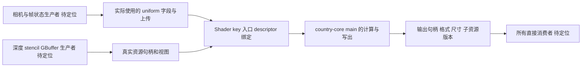

# 单个渲染 Pass 完整恢复计划

日期：2026-10-12。状态：`proposed_not_started`。本轮仅做选题、保留证据核对和计划编写；没有领取任务、查询反编译数据库、恢复函数、执行原版或 GPU 验证。

首个样板选择 **C v1.16.0 的 `extract_half_res_depth_normals`**，原文件为 [half_res.rs](skeleton/C/crates/country-core/src/systems/render_loop/compute_passes/half_res.rs)。目标是恢复其真实参数生产、输入资源、绑定、计算、输出资源和直接消费者，并通过目标版本验证。745 字节的函数体只是 CPU 包装层规模，不代表整条资源链的工作量。

机器计划：[render-pass-pilot-plan.json](tracking/render-pass-pilot-plan.json)。该计划沿用既有 A/B/C、证据和任务索引，不新建交付目录。后续代码/合同回填对应原有文件；生产工程整合由已有整合流程处理。本计划不调整建筑任务优先级，不把局部 Pass 验收升级为完整渲染器验收。

## 选择依据与事实边界

| 已有事实 | 来源与边界 |
|---|---|
| C 独立过程 RVA `0xAED340`，长度 745 字节；PE image base 为 `0x140000000`，首选 VA 为 `0x140AED340` | PDB procedure、已有原指令记录及本轮 PE 头核对；运行时地址须考虑加载基址。 |
| `render_world` 的 RVA `0x56C48C` 有静态直接调用，父函数 RVA `0x56A700` | `half_res.rs.render-pass.json.gz` 的 `native_incoming[0]`；不证明此路径运行或 GPU 顺序。 |
| PDB permutation 类型关联 `country_core/extract_half_res_depth_normals` | 附档 `shader_mappings[0]`；尚未证明实际绑定和 permutation 值。 |
| 对应 country-core Shader 包有一个 GLCompute SPIR-V 模块，入口 `main`，LocalSize 为 `8×8×1`，276 条指令 | 版本绑定的 Shader catalog；276 含声明等全部指令，不是算法复杂度。 |
| Shader 声明有五个纹理、两个 uniform | 附档 `shader_interfaces[0]`；各声明是否被实际入口使用、各资源句柄和 producer/consumer 仍未知。 |
| CPU 包装层存在两处 `create_raw_resource`，以及 stencil view、Shader 获取、入口绑定、dispatch 调用 | `native_outgoing` 原指令记录；两次创建尚不能直接命名为两个输出，必须追踪返回值。 |
| A/B/C 的文件源 checksum 和观察函数体字节集合均不相同 | 任务索引；不能共用 ABI、结构偏移或默认参数。 |

存在另一份 `rhapsody-deferred/compiled/extract_half_res_depth_normals.precomp`，头部 URI 是 `rhapsody_deferred/extract_half_res_depth_normals:main`。它与目标 country-core 包的哈希不同。必须通过 CPU 的 Shader key/入口选择和容器身份消除歧义，不凭文件同名替换。

任务组：`TG-b1237e511d78c48e8a`；C 函数 ID：`f27837235652a8fe2d`。当前索引为 `deferred`；本轮没有 claim，也没有改索引分类。本轮核对该组 A/B/C 源文件 SHA 与索引快照一致，未来领取时仍须重新检查快照和占用。

## 需要贯通的链

下面是研究目标图，所有箭头都是待证明关系，不是已确认的原作执行图。

“完整”的边界是：实际使用的参数都有真实生产来源；输入有真实创建/写入来源；输出通过原句柄流进入全部已发现的直接消费者。生产者、消费者若是独立复杂 Pass，只恢复证明本链所需的创建、写入和读取边界，不递归恢复整个渲染器；验收运行时这些边界必须由真实原版或有效已恢复模块提供，不能注入预期输出来代替。

## 资源与参数证明清单

| 声明名 | set/binding | 现有信息 | 必须补齐 |
|---|---|---|---|
| `depth_input_tex` | 0/2 | sampled image 声明 | 输入句柄、实际读取、深度约定、格式/aspect、生产者和最后写入节点。 |
| `stencil_tex` | 0/1 | sampled image 声明；CPU 有 stencil-aspect 调用 | 是否与 depth 共享物理图像、视图关系、实际 stencil 测试语义。 |
| `gbuffer_input_tex` | 0/3 | sampled image 声明 | 真实生产者、编码、被读取分量及相应转换。 |
| `depth_output_tex` | 0/4 | storage image 声明；读写方向 unknown | 实际 store/load、图像格式、尺寸取整、资源版本、所有直接消费者。 |
| `normals_output_tex` | 0/5 | storage image 声明；读写方向 unknown | 实际 store/load、法线空间/编码、资源版本及所有直接消费者。 |
| `frame_counter` | 2/0 | uniform block，声明 `index` offset 0 | 是否使用、值的 owner、更新时机、整数宽度和上传位置。 |
| `current_view` | 4/0 | ViewConstants 字段及 GPU 布局已提取 | 入口实际使用的字段、矩阵/采样偏移生产规则、CPU 上传 ABI。 |

名字带 input/output 不能独立证明读写；uniform 的声明布局不能当作 CPU Rust 结构 ABI。未被入口使用的字段登记为“不参与该入口”，不为贯通本 Pass 扩大恢复全部 ViewConstants 的范围。

## 执行阶段与门槛

| 阶段 | 有界工作 | 产物 | 通过条件 |
|---|---|---|---|
| P0 身份与范围 | 固定 C EXE/PDB/目标 Shader 和同名干扰包；读取当前 task/依赖政策；未来开工合法领取文件组。 | 身份清单、边界合同、原文件指纹。 | C 证据身份一致；没有把 C 地址发给 B 库；没有覆盖其他 owner。 |
| P1 CPU ABI 与资源创建 | 分析完整 745 字节及调用点所在基本块；查实际传参、返回存储、尺寸描述和两次资源创建。检查分支而非仅按地址排序。 | native 参数观察合同、资源句柄流、尺寸/格式创建合同。 | 每个参与本 Pass 的实参/返回值可追到指令；占位 `void()` 未被当成真实签名；未知偏移未命名或填默认值。 |
| P2 输入和参数生产者 | 从实参反向切片，定位输入资源最后写入、视图/aspect 创建；从 Shader 实际使用字段反查 frame/view 上传及其状态 owner。 | producer 表、uniform 字段到 CPU store/upload 的映射。 | 每个实际读取的输入/参数都有真实来源；depth/stencil 的资源关系被证明；生产者路径条件和失效规则已记录。 |
| P3 Shader 绑定与算法 | 在完整 SPIR-V 中追踪资源使用、采样/读取、坐标、分支、depth/normal 运算及写出；追 CPU key、permutation、descriptor/entry 绑定和 dispatch。 | 绑定表、算法合同、可恢复代码位置、分支义务表。 | country-core 包绑定被确认；读写集合和 CPU 绑定一致；`8×8×1` 与实际 dispatch 计算对应；没有以名称猜算法。 |
| P4 输出消费者与调度 | 从返回句柄向前切片，跟踪复制/存储/别名到每个直接消费者；查图节点读写、资源版本、屏障和命令录制相关边界。 | producer→Pass→consumer 图及生命周期表。 | 所有在本链中已发现的输出使用已分类；图依赖与实际命令关系有证据；未解析间接用途仍为 gap，不能宣称完全贯通。 |
| P5 候选实现 | 合同关键事实就绪后，恢复游戏包装层、确有必要的参数生产策略和 Shader 行为；复用匹配依赖；连接真实输入和消费者。 | 对应 A/B/C 布局中的 C 候选/patch、合同、依赖清单。 | 候选没有用注入结果绕过 producer/consumer；原 Shader 执行可作为原行为路径，但只复制 SPIR-V 不算源码算法恢复。 |
| P6 审查与验证 | 冻结候选和完整证据闭包；独立核对身份、关键字节、bindings 和反例；按后续执行授权完成原版/候选差分与真实资源链运行。 | scoped review、验证报告、输出差分、消费者记录。 | 同版本有效运行覆盖 P1–P4；无关键 gaps；依赖/合同/源码改变后相关旧报告失效。 |

阶段依赖：P0→P1；P1 之后 P2/P3 可以交替取证；P2/P3→P4→P5→P6。这里只描述工作依赖，不启动多 agent、线程或任务。每阶段保留实际耗时和新增证据，P4 闭合后再估算实现成本，不根据函数长度给出固定工期。

## 第一轮最小取证范围

先复用现有 LLVM/PDB 和原字节缓存。默认持久 Ghidra/ReVa 为 B patched EXE，专属 worker 只隔离写入，不自动成为 C 数据库。C 查询前必须有匹配原 C 的数据库身份；缺失时先用 C 原字节取证，登记定点反编译缺口。不得在 B 工具上查询下列 C 地址。

1. 完整 C `0xAED340..0xAED629` 半开区间；`render_world` 在 `0x56C48C` 调用所在基本块及实参的 reaching definitions。初始上下文窗口不等于完整 producer/consumer 切片，遇到定义超出窗口须扩展相关基本块。
2. 两个创建调用点 `0xAED3CC`、`0xAED46D`，目标 `0xE26CF0`；核对 descriptor 实参和返回值去向。
3. stencil view 调用点 `0xAED4CB`，目标 `0xE21150`；核对源句柄及 aspect。
4. Shader 获取 `0xAED53B → 0x1770E40`；入口绑定 `0xAED5AE → 0x178F6D0`；dispatch `0xAED5E5 → 0xE24020`。先读调用方值流，只在合同不清时读取依赖目标的必要范围。
5. 对 country-core 包 offset 132 的 SPIR-V payload 做完整入口使用和写出分析；先排除同名 rhapsody-deferred 包，不能把反射声明当作完整算法。
6. 从结果返回/存储开始查 consumers。`grass_velocity_reconstruct` 只是下一条已映射静态调用的目标，不是已确认消费者；不得按相邻调用建边。

每批 MCP 最多 20 函数，指定返回字段；不全程序重扫。工具错误、截断、空反编译单独记录。overlay 或 ReVa 脚本使用唯一可写 worker，保存读回；原始字节仍以目标原 C 为准。

## 依赖与运行条件

C 的 `rhapsody 0.1.0` 属依赖复用，锁定 `rhapsody2` commit `48efa87114d22e484592a0e9efe866faafa6a876`。获取匹配源码/API 后直接复用，不恢复整个渲染图、Vulkan、分配器或容器实现。必要边界分析用于理解游戏调用，不能计为游戏自有算法恢复。

匹配私有源码/API 的可获取性与可运行接入仍待确认；不能用自造 GraphApi 或手工 descriptor 夹具声称完整依赖集成已通过。Shader 是否来自游戏自有实现或复用库须完成定义归属核对，若确认是依赖，只恢复游戏参数和组合策略。

原版运行环境、C 身份绑定分析数据库、GPU 捕获及可用目标设备均为未来前置检查，本轮未检查为可用。缺少运行条件不阻止静态取证；P6 完整验收必须保留未完成，不用编译成功替代 GPU 差分。

## 计划中的验证案例

| 类型 | 案例与检查 |
|---|---|
| 尺寸与边界 | 合法输入中的 `1×1`、`1×N`、奇偶尺寸、最后不足一个工作组的区域；以原版 guards 确定合法范围。确认取整、越界处理与输出写覆盖。 |
| 深度和 stencil | 均匀、突变、前景/背景边界、实际代码出现的 stencil 分类；不预设 min/max、reversed-Z 或掩码默认值。 |
| GBuffer 与法线 | 实际编码的代表值、边界和分支；检查选样规则、法线空间、归一化/打包和存储量化。 |
| 参数 | Shader 真正读取的矩阵、采样偏移及帧索引变化；只有代码确实使用时才覆盖对应影响。 |
| 生命周期 | 连续帧、合法 resize、输出资源重建、消费者启用/禁用；检查视图/descriptor 更新及旧资源不再被消费。是否存在历史状态由证据决定。 |
| 数值 | 原版 Shader 与恢复候选使用同一份已记录真实输入；比较两个输出。整数/掩码与覆盖精确匹配；浮点按已证明的精度/量化制定规则，不能失败后随意扩大容差。 |
| 真实消费 | 原版与候选的真实消费者读取正确输出版本；记录绑定、命令和影响范围。直接提供半分辨率期望结果只可作为隔离夹具，不可替代全链验证。 |

异常值、非有限值或无效尺寸只在原版边界允许或有明确失败行为时加入；不把不合法 Vulkan 调用当作通用测试输入。固定样例之外增加由真实分支导出的反例。

## 完成定义与断点

完整 Pass 验收要求：身份正确；参数和输入来源闭合；country-core Shader 与运行绑定闭合；实际计算及写出行为恢复；输出的全部已发现直接消费者和资源生命周期闭合；独立审查通过；目标版本的有效差分及真实链运行通过。

状态使用既有 handoff 规则：`unknown` → `evidence_ready` → `implemented_unverified` → `verified`。文档齐全、静态 audit、候选可编译或局部 Shader 差分单独通过都不能升级为全链 `verified`。

每个未知项必须记录原因、影响、现有证据、下一条判别查询。ABI、真实输入、输出消费者、Shader key 或生命周期存在关键歧义时，停在相应门槛补证，不能用猜字段、填零或替换消费者完成计划。

A/B 只提供历史参照；C 完成后分别决定是否需要各版适配和验证，不自动将 C 结果回填成 A/B 已确认事实。首轮结果将用于估算后续同类 Pass 的工作量，而不是宣称整体渲染管线完成。
