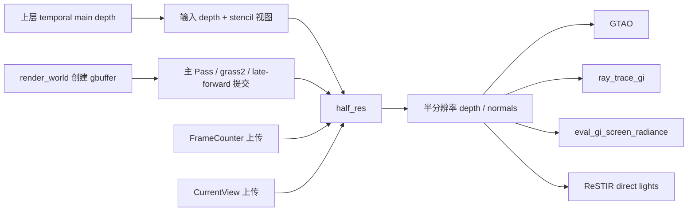

# C：半分辨率深度与法线 Pass 恢复记录

2026-10-12，状态 **implemented_unverified**。候选直接写进已有 C 项目；A/B 保留原证据，不套用 C 的地址、类型或依赖。此前暂停验证的约定继续沿用，本轮没有构建、运行原作指令、GPU 差分或完整帧验证。该 Pass 的包装层和 Shader 算法已有候选源码；真实参数 owner、渲染依赖适配和下游生命周期尚未贯通，不能宣布完整恢复。

候选在 [half_res.rs](/Users/yuluo/Desktop/game/games_test/reverse-engineering/tiny-glade/skeleton/C/crates/country-core/src/systems/render_loop/compute_passes/half_res.rs) 的 `recovered_c` 模块；[GLSL 恢复稿](/Users/yuluo/Desktop/game/games_test/reverse-engineering/tiny-glade/skeleton/C/crates/country-core/src/systems/render_loop/compute_passes/half_res.recovered.comp) 是 SPIR-V 的语义表达，作者原文和源文件名未知。[机器合同](/Users/yuluo/Desktop/game/games_test/reverse-engineering/tiny-glade/skeleton/C/crates/country-core/src/systems/render_loop/compute_passes/half_res.rs.recovery.json) 保存 19 项事实、精确原指令/Shader word 引用、7 个绑定、4 个直接消费者和 8 个缺口。

## 版本与边界

- 原 C EXE：SHA256 `d8f9261b1a4cb677fe91b8f5017bcff63b1312228b3f3264a2071ca7d3ad80a9`。
- 原 C PDB：SHA256 `df472d8e6ae642baed96127151b18685291468518ea8dc71557bce4508c78902`，GUID `6A287060-44E4-AFA2-4C4C-44205044422E`，Age1。
- 包装函数：RVA `0xaed340..0xaed629`，745 字节。所有地址都是 RVA；preferred VA 加 `0x140000000`，运行时 ASLR 基址未知。
- 实际 Shader URI：`country_core/extract_half_res_depth_normals:main`，由原包装层静态字符串与调用参数确认。不是另一份 `rhapsody-deferred` 同名包。
- Shader payload：包内 byte132 起、1330 words，SHA256 `2a962aef4c657065c834d9f475fa22c2cc4977ab64c06b05cab44b202672e4b8`；入口 `main`，276 条指令，local size `8×8×1`。
- 依赖复用：`glam 0.30.10`；`rhapsody2` commit `48efa87114d22e484592a0e9efe866faafa6a876`。未重写 Bevy、GraphApi、数学库、容器或 Vulkan 调度器。

## 已证实的静态资源路径

图中的边表示原指令实参/句柄流，未证明 GPU 最终 barrier、运行时所有条件或间接消费者。

GBuffer 由 `render_world` 在 `0x56b074` 创建，标签 `gbuffer`，格式值101对应 `R32G32_UINT`。句柄从 `rbp+7b0 → +5f0 → +198` 传入本 Pass。主 Pass、主 Pass oc2、grass2、late-forward/deferred 的提交先于 half-res；最终哪些 Shader 写入每个像素仍需逐个核对。

Depth 来自上层 `compile_main_render_graph` 内联闭包，`0x399be5` 调用依赖的 `get_or_create_temporal("main depth")`。在 `0x399cdd` 调用 `render_world` 时通过 `stack+30` 传入，随后复制为 `rbp+7c8 → +608 → +1b0`。不能把它当作 half-res 包装层自行创建的深度；其 clear、最后写入者和 temporal 复用分支还没有全部恢复。

FrameCounter 在上层 `0x398403` 从 `RenderTemporalState+0x108` 读 u32，`0x398438` 上传到 `rhapsody_core/frame/frame_counter`。该 lookup 与已命名 `get_res<RenderTemporalState>` 使用相同的完整128位 TypeId 与 hash，不只依据尺寸猜类型。字段原名及递增/重置规则仍 **unknown**，没有默认帧号。

CurrentView 在 `render_world` 的 `0x56ac29` 从 `GameViews` 首1024字节复制、`0x56ac47` 初始化 `rhapsody_core/view/current_view` binding set；同样由完整 TypeId 与 `get_res<GameViews>` 匹配确定资源类型。实际矩阵计算与更新规则仍 **unknown**。上层另一支 `GameViews+0x400` 上传与本路径的首块分别记录。

候选 `UsedShaderParameters::from_resource_payloads` 已能从这两个真实资源数据投影读取帧号与矩阵，不重建 Bevy 存储，也不填默认值；短 buffer 的 `None` 只属于恢复工具接口诊断，不代表原作错误策略。真实资源更新系统及 GPU 上传接口尚待接入。

## 包装层实现

观测 native 调用投影为 `RCX=sret48B, RDX=GraphApi*, R8=GBuffer*, R9=Depth*`。输入 handle 的 view word 在 `+0`，resource ID 在 `+4`，u16 width/height 在 `+8/+10`。这些是内存观察；完整作者类型、Rust ABI、padding 和字段名仍未知，没有补造 `repr(C)`。

1. 从 depth 尺寸计算 `max(ceil(width/2),1)` 和 `max(ceil(height/2),1)`。
2. 依次创建 `half-res depth`（格式100，`R32_SFLOAT`）和 `half-res normals`（格式38，`R8G8B8A8_SNORM`）。保留原创建描述前15个写入字节；不将未知 byte15 或 handle padding 填零。
3. 每次创建后单独检查 `GraphApi+0x24c == 1`，成立才调用依赖的 debug garbage 初始化。
4. 用 `TexView(0).with_stencil_aspect()` 创建 view word `0x800000`，保留原 depth resource ID 与 descriptor；没有继承输入 depth 的其他 view bits。
5. 加载实际 country-core Shader，传入观测到的 key 存储 `[0,8,0]`。内部字段语义/容器仍未知，不把它误写为三个 permutation 宏。
6. 按原五指针 tuple 绑定并提交线程数 `[halfWidth,halfHeight,1]`。工作组取整由真实依赖负责。
7. 返回 depth、normals，原 sret 各占24字节，调用方分别存入 `rbp+6f0` 与 `rbp+5b0`。

`RhapsodyHalfResApi` 明确保留真实依赖适配边界，尚无生产适配器。未知 API 没有用假句柄、内存 Graph 或返回成功的空实现填充。骨架的 Cargo/lib/运行入口没有因本次候选而变成可运行游戏。

## Shader 的输入与输出

| Set / Binding | 资源 | 访问与实际使用 |
|---|---|---|
| 0 / 1 | stencil_tex | 读取选中像素，取低3位材质编号 |
| 0 / 2 | depth_input_tex | 读取选中像素的 depth.x |
| 0 / 3 | gbuffer_input_tex | 读取选中像素的 uint.x，低三个字节为法线编码 |
| 0 / 4 | depth_output_tex | 写 R32f，最低位写入材质1/2标记 |
| 0 / 5 | normals_output_tex | 写 Rgba8Snorm，xyz 视图法线，w 采样位置编码 |
| 2 / 0 | frame_counter | 只读取 `index`，GPU offset0 |
| 4 / 0 | current_view | 只读取 `world_to_view`，GPU offset256，RowMajor，stride16 |

每个输出像素在2×2输入区域中选一个像素，四帧循环 `00→01→11→10`，不是平均/最小深度过滤。Stencil 低3位为1或2时把 depth 浮点位模式最低位设1，否则清0；这些材质值对应的游戏名称 **unknown**。

法线来自 `GBuffer.x` 的 bit0..7、8..15、16..23，分别乘原 f32 常量位模式 `998277249`，再乘2、减1。使用 `(normal.xyz,0)` 行向量乘逻辑 `world_to_view`，再 normalize。CPU 投影通过 glam 转置矩阵表达该乘法，不把 GPU RowMajor 存储误当作变换方向。Alpha 四帧依次 `-0.5,+0.5,+1,-1`；CPU helper 返回量化前值，未伪造实际 SNORM 存储结果。

原 Shader 没有越界 guard。奇数尺寸、末尾工作组、设备 robustness、image view/mip、zero/nonfinite normalize 和 SNORM 量化待核。GLSL 的 `texelFetch(...,0)` 是恢复表达，其与原未带 Lod 的 OpImageFetch 必须在实际视图下验证，不宣称重新编译即等价。

## 输出消费者与下一步

| 调用方中的 CALL RVA | 消费者 | depth / normals 实参 |
|---|---|---|
| 0x56c6b7 | calculate_gtao | R8=+6f0 / R9=+5b0 |
| 0x56c8c7 | ray_trace_gi | R9=+6f0 / stack+20=+5b0 |
| 0x56c90c | eval_gi_screen_radiance | R8=+6f0 / R9=+5b0 |
| 0x56c9bd | restir_sample_direct_lights | R9=+6f0 / stack+20=+5b0 |

这是已发现的四个直接实参消费者，地址排序反映所观察正常调用路径；错误、资源缺失、开关分支和实际 GPU 执行另需确认。下游 Shader 读取绑定、历史资源版本和 resize/reuse/disposal 尚未全部恢复。

下一步优先关闭三处接入：RenderTemporalState 的帧号递增/重置规则、GameViews 的矩阵更新者、锁定 rhapsody API 适配器；随后沿四消费者核 Shader 访问和资源生命周期。验证恢复后再进行 C 原码差分、GPU 及完整帧链验收。本次仅 Rust 格式化/静态证据指纹核对，不把这些检查计作游戏业务验收。
