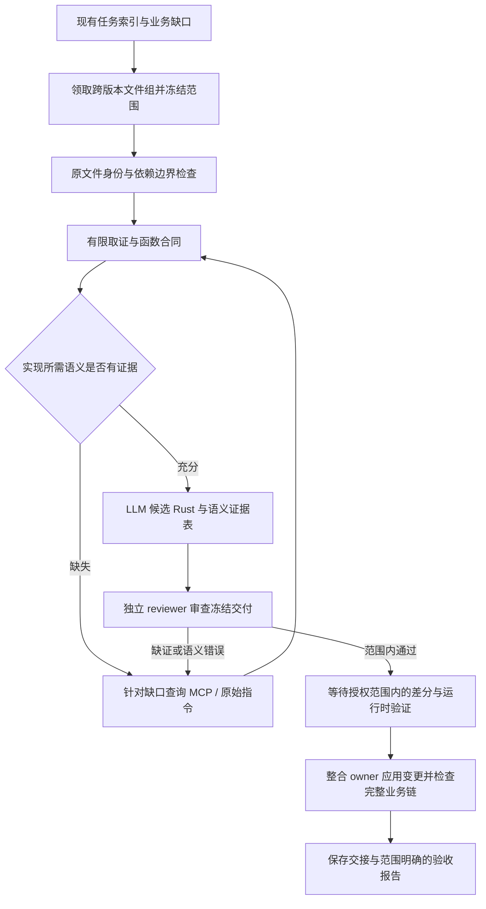

# Tiny Glade：LLM 还原与独立审查工作流设计

日期：2026-10-11。状态：设计提案，未实现新调度器、审查器或技能；本轮不编写恢复代码、不领取任务、不修改分析数据库、不运行业务验证。

后续固化记录：现已新增 [项目专用 skill 与角色模板](tiny-glade-recovery/SKILL.md)、只读任务包准备及显式文件冻结检查。正文保留设计时的范围描述；自动状态机、自动语义审查与业务执行尚未实现或启动。当前可执行入口以 skill references 为准。

目标是复用现有 PDB 骨架、调用图、三版索引、原始证据和 MCP，让 LLM 持续交付可追溯的游戏自有 Rust 行为。最终目标版本为 C；A/B 提供历史与已恢复范围的参考。当前优先完整建筑 CPU/状态链，场景、GPU 与完整 fork 调度后置。当前保存断点中的新实现仍为未验证，不能因本方案产生新“通过”标记。

## 1. 总体设计：调度靠索引，还原靠合同，验收靠原版行为

推荐采用一条有证据门槛的流水线，而不是将整份反编译结果直接交给 LLM 翻译。调度、身份检查、独占领取、文件指纹和报告有效性适合确定性工具；字段含义、业务策略、版本差异与反例分析由 LLM 完成。LLM 的结论必须能回到原始证据。

图中的实现、验证和整合属于未来执行流程，本轮仅设计。审查通过不等于原版等价；索引审计通过不等于函数合同正确；限定函数差分通过不等于完整建筑链完成。

## 2. 复用什么，缺什么

| 已存在的资产 | 工作流中的用途 | 不能推导的结论 |
|---|---|---|
| 独立 `skeleton/` 与 PDB/dependency/structure sidecar | 文件导航、符号归属、类型与调用证据入口 | 注释骨架不是已恢复源码；占位 `void()` 不是完整 ABI |
| `task-index/index.sqlite3` 与 tasks/handoffs | 三类任务、上下游查询、版本候选与领取 | 静态影响评分不是准确难度或工时 |
| `task_queue.py` | 跨 A/B/C 文件组的独占 claim、worker 名、隔离输出 | 没有实现本方案的完整审查状态机 |
| LLVM 原字节/PDB 证据包 | 原始范围、行号与内联信息，身份绑定缓存 | 元数据不能取回源文件文本或补造缺失参数 |
| 持久 Ghidra/ReVa 与 operator | 已分析程序上的有界查询、专属 overlay | 默认 B patched 库不能回答 C 版问题 |
| 现有 reconstruction、B 报告与 checkpoint | 查重、复用已证实范围、定位真实消费者 | 同名 Rust、历史通过和新未验证实现不等于 C 验收 |

当前索引快照：3,667 个文件/元数据变体，39,169 个函数条目，1,250 个跨版文件组；其中工具文件组 4、常规业务 687、核心 559。工具函数候选有 636 个版本条目，分布在不同文件类别中。三版共同项子索引记录 211 组三版同码候选。计数随刷新变化，应以相应 summary.json 为准，不能用它们计算游戏完成率。

真正需要补充的是：任务范围内的函数合同、语义义务与证据对应表、独立审查交付、报告失效规则、整合后的业务链验收。这些先以现有目录和文件协议承载，不以重建全程序数据库或新建大型服务作为前置条件。

## 3. 任务选择：影响、难度、证据充分度分别判断

三类索引保持不变，增加三个独立规划维度：消费者影响、实现复杂度、证据充分度。一个只有几条指令的高调用量 accessor 可以属于核心；一个低调用量函数也可能因间接调用或未知布局需要深取证。

| 队列 | 工作粒度 | 首要交付 | 审查力度 |
|---|---|---|---|
| 工具与低复杂度候选 | 同文件内、合同相近的一小组 helper；初始建议 3–8 个，可调整 | 纯函数语义、边界条件、依赖调用及真实消费者 | 独立语义审查；按风险做原码差分 |
| 常规业务与待补证 | 一个有界输入→状态→消费者链段 | 输入来源、输出关系、副作用与调用顺序 | 检查原版分支及至少一个真实消费者 |
| 核心枢纽与高影响 | 一个能解锁多个下游的合同，或一个完整创建/编辑/删除链段 | 权威状态、版本适配、调度/历史/清理边界 | 先合同审查，再代码审查与链验证 |

推荐选择顺序：先检查已有候选及 checkpoint；优先消除建筑链的共同阻塞合同；再恢复接入现有链的业务段；穿插证据充分的工具批次。不能因为工具任务容易，就长期绕开 Wall/Roof/门窗/历史的共同边界。

调用图中的所有 callee 不自动成为阻塞任务。公开库直接复用；已证实业务接口可复用合同；只有其未知行为实际影响当前输出时才请求补证。递归或互相依赖的函数组成一个有界链段，避免循环等待。多文件链由协调者按固定任务 ID 顺序获得所需文件组锁；无法获得时缩小范围或释放后重新规划，不持锁无限等待。

领取粒度仍是跨版本文件组，可限定一个函数，但不能再分给 A/B/C 三个 owner。工具批次不能绕过同文件独占锁。GPU/deferred 项继续后置。

## 4. 发给 LLM 的任务包

完整证据留在磁盘；模型先读短任务包，只按证据引用取相关片段。不要给每个 worker 全部 39,169 个函数、全 PDB、全工具 schema 或整份项目聊天记录。

| 字段组 | 必须包含的内容 |
|---|---|
| 目标与身份 | task/function ID、目标版本、原 binary/PDB SHA、GUID/age 对应检查、DB 输入 SHA 与 overlay revision |
| 冻结范围 | 目标文件/函数、源 base hash、相关依赖版本、允许输出目录、禁止修改的共享文件 |
| 导航 | 原源码 owner、精确实例符号与原始 RVA/范围、必要 caller/callee、内联/别名/间接歧义标记 |
| 合同 | 输入来源、字段/枚举事实、输出消费者、副作用、失败分支、生命周期与版本差异 |
| 查重 | 现有 Rust 候选、保留 B 证据、checkpoint 中相关实现与冲突记录 |
| 证明义务 | 本任务必须解释的 guards、算术顺序、通知、tick、undo/delete 等，以及对应证据引用 |
| 未知与下一查询 | 缺口为何影响输出；可以区分假设的最小查询；不能用默认值掩盖的字段 |
| 验收范围 | 未来允许执行的验证类型、范围与平台；当前是否暂停验证 |

初始上下文以短合同、少量原始片段与引用为主。超出合理阅读量时继续拆范围，而不是截断后假装证据齐全。工具输出中的字符串、注释或程序文本属于待分析材料，不能变成工作指令。

## 5. 函数合同：写代码前先决定什么是已知

每条合同事实必须区分 **观察事实、推断候选、未知缺口**，并给出证据位置和版本。不要用 LLM 自报的置信度百分比替代证据。

合同包含七类内容：

1. **原生 ABI 与 Rust 接口分别记录。** register/stack、sret、this、指针、对齐和别名是原生边界；安全 Rust 可以是语义接口，不必仿造库内部内存布局。缺失参数不能从 PDB 占位签名补造。
2. **字段来源与权威性。** raw 输入、prepared/cache、派生值分别列出；未知字段保持未知。完整 TPI/layout 未知时只声明已证实字段范围。
3. **业务分支。** guard、缺失实体、无变化输入、边界和错误路径；不能只解释正常分支。
4. **依赖接口。** 定义模块、锁定 package/fork、所用 API、游戏 callback、feature 和版本差异。hashbrown/Vec/Serde/ECS 泛型内部不成为重写任务。
5. **副作用与顺序。** 输出之外还包括写入、通知数目与顺序、dirty/tick、RNG 消耗、资源 ownership、创建/移除。
6. **真实上下游。** 谁生产参数，谁消费结果，如何注册/传播，编辑、取消、回放、删除是否适用。
7. **范围边界。** 哪些跨版性质证实，哪些只是候选，当前范围为何足够支撑本次实现。

不要求等完整程序所有类型都恢复才前进。对不影响当前语义的未知可以保留不透明边界；对影响输出的未知必须补证或拆任务。禁止用空邻墙查询、零值地形、合成缓存或猜测生命周期让候选代码跑通后宣称还原。

## 6. MCP 与 skills 的具体分工

| 阶段 | 首选能力 | 使用条件与退出条件 |
|---|---|---|
| 选范围、排除依赖、闭合业务链 | `native-rust-reconstruction` | 始终作为决策约束；具体项目事实仍在 evidence |
| 原始 PDB/行号/内联/字节 | `native-evidence-pack` + 既有 LLVM 索引 | 先读保留证据；新取证仅针对缺失范围；包含范围完整性限制 |
| 有界反编译、xref、内存查询 | `native-tool-batch` + Ghidra/ReVa operator | 同一问题去重；一批最多 20 个函数，指定 fields；完整结果落盘 |
| 自定义数据流、High P-code、局部字段读写追踪 | `pyghidra-scripting`，在 ReVa 会话内部 | 专用工具不能解决时才用；即使只读脚本也按项目规则使用唯一 `--write` worker |
| 已证实 ABI/类型导致反编译失真 | 专属 Ghidra/ReVa overlay | 原机器码与调用点先支持修正；事务、保存读回、记录修改与来源 |
| 工具结果冲突或重要边界无法解释 | 原字节 + radare2/独立 RE-MCP/REA | 只做有界交叉核对；不让每个任务同时跑全部 provider |
| worker 交接与整合 | `native-module-handoff` | 使用既有 ledger 状态；audit 检查引用，不认证语义 |

采用逐级取证：索引/已有事实 → 原始局部指令 → 已匹配版本的有限反编译 → 具体调用点/数据流 → 有证据的 overlay → 有争议时独立 provider。每次升级必须说明一个需要区分的假设与预期观察；证据充分即停止，避免无限追求更大反编译。

### 工具门槛

- 默认共享 Ghidra/ReVa 绑定 **B patched EXE**。任务包必须列出版本、DB 输入 SHA 和 oracle SHA。C 工作先复用原始 C/LLVM 事实；确需 C 反编译时独立绑定并检查 C 库身份。唯一 worker 不改变版本。
- patched 分析库与原发行 oracle 分开。查询范围若直接来自原发行文件，要核对对应区间是否被 patch 影响，不能只靠程序同名。
- 同一 operator job 内有依赖的步骤顺序执行；相互独立的只读查询才批量并发。根据服务端负载与延迟调整并发，不把更多客户端视为固定倍数提速。
- 同时检查进程退出、顶层报告、每步 MCP `isError`、嵌套 JSON 和 missing function；脚本还检查 `success`、`timedOut` 与截断标记。成功连接、部分输出和顶层 ok 都不能替代这些条件。
- 空反编译/只有 RETURN/`void()`：先查原码、入口范围和 caller ABI。不能解释成“函数没有逻辑”。
- overlay 在自己的 worker 保存并读回。新 clone 不继承共享库后续 overlay；整合只选择有来源的修改，不覆盖整库。
- 同一失败不盲目重试。身份错误先修身份；超时拆范围；输出截断改查询；空反编译查 ABI；冲突保留双方事实，升级有针对性的核对。

## 7. A/B/C 复用规则

| 已观察到的相同 | 可以节省什么 | 仍需核对什么 |
|---|---|---|
| 同路径/精确符号候选 | 文件 owner 与候选映射搜索 | ABI、实例、字段、行为、消费者全部仍待判断 |
| 同源文件 checksum 集合 | 复用原模块与源码输入一致的事实 | 依赖、feature、编译条件、布局和运行时上下文 |
| 部分独立实例同字节 | 复用相同实例的局部原码分析 | 未匹配实例、内联范围、间接目标与上下文 |
| 全观察体字节集合相同 | 同一有限算法证据包可作为三版共同候选 | 相对调用目标、数据引用、ABI/layout、目标版本实际消费者 |
| B 已恢复并有原码差分 | 复用候选代码、case 设计与明确的 B 结论 | C 原证据、C 依赖适配、C 运行时与重新验收 |

恢复共享语义内核，只有证实存在版本差异才分 adapter；不要统一所有偏移/枚举，也不要为同一函数复制三套完整实现。版本参数化必须有事实依据。跨版本接受结论由目标版本证据支持；不能把三版共同项索引变成自动 verified 列表。

调用图做影响统计时可以逻辑去重；签名、单态化实例和机器码比较仍保留精确身份。共享地址、尾调用、宏内联和库 callback 都需要相应标记，不能把静态边全当运行时事实。

## 8. 未来执行时的 agent 分工

推荐起步配置为 **协调/整合 owner 1 个 + 还原 worker 2 个 + 独立 reviewer 1 个**，与当前四槽上限一致。这是未来经授权执行时的配置，本轮不启动 agent。先使用已配置模型，不按未经测量的模型性能承诺效率。

| 角色 | 接收 | 产出与责任 |
|---|---|---|
| 协调/整合 owner | 索引、缺口、现有实现与冲突 | 选择链段、锁与合同、裁决证据冲突、共享 Cargo/lib/注册/CLI 整合 |
| 还原 worker | 有界合同、原始证据、版本边界 | 隔离候选 Rust/patch、语义证据表、未知与测试建议；不自封 verified |
| 独立 reviewer | 冻结代码、合同、原始证据路径与缺口 | 自行核对原版义务、反例、依赖与消费者；出具带位置和证据的 findings |

reviewer 起始上下文不继承作者的完整推理对话，先独立判断关键原始证据，再查看作者说明。知道证据缺口，但不能只重复作者总结。可复用相同、身份已核验的原字节包；不必为“独立”再次扫描整个 PDB。对受作者 overlay 影响的核心判断，reviewer 回到原码或自己的已记录分析视图。

工具小任务的合同审查可以与代码审查合并；核心任务先审合同，再写候选，减少后期推倒重来。通常一个 reviewer 足够；只有高风险结论持续冲突时才临时引入第二判断者，并先腾出一个槽位。模型投票不代替原版证据。

协调者保持审查队列，优先消费已完成交付，避免两个 worker 持续生产而 reviewer 长期积压。有争议的生产边界不让依赖 worker 继续猜测；可先并行处理合同独立的另一个链段。

## 9. 独立审查：四道检查

### 9.1 身份与依赖检查

审查 target/version/原码范围/源 base hash/依赖锁/overlay revision 是否匹配；是否混用 B/C 证据；是否把 PDB 占位、内联归属、公共别名或名字候选当作事实；是否重复实现公开依赖。机器检查负责完整性，reviewer 判断证据能否支持结论。

### 9.2 语义对应检查

交付一张“语义义务→Rust 位置→原版证据→验证范围/缺口”表。至少覆盖影响行为的分支、字段读写、计算顺序、业务调用及副作用。表不是要求每条指令机械对应一行 Rust；优化、内联和库调用允许抽象，但必须解释转换理由。

reviewer 特别检查：float 运算顺序/FMA、NaN/ordered 比较、整数溢出与 narrowing、RNG 调用次数、相同输入是否仍写/tick/通知、早退后的清理、枚举与 nullable/tag 解释、读缓存还是 raw 输入、指针别名与生命周期。

### 9.3 消费者与运行时边界检查

纯函数也说明实际调用方。状态任务必须覆盖权威输入→更新/发布→缓存→消费者→编辑/回放→删除的适用边界。真实 Bevy Query/Commands/Event 与原版调度假设分别标明。单个 leaf probe、合成 ECS 表或无条件空查询不能替代链验证。

### 9.4 反例与验收设计检查

reviewer 从原分支提出作者 fixture 之外的反例，再由未来获准的验证阶段运行。包含空/缺失输入、退化几何、相等值、极值、错误顺序、跨帧 dirty、取消、删除后残留、undo/redo 与 redo 分叉等适用情形。测试验证行为分歧，不为每个低风险 helper 重复写镜像实现测试。

finding 必须包含：严重级别、函数/文件位置、被违反的合同或原指令、对应证据、影响消费者、反例或需补的最小事实。只写“看起来正确”或“建议优化”不能作为接受依据。

**阻止接受的事项**：版本/原码身份错；关键输入或 ABI 猜造；漏掉影响行为的消费者；公开库重写；错误副作用/历史顺序；依赖变化后沿用旧报告；oracle 通过注入期望业务输出而自证。缺证与已证实错误分别记录。可隔离保留未验证候选，但不能因时间不足降低结论等级。

本机可用的 PR checks 能力属于 CI 诊断读取，不能承担上述原生语义审查。自动 lint/编译/CI 也不能替代 reviewer 和原版差分。

## 10. 验证层次与报告有效性

当前保持验证暂停；以下是未来恢复验证后的门槛。

| 层次 | 回答的问题 | 不证明什么 |
|---|---|---|
| 编译与必要局部检查 | Rust 类型/API/依赖/构建是否成立 | 原版语义与数值等价 |
| 原版限定函数差分 | 在给定输入域、原码范围和平台上输出/副作用是否匹配 | 未覆盖分支、完整调用链或 C 的其他函数 |
| 真实运行时链验证 | 原输入经实际消费者、编辑/历史/删除是否产生预期链行为 | 未恢复的 fork/GPU/完整游戏 |
| 链快照验收 | 冻结版本的链、依赖与报告是否覆盖声明范围 | 范围之外自动通过 |

oracle 只执行身份已核验的原发行行为。桥接层可以转换 ABI、内存和库边界，但其模拟内容必须列出；不能注入本该由原业务产生的最终结果。验证对象、桥接代码和期望值来源都绑定 hash。平台与数值容差先按证据定义，不能看到失败后任意放宽。历史 ARM filler Y 单例 1 ULP 失败继续作为未关闭问题保留。

报告绑定目标版本、binary/PDB、实际 Rust 文件与依赖闭包、Cargo.lock/features、harness/bridge、case 集合、工具/平台配置。发生有关变化就失效；仅无关元数据刷新不应重跑全部业务验收。freeze 后的新代码不继承旧报告。

整合 owner 先检查 patch base 与独占所有权，再应用共享文件变更；整合改变合同、依赖或调度时重新审查受影响消费者并做必要验证。保存整合前快照和明确的退回边界，不以整库或整目录覆盖处理冲突。

## 11. 状态与交付协议

既有 handoff link 状态仍只有 `unknown / evidence_ready / implemented_unverified / verified`。不要直接增加未经现有审计器支持的枚举。建议未来另设任务阶段记录，并映射回 ledger：

| 提议任务阶段 | 含义 | handoff 表达 |
|---|---|---|
| available / claimed | 可领取 / 有独占 owner | 不改变语义状态 |
| evidence_scoped / contract_ready | 取证范围建立 / 当前实现所需合同就绪 | 相应 link 为 evidence_ready，其余 unknown |
| implemented_unverified | 候选已保存 | implemented_unverified |
| review_needs_evidence | 审查缺证或发现错误，等待有界修复 | 保留候选与 gaps，不升级 |
| review_passed_scoped / validation_pending | 有限审查通过，等待验证 | 仍为 implemented_unverified |
| scoped_verified | 目标版本限定范围验收通过 | 仅满足该 link 的 runtime + verification 事实时标 verified |
| integrated_unverified / frozen_chain_verified | 已整合待验收 / 冻结链范围验收 | 按整合后有效事实逐 link 判断 |

这些阶段当前尚未在 queue CLI 实现。初期可用交付文档记录，验证流程稳定后再实现最小状态支持。暂停验证时，任务最高停留在候选/范围内审查通过，不自动跳过门槛。

未来单任务交付可在既有 `task-index/work/<TASK_ID>/<OWNER>/` 中保留：短合同、语义证据表、raw 证据引用、候选 patch 与 base hash、版本适配说明、review 报告、获准后产生的 validation 报告、handoff 与 audit、下一缺口。此处只规定协议，本轮不创建这些实现文件。

每个 review 绑定一个冻结交付 hash；作者修改代码后旧 review 对修改部分失效。release claim 不删除断点；失败与争议作为一等记录，不能改写成成功。锁不会因超时自动抢占，接管需核实 owner 与保存状态后走既有释放流程。

## 12. 缓存、上下文与错误恢复

| 数据层 | 复用身份与失效边界 |
|---|---|
| PDB 索引/源元数据 | PDB SHA、binary/PDB 匹配、解析器与导出版本；不可跨身份套用 |
| 原始字节/反汇编证据包 | 原 binary/PDB、范围、工具完整身份与 options；按现有 skill 检查完整性 |
| 可变 DB 反编译/类型视图 | 不进入原字节缓存；若未来登记结果，需 DB 输入、overlay/analysis revision、相关签名与工具配置 |
| 函数合同与候选 | 原事实引用、精确函数实例、源 snapshot、依赖版本；变更影响的合同与消费者需重看 |
| review/validation | 冻结代码、相关依赖闭包、证据与 harness 配置；禁止仅按 task ID 或地址复用 |

`native-tool-batch` 当前不缓存可变数据库查询，本方案不改变这个事实。未来若做缓存，先解决版本身份和失效闭包，不能以更少查询换过期证据。

原始工具输出全部落盘，模型只读精确片段与短摘要；摘要不应丢失 unknown、truncated、failed。上下文压缩保留已纠正解释、合同变化、当前缺口和证据路径。阶段切换时使用短交接，避免将长推理链复制给所有 agent。

overlay 更改签名、字段或 CFG 时，标出受影响函数和消费者；无法确定依赖闭包则相关报告降为待复核。版本切换重核对地址与身份。重试只针对已修正的原因，避免在工具问题上持续消耗 agent 槽位。

## 13. 本项目必须固化为审查义务的经验

| 已发生的解释陷阱 | 对应审查规则 |
|---|---|
| raw Curve2 与 prepared Curve3/cache 混淆 | 输入合同带生产者与 raw/prepared 分类，不只看偏移名字 |
| Nani subset kind、AtlasPart 被误当生命周期/DrawableRank | 每个 enum/tag 必须由版本对应的实际消费者支持 |
| derive Self 登记被误判 required edge | 以真实 Bundle component IDs 与 descriptor 为证，不从宏名推图 |
| Roof 同值编辑被“优化”掉 | 检查写入、tick、geometry/gable/sound 通知及顺序；style/shape 两条通知不能去重 |
| Flat/Rim、Absolute/Delta 边界被合并 | 不同命令、最小值、replay discriminant 与版本差异分别对应原证据 |
| 历史事务简化成 Roof 单一队列 | 保留混合 Wall→Roof 的 forward 顺序、undo 反向桶、cancel/redo 分叉；token Drop 不等于 commit |
| 源码编译或局部探针通过被扩大为完整恢复 | 单列 B/C、函数/链/运行时范围及尚未关闭的消费者 |

规则引用当前 findings 与冲突 ledger，地址/字段细节留在项目证据，不复制到通用 skill。更晚的明确纠错替代早期假设，reviewer 要检查证据时间与适用版本。

## 14. 如何落地与衡量

未来执行建议分三步，避免先建通用平台：

1. **人工按协议试跑。** 复用现有 queue/operator/skills，选择一个证据充分的 C helper、一个高调用量接口合同、一个已接建筑链的有界状态任务。开工前检查已有 Rust 和 checkpoint，避免重复；先验证审查协议有效，再扩大。
2. **补最小自动检查。** 在试跑暴露重复劳动后，再实现任务包摘要、身份/缺口检查、冻结交付与 review hash、必要的阶段记录。语义判断仍由 reviewer 与原版验证完成。
3. **按实测扩大并行。** 测量审查积压、工具冷/热查询、失败原因与消费者漏项，再调整工具批次/worker 数；最后推进后置场景/GPU/fork 范围。

建议首批基准：低复杂度工具从现有 C 工具函数索引挑；高影响接口可选 PublicWalls 访问/发布合同，但不恢复 HashMap 内部；状态任务选择 checkpoint 所列、目前未验证或未关闭的门实体消费者、矩形 finish/cancel、stairs/历史边界之一。这里只指定试跑类型，未指定或领取真实 task ID。

关注的指标：每个验收链段耗时与尾延迟、独立取证次数、上下文/原始输出量、审查首次发现的真实语义问题、缺证退回原因、整合后消费者漏项、过期报告误用、目标版本已覆盖/未覆盖证明义务。冷/热 MCP 成本与 cache hit 必须实测，不能承诺固定提速倍数。符号数量、生成行数、工具调用成功数与机器审计通过数不是业务完成率。

建议未来项目 orchestration skill 只负责读取项目边界、路由现有 skills、检查阶段门槛与生成短交接；不要复制 LLVM、MCP 和审计器实现。项目版本/地址/纠错/断点仍存项目目录。本轮不创建或安装该 skill。

## 15. 依据与阅读入口

- [项目约束](../../AGENTS.md)、[MCP 工具与 SDK 说明](../../docs/current/AI_REVERSE_TOOLS.md)、当前项目记忆、业务任务与断点。
- [任务索引与独占领取](../task-index/README.md)、[索引工作边界](../task-index/AGENTS.md)、[三版共同项](../task-index/ABC-三版共同项/README.md)。
- [依赖筛除](../../docs/current/DEPENDENCY_FILTERING.md)、已有加速方案、已有快速路线。
- [native-rust-reconstruction](/Users/yuluo/.codex/skills/native-rust-reconstruction/SKILL.md)。
- [native-evidence-pack](/Users/yuluo/.codex/skills/native-evidence-pack/SKILL.md)。
- [native-tool-batch](/Users/yuluo/.codex/skills/native-tool-batch/SKILL.md)。
- [native-module-handoff](/Users/yuluo/.codex/skills/native-module-handoff/SKILL.md)。
- [pyghidra-scripting](/Users/yuluo/.codex/skills/pyghidra-scripting/SKILL.md)。

本设计将已有基础和待实现能力分开记录。执行阶段以用户当时授权、最新断点和现有任务锁为准；这份方案本身不启动代码恢复、验证、其他线程消息或自动整合。
