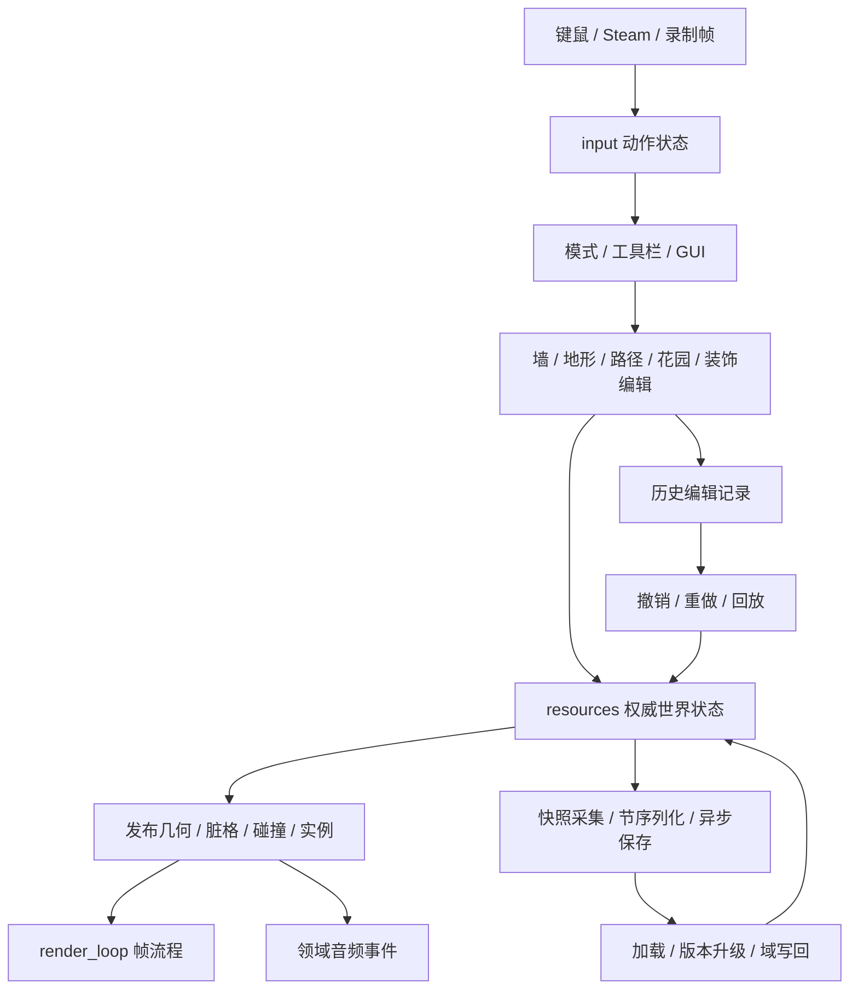

# country-core：模块功能、设计与业务说明

## 2026-10-18 core / rhapsody 调用接线

新增宿主侧 `tiny_glade::render_bridge::CoreRenderBridge`，共用一个 `VulkanGraphSession`，连接 core 计算/光栅 pass、权威 shader 句柄和真实资源导入，并提供构图失败取消。接口调查、调用方式、验证范围及剩余阻塞见 [接线报告](../../reports/core-rhapsody-bridge-2026-10-18/README.md)。这不代表完整 `WorldAccess`、`FramePasses`、游戏主循环或 GPU 帧已经验收。


本文描述当前 `src/` 的职责划分、数据所有权和业务流。目标版本为 Tiny Glade B；**有函数、有类型、能够编译，都不等于完整原作业务已经恢复**。文档中的“负责”说明模块职责，不表示该职责所有分支均已实现。更新日期：2026-10-17。

- [逐模块索引](docs/modules/README.md)：按源码目录列出 Rust 文件、用途及主要类型/接口；包含更细的子模块。
- [恢复状态入口](recovery/README.md)、[目录台账](recovery/DIRECTORIES.md)、[逐文件库存](recovery/inventory.json)、[核验合同](recovery/contracts.json)：查原作来源、证据和限定验收。
- [历史 README](README.legacy.md)：保留旧报告链接与历史实现说明；不据其中测试数量或旧缺口判断当前完成度。

## 1. 整体设计

`country-core` 是游戏规则、世界状态、编辑交互和游戏侧渲染消费的集合。它不是窗口程序，也不是独立图形引擎。完整宿主入口位于相邻的 `tiny-glade` crate；GPU 库由 `rhapsody` 提供。

| 层 | 模块 | 功能与设计 | 业务角色 |
|---|---|---|---|
| 配置和命令 | `game_config`、`game_profile`、`meta_commander` | 配置/档案独立持久化；跨流程操作使用队列和 fence | 用户偏好、教程状态、会话切换和延迟命令 |
| 权威状态 | `resources` | ECS Resource、集合、ID、变更集合和序列化合同 | 保存“世界当前是什么”，供编辑、历史和渲染共同读取 |
| 实体数据 | `components` | 按实体附着组件，记录绘制或树实例信息 | 连接逻辑对象、实体和视觉对象 |
| 行为系统 | `systems` | 读输入、读写资源、消费事件、发布派生结果 | 执行编辑、回放、保存、音频和每帧更新 |
| 初始化 | `startup` | 资产载入、初始资源、会话准备及部分系统注册 | 将磁盘资产和会话配置变成运行期状态 |
| 渲染基础 | `render`、`asset_libraries` | 类型化缓冲/资产句柄、渲染图访问声明和后端接口 | 把世界数据组织为可绘制资源 |
| 图像流程 | `systems::render_loop` | 组织 compute/raster pass、绘制列表、回读和后处理 | 将当前世界与相机转换为一帧画面 |
| 算法和复用 | `geometry`、`utils`、`resources` 和各领域 `systems` | 纯 CPU 规则与已解析输入上的算法；公共数学复用锁定依赖 | 为上述模块提供几何、历史及数据转换 |
| 边界适配 | `rhapsody_contract`、`rhapsody_types`、`utils_contract`、`reused`、`frozen_map` | 将游戏调用面连接到库；部分接口仍是兼容投影 | 处理依赖差异；不计作额外游戏业务恢复 |

### 主要业务流



此图表示设计中的数据流。保存域组装、加载域写回、宿主调度和 GPU 接线仍有未闭合部分，不能把箭头视作全部已运行验证。

## 2. 配置、档案与公共边界

| 模块 | 功能 | 设计 | 业务流程 / 边界 |
|---|---|---|---|
| [game_config](src/game_config.rs) | 视频、音频、UI、开发和游戏选项，以及语言覆盖 | serde 结构、默认值、配置升级 | 从配置读入设置，供菜单和运行系统消费；配置 schema 不代表所有设置已接到设备 |
| [game_profile](src/game_profile.rs) | 玩家 ID、教程、冷却、键位、新场景次数 | RON 档案；与单个场景存档分开 | 跨会话保存玩家偏好和教学进度 |
| [meta_commander](src/meta_commander.rs) | 元命令队列、阻塞 fence、延迟执行 | 队首查看/消费/撤回；命令分派返回结果供系统消费 | 会话切换、报告及其他跨系统操作；部分命令载荷仍由宿主处理 |
| [name_hash](src/name_hash.rs) | 将资产和对象名字映射为整数键 | 复用 xxh3，不自写哈希算法 | 资产表、网格和 shader 按名字关联 |
| [frozen_map](src/frozen_map.rs) | 稳定引用、重复键拒绝的注册容器适配 | 装箱存储及同步访问 | 给资产库提供不会因表扩容移动的对象引用；不是已确认的原 frozen 库实现 |
| [reused](src/reused.rs) | hotwatch 依赖适配 | 转发真实监听接口 | 配置、网格和纹理变动通知 |
| [rhapsody_contract](src/rhapsody_contract.rs) / [rhapsody_types](src/rhapsody_types.rs) | 游戏侧设备、图、纹理和 shader 调用边界 | 正式库包装与兼容类型共存 | 连接渲染后端；未知描述符、屏障和资源布局仍须逐项核对 |
| [utils_contract](src/utils_contract.rs) | 共享几何类型再导出 | 保持使用同一依赖类型 | 避免 core 重复实现 AABB、三角形与矩形 |
| `Gap` / `typed_gap` | 显式标记尚无完整合同的类型 | 标记或再导出 | 不提供业务行为；不能将其存在计为功能完成 |

## 3. 世界资源 resources

这里主要定义“拥有状态”和规则，实际每帧执行通常在 `systems`。同一个 Resource 应由多个消费者共享，不能用同名 View 替代权威状态。

### 建筑与世界编辑

| 模块 | 功能 | 设计 | 业务 |
|---|---|---|---|
| [walls](src/resources/walls/mod.rs) | 墙权威状态、公开状态、装饰及结构数据 | `InnerWalls` 管 ID/状态/创建修改删除通知；`PublicWalls` 管派生发布面；分离洞口、拱、材料与触发体 | 建墙、改高、弯曲、样式、删除及向屋顶/碰撞/渲染发布 |
| `walls::{inner_wall_state,inner_walls}` | 单墙字段和墙集合 | 状态快照、ID 计数、明确变更集合 | 权威增删改、加载恢复；当前字节恢复曲线点列仍有缺口 |
| `walls::{public_wall_state,public_walls,height_rules}` | 外部可消费墙状态及高度策略 | 权威输入转为缓存/发布结果 | 采样几何、有效墙高度、下游系统读取 |
| `walls::{decorator,decorator_storage,decorator_archivist,decorator_subtype,cached_decorator_transforms}` | 门窗等附着对象、分桶存储、备份及变换缓存 | 以墙/地形/楼梯地址关联装饰；编辑前后保存状态 | 放置、移动、删除、墙变形后恢复附着物 |
| `walls::{arches,curved_halftimber,plaster,wooden_gates,wall_stone_columns}` | 拱、曲木构、石膏、木门及石柱的结构规则 | 不同材质与结构各自维护参数 | 由墙形态推导建筑细部 |
| `walls::{wall_holes,wall_path_segment,wall_trigger_volume,shape_alignment,material_stats,elevation_support_stats}` | 洞口、路径段、空间触发、形状对齐及统计 | 几何/空间派生数据与权威墙分开 | 建筑开口、吸附、碰撞与音频所需统计 |
| [roofs](src/resources/roofs/mod.rs) | 屋顶状态、形状、瓦片、动画、触发体和 GPU 载荷 | 几何构造与视觉/瓦片资源分层 | 创建屋顶、编辑方向/轮廓、屋脊和瓦片模拟、删除动画 |
| `roofs::geometry` | 屋顶参数、编辑规则、矩形端盖/面/边、屋脊与表面 | 纯几何构造 pipeline，并提供 replay 入口 | 参数变化生成新的屋顶几何；不等于整套实体/GPU 生命周期已完成 |
| [stairs](src/resources/stairs/mod.rs) | 楼梯权威图、结构图、快照、碰撞及视觉数据 | 图节点/边、脏边、备份标志与校验缓存 | 增删楼梯连接、找连通分量、恢复和失效传播 |
| [stairs_walls](src/resources/stairs_walls.rs) | 楼梯与墙的支柱提议 | 按 key 分桶保存提议 | 将楼梯支撑需求交给建筑构造消费者 |
| `in_progress_curve` | 自由绘墙中的原始输入曲线 | 活动墙 ID、累计点列和状态 | 持续绘制、吸附与橡皮擦读取同一笔画 |
| `tree_storage` / `prefab` | 树存储、预制体引用及预制体库 | 稳定索引/句柄关联实例与资产 | 放置、查询和回收树或预制物；完整树行为还有库外消费者 |
| `glade_border` / `glade_settings` | 场景边界与单场景配置 | 圆/矩形查询、独立配置 schema | 限制编辑范围，提供主题和场景参数 |
| `gothic_window_profile` | Gothic 门窗剖面点列 | 按尺寸选择固定轮廓 | 生成相应门窗开口外形 |

### 地形、栅格和生态

| 模块 | 功能 | 设计 | 业务 |
|---|---|---|---|
| `world_raster` / `world_raster_defs` | 世界二维栅格、六个命名通道和批量写入 | 双缓冲、脏瓦片、发布通知、通道白名单 | 路径、鹅卵石、水和花园绘制及上传/恢复 |
| `active_raster_stroke` / `raster_stroke` | 进行中的笔画与历史拥有载荷 | 活动状态与已提交 Arc 点列分开 | 开始、续画、平滑、提交、撤销/重放 |
| `brush_sizes` / `path_stroke` | 笔刷大小及路径笔画事件 | 默认值/夹取策略与事件载荷分离 | 工具调节、绘制和跨域删除输入 |
| `terrain_editing` / `terrain_height` | 地形编辑记录和 CPU 高度场 | 复用 tg-terrain；GPU 高度回读、双线性采样、射线相交 | 地形造型、光标定位、碰撞高度查询 |
| `terrain_rock_mask` / `rocky_terrain` | 岩石分布回读和岩层网格 | mask 与网格/SSBO 资源分开 | 地形材质和岩层表现 |
| `garden_mask` / `water_mask` / `water_exclude_clutter_mask` / `water` | 花园、水面及排除区域数据 | mask/回读资源与水域状态 | 植被、水效果、杂物排除；各资源拥有的已恢复字段见源码 |
| [ivy](src/resources/ivy/mod.rs) | 常春藤植株、枝条、叶片、墙面坐标和生长方向 | 植株/叶片分开存储，方向 proposer 消费墙面几何 | 生长、修剪、叶片动画及实例上传输入 |
| [critters::sheep](src/resources/critters/sheep.rs) | 羊的移动状态和可保存状态合同 | 状态枚举、捕获/恢复接口 | 保存与恢复羊状态；不表示完整动物 AI 已恢复 |

### UI、时间、会话和视觉资源

| 模块 | 功能 | 设计 | 业务 |
|---|---|---|---|
| `gui` / `toolbar` / `ui_settings` | 菜单、工具类别和 UI 选项 | 拥有状态、Next/Prev、模式表及 serde 默认值 | Esc/加载/备份/设置菜单推进、工具切换和布局 |
| `photo_mode` / `onboarding` | 拍照模式选择和教学通知 | 模式与事件合同独立 | 拍照子模式切换；向教程消费者报告用户操作 |
| `window` / `mouse_capture` / `mouse_terrain_raycast` / `cursor_terrain_raycast` | 窗口尺寸、鼠标捕获和地形命中 | 输入位置与射线结果分开 | UI/世界空间定位、画笔与编辑拾取 |
| `editing_highlight` / `color_icon` / `color_id` / `color_id_roof` | 编辑高亮、颜色选择、颜色 ID 与屋顶颜色载荷 | 颜色标识、CPU 状态与 GPU 元素分离 | 选中墙提示、改色、屋顶颜色同步 |
| `glade_color_customization` | 单场景颜色定制 | 明确字段 schema | 菜单调整及 Colors 存档节 |
| `grading_lut` / `grading_lut_cube` / `image_formation` | LUT 解析/装载及画面形成参数 | 文件解析与纹理设备接口分离 | 调色、画面风格和曝光相关参数消费 |
| `time` / `game_clock` / `time_of_day` | 游戏时钟、小时序列与光照快照 | `time` 再导出共享时钟身份；昼夜曲线独立 | 动画时间、昼夜插值、向音频映射小时 |
| `history` | 历史资源、各类编辑和回放命令缓冲 | 编辑类型分域，事务与游标统一 | 墙、装饰、楼梯、树、路径、颜色和自动杂物撤销重做 |
| `save_file` / `session` | 存档节规则、会话元数据、活动/下一会话和列表 | 单场景身份与档案分离；文件持久化与切换请求分离 | 列出/新建/删除/加载场景、自动保存状态 |
| `audio_resources` / `audio_instance` / `audio_settings` | FMOD core、bank/实例、循环播放器和音量选项 | Studio/backend 接口；实例状态判定 | 领域声音与音乐系统共用的播放资源 |
| `steam` | SteamInput 动作集与设备输入状态 | 外部接口适配和动作句柄缓存 | Steam 控制输入进入统一动作模型 |
| `render` / `render_ssbo` / `render_input_views` / `placement_data` | 渲染资源、SSBO 元素和显式输入视图 | 类型化数据；View 仅暴露消费字段 | 帧 pass 参数和放置数据；View 不等于完整权威资源 |
| `rt` | 光追世界、网格及 BVH 数据 | CPU 世界管理与 GPU 数据组织 | 为光追/GI 提供几何输入 |
| `texture_presets` / `logo_animation` / `sparkle` | 预设纹理引用、logo 进度和粒子元素 | 资源合同与动画/实例数据 | 纹理绑定、启动表现与火花效果 |

## 4. 交互与业务系统 systems

| 模块 | 功能 | 设计 | 业务流程 / 边界 |
|---|---|---|---|
| [backend::input](src/systems/backend/input/mod.rs) | 键鼠动作翻译、光标合成、输入增量、修饰键、重置、录制回放 | 平台输入先转换为统一动作和事件，再由游戏消费 | 原始输入 → action_set → 游标/工具；录制帧可成为另一输入源 |
| `backend::{gui,photomode,flush_screen_log}` | GUI 后端、拍照后端、屏幕日志刷新 | 对接菜单状态和宿主 GUI/输出 | 呈现控件、拍照参数和日志；完整窗口/截图设备由宿主供给 |
| [mode_manager](src/systems/mode_manager.rs) | 当前模式与工具栏转换 | 请求顺序、菜单门控、历史录制限制及模式通知 | 用户选工具 → 检查/切换 → 更新类别并通知消费者 |
| [wall](src/systems/wall/mod.rs) | 墙编辑、发布、几何构造、高亮和删除 | 权威变更与几何/空间/屋顶关联分阶段 | 新建/改高/弯曲/删除 → 历史 → 变更发布 → 下游更新 |
| `wall::wall_state` | 发布公开墙状态、墙屋顶表及空间哈希 | 派生缓存和权威输入分离 | 让屋顶、查询、构造读取更新后的墙 |
| `wall::snapping` | 吸附初始化、维护、端点/线段检测及提示音 | 吸附候选与输入曲线共同计算 | 自由绘墙接近既有墙时对齐，并提示合并 |
| `wall::eraser` | 橡皮擦/推土机、归档和拆除动画 | 编辑动作、历史备份、视觉动画分开 | 拖动删除墙并保留撤销所需状态 |
| `wall::shapes` | 圆形/矩形建墙、尺寸/方向编辑及操作标记 | 各形状有独立 create/edit/finish 与 signifier | 拖拽生成建筑轮廓、旋转/缩放、提交编辑 |
| `wall::valid_enclosure` / `structure_outline` | 围合有效性及结构轮廓 | 基于曲线/结构的几何规则 | 判断是否形成可用围合、输出轮廓消费数据 |
| [terrain](src/systems/terrain/mod.rs) | 地形笔画绘制/编辑、悬停、聚焦、历史和回放 | UI 输入与地形 stroke 所有者分离；延迟通知汇总变更 | 拖动地形 → 参数修改 → 脏状态/历史 → 回放 |
| [world_raster](src/systems/world_raster.rs) / [paths](src/systems/paths.rs) | 栅格绘制/发布/历史与路径工具状态 | 工具状态转换、笔画提交、资源上传通知 | 路径/水/鹅卵石等通道编辑；不能只凭 DrawState 判断全部工具闭合 |
| [garden](src/systems/garden/mod.rs) | 花园绘制及历史记录 | 模式/画笔/边界共同约束绘制 | 输入 → 花园栅格 → 历史；scatter、pin 和音频仍需消费者 |
| [ui_clutter](src/systems/ui_clutter/mod.rs) | 自动杂物编辑、右键旋转、删除/生成、调试放置和 pin | 删除保护集合、延迟历史与装饰存储交互 | 选择/修改/删除环境装饰，再进入撤销回放 |
| [prefab](src/systems/prefab.rs) | 预制体实例生成、更新和回收 | 实例与源资产关联，使用事件驱动生命周期 | 放置静态对象，资产变化时刷新实例 |
| [ivy](src/systems/ivy.rs) 及其子模块 | 墙段查询、生长/修剪、枝叶动画和上传准备 | 读取墙面几何，维护株/叶状态并分阶段更新 | 新枝提出 → 生长 → 叶片/枝条动画 → GPU 数据 |
| [collision](src/systems/collision.rs) | 分槽碰撞世界、射线/球扫、网格相交和调试 | 原 Rapier/parry 依赖 + 游戏注册表和相交图 | 拾取、地形命中、相交折线与碰撞更新；默认未启用 native-physics 的查询是壳 |
| [history](src/systems/history.rs) | 编辑提交、事务、撤销/重做与各域回放 | 统一历史资源驱动不同域消费者 | 编辑日志 → replay 命令 → 权威状态变化；须分别核对每个域消费者 |
| [save](src/systems/save/mod.rs) | 同步/自动保存、后台写入、加载、快照、备份和 GC | 游戏线程采集，后台线程处理命令和文件；加载解析与世界写回分开 | 捕获 → 编码/写盘 → 解析 → 域恢复；当前完整往返未闭合，见第 8 节 |
| [camera_rig](src/systems/camera_rig/mod.rs) / [main_camera](src/systems/main_camera.rs) | 主/自由相机、normal body、参数保存及原路径枚举 | dolly rig 与游戏模式参数分离；两个 main_camera 路径职责不同 | 视角移动、模式切换、拍照相机；不得将枚举模块视为完整相机实现 |
| [time_of_day](src/systems/time_of_day.rs) / [weather_system](src/systems/weather_system.rs) | 昼夜与季节天气更新 | 序列插值、时间门控、照明/音频 sink 和降雪强度 | 更新时间 → 光照参数/FMOD 小时 → 季节天气表现 |
| [audio](src/systems/audio/mod.rs) | 建筑、地形、水、动物、UI 等领域音频及音乐 | 领域事件 → 播放/循环策略 → AudioCore/backend | 编辑即时反馈、环境氛围、音乐队列和节拍切换；native FMOD 需设备集成 |
| [ui](src/systems/ui/mod.rs) / [ui_edit_focus](src/systems/ui_edit_focus.rs) | 3D slider、widget 状态、标记生命周期和编辑对象映射 | 控件资源、创建/动画/删除标记分层 | 命中几何 → EditSubject → 显示/操作对应控件 |
| [brush_preview](src/systems/brush_preview.rs) / [debug](src/systems/debug/mod.rs) | 笔刷位置/尺寸预览与羊调试控制 | 组件查询更新 Transform；调试控制与正常 AI 分开 | 绘制范围可视化、调试捕获/恢复羊状态 |
| [steam](src/systems/steam/mod.rs) | Steam 初始化接线 | 通过外部接口和资源合同挂载 | 建立输入句柄和平台状态；不是平台服务完整实现 |

### save 的内部划分

| 子模块 | 功能 / 设计 / 业务 |
|---|---|
| `save_game` | 游戏线程收集状态、变更节检测、自动保存节拍、同步保存与快照触发 |
| `save_thread` | 接收异步命令、管理活动文件、落盘快照、flush 与错误回传 |
| `shadow_file` | 影子文件块、脏区、追加编辑和分段刷新；避免每次重写完整文件 |
| `snapshot` | 域数据收集、排序、JSON 解析和域写回；必须同时核对采集、编码和恢复三端 |
| `load_game` | 解析历史、版本升级门、NextSession 推进和 on_load 命令回放 |
| `load_completion_checker` | 检查加载完成状态、完成标记与损坏告警 |
| `save_backup_list` / `save_backup_metronome` | 备份清单和定时备份节拍 |
| `save_file_identity` | 存档身份信息 |
| `snapshot_gc` | 根据历史/备份引用清理不再需要的快照 |

## 5. 输入模型 input

[input](src/input/mod.rs) 定义游戏动作和录制数据，不直接代替平台事件循环。

| 子模块 | 功能 | 设计与业务 |
|---|---|---|
| `action_set` | 数字动作状态、动作集合及压缩记录 | 平台输入/Steam/录制共用动作模型；工具消费 pressed/just_pressed 等谓词 |
| `input_stream` | 帧记录、同步点及旧帧淘汰 | 录制帧与历史同步点关联，供回放与问题复现 |
| `panic_repro_state` | 崩溃复现状态 | 维护是否处于复现流程等状态；不是崩溃报告上传器 |
| `input` 内联类型 | 活动输入模式跟踪、录制回放模式 | 控制设备切换冷却及录制/播放状态 |

## 6. 资产与渲染

### asset_libraries：持有和查找资产

| 子模块 | 功能 | 设计 / 业务 |
|---|---|---|
| `mesh_library` / `vao_library` | 网格与顶点输入对象注册 | 名字/句柄索引关联网格、VAO，提供重载后的资源查询 |
| `shader_library` | shader 程序注册与重载 | 名字到程序句柄，光栅/计算程序分别管理 |
| `ssbo_library` | 类型化存储缓冲注册 | 按 SsboId 定位缓冲，供 pass 绑定与数据上传 |
| `texture_library` | 纹理和预设纹理管理 | 纹理句柄、bindless/渲染图桥；完整描述符状态仍有边界 |
| `color_library` | 调色板装载与 SSBO | JSON 颜色数据进入渲染用颜色表 |
| `placement_data_library` | 预制摆放数据 | 按名字持有 placement 记录供实例生成读取 |
| `audio_trigger_library` | 音频触发盒集合 | 场景空间触发参数供环境声音查询 |
| `configwatch` / `meshwatch` / `texture_watch` | 配置、网格和纹理热重载监听 | 文件变化 → 通知 → 对应资产更新 |
| `transient_mesh` | 临时网格生命周期 | 延迟回收掉落/不再持有的临时网格 |

### render：表达如何使用 GPU 资源

| 子模块 / 分组 | 功能 | 设计 / 业务 |
|---|---|---|
| `device` / `execution_host` / `rg_helpers` | 设备调用、执行宿主和图辅助 | 显式接口分离业务参数与 GPU 执行；宿主负责实际资源 |
| `ssbo` / `shadowed_buffer` / `sparse_instance_buffer` / `dirty_index_range` | 类型化缓冲、CPU 镜像、稀疏实例和脏区 | 只上传变化区间，维护实例容量/索引生命周期 |
| `mesh` / `vao` / `mesh_atlas` | 网格描述和图集 | 顶点属性/索引/子网格组织为可绘制对象 |
| `shader` / `load_texture` | shader 程序与纹理文件加载 | 缓存/解析与设备 backend 分离 |
| `frame_constants` / `view_constants` / `render_config` | 帧、视图和画面配置 | 将相机、时间和效果参数打包供 shader 使用 |
| `atmosphere` / `directional_light` | 大气及方向光参数 | 构建天空、太阳和光照输入 |
| `indirect` / `raster_single` / `utils` | 间接绘制、单次光栅调用与辅助转换 | 将实例/绘制数据转为 pass 可使用的描述 |
| `pass_builder` | 资源绑定、访问声明、uniform、计算/光栅构建和绘制流 | 声明读写与附件，再提交 dispatch/draw；不等于驱动层已执行 |
| `nani` | 多类实例世界、稠密 ID、载荷更新、图集、剔除及绘制扩展 | 逻辑实例 → 类型化实例缓冲 → meshlet/cull → 间接绘制 |
| `test_device` | 测试用设备替身 | 用于观察调用和回归；不能作为真实 GPU 运行证据 |

### systems::render_loop：组织一帧

| 分组 | 功能 | 设计 / 业务 |
|---|---|---|
| `render_world` / `render_frame` | 世界绘制及帧级编排 | 读取世界/相机输入，组织 pass、上传、绘制及回读 |
| `compute_passes` | 地形/水/建筑栅格、植被、GI/光照、可见性、HZB、TAA、DoF 等 | 每个 pass 计算尺寸/绑定/dispatch；真实执行依赖图和 GPU backend |
| `draw_passes` | 主通道、阴影、透明、水/冰、UI、光标、线框及最终输出 | 光栅附件和 shader 配置 + draw list/callback 资源消费 |
| `draw_passes::draw_shaders` | 草、砖、楼梯、屋顶、动物、常春藤、水等绘制程序声明 | 按材质/对象种类选择绑定和实例格式 |
| `indirect_params` / `resources` | 间接绘制参数与帧资源载荷 | 供上述 pass 共享 |
| `painterly` / `vermeer` | 风格化画面处理参数与流程 | 服务最终画面风格；完整效果依赖 shader 及后端 |
| `lut_gallery` / `session_selection` / `menu_background` | 调色预览、会话选择与菜单背景 | 消费 GUI/会话状态生成对应绘制输入 |
| `render_loop_ctx` | `systems::render_loop` 的别名 | 兼容路径，不是第二套渲染循环 |

## 7. 初始化、几何与已恢复算法

| 模块 | 功能 | 设计 / 业务 |
|---|---|---|
| `startup::run_game` / `startup` | core 资源、事件和部分系统注册 | 提供宿主调用入口；完整启动 tuple、运行期资源与执行顺序仍需装配 |
| `startup::startup_session` | 会话目录、模板复制、元数据及初始加载事件 | 新建/继续场景入口；不等于加载世界已经完成 |
| `startup::load_prefabs` / `load_textures` / `load_glade_audio` | 资产载入、白名单、预制体监听与场景音频准备 | 磁盘数据进入资产库/音频 backend |
| `startup::startup_garden_brush` / `startup_ivy` | 花园笔刷与常春藤网格准备 | 载入网格、注册资产，并保留 shader/实体的接线边界 |
| `startup::startup_terrain` / `init_photomode_state` | 地形网格索引与拍照初始状态 | 准备网格拓扑/相机参数，不替代完整地形/拍照系统 |
| `geometry::{cube,plane,sphere}` | 基础几何生成 | 顶点/法线/UV 和索引供网格消费；sphere 复用 hexasphere |
| `geometry::instanced_wall` | 砖源与实例墙载荷 | 建筑生成结果进入实例缓冲 |
| `components::{drawable,registry,trees}` | 绘制、注册策略和树组件 | 实体携带最小状态，行为由系统执行；字段恢复范围须逐项核对 |
| [utils](src/utils/README.md)`::{dirty_tiles,conservative_line_raster,float_grid,index_condenser}` | 脏格、保守线光栅、网格采样和 ID 压缩接口 | 服务栅格/空间/实例更新；共享算法复用相邻 utils crate；正确性问题见 [审查](src/utils/REVIEW.md) |
| `utils::{geo,child_wall,project_cursor_onto_ray}` | 几何变换、子墙切片和屏幕投影 | 用户输入坐标转为世界编辑几何 |
| `utils::{load_json,debug_viz,audio_utils,components::transform}` | 网格 JSON、调试图形、音频循环辅助和 Transform 外壳 | 为资产、可视化、音频和 ECS 消费提供工具 |
| `systems/wall/construction`、`resources/walls`、`resources/roofs`、`resources/history` | 建筑 CPU 算法及状态合同 | 按资源所有权、构造和回放职责保存，正式系统直接引用 |
| `system-tree`、`system-critters`、`system-water`、`systems/audio`、`resources/world_raster/blend_policy` | 共享系统规则 | 树删除、小生物判定、音频表、音乐参数和栅格策略；杂物 schema 直接属于 `resources/history/auto_clutter_edit` |

2026-10-18：两个早期恢复集合目录已迁出并删除，所有调用方改用实际所属模块。逐文件路径及保留的缺口见 [迁移清单](recovery/module-migration-2026-10-18.json)。目录整理不提高原作行为验收范围。

## 8. 当前实现边界与阅读方法

2026-10-17 源码复核确认以下关键边界：

- 保存采集已接入部分墙/地形/楼梯资源，但自动快照的节序列化仍缺多域，且缺省没有 `Version`，不能据采集函数存在就宣称保存往返完成。
- 墙集合加载已有插入、通知和 ID 恢复；JSON→记录仍未保留完整曲线/枚举，不能据墙数量恢复就宣称几何恢复完成。
- 加载系统的部分 Apply/WriteManager 回放分支和屋顶/颜色/树域写回未完成；完成事件不构成世界状态已正确恢复的证据。
- 会话启动未创建缺失的 `ActiveSession`；宿主资源装配仍须核对。
- 默认不启用 `native-physics`，部分碰撞查询返回未命中；启用特性后仍须核对碰撞资产和游戏消费者。
- `tiny-glade` 宿主运行入口仍有未实现部分；完整 ECS 调度、GPU、音频设备与原作整链未验收。

这些是本次阅读时的事实，不是永久缺口清单。以后修改实现时应同步更新本节及对应合同，不能继续套用旧说明。

阅读一个模块时，依次查看：**状态由谁创建 → 谁修改 → 谁收到变更 → 历史如何回放 → 如何保存/恢复 → 删除如何清理**。只有类型和独立测试，不足以证明整条业务闭合。

## 9. 开发与验证

在 `games_test/tiny-glade` workspace 根执行：

```sh
cargo check -p country-core --all-targets --locked --offline
cargo test -p country-core --locked --offline
cargo check -p country-core --all-targets --features native-physics --locked --offline
```

`native-audio` 启用原 libfmod 绑定，运行时还需要相应 native 库和设备。不要把启用特性或编译成功等同于原版运行验收。2026-10-17 最近一次默认 all-targets check 通过但有警告；本文不宣称严格 Clippy 或全部测试当前通过。

源码中的 O/I/U 分别表示观察、推断、未知。原指令差分、静态合同、Rust 测试和完整运行属于不同证据范围。数值表达式及 API 保真所需 lint 例外见 [lint-preservation.json](lint-preservation.json)。
