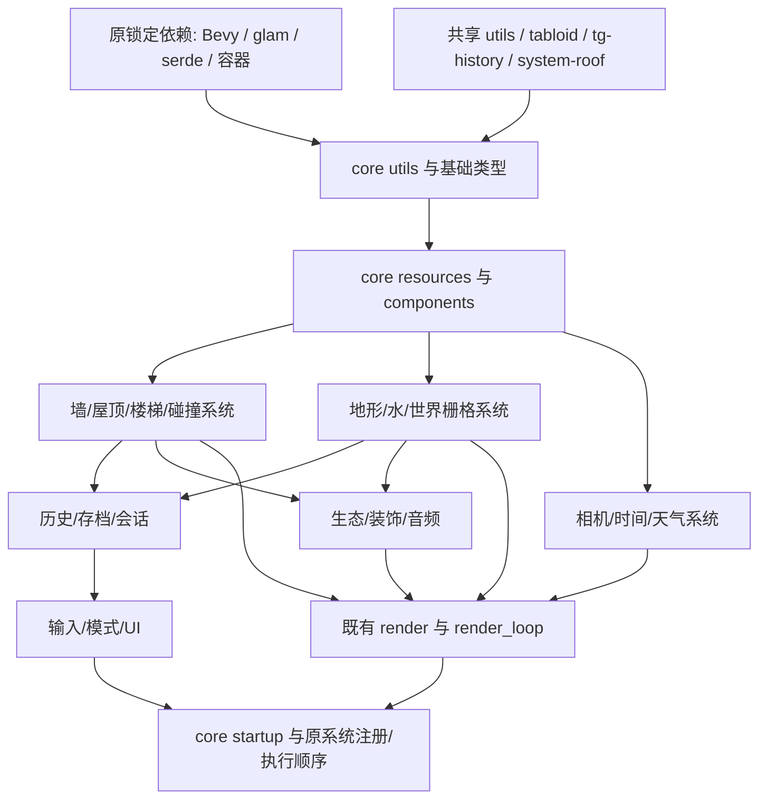

# country-core 按源码目录恢复

目标是 B 版完整 core 的业务和算法一致。所有新增游戏逻辑放在本 crate；原始文件、章节、旧纠错表保持为历史证据，不用其 O/FIX 标签直接宣布完成。

本目录是当前进度入口：[逐目录/逐文件清单](DIRECTORIES.md)、[机器清单](inventory.json)、[逐文件核验合同](contracts.json)。源文件是主键；报告、函数地址、当前代码位置、真实消费者都是它的附属信息。`README.md` 中更早的模块介绍保留为历史说明，以这里的限定核验状态为准。

## 依赖关系

`Cargo.toml` 当前直接依赖 28 个包：4 个 workspace 恢复库，加 24 个公开/公开 fork 包（其中 Rapier 可选）。新增 `uuid 1.15.1` 直接复用 B 原锁版本，供菜单载荷的 SessionId 使用。当前 core 没有依赖 `tg-building-runtime`；`systems` 只导出 camera_rig、render_loop、wall，尚无完整游戏调度器。

原文件主清单使用 B PDB 索引的 539 个记录。旧 595 文件库存属于历史重建目录；与 420 章节合并后有 74 个路径未出现在 B 文件表，另有两个 B 文件原先未进库存。它们分别记录，不能把重建辅助文件计成原作恢复进度。



箭头表示恢复顺序上的数据前置，不是声称所有接线已经存在。编译器提取的类型/签名依赖见 `inventory.json.signature_dependency_edges`，它不是函数体调用图。原调用者见每个文件的 `original_consumers`，无索引边的地方明确保留待定位。

## 推进顺序

| 顺序 | 原源码目录 | 当前工作与验收条件 |
|---|---|---|
| 0 | `lib.rs`、各 `mod.rs`、Cargo | 核对真实导出、共享依赖、旧实现位置；编译可达不作为业务完成 |
| 1 | `utils/`、`resources/` 基础文件、`components/` | 当前阶段；按消费者恢复类型/default/serde/事件/坐标；未知字段回查原码 |
| 2 | `resources/walls/`、`systems/wall/` | 将已有墙权威和 CPU 发布实现扩展为完整 PublicWalls、增改删与脏区传播 |
| 3 | `resources/roofs/`、`resources/stairs/`、碰撞目录 | 接回原资源所有者与实体关系；复核已有 recovered_building 算法后再复用 |
| 4 | `resources/world_raster*`、地形/水相关 systems | 补真实状态机、掩码、脏格与历史输入，逐算法复核 |
| 5 | 历史、存档、会话、预制件目录 | 编辑/undo/redo/replay/删除/保存往返的完整状态传播 |
| 6 | 相机/时间/天气、输入/UI/模式目录 | 恢复原模式与转换分支、真实资源消费 |
| 7 | 生态/装饰/音频目录 | 消费上述权威状态，补完整更新和清理链 |
| 8 | `startup/`、系统注册、渲染消费桥 | 核对原初始化/调度顺序；消除假资源与手工装配输入，再验整条 core 链 |

目录间存在相互依赖时，只向前补当前消费者必需的合同，回到当前目录继续。既有 `recovered_building` / `recovered_systems` 先登记映射和验证边界；没有语义证据时不搬文件凑“原目录完成”。

## 当前断点

2026-10-15 按用户要求改为实现优先，只做必要编译检查，疑义才定点查原码，不继续扩充测试矩阵。`gui.rs` 已从前缀 View 推进到拥有状态：菜单/加载与备份/设置子菜单、Next/Prev 和状态推进；缩略图位置算法及两组调试标签已恢复。`lut_gallery.rs` 删除重复假布局和外供坐标，改读同一 `EscMenuState` 和 metrics。`session.rs` 仅补菜单必需的 SessionId，不展开存档域。

既有基础文件和墙高亮的限定原指令报告保留，但不覆盖这次新增拥有状态、依赖与接线。当前增量完成 all-targets 编译，未声明完整 UI、原全局调度或 ABI 验收。

`utils/components/transform.rs` 是 core 的组件外壳，原算法属于共享 `crates/utils/src/components/transform.rs`；本轮复用其 look_at/abs_diff_eq，不重复实现依赖数学。这个外壳不算额外原 core 源文件。

下一项仍在 `resources/gui.rs`：PhotomodeScreen、完整 DebugGui/屏幕日志、PendingEguiContextResource；之后继续 `resources/walls/public_walls.rs` 的完整状态和发布/创建/删除同步。GUI 设置 tag10、报告菜单 bool 和 warning_session 的准确命名保留待取证；不把描述性名字当作者原字段名。

## 状态含义

- **已修复并核验**：只覆盖合同中明确列出的函数、数据与原入口；文件其余部分仍可未完成。
- **部分恢复/缺实现**：已有可调用逻辑，但完整状态或真实消费者缺失。
- **待取证**：证据冲突、类型不明或原入口未定位；不推导成实现完成。
- **依赖胶水**：derive、serde visitor、Bevy/容器泛型直接复用原依赖；自定义默认值和字段策略仍需核验。
- **待逐文件复核**：清单已关联源码/旧章节，但尚未作当前语义判定。

每个目录只有在其中所有自有业务、schema、错误分支及真实生产/消费链都闭合后才能标为完整。当前没有给任何未核完目录打“100%”。

## 更新清单

在 workspace 根先生成当前编译器导出，再重新生成清单：

```sh
env RUSTC_BOOTSTRAP=1 cargo rustdoc -p country-core --lib --locked --offline -- -Z unstable-options --output-format json --document-private-items
python3 tools/audit_core_foundation.py --workspace . --project ../reverse-engineering/tiny-glade --output crates/country-core/recovery/inventory.json --markdown crates/country-core/recovery/DIRECTORIES.md
```

原章节和 FIX 行与当前修复分开保存。`contracts.json` 中显式的纠错结论覆盖相应历史意见；未审条目不会自动继承旧 OK。
