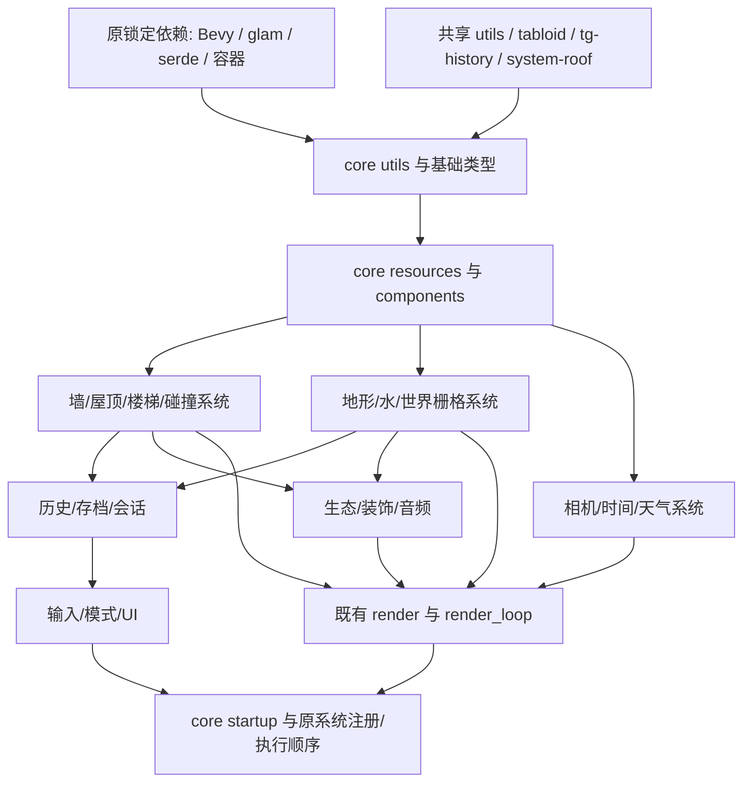

# country-core 按源码目录恢复

目标是 B 版完整 core 的业务和算法一致。所有新增游戏逻辑放在本 crate；原始文件、章节、旧纠错表保持为历史证据，不用其 O/FIX 标签直接宣布完成。

本目录是当前进度入口：[逐目录/逐文件清单](DIRECTORIES.md)、[机器清单](inventory.json)、[逐文件核验合同](contracts.json)。源文件是主键；报告、函数地址、当前代码位置、真实消费者都是它的附属信息。`README.md` 中更早的模块介绍保留为历史说明，以这里的限定核验状态为准。

## 依赖关系

`Cargo.toml` 当前直接依赖 41 个包（含可选 Rapier/FMOD）；`ahash 0.8.11`、`petgraph 0.8.1`、`bevy_time 0.16.0`、`libfmod 2.222.6`、`bracket-noise 0.8.2` 复用 B 原锁版本，`tempfile 3.20.0`、`crossbeam-channel 0.5.6` 及其传递依赖复用原锁，并连接已有 `tg-terrain`、`paths`。新增噪声传递依赖也按原锁固定，未使用 Cargo 自动选择的新版本。当前 core 没有依赖 `tg-building-runtime`；尚无完整游戏调度器。

原文件主清单使用 B PDB 索引的 539 个记录。旧 595 文件库存属于历史重建目录；与 420 章节合并后有 74 个路径未出现在 B 文件表，另有两个 B 文件原先未进库存。它们分别记录，不能把重建辅助文件计成原作恢复进度。



箭头表示恢复顺序上的数据前置，不是声称所有接线已经存在。编译器提取的类型/签名依赖见 `inventory.json.signature_dependency_edges`，它不是函数体调用图。原调用者见每个文件的 `original_consumers`，无索引边的地方明确保留待定位。

## 当前进度（2026-10-15 更新）

2026-10-15 用户修正：优先补实际实现程度最低的模块，依赖只补到足以实现当前业务；不持续加深已具备编辑/发布/回放链的墙、屋顶和历史。2026-10-15 晚收口：**9 个最低实现模块已全部实现并限定复验通过**（`review_passed(限定已实现范围)`），逐模块证据见
`recovery/agent-team/DISPATCH.md`（分派台账/状态流转）与
`recovery/agent-team/reports/<组>/<模块>/{RESTORE,REVIEW,RE-ANALYSIS}.md`（逐模块核验证据 + fresh 反编译）。
**限定复验 ≠ 整模块完成**：下列"验收层面开放项"未闭合前不宣布 100%（红线：不把编译通过或局部测试当整模块完成）。

| 模块 | 本批实现目标 | 现状（实现 + 限定复验） | 验收层面开放项 |
|---|---|---|---|
| `resources/ivy` + `systems/ivy` | 实际株/叶存储、坐标和动画消费 | 株/叶存储(20+7)、grower/pruner/leaf/branch 动画、spawner、send_to_gpu 库内业务均已实现；`review_passed(限定)` | GPU 提交待 render 域接线、SsboId::of 待 ssbo_library 对账、grower 主闭包逐相语义 / 48B↔104B 叶映射 / 噪声阈值待取证 |
| `systems/garden` | 接真实模式/画笔/UI/边界，绘制与历史记录 | 模式/画笔/UI/边界/绘制/历史四链与 0x140ae4620/0x141695e10 对上；`review_passed(限定)` | pin 渲染与 scatter/audio 消费、全局注册(impl$0::build)待接线 |
| `resources/critters/sheep` | 核实移动状态和快照字段，实现捕获/恢复；不复制空壳 Sheep | SheepMoveState 与快照 schema 定案、capture/apply 闭合、serde wire 验证；`review_passed(限定)` | 完整 Sheep owner/being_petted 按边界外；存档 Sheep 节接入 = save 组消费端 |
| `systems/audio/music` | 播放器拥有状态、随机队列和更新算法 | 5 态播放器/洗牌队列/节拍回调/切换阈值实现；`review_passed` | native FMOD 现场集成与 GladeAudio 曲目生产者（load_glade_audio） |
| `systems/backend/input` | 键盘/Steam/录制全链 | 数字动作增量(Shape B)、光标事件合成(方向/夹取/捕获)、录制回放状态机分派实现；`review_passed(限定)` | 动作↔槽映射、Steam 全链、帧 serde / try_load / SyncPoint、录制往返 |
| `systems/terrain` | 工具 UI 和历史生产 | 点/参数编辑、聚合通知、延迟回读、工具 UI(ui_draw/ui_edit/focus_mode/hover) 与历史生产实现；`review_passed(限定)` | EditType::Terrain 真 tag、focus_mode switch 表、ui_draw 消费面、脏掩码位序、AppMode==10 门裁决 |
| `systems/save` | 完整异步捕获 | 影子文件重试/分块刷新、节扩容/历史替换、节装载/GC/备份元节拍实现；`review_passed(限定)` | GameSaveData 域组装（域类型 CameraRigParametersCache/HistoryIdentity/GladeColorCustomization/GameProfile 已派 re-analyst-state 挖证据）、commander_update / on_load 回放、load_completion_checker |
| `resources/session` | 完整切换生命周期 | 真实元数据/活动会话/图像 schema/音乐消费、NextSession 数据结构与 on_load 吸收、会话列表/删除实现；`review_passed(限定)` | 完整切换调度 / MetaCommand 应用 / 全局接线（load_game_session 会话切换链） |
| `systems/ui_clutter` | 拾取/生成可见消费 | 权威删除集合、延迟历史、撤销/重做、spawn 事件/rmb 旋转/debug_spawn 实现；`review_passed(限定)` | DecoratorStorage 实体机制、ui_convert quat 接线、decoclutter 注册、ui_focus 主体、debug_spawn 消费端 |

验收层面开放项已按依赖顺序编排为下一批任务卡，见 `recovery/agent-team/planning/2026-10-15-next-batch.md`。
本批 9 模块"已实现并限定复验通过"不代表墙/屋顶/历史或本批模块的整体验收完成；完整全局调度、存档往返、视觉/碰撞消费者与 render 域 GPU 接线仍未验收。

## 依赖参考顺序

| 顺序 | 原源码目录 | 当前工作与验收条件 |
|---|---|---|
| 0 | `lib.rs`、各 `mod.rs`、Cargo | 核对真实导出、共享依赖、旧实现位置；编译可达不作为业务完成 |
| 1 | `utils/`、`resources/` 基础文件、`components/` | 当前阶段；按消费者恢复类型/default/serde/事件/坐标；未知字段回查原码 |
| 2 | `resources/walls/`、`systems/wall/` | 将已有墙权威和 CPU 发布实现扩展为完整 PublicWalls、增改删与脏区传播 |
| 3 | `resources/roofs/`、`resources/stairs/`、碰撞目录 | 接回原资源所有者与实体关系；复核已有 recovered_building 算法后再复用 |
| 4 | `resources/world_raster*`、地形/水相关 systems | 补真实状态机、掩码、脏格与历史输入，逐算法复核 |
| 5 | 历史、存档、会话、预制件目录 | 编辑/undo/redo/replay/删除/保存往返的完整状态传播 |
| 6 | 相机/时间/天气、输入/UI/模式目录 | 恢复原模式与转换分支、真实资源消费 |
| 7 | 生态/装饰/音频目录 | 消费上述权威状态，补完整更新和清理链 |
| 8 | `startup/`、系统注册、渲染消费桥 | 核对原初始化/调度顺序；消除假资源与手工装配输入，再验整条 core 链 |

目录间存在相互依赖时，只向前补当前消费者必需的合同，回到当前目录继续。既有 `recovered_building` / `recovered_systems` 先登记映射和验证边界；没有语义证据时不搬文件凑“原目录完成”。

## 当前断点

2026-10-15 按用户要求改为实现优先，只做必要编译检查，疑义才定点查原码，不继续扩充测试矩阵。`gui.rs` 已从前缀 View 推进到拥有状态：菜单/加载与备份/设置子菜单、Next/Prev 和状态推进；缩略图位置算法及两组调试标签已恢复。`lut_gallery.rs` 删除重复假布局和外供坐标，改读同一 `EscMenuState` 和 metrics。`session.rs` 已推进为实际 ActiveSession/SessionMeta，元数据与图像配置采用原 schema，写入临时文件后同步并重命名；音乐直接消费 ActiveSession。完整 NextSession/world 切换仍被未恢复的 GameSaveData/MetaCommand 所阻断，未伪造加载成功。

既有基础文件和墙高亮的限定原指令报告保留，但不覆盖这次新增拥有状态、依赖与接线。当前增量完成 all-targets 编译，未声明完整 UI、原全局调度或 ABI 验收。

`utils/components/transform.rs` 是 core 的组件外壳，原算法属于共享 `crates/utils/src/components/transform.rs`；本轮复用其 look_at/abs_diff_eq，不重复实现依赖数学。这个外壳不算额外原 core 源文件。

本次继续实现已进入墙 PublicWalls 发布/空间/高度/砖块创建、屋顶创建/删除/类型切换/回放、楼梯权威图/快照/差分、AppMode/工具栏转换，以及世界栅格开始/续画/提交/历史提取。GUI 已接 pending context、屏幕日志和已证实 DebugGui 控件。实现和剩余边界见 `skeleton/task-index/work/TG-cfac1f498c427933d2/core-gui-20261014/REPORT.md`（gui）、`skeleton/task-index/work/TG-9f411268a571c6bce1/core-walls-20261014/REPORT.md`（walls）、`evidence/country-core-deep/roofs-rt/ALGORITHMS.md`（roofs-stairs）、`evidence/country-core-audit/R5_world_raster_terrain.md`（raster）——原 `evidence/core-recovery-20261015/{gui,walls,roofs-stairs,raster}/REPORT.md` 引用从未落盘，2026-10-15 已重锚；此前目录清单尚未重新提取，不作为本次新增实现总数。

墙、屋顶、栅格已增补统一历史消费者，当前改为上表的最低实现模块优先。完整全局调度、存档往返、视觉/碰撞消费者和未恢复的自有业务仍未验收；不把编译通过或局部测试通过当作整模块完成。GUI 设置 tag10、报告菜单 bool 和 warning_session 的准确命名仍待取证。

## 状态含义

- **已修复并核验**：只覆盖合同中明确列出的函数、数据与原入口；文件其余部分仍可未完成。
- **部分恢复/缺实现**：已有可调用逻辑，但完整状态或真实消费者缺失。
- **待取证**：证据冲突、类型不明或原入口未定位；不推导成实现完成。
- **依赖胶水**：derive、serde visitor、Bevy/容器泛型直接复用原依赖；自定义默认值和字段策略仍需核验。
- **待逐文件复核**：清单已关联源码/旧章节，但尚未作当前语义判定。

每个目录只有在其中所有自有业务、schema、错误分支及真实生产/消费链都闭合后才能标为完整。当前没有给任何未核完目录打“100%”。

## 更新清单

在 workspace 根先生成当前编译器导出，再重新生成清单：

```sh
env RUSTC_BOOTSTRAP=1 cargo rustdoc -p country-core --lib --locked --offline -- -Z unstable-options --output-format json --document-private-items
python3 tools/audit_core_foundation.py --workspace . --project ../reverse-engineering/tiny-glade --output crates/country-core/recovery/inventory.json --markdown crates/country-core/recovery/DIRECTORIES.md
```

原章节和 FIX 行与当前修复分开保存。`contracts.json` 中显式的纠错结论覆盖相应历史意见；未审条目不会自动继承旧 OK。
