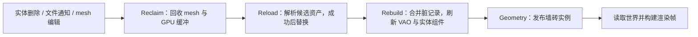

# asset_libraries：资产身份、发布与生命周期

本模块持有游戏资产并把变更发布给渲染、prefab 和音频消费者。当前实现以功能正确性为先，已经整理为工程接口，不再保留反汇编中的对象偏移、指令顺序或错误副作用。原作来源继续保存在项目 evidence；本次行为变化和验证见 [重构报告](../../../../reports/foundation/2026-10-18-asset-libraries-refactor/README.md)。

## 业务结构

| 模块 | 作用 |
|---|---|
| `mod.rs` | 游戏自己的 `HandleId` 和 `Handle<T>`；Bevy 的 Component 派生仅提供 ECS 存储/查询 |
| `mesh_library` | CPU 网格、可选名字及源路径索引，登记修改通知 |
| `vao_library` | mesh → VAO → 顶点/索引缓冲；通过创建设备释放物理资源 |
| `transient_mesh` | 组件析构登记删除，游戏线程批量回收 |
| `shader_library` | 光栅程序按名字与描述去重，计算程序按源码哈希注册 |
| `ssbo_library` | 按短名查找具体存储，以完整类型名校验，缓存当前导入周期的图句柄；typed 初始上传要求 NoUninit |
| `texture_library` | 普通纹理、名字别名、25 项预设、延迟描述符发布 |
| `descriptor_table` | 描述符所有权与不可变租约；实际分配、写入、GPU 延迟回收复用 rhapsody |
| `color_library` | 基础/主题调色板加载，上传成功后发布 CPU 副本 |
| `placement_data_library` | 摆放数据 JSON、GPU 缓冲与元素个数 |
| `audio_trigger_library` | 以 slotmap 管理带版本的 AABB 触发盒，不负责声音播放 |
| `configwatch` / `meshwatch` / `texture_watch` | 文件线程只登记通知，不读文件、不调用 GPU |
| `runtime` | ECS 中实际执行回收、热重载与 VAO 发布 |

## 身份和所有权

`Handle<T>` 是轻量、可复制的资产身份，既不拥有 T，也不负责释放。`HandleId` 使用游戏全局原子计数器，零为无效值，编号耗尽后显式失败而非回绕复用。`PhantomData` 只提供编译期类型区别，不占运行时空间。

纹理使用 `AssetIndex`（向量下标），采样使用 `DescriptorIndex`（描述符槽位），两者不能与全局 Handle 混用。SSBO 键是元素短名的 xxh3 哈希，完整 Rust 类型名另存用于检测冲突；哈希实现直接复用依赖。

CPU 网格和已编译程序使用稳定装箱引用。VAO 的缓冲身份由宿主表管理，因此 `AssetVAOLibrary::remove(device, mesh)` 和瞬态回收都必须携带创建设备。仅丢弃数值句柄不能释放 GPU 资源。

## 每帧发布流程



`runtime::add_asset_library_systems` 将上述阶段注册到同一 Schedule，并以 SystemSet 明确排序。Geometry 阶段复用几何模块自己的稀疏实例上传与失败状态。真实宿主 `GameFrameDriver` 把它挂在 `PostUpdate`，渲染读取世界之前执行。`CoreRenderBridge::install_asset_libraries` 安装同一宿主的设备、mesh/VAO/纹理库及预设纹理，真实 GameLoop 已调用该入口。

没有安装 `AssetLibraryRuntime` 时，需要 GPU 的维护系统保留队列，不制造成功结果。该资源的设备引用不能在外部替换，避免不同宿主的数值 ID 相互混用。

### 网格与 VAO

- `get_mut` 只在 mesh 存在时登记修改。维护系统排序、去重，不会为每条重复记录重建一次。
- JSON 重载先完成读取和校验，再替换 CPU 网格；编辑器暂时写入半个文件时保留旧资产，下一次文件事件重新尝试。
- VAO 构建失败时释放本次已经分配的缓冲，保留旧 VAO 并保留重试记录。成功后维持 VAO 身份，释放旧缓冲。
- 没有变化的帧复用已有缓冲；实体切换 mesh 时同步其 VAO 组件；空网格移除旧 VAO，避免继续绘制过期几何。
- 删除 mesh 时同时清理名字、源路径和修改记录。
- 普通删除也登记独立的 GPU 回收通知；即使没有实体或 `TransientMesh`，维护阶段仍释放对应 VAO。设备暂缺时通知保留，重复删除不重复释放。

### 瞬态回收

`TransientMesh::drop` 只入队。批量删除在队列锁之外执行，允许删除过程中再次入队；批次守卫在回调展开时归还未完成项，并复用队列容量。队列曾被毒化时仍允许恢复回收，避免析构二次 panic。

## 纹理与描述符

预设表使用固定范围的稠密向量，按槽位直接读取，不再使用 HashMap。每项保存创建时的完整 `TextureDesc`，图导入显式要求该描述，不再从宽高猜测 mip、数组层或用途。

预设创建采用整批发布：中途失败释放本批新建资源，保留旧表；仍导入图中的预设不允许重建。清零使用 rhapsody 已恢复格式表，计算长度时检查溢出，覆盖 mip 0 的全部数组层。D16_UNORM 按每像素 2 字节处理。

`TextureLibraryDevice` 的创建、上传和描述符提交均返回 Result。未连接宿主的旧 GraphicsDevice 包装返回明确错误；真实 TextureHost 使用已有托管纹理表、视图缓存、上传接口和 BindlessHeap。

描述符容量由设备实际布局支持决定，不强行要求原版的 8160 个采样槽。索引分配会检查真实容量，并发查询同一资产只分配一次；失败不消耗索引，不毒化锁。真实宿主通过 BindlessHeap 取得实际 GPU 槽位并立即写入；可注入设备的延迟路径只在提交成功后清空队列，失败后可以重试。

描述符发布后保持不可变，租约负责资源寿命。纹理重载替换物理资产，名字和别名仍指向同一 AssetIndex；真实宿主释放库内旧租约，下一次名字查询从 BindlessHeap 取得可用槽位。已经提交的命令继续持有旧租约，GPU 使用结束后槽位由渲染库回收。**缓存 DescriptorIndex 的消费者必须在资产变化后重新查询。** 不再通过递增整数猜测 GPU 槽位，也不把旧纹理永久积累到表释放。

未接原生堆的延迟后端保留已有索引，将替换资产重新入队，提交时读取最新纹理；连续重载不会耗尽表容量。已在队列中的替换合并为一次提交。该记录型路径没有原生 GPU 租约，不能当作真实宿主的在途资源管理。

需要实际使用描述符的渲染命令必须保留 `DescriptorSet::lease(index)` 返回的租约，并按 rhapsody 的 GPU 使用协议登记；复制整数不会延长 GPU 生命周期。这张资产表不替代着色器自身的反射与参数绑定。

## 调色板、监听与其他资产

颜色有 37 个 RGBA 槽，默认品红。先加载 `<assets_root>/colors.json`，再覆盖 `<assets_root>/glade/<theme>/colors.json`。同名后写覆盖，alpha 固定为 1；未知名字、非有限数值或上传失败都不会发布部分 CPU 状态。更新逻辑由同一 Result 入口实现。

监听启用时采用 100 ms 防抖：

| 通知 | 接受事件 | 保存内容 |
|---|---|---|
| ConfigWatch | Create / Write / Rename | 配置路径，单槽合并 |
| MeshWatch | Create / Write / Rename | 网格源路径，集合去重 |
| TextureWatch | Create / Write / Rename | 纹理逻辑名字，集合去重 |

Create/Rename 用于支持编辑器的原子保存。宿主按开发配置创建、注册 watcher 并插入对应 Resource；默认安装不自动开启磁盘监听。runtime 已提供实际消费者，文件 I/O 和 GPU 工作都在通知锁之外进行。

摆放库当前元素仍使用 `resources::placement_data::PlacementDataSsbo` 的 `{x, y}` schema，占位来源不因工程化而自动变为完整原作布局。音频触发盒继续复用 slotmap，删除后旧键失效。

## 验证与边界

在 workspace 根目录运行：

```sh
cargo test -p country-core --lib --test asset_libraries --locked --offline
cargo check -p tiny-glade --all-targets --locked --offline
RHAPSODY_REQUIRE_VULKAN=1 cargo test -p tiny-glade --test asset_libraries_gpu --locked --offline -- --nocapture
```

CPU 回归包含原有业务测试及生产 ECS 调度、并发分配、描述符失败重试、完整描述保留、文件半写入与回收链。GPU 回归使用真实宿主验证更新/清零后像素回读以及真实描述符租约。最终结果和保留的失败尝试见 [重构报告](../../../../reports/foundation/2026-10-18-asset-libraries-refactor/README.md)。

本轮调整了原行为，不沿用旧原作逐位等价结论；不宣称完成了整游戏、全部着色器消费者或原进程验收。[历史审查](REVIEW.md) 保留问题来源，以最新修复报告为准。

第二轮审查及修复见 [复审报告](../../../../reports/foundation/2026-10-18-asset-libraries-rereview/README.md)，其验证针对复审后的当前源码。
