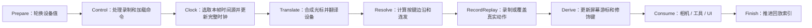

# input：游戏动作与完整录制

本模块负责统一动作状态、拥有数据的同步快照、输入队列和录制文件。设备翻译及调度位于 [systems/backend/input](../systems/backend/input/mod.rs)。本轮按功能正确性重构，不再把原生内存偏移、裸指针或猜测的结构布局当成运行时接口。

## 结构与职责

| 文件 | 职责 |
|---|---|
| [action_set.rs](action_set.rs) | 46 个动作槽、按键阶段、计时、稀疏动作编码和严格解码 |
| [input_stream.rs](input_stream.rs) | VecDeque 帧队列、工具栏/模式/相机快照、最近输入裁剪 |
| [recording.rs](recording.rs) | 完整帧文件、版本校验、加载、原子替换式保存 |
| [mod.rs](mod.rs) | 输入设备提示、录制/回放模式 |
| [panic_repro_state.rs](panic_repro_state.rs) | 宿主 panic 复现开关的零标签判定 |
| [input_record_replay.rs](../systems/backend/input/input_record_replay.rs) | 控制命令、状态切换、回放覆盖真实动作资源 |

容器、序列化、数学、ECS、临时文件分别复用标准库、serde、glam、Bevy、tempfile。键鼠边沿复用项目已有版本的 `bevy_input = 0.16.0`；country-core 新增对此依赖的引用。

## 动作状态

`ActionSetValues` 保存设备前后两帧的值；`ActionSetStates` 是 `MainActionSet` 的别名，也是游戏实际消费的唯一状态。回放直接覆盖同一份资源，实时键鼠不会混入录制动作。

- 模拟槽 0–5：输入空间光标、窗口空间光标、相机平移、高度、缩放、旋转。
- 数字槽 0–39：点击、工具、UI、撤销/重做、截图等。名字与顺序见 `ANALOG_NAMES`、`DIGITAL_NAMES`。
- `DigitalActionPhase`：`JustPressed`、`Held`、`Repeating`、`JustReleased`、`Idle`。
- `timer_seconds`：持续按住的秒数，或连发倒计时；不再使用没有语义的 disc/val。
- UI 导航槽 20–25 长按 0.2 秒开始连发，间隔 0.1 秒；每帧最多触发一次。
- 输入计时使用真实时间，暂停游戏不影响菜单导航。非法帧增量按零处理，非法模拟值归零，避免污染后续状态。

`released()` 包含空闲状态；需要释放边沿时使用 `just_released()`。

键鼠状态通过 `press`、`release` 更新，通过 `clear` 清除本帧边沿并保留按住状态；`reset_all` 清除全部状态，用于会话切换。宿主不要直接修改边沿集合。右键手势在真实按下时复位距离，按住及释放所在帧均计入位移。

原始鼠标增量保留在 `analog[0]`，供相机拖动等动作使用；限幅后的窗口位移在 `analog[1]`。屏幕游标应用后者并再次检查窗口边界，捕获期间保持锚点；回放恢复录制锚点，不混入实时捕获状态。

### 编码与文件校验

每条稀疏动作记录仍为 12 字节的小端协议：kind、slot、两字节保留位、两个四字节载荷。运行时使用定长数组，不使用原生结构体内存转储。

`MainActionSet::reconstruct` 返回 `Result`，拒绝未知 kind、越界槽、无效按键阶段、非零保留位、重复槽以及非有限载荷。名称映射也拒绝未知或重复字段。

```rust
use country_core::input::action_set::{DigitalActionPhase, DigitalActionState, MainActionSet};

let mut actions = MainActionSet::default();
actions.digital[16] = DigitalActionState {
    phase: DigitalActionPhase::JustPressed,
    timer_seconds: 0.0,
};
let records = actions.deconstruct();
let restored = MainActionSet::reconstruct(&records)?;
assert!(restored.digital[16].just_pressed());
```

## 明确的帧顺序



`add_input_cpu_consumers` 使用链式 SystemSet 建立顺序。控制命令先于完整时钟更新，屏幕游标和修饰键先于游戏消费者；光标事件先于右键手势计算；回放推进在消费者之后，所以首帧、最后一帧都恰好消费一次，不需要 `u64::MAX` 或索引减一的哨兵。

宿主接入：

1. 调用 `register_input_events(world)` 注册输入资源及事件。
2. 提供初始化好的 `MainCamera::new(aspect)`、实际 `Toolbar` 和 `AppMode`、`EscMenuState`、`ShaderRefactoringState`、`CursorPositionSS`、`CursorCapturedPosition`、`WindowSize`。
3. 调用 `add_input_cpu_consumers(schedule)`。
4. 游戏系统加入 `InputSystemSet::Consume`；不要另外重复注册复位、时钟更新、回放或推进系统。
5. 宿主负责每帧更新 `bevy_time::Time`、按钮边沿和事件缓冲；流水线在 Clock 阶段独占更新 `GameTime`。完整可执行例子见 [input_pipeline.rs](../../tests/input_pipeline.rs)。

`BindingsTable` 是输入资源，可由宿主修改键位；每帧不会重新构造默认表。Egui 面板只有在相应资源存在时才运行。

## 录制和同步点

`InputSnapshot` 拥有实际 `Toolbar`（所有类别及索引）、`AppMode` 和类型化相机参数。修改、清空或释放当前工具栏不会改变旧快照。恢复先校验，再整体写回实际工具资源，立即定位相机并清掉旧镜头动画；复用 `AppModeChanged` 通知及 `PreviousAppMode`，避免通知重复。

实时请求和回放共用捕获切换入口，同时更新内部锚点、窗口捕获和鼠标显隐来源。回放中的重复锚点不重复发送 OS 命令；回放正常结束、Stop 中止回放或时钟/帧错误均释放捕获。本帧结束后到达的实时请求会被消费并忽略，下一帧恢复实时控制。宿主在 PostUpdate 调用 `mouse_capture`，并应用 `OsCursorCaptureCmd` / `OsCursorVisibilityCmd`；不要直接改写 `CursorCapturedPosition`。

`InputFrame` 保留动作的边沿/计时、整数游标、消费动作前的屏幕游标、捕获锚点和帧增量。没有 raw qword 状态块、游标归一除数或两套有损帧转换。

`InputStream::record_frame` 根据 `RecordingRetention` 选择策略：

| 策略 | 行为 |
|---|---|
| `Recent` | 自动复现；最多保留 9,999 帧和 9 个同步点。即使没有历史事件，也每 1,111 帧生成快照并裁剪完整分段，避免达到上限时丢空近期历史 |
| `All` | 用户主动完整录制；不自动裁掉帧或同步点，内存随录制时长增长 |

首帧和分段边界才创建快照；普通帧不克隆工具栏、不创建动作 Vec。序列化直接写动作记录；需要手工编码时可用 `deconstruct_into` 复用缓冲。

同步点索引表示下一帧的位置。删除旧分段时按新头索引批量 `drain`，再重定位剩余索引。`get_frame` 提供非 panic 查询。

## 文件与控制命令

```rust
use country_core::input::recording::{load_recording, save_recording};

save_recording(path, &replay.stream)?;
let stream = load_recording(path)?;
```

当前格式包含 `format_version: 2` 和 `stream: { sync_points, frames }`。所有帧、动作和同步点都写入文件。加载验证版本、动作、单帧与累计时间、相机、工具栏和索引；单文件最大 64 MiB。保存先写同目录临时文件，再替换目标，失败时保留旧文件。

版本 1 缺少实际工具模式和捕获状态；更早只含 `first_frame` 的文件也无法恢复完整输入，均明确报错；不静默填零或伪造兼容。当前格式是本工程的新协议，尚未承诺兼容原作 B 文件。

通过 `InputReplayCommand` 发出：

- `StartRecording`：清理旧流并开始完整录制。
- `Stop`：停止并保留数据。
- `Replay { rewind }`：从倒数第 `rewind + 1` 个有后续输入帧的同步点回放；末尾空同步点不参与回退计数。
- `Load { path, rewind }`：解析、校验、确定回退目标后，整体替换当前录制。
- `Sync { record }`：历史同步；自动录制允许复位，主动完整录制保留已有帧。

加载或回退失败不会清空当前录制，也不会 panic；错误保存在 `last_error` 并写入日志。`DisableInput` 清空实际动作和设备当前值。空流回放安全停止。时钟更新在副本上完成；累计时间溢出或非法回放帧会停止回放、保留录制、记录错误并屏蔽本帧动作，避免半更新时钟和异常退出。

文件只负责输入及工具栏/相机锚点；场景初始存档由宿主准备，不包含完整世界、羊群或整个游戏状态。原作 CLI 和 crash-report 导出仍是各自宿主的独立接入点。

## 验证与历史审查

[REVIEW.md](REVIEW.md) 保留原四项问题及本轮修复状态。回归覆盖完整保存/加载/播放、实际消费者、失败保留、工具栏所有权、禁用输入、最近队列边界、文件格式与无效数据。最新运行结果和指纹见 [重构报告](../../../../reports/ui-input/2026-10-18-input-refactor/README.md)。本次复审修复与新回归见 [五项修复报告](../../../../reports/ui-input/2026-10-18-input-fixes/README.md)。原有逆向报告仅作历史事实，不用作新设计的正确性验收。

最新边沿、末尾同步点和 OS 捕获链修复见 [输入边界修复报告](../../../../reports/ui-input/2026-10-18-input-edge-fixes/README.md)。
