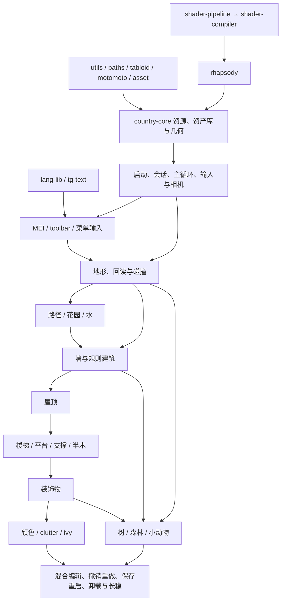

# 按依赖次序审查业务还原进度

审查日期：2026-10-24。对象为当前 `tiny-glade/` 正式源码，B 为原版行为基线。当前工作区不含 Git 元数据，本报告不绑定旧 `games_test` 提交。

## 判断边界

本次独立检查 Cargo 依赖、生产入口、系统注册、关键函数体及测试入口；当前 STATUS 和 README 只用来定位，并未继承其完成率。`cargo metadata --offline --no-deps --format-version 1` 成功，确认 33 个 workspace package。这只证明清单可解析，不证明源码编译或业务通过。

本次没有重新执行原版机器码差分、Cargo 构建、测试、真实 GPU 或窗口长稳。源码中的地址、原证说明和既有测试属于可追溯线索，不能冒称本轮已复验。以下是实现与接线的静态审查，不是每个函数的逐指令等价认证。

采用三个分开的判断：**实现深度、生产接线、验收缺口**。没有完整业务流分母，不能给可信的代码百分比；未验收也不代表从零开始。尤其当前台账中的“后序模块未进入”指尚未开始逐流验收，不代表这些模块没有恢复代码。

## 依赖关系

Cargo 依赖和业务依赖应分开：大多数 `systems/*` 依赖 country-core，彼此没有直接 Cargo 依赖；但业务上通过共享资源、实体和事件形成下列先后关系。

历史与存档、音频、世界渲染贯穿所有业务，不是最后才接。上图是恢复优先次序，非每条支线必须严格串行；例如树工具可在地形输入闭合后与建筑并行推进。

## 第 0 层：公共基础包

| 包 | 当前实际内容 | 进度判断与边界 |
| --- | --- | --- |
| utils | 曲线、样条、几何交集、采样、相机数学、索引、文件等实际实现 | 基础实现较深，已有用户重构与边界修复；有意修复不自动等价于原版全部边界。没有发现需要重建整包的依据。 |
| paths | 安装、配置、存档、备份、临时目录与全局初始化 | 有实际路径与失败处理 API，主入口使用；继续检查每个消费者的目录语义即可。 |
| tabloid | Publisher / Subscriber、增量发布与订阅所有权 | 有同步和生命周期实现，是墙、森林和 clutter 的公共依赖；业务通知是否完整需要逐消费者验证。 |
| motomoto | 带 tag 和长度的 chunk 读写 | 有实际编码读写实现；底层容器完成不代表上层存档 schema 和恢复完成。 |
| asset | prefab 继承、扫描和纹理档案 | 库内有实现，country-core 资产库使用；完整安装资源与热重载需在启动链验证。 |
| asset-pipe | 离线纹理处理、压缩和持久编译 | 有离线实现，不是游戏每帧主链的前置运行系统；不应混入运行时完成率。 |
| lang-lib | 语言包、查找、全局服务与事务替换 | 有真实服务；主程序加载且 UI 使用。语言切换页面仍是另一个业务缺口。 |
| tg-package-integrity | manifest 校验、checksum 与多余文件查找 | 有实质实现；其报告窗口等已明确删除的功能不算待恢复。 |
| tg-theme | 活动定义、HTTP、缓存和可取消订阅 | 库内状态机存在，但未见被当前 tiny-glade Cargo 依赖直接接入；不能把库完成算作每日主题游戏接线完成。 |
| tg-iced | 本地化对话框、窗口后端与截图 | 支持包有实现，原生能力受 feature 和平台约束；不代表游戏内菜单完成。 |
| tg-gpu-selector | GPU 选择与 Vulkan 配置对话框 | 有独立调用 API；当前 tiny-glade 未直接依赖此包，应核对实际启动分支再认定产品入口接通。 |

## 第 1 层：渲染与资产底座

| 模块 | 已存在的实现 | 仍需闭合 |
| --- | --- | --- |
| shader-pipeline / shader-compiler | shader 协议、预处理、反射和编译；rhapsody 实际依赖 | 全部运行分支的原资产身份、编译结果和真实 GPU 行为不能由文件存在推断。 |
| rhapsody | 继续沿用重构架构；图编译、资源、屏障、命令录制、提交、完成回收及 swapchain API 已有实际实现 | 不需要照原版重建整包；缺失原版分支、跨设备行为、销毁和性能要按具体 API 与消费者验证。 |
| tg-text | 字体、文字 shaping、shape stream、GPU renderer | 已被 tiny-glade 和 country-core 使用；MEI、字体资产、缩放和实际画面需要联合验证。 |
| country-core 资产库 / Nani / SSBO / 几何 | typed 资产库、GPU world、缓冲与绘制声明、建筑几何和共享资源 | “资源类型已初始化”不能替代真实资产 producer。依赖源、上传、编辑更新和释放需闭合到各业务。 |
| 世界渲染图 | `world_graph::build_world` 实际调用地形、栅格、水、花园、植被、楼梯、墙/Nani、光照和后处理；宿主连接同一图与帧资源 | 完整声明链已经存在；所有场景、摄影、动态编辑更新、实际窗口长稳和性能未获本轮认证。 |

源码锚点：`crates/tiny-glade/src/{render_bridge,production_renderer,world_graph,world_geometry,world_terrain,world_surface,world_lighting,world_postprocess}.rs`。

生产渲染中保留显式诊断用 minimal world frame。默认路径缺 producer 时返回错误，不静默把 clear+export 当完整世界。验收必须排除此诊断分支。世界图中“有楼梯 pass”也不能证明上游楼梯几何生成完整。

## 第 2 层起：逐业务模块

| 次序 | 业务模块与前置依赖 | 当前实际还原与接线 | 进度结论及主要剩余项 |
| --- | --- | --- | --- |
| 1 | 启动与资源注册：基础包、设备、资产 | `tiny-glade-host → standalone_main → run_game`；有真实 Prefab / mesh atlas / Nani 启动链、加载 App 与 gameplay App 交接 | 主体已实现并存在生产入口；原插件 tuple 的完整顺序仍标 OPEN。须用当前源码重验加载→Game、取消与失败分支。 |
| 2 | OS / 游戏 / 渲染循环：窗口与设备 | `event_loop`、`GameLoop`、渲染线程和 `ProductionRenderer` 有真实实现及 resize、suspend/resume、shutdown 路径 | 已超过早期 facade 阶段；不能再称完全没有主循环/present。当前连续呈现、完整窗口生命周期、退出资源和性能仍需实测。 |
| 3 | 公共输入、相机、MEI / toolbar：主循环、文本、picker | `toolbar_plugin::build` 注册 set6/7/8 的命中、UI、导航、按钮、工具切换、摄影和会话清理；存在真实链测试入口 | 接线较完整，属于当前优先验收模块；实际窗口操作、完整 Reload、资源稳定性及最新修改需统一复验。 |
| 4 | 历史、会话、保存与恢复：权威资源、业务命令 | country-core history/save、宿主 `history_runtime` 有真实回放、snapshot、颜色/树/装饰/楼梯消费者；保存加载测试存在 | 共用主干已存在，不能称存档只有解析器；但各业务 producer、完整命令分支、附属记录和卸载缺项使全编辑闭环未完成。 |
| 5 | 地形编辑：输入、回读、地形 SSBO、历史 | TerrainSystems 已注册，绘制、编辑、回放、地形 GPU pass 存在 | **算法/系统部分恢复，真实编辑输入未闭合**。宿主只初始化 hover/readback/widget/focus 适配资源，缺真实 writer 的边界已在源码登记。 |
| 6 | 路径 / 三类铺石：地形、四栅格、输入、历史 | `systems/paths.rs` 有 draw、record、四栅格借用和局部测试；宿主有四栅格、笔刷与渲染 | **叶函数已恢复，主宿主完整编辑注册缺失**。`run_game` 仅明确注册 PathDrawEvent 并保留其它事件未接说明；不能把显示已有路径算作绘制工具完成。 |
| 7 | 花园：栅格、输入、历史 | draw_garden、record_garden_history、局部 build；宿主有 GardenRaster、staging 和 vegetation pass | **CPU/GPU 两端都有实现，中间编辑接线未闭合**。当前主宿主未找到 draw/record 的实际安装调用。 |
| 8 | 水：共享栅格、输入、历史、植被与音频 | WaterPlugin 确实注册绘制、历史与音频栅格；世界图有水上传、植被与表面消费者 | **已接部分生产链**；仍用 WaterPinnedClutterCircle 特化事件代替统一 ShowPinnedDecoClutter，需要恢复消费者联动并验收实际画水、回放、删除。 |
| 9 | 林地边界：光标、场景边界、UI | GladeBorderPlugin 注册边界显示与越界反馈，宿主建立真实边界资源 | **小模块有生产接线**；demo overlay 原注册归属仍未定位，完整画面和工具越界反馈待验。 |
| 10 | 墙体权威与编辑：输入、地形、历史、碰撞 | 原 set19 中 draw/continue、吸附、合并、墙高、发布、删除、空间索引等已注册，set34 历史存在 | **核心流程恢复较深，规则形状/构造链仍不完整**。不能因基础墙能生成就认定规则建筑全完成。 |
| 11 | 墙体构造、门栅栏、支撑、楼板、抹灰：墙发布与分段 | 分段、拱、过梁、门、栅栏、墙输出及 SSBO flush 有实际注册 | **明显未完成**。支撑段检测、圆支撑、矩形柱/支架、石柱碰撞、楼板、抹灰维护等仍是显式 todo，宿主主动不注册这些成员。 |
| 12 | 屋顶：墙权威、几何、历史 | RoofSystems 确实安装；创建、编辑、删除、空间更新、瓦片、回放及 GPU 消费已有实现 | **恢复与接线较深，整模块未验收**。仍依赖墙/结构生产完整性；部分屋顶关联及无效通知的原注册点未定位，不能继承早期 README 的“完全未接”结论。 |
| 13 | 楼梯 / 平台 / 扶手：墙、屋顶、地形与装饰缓存 | stairs 权威资源、历史、分段、构造请求及 render compute/draw 存在 | **主要阻塞模块之一**。platform stairs、playermade stairs、支柱/支架/magic support 的生产体仍有 todo；完整 cache→几何→碰撞→画面→卸载没有闭合。 |
| 14 | 半木：墙形状、构造缓存、GPU | `add_timberframe` 安装矩形/圆形构造、音频与 OnExit；宿主初始化 cache | **消费者已接，上游不全**。规则形状 UX 系统尚未完整安装；curved halftimber 和附属楼板边等仍有未实现函数。 |
| 15 | decorator：墙→屋顶→楼梯、碰撞、历史 | crate 内有操作、归档、变换、blueprint、cull、UI 和回放；主入口仅调用 `build_startup_resources` | **库内恢复较多，主游戏完整编辑链没有接通**。完整 build 与视觉生成组并未在主入口调用；原 `decorators_on_glade_unload` 仍 todo。楼梯附着缓存也阻塞完整 set25。 |
| 16 | 颜色与自定义：toolbar、墙/屋顶/装饰权威 | `ColorSystems::add_color` 实际注册菜单、replay、各类颜色命令与部分 GPU 上传 | **已有生产调用**；须逐对象验证触发、取消回滚、历史、GPU 和卸载，装饰/半木上游缺项不能靠颜色命令层弥补。部分上传采用宿主独立适配。 |
| 17 | clutter：地形、建筑、装饰、树位置与回读 | ClutterPlugin 已安装自动生成、候选、实体、动画、stitches/merlons 等 | **已接但仍混有局部适配**。init_adapter_resources 存在无充分原 owner 对应的状态；dirty_walls 使用改写后的桥接。应逐项证明真实 producer 与原语义，不能因系统每帧运行就算完成。 |
| 18 | ivy：墙洞、输入、增长与 GPU | grower、spawner、pruner、leaf、动画和上传函数存在；主宿主只找到资源初始化与 startup_ivy | **局部实现存在，完整持续业务注册未闭合**。局部 add_ivy_systems 不等于主入口安装；原事件仍以 OnWallChanged 替代 OnCircleRotated，上传/音频注册也有待接说明。 |
| 19 | 树工具：地形、碰撞、prefab、历史 | TreePlugin 实际安装 place/move/delete/hide、回放、地形变化重定位与 OnExit reset | **恢复与生产接线较深**；真实鼠标编辑、地形/墙/水联动、保存重启和删除后实体释放需统一验收。 |
| 20 | 森林：树存储、prefab、发布订阅 | ForestPlugin 注册 prefab 管理、森林与手放树动画，共用权威存储 | **已接主要消费者**；场景资源、地形变化、隐藏/恢复、卸载生命周期需与树工具一起验证。 |
| 21 | 小动物：水、路径、建筑碰撞、鸟点、音频 | CritterPlugin 与 SheepPlugin 确实进入主循环；羊鸭等行为/动画/音频/回放已有大量实现 | **恢复深入但存在明确算法近似，不能验收**。fish 用水栅格替代四路径栅格、缺 flock 持久状态/候选占用；boids 的 32 方向表为 golden-angle 占位；摸羊鸭 UI 和部分鸟群状态未闭合。 |
| 22 | onboarding：所有真实工具事件、UI、持久标志 | add_onboarding 已安装，提示族与完成度逻辑存在 | **系统已接，部分触发源未接**。宿主保留 HintResetState 和无真实 producer 的提示适配事件，应在所属业务完成时接回。 |
| 23 | 菜单 / 设置 / 语言 / 主题：会话、UI、平台 | 实际 Escape / Load / Welcome 等链与测试存在；语言与主题基础服务存在 | **部分页面已恢复，整菜单族不完整**。language_menu、controls 和多个 settings 页面仍 todo；theme_fetcher 的 update_daily_theme_system 是真实空函数，未连库服务与 ECS。 |
| 24 | 摄影 / 时间 / 天气 / 截图：相机、toolbar、渲染与文件 | 摄影按钮、slider、focus、截图捕获/写盘和时间天气系统存在，TOD UI 函数已恢复 | **存在实际实现但链仍有断点**。gui_tod 的宿主注册和 TodButtonState 生命周期未找到；对焦坐标适配须按原证复核；截图、LUT、窗口效果和退出残留仍需实际验收。 |
| 25 | 音频与平台：共享 Studio、各业务事件 | Windows/native-audio 使用原生后端，其他默认宿主走显式 DisabledStudio；加载、水及 toolbar 等有实际接线 | **业务事件层部分接通，不等于本机已可听**。非 Windows 要明确启用 native-audio 与 FMOD；Steam/独立宿主边界、各域事件及释放需分别验证。 |

## 容易误判的边界

1. `country-core` 不是一个单独可标 100% 的模块：它同时承载资产、渲染、权威状态、编辑、历史和生态；必须沿上表按业务拆分判断。
2. `tg-history` 是只读 JSON 文档访问与屋顶投影包。它明确不执行 undo/redo。真正运行时在 country-core 与宿主 history_runtime，不能混为一谈。
   同样，`tg-terrain` 只提供已解析的地形编辑、点序列与回放策略，不是完整地形工具或栅格化器；地形业务接线主要在 country-core 与宿主。
3. `tg-building-runtime` 是独立 headless Bevy 建筑适配，存在另外的资源和调度类型。当前 tiny-glade Cargo 依赖没有安装它；其测试成功不能直接证明游戏主宿主成功。
4. `startup_construction_runtime::install_open_adapter_inputs` 直接说明若干空资源只让 SystemParam 可用，缺真实生产者。启动成功与玩家能使用这些工具是两种进度。
5. `adjust_wall_height_impl.rs` 的 mode!=1 `todo!()` 有原版 panic 的地址与行为说明。此次不把它计为恢复缺口。相反，楼梯与支撑 todo、主题空 updater 有明确未实现含义。
6. 未重新运行当前程序，故不延用过去“Logo 卡在某帧/某行崩溃”的判断，也不宣称现在已经完整可玩。当前静态证据证明的是比旧 facade 更多的实现和上述明确断点。
7. 已删除的反馈、崩溃报告 GUI、完整性报告窗口和 GeForce NOW 业务不重新纳入待恢复范围。

## 建议推进次序

1. 冻结当前输入和渲染源码，先复验启动→Game→真实输入→连续 present→关闭，再验 toolbar 的窗口交互、Welcome 阻挡、Reload 和资源释放。没有基线就不能把后续业务失败与宿主失败区分开。
2. 完成地形的 GPU/碰撞回读→hover/focus/widget producer→编辑→历史→画面；然后分别完成路径、花园和水，不把共享栅格当作三种工具已经完成。
3. 补墙规则形状与构造缺口，按墙→屋顶→楼梯/平台/支撑/半木推进。楼梯是装饰 set25 的前置阻塞，不能跳过它挂装饰消费者。
4. 完成装饰物全编辑、visual/collider、归档恢复和真正卸载，再逐对象验颜色、clutter 与 ivy。
5. 树/森林可在地形链闭合后并行验收；小动物要恢复真实表和持久 flock 状态，消除已知算法替代，补交互、鸟点认领释放与回放。
6. 菜单命令逐一接到已验收业务；补 TOD、摄影渲染接口、截图、主题和音频；最后做混合编辑→undo/redo→保存退出→新进程恢复→多次切场景。
7. 性能按实际目标 GPU、Release、明确分辨率测 FPS、1% low、p95/p99、内存和 GPU 资源趋势；本报告没有可用于宣称性能达标的数据。

## 关键可复核源码位置

所有路径相对正式工程根目录。

- 入口与业务装配：`crates/tiny-glade/src/run_game.rs`，重点 `add_original_plugins`、`run_game_thread`、`install_history_and_wall_runtime`。
- 空适配输入：`crates/tiny-glade/src/startup_construction_runtime.rs::install_open_adapter_inputs`。
- 墙构造被排除的成员与已接系统：`crates/tiny-glade/src/app_systems.rs::add_wall_systems`。
- 装饰注册与卸载：`crates/tiny-glade/src/decorator_plugin.rs`；主入口实际仅使用 build_startup_resources。
- 世界声明与生产帧：`crates/tiny-glade/src/world_graph.rs::build_world`、`production_renderer.rs::compile_world_graph`。
- 路径与花园：`crates/country-core/src/systems/paths.rs`、`systems/garden/mod.rs`。
- 水与半木：`crates/systems/water/src/lib.rs::WaterPlugin::build`、`crates/systems/timberframe/src/lib.rs::add_timberframe`。
- 楼梯未恢复体：`crates/systems/wall-constructor/src/construct_platform_stairs/mod.rs`、`construct_playermade_stairs/`。
- ivy 注册：`crates/country-core/src/systems/ivy/registration.rs`、宿主 `gameplay_startup.rs`。
- 小动物非等价实现：`crates/systems/critters/src/fish.rs`、`boids.rs::make_ray_dirs`、`wren_boids.rs`、`ui_pet_ducks.rs`、`sheep/ui_pet_sheep.rs`。
- 菜单/主题：`crates/tiny-glade/src/gui/settings.rs`、`gui/language_menu.rs`、`theme_fetcher_plugin.rs::update_daily_theme_system`。
- TOD：`crates/tiny-glade/src/gui/gui_tod.rs`；应核对生产调用与资源生命周期，而不只核对函数体。
- 独立验收入口：`crates/tiny-glade/tests/{original_loading_present,original_gameplay_chain,toolbar_window_chain,toolbar_module_chain}.rs`。入口存在不表示本轮执行成功。

## 本次关键源码身份

SHA-256 仅绑定本次读取内容，不追溯认证旧日志，也不代替全依赖闭包指纹。

| 文件 | SHA-256 |
| --- | --- |
| `crates/tiny-glade/src/run_game.rs` | `ab959bf9502d5e7e22e856714b63c36c30e79a3927c29900c8c54e8629b60dee` |
| `crates/tiny-glade/src/startup_construction_runtime.rs` | `e010468d34d0ad7ac5fe8729bd3eab235cc789d782d6adf50c29c87755814f70` |
| `crates/tiny-glade/src/app_systems.rs` | `dbcb60eb7475759a4340f79bd142c16d61752d989edc32bac0448003ba01bce4` |
| `crates/tiny-glade/src/decorator_plugin.rs` | `ea1ed1fc39ffc34230dc3626a700992d76ca4b6f3955de39a4e229df7fe6782b` |
| `crates/tiny-glade/src/production_renderer.rs` | `aad684a46a3c439eadf3ba95f351414379ed94c90f9a68ca7fe343e0cd72f375` |
| `crates/tiny-glade/src/world_graph.rs` | `2e8ffbf2c23ece291f99bc6f208f36726fffb19f38c20c8903e41b318d8c7db9` |
| `crates/tiny-glade/src/toolbar_plugin.rs` | `4e1eed7edbf47b4c833bc9495f0352fba375812c1a23b721feb155ff81f2c660` |
| `crates/tiny-glade/src/theme_fetcher_plugin.rs` | `2f09a4b4b856d11bb312589dfccee8c0009923475f13d56e7e14169ec542d613` |
| `crates/systems/critters/src/fish.rs` | `070ac5f67a1db5e250e964adf94db4f8d08a84ff927d1a29d172ba411ff2c208` |
| `crates/systems/critters/src/boids.rs` | `42efd8f8a29bda0fe2edb6a21597941dbcaadbf36bc3ebd2f13f125ff4e5ae13` |
