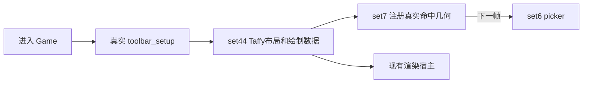
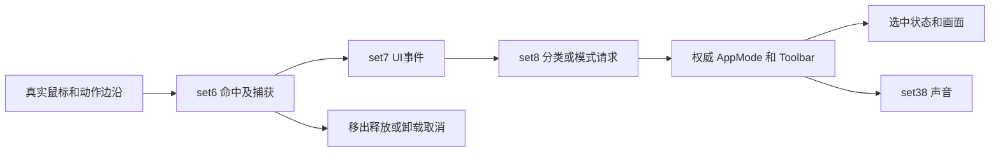
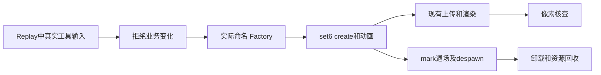

# 业务流恢复台账

### 2026-10-30 M6 用户要求停止推进并保存提交

按用户最新指令停止业务推进及新增验证，保存当前源码和文档检查点。**M6仍未完成，约75%工程估计不变**，以下候选不能冒称已通过。

- 已有结果：`m6-core-contract-regressions-v3.log` 9/9通过；`m6-published-owner-contract-v3.log` 8/8通过。后者对应随后补充烟囱／门阶 lane 重发布替换及释放次序之前的源码，不覆盖最后的生命周期增量。
- `m6-wall-color-isolated-v2.log` 父进程合法输入→真实菜单→颜色→Undo/Redo→实际GPU表→完整typed ledger落盘通过；child在75.15秒失败于runtime完整typed history不等于父期望，父项总计265.17秒。真实存档及期望保留于 `tmp-merge/m6-acceptance-retained-v2/wall-color/run-GHu1LF/`。已补首差字段／完整失败ledger留存，恢复工作应先用该目录meta重跑child，避免重复已通过父链；新增诊断尚未构建实测。
- `m6-decorator-color-isolated-v2.log` 91.87秒失败于真实placement的 `d2s insert: already exists; 0`；不得删除断言或跳过ID。已补正式ID生成器、索引及完整Info的逐帧只读诊断，尚未实测定位首次冲突。
- `m6-rim-isolated-v2.log` 104.32秒失败于GPU设备丢失；System/Display事件同时记录Intel驱动停止响应后恢复，不能据此确定应用侧根因。带现有Vulkan验证层的 `m6-rim-validation-v2.log` 尚无最终结果，不计通过。测试已增加可选 `TG_M6_VK_VALIDATION=1` 及rim阶段诊断，生产渲染算法未改。
- 原证新增：`+120`是独立拱砖，主体墙砖另有allocation；`+160/+170`为烟囱／门阶砖，对应当前实体的两个assembly lanes。现候选在成功重发布替换这些lanes并保留base，五个sidecar按已证顺序退役、局部构造完成后提交；缺库异常的完整原EH回收序列仍未逐项闭合。最后lane与释放次序增量待回归。
- 烟囱高度候选已移除误归属的0x28B操作队列，改用真实PlayDecoratorSoundCmd；恢复真实dispatcher目标、PrevDecoratorBlueprints（原PDB泛型已确认）、跨帧投影／修改／历史及两张碰撞表的实际归档，恢复真实signifier工厂。`m6-decorator-contract-v3.log` 未产生最终结果，新增跨帧／碰撞归档回归不计通过。
- 删除链验收已从末项历史比较加强为完整typed ledger、cursor、history_start与磁盘／同App Reload／child比较；新增取消预览场景通过配置中的真实取消按键路径，检查完整权威状态、GPU及菜单实体回收。两者均待构建／实测，不作为当前整链通过证据。

恢复顺序：先构建冻结候选并跑烟囱／owner定向回归；用已留存存档定位child历史首差；实测ID诊断闭合装饰创建；再独立进程跑rim、完整删除／清理／Reload及取消场景。六项旧跨平台浮点fixture差异继续保留，不改期望或放宽断言；原算法和业务逻辑不得简化。

### 2026-10-30 M6 菜单／删除／保存恢复集中验证（继续进行）

本轮按用户要求使用三个显式 `gpt-6.1-terra` 专岗，中央串行 App/GPU 独立验证，不扩展其它业务模块。`m6-core-contract-regressions-v3.log` **9/9通过**（显式 native-physics），包括删除索引失败前缀、prepared path失败顺序、圆／矩形创建缺录制失败前缀及共享地形输入生命周期。`m6-app-isolated-build-v2.log` App 快照构建通过。

`m6-wall-color-isolated-v2.log` 已从合法屏幕位置 `(180,162)` 走真实 picker／菜单，父进程颜色提交、完整历史 Undo/Redo、真实绘制物理 owner 的整 GPU 颜色表读回及 runtime→磁盘完整 typed ledger 比较通过，正在子进程恢复；尚不计整项通过。各场景分别启动进程，避免 ACCOUNT／paths 静态状态污染。

独立审查补齐删除验收的完整 typed ledger、cursor 与 history_start 对照候选（此前只比较末项）；已合入，待构建。烟囱高度释放发现八字节复制到四字节切片的确定 panic，原 `1407ae76e/775/77a` 的写入宽度已中央独立复核并修候选；进一步确认原 caller 的三维位置／比例／dispatcher 归属及后继消费仍有业务缺口，正在按原证恢复，不把仅修 panic 算完整交互恢复。原 `+120` allocation 映射仍待证，不造第二份原 owner。本轮 M6 仍未整体完成，保持约75%工程估计。

### 2026-10-30 M0 渲染计算定向修复

按用户授权修复已确认的渲染计算问题：MEI最小尺寸恢复gap先入累加器；子布局恢复两轴padding求和、原expand剩余空间扣减顺序；绘制恢复`sort_unstable_by`及`total_cmp`。未改摄影焦点或多slider已核一致的分支，辅助业务继续跳过。当前实际`layout.rs`独立源码测试7/7通过（新增3项原证数值回归，0忽略），`git diff --check`通过；toolbar整包Cargo测试等待共享构建锁，已停止等待，未计通过；未做GPU像素验收。原版等值元素排列不宣称与现代std逐项一致。证据、源码指纹及限制见[m0-render-algorithm-review-2026-10-30.md](m0-render-algorithm-review-2026-10-30.md)。

### 2026-10-30 M1 → M6 持续收口（未完成）

本轮继续集中M6（最多三个Terra），中央独立串行App/GPU验证。墙色完整App首轮`tmp-merge/m6-real-wall-color-v1.log`实际失败：`visualize_ui_stairs`缺`StairsVisualization`。复核发现该叶自身使用虚构坐标／旧signifier载荷，不能靠初始化自造owner掩盖；已撤下这一未恢复M8叶及同类focus叶，明确不计恢复。set25修正slot1的自动转换→派发→放置→continue顺序、保留三次独立cache，set10接真实wall-hole双缓冲推进；新快照由中央复验`m6-real-wall-color-v2.log`，尚未通过。

本轮新增实际通过：`m6-remove-storage-v2.log` 1项（墙桶removed/live ID传播和重建）；`m6-height-outline-preview-v2.log` 1项（非均匀已发布高度的红色删除预览）；`m6-mixed-color-history-v2.log` 1项（墙色／rim／装饰颜色混合history序列化与回放顺序）。它们不代表生产App删除/重建已通过。现有App测试已扩展rim、窗口颜色的保存worker→新进程Reload→完整字段／全history／UndoRedo，以及墙拾取→装饰清理→UndoRedo→同App Reload→新进程恢复；候选待中央编译实测，不计通过。测试模式切换改走canonical RequestAppModeChange，GPU回放等待每帧运行真实上传与渲染；大期望JSON通过临时文件传递，避免Windows环境块容量限制。

墙色v2已实际失败（96.11秒）：启动不再panic，但90帧内未得到可交互不同色图标。发现新进程profile会显示真实Welcome，世界碰撞命中不等于UI点击可达；新夹具先经配置中的真实键盘确认关闭Welcome，再从真实publisher/recording/deferred/replay的安静状态采基线。v3测试辅助代码两处编译错误已修，最新冻结候选复验为`tmp-merge/m6-real-wall-color-v4.log`（尚未通过）。进一步新增G-buffer实际物理颜色buffer owner关联及整表GPU读回，在点击／UndoRedo／新进程恢复后检查，不以CPU色表代替上传结果。保存前观察完整ledger连续稳定且录制／延迟记录排空，不以SavingGameComplete单独认定快照完整。

v4完整运行已结束（181.59秒）：父进程真实wall picker→menu→颜色提交→UndoRedo→实际G-buffer同物理owner整颜色表读回→save worker通过；child已完成Reload且颜色值与真实GPU表通过，随后完整history/cursor比较失败。尚不能认定存档丢失：父期望经过JSON Value/f64文本中转，现增加保存前settled typed ledger→实际磁盘typed edit_chain→child typed ledger三方严格比较，保留原JSON首差诊断及独立cursor/history_start。三种颜色场景可用TG_M6_DUMP_DIR留存真实save/完整期望/meta，不修改生产存档路径。最新比较候选待编译实测。

后续独立复核纠正v4输入边界：当时直接取图标中心，允许屏幕外鼠标点，因此它只保留颜色／历史／物理GPU子链证据，不能证明480×270合法指针交互通过。`m6-wall-color-isolated-v1.log` 95.78秒实际失败于viewport内未选到图标；原主环半径／尺寸公式经f507字节确认一致，尚无窗口fit／自动缩放原证，不擅改算法。测试应从全部真实图标的AABB与viewport交集中取合法点击点（中心在屏幕外不等于整个控件不可见），并选择给原菜单留空间的真实墙射线；当前已修候选待运行。四场景同进程`m6-app-acceptance-v1.log` 0/4、205.71秒；发现静态ACCOUNT／paths共享以及最近存档选择的跨测试污染路径，不能把后续每个失败直接归因生产，也不声称已证明污染造成每次失败。后续各场景独立进程验证。

上述App轮还实际发现支撑detector对非零高程自由墙`get_wall_shape` panic：原140787408..40c在零高程清理之后对tag>1直接跳过，中央已独立原字节复核并恢复该门。原publisher对支撑木／砖及半木allocation也逐次新建，当前sidecar已按成功发布重建，消费者不再惰性造owner；+120主墙／拱门侧挂映射仍单独待证，未制造第二份原owner。矩形／圆创建缺录制时吞掉History::add失败也已按原panic修复，保留墙／屋顶请求已发生而后续toolbar／sheep尚未发生的前缀。新增候选尚待定向测试。

`m6-production-contract-regressions-v1.log` 在country-core lib-test LLVM阶段out-of-memory，未执行测试，不算算法失败或通过。后改为单crate、CARGO_BUILD_JOBS=1 的`m6-core-contract-regressions-v2.log`；最新App隔离快照构建为`m6-app-isolated-build-v2.log`。共享boot等待也补真实上传消费，避免dormer SSBO在90个App-only warm-up tick内耗尽队列；不加容量、不屏蔽原上传。

本轮原指令确认并合入的生产修正（待`m6-production-contract-regressions-v1.log`验证）：①原publisher为每次成功发布创建新的通用木板+130分配，成功重发布先退役旧owner；现由当前sidecar在同一成功发布边界适配，清理不再无条件造空owner。独立核实原指针字符串为WoodenPlankSsbo，纠正旧Uber误归属；其余slots生命周期仍独立审查，不机械套用。②普通prepared path少于两点原caller panic，现保留policy及高度映射先行，再在数组构造前恢复该失败语义；None/缺缓存等重构状态不一概panic。③装饰延迟历史缺录制原History::add panic，现不再warning后吞掉；原pending先清、records长度先归零而allocation保留、集合尚未清的异常前缀经中央原字节及EH helper复核，使用当前Vec::drain保持安全所有权。

按用户追加要求另启一个Sol专岗：先闭合旧M02/当前M1地形画面一致性，再逐项对照B函数列表；只有确证算法简化或业务缺失才列修改项。v5 canonical mode基线`m1-canonical-mode-save-restore-v5.log`实际370.75秒失败于child App-only Reload等待的Dormer Holes上传队列耗尽，尚未抵达图像比较；已在M2等待helper统一加入真实host上传消费，未加容量／屏蔽系统／放宽图像断言，修后待复验。M6三个Terra仍集中生产调度、删除和持久化，不扩展新业务模块。

浮点独立静态增量：按原`xz_rotation_bad`及矩阵指令，同法线得到half record11当前`...595`；按原采样角／插值／normalize算序并调用Windows UCRT，turret stone14与offset74首差也逐位复现当前Rust。两圆塔结论仍依赖日志给出的层参数、采样索引、t及split，原上游采样knot／随机分割未完整独立核完；六项旧Darwin桥夹具失败继续保留，未改数学／期望／断言，不计完整原入口同输入差分。详见既有arch/lintel报告的2026-10-30静态计算章节。

用户要求继续至 M6 完成；三个 Terra owner 分别补齐调色菜单真实交互、菜单构造及共享导航、推土机完整分支，中央串行构建和独立验证。保持小窗口、不跳过 Logo、不伪造 ready，不回退 rhapsody／utils 已重构架构。后续 M7／M8 仅处理实际阻断 M6 的共享依赖。

向用户说明 M6 约75%（70–80%的调用链工程估计，不是原版函数覆盖率）。楼梯边／中点删除与附着装饰重定位已有下述有界Rapier／History通过；当前最大缺口是新生产调度下真实UI→权威／实体／碰撞／GPU→完整UndoRedo→保存／新进程恢复→卸载重入的联合闭合，不能继续把这些已补子分支列为完全未实现。新调色真实App入口仍有实测阻断，算法上保留六项旧跨平台浮点fixture失败及其原证边界。

- **M1 物理墙砖 owner 检查通过**：`tmp-merge/m1-physical-owner-edit-v2.log`，1 项，44.57 秒。绘制 receipt 的 Shadows 三项、G-buffer、G-buffer OC/2 都引用同一真实物理 buffer；目标 96B 有效记录与 CPU 一致且编辑前后改变。本检查不证明目标墙间接绘制命令或像素归因。
- **M1 跨进程最终图像仍失败**：`tmp-merge/m1-aligned-clock-save-restore-v2.log`，313.28 秒；历史、地形、双高度及保存的三个日照 f32 严格一致，最终图像 129585 像素不同、RGB MAE 3.175967。诊断捕获的相机、日照、配置、FrameConstants、时钟时间／delta 相同，GameClock.frame_count 仍差三帧；尚未证明这是唯一原因。现让真实零时长 tick 自然对齐模拟／渲染计数差，并补保存端地形 lighting 捕获，待复验；不直接覆写计数器、不扩存档 schema、不放宽断言。
- **M6 当前候选**：墙色 picker、13 类主菜单交互、墙／屋顶／门／半木与装饰菜单构造、窗口灯次级环，以及推土机墙命中与动画已补实现，统一编译／实际链路仍待验证。其它删除动作、共享 UiNav、楼梯与梯子次级环及完整输入→历史→磁盘→重入尚未全部闭合，不能计作整模块完成。

后续验证／审计增量：稳定快照整合构建v4通过（`tmp-merge/m1-m6-checkpoint-build-v4.log`）；颜色库20项通过（`tmp-merge/m6-color-lib-v1.log`），包含真实门网格picker、窗口灯／楼梯／梯子环和取消等有界夹具，不是完整App／GPU验收。门与装饰picker已补原mask、storage和magic查询规则，门色setter恢复先SSBO、按墙存在性处理事件、最后整表上传；rim改由原颜色set31消费者直接记录History，移除晚于录制结束的set40重复适配。装饰删除完整Info回放夹具首轮构建被新增楼梯重定位helper的generic archivist类型错误阻断（`tmp-merge/m6-decorator-bulldozer-v1.log`），待修复，不计通过。柱放置独立审计发现几何材质`==1`与统计`!=0`的原条件不能合并，以及自由墙末端f32计算不能代成f64；均已修候选，待回归。

M1严格图像v3再次失败（`tmp-merge/m1-aligned-clock-save-restore-v3.log`，父测试581.76秒）：这次所有已捕获帧状态／GameClock逐项相同，最终129586像素不同、RGB MAE3.176021；地形lighting仅348/262144像素不同、MAE0.019573。独立审查识别`ShadowMaskMeanSsbo`为尚未观察的全屏tonemap输入：原shader使用`1-exp(-5*delta)`平滑，零时长输入会冻结各进程此前不同的运行均值。当前增加真实同owner四字节读回，并改为先自然对齐完整render frame，再给相同非零时间输入让真实GPU历史收敛；未改生产算法／存档schema／图像断言，仍待复验。

v5整合构建通过（`tmp-merge/m1-m6-checkpoint-build-v5.log`）；M1正时间v4仍失败（`tmp-merge/m1-positive-time-save-restore-v4.log`，574.32秒），最终差异降为30738像素／RGB MAE0.257894，terrain-lighting1340像素／MAE0.046975。实际同owner shadow mean为0.715192616与0.715234458；除新补捕获的AppMode外所有记录帧状态一致，父为Terrain、子为Editing(None)。当前改为工具栏canonical RequestAppModeChange→真实mode_manager统一未保存的工具状态，再复验，不直接写AppMode或松断言。先前拟用动作26已在下游review时撤销：它会清空整个世界，不能用于结束工具；该错误前置未运行。诊断只给ShadowMaskMeanSsbo额外TRANSFER_SRC，不修改其它描述符或生产shader。新增装饰删除Rapier→picker→完整Info／地址Undo/Redo已通过1项（`tmp-merge/m6-decorator-bulldozer-v2.log`）；新中点／边删除、恢复的set25装饰放置与视觉链及set34历史仍待实际验证。

本轮后续实际结果：最新擦除core显式native-physics **37/37通过**（`tmp-merge/m6-core-eraser-v1.log`）；装饰删除／楼梯边／楼梯中点真实Rapier→picker→历史及完整状态Undo/Redo **3/3通过**（`tmp-merge/m6-bulldozer-integration-v5.log`）；柱父链含材料字节2的真实proposal／brick allocation／统计回归1项通过（`tmp-merge/m6-pillar-parent-v2.log`）；楼板保存→新进程恢复→恢复后撤销重做父子全部通过（`tmp-merge/m6-floor-save-restart-v2.log`）。这些结果不包含随后仍在修正的整个DecoratorPlugin注册树，也不替代正式App图像／磁盘联合验收。

墙构造全库首轮185过／7失败（`tmp-merge/m6-wall-constructor-v1.log`），柱setup缺真实brick allocation已修并单独重过；剩6项仍失败。两项overlap及gable输入已核到旧Darwin libSystem数学桥与Windows UCRT的1ULP差；两个turret和同输入half圆墙首差仍需逐步定位，不能一概归因CRT或放宽assert。已采细节（`tmp-merge/m6-turret-float-diagnostics-v1.log`、`tmp-merge/m6-half-float-diagnostics-v1.log`），只在测试环境变量下输出中间位值，未改生产算法／冻结期望。原PE数学API-set在当前Windows解析到ucrtbase；旧跨平台桥接记录不等于Windows原侧动态验收。

新增流程经验：新App接线先完整重建原parent配置树的chain／普通tuple／chain_ignore_deferred／flush位置，不能把已恢复叶函数平铺后视作完成；原同函数多次注册是不同位置的system实例，不能凭函数名全局去重。独立审计已否定初版set25简化接线（缺清瞬态实体、原slot3及slot14子链／尾部flush等），当前由原owner按现有slots原证纠正。新增跨crate事件必须先App::add_event再World init，保持真实帧维护；新增mandatory输入不得改Optional隐藏缺owner。

本轮流程经验：①同一物理 owner 要在绘制 receipt 退役前关联，General 的读写访问也包含读取；②只推进 App 时须按真实宿主消费有界上传队列，不能放宽队列上限掩盖饥饿；③跨进程画面比较必须区分存档字段与未保存运行态，靠真实输入推进到等价观察条件；④原 format literal pieces 决定 widget 身份，不能凭可读性添加分隔符；⑤已结束的 agent 必须通过 followup_task 继续派工，普通消息不会重新启动；⑥新叶函数通过不能替代完整调用链，中央保留独立生产验收。

### 2026-10-30 M0 独立逐函数审计

用户要求新增一个Terra agent独立审计M0所有函数，核实原版算法／数据／分支是否完整，明确区分语义等价适配、近似、空实现、缺接线和原证不足。Daily仍排除。此前M0“本轮范围收口”仅指列明的功能链验证通过，不表示所有函数已原版等价；逐函数分母、原证与结论待独立清单复核。审计只读生产实现，与中央继续推进M1并行，不以无TODO或测试通过代替等价结论。

中央复核发现旧扫描在文件中途的`cfg(test)`模块处截断，漏掉其后的生产实现；已补41项，当前清单579个候选、51个文件，仍不是原侧去重／跨crate闭合后的覆盖率。新增独立Terra审计已逐项处理清单内全部剩余源码记录：10条是无函数体声明、2条Daily专用函数明确排除；其余记录已有具体源码行为与待证边界。中央核验全部记录的源码SHA，未发现过期指纹。547条仍为原证不足，不能把源码实读完成算成原版判等；原侧721条metadata候选／闭包／跨crate映射仍未闭合。记录见[m0-independent-function-candidates-2026-10-30.json](m0-independent-function-candidates-2026-10-30.json)。已直接核出的差异／接线问题：

- `mei_pre_update`先按GlobalId排序再执行节点，而原始f507 RNE `140684a79..140684b53`直接按HashMap control字节逐桶调用vtable+58，后续交互循环也直接逐桶扫描。顺序算法存在确定差异；声音、事件及交互结果的影响仍待核，不能判语义等价。
- 原始`1404dc465`调用`on_key_event@140685fc0`、`1404dc32c`调用`on_clipboard_paste@1406860d0`；当前全crates静态搜索只见这两个MEI方法的定义，实际宿主键盘入口只向core／Bevy发布。原MEI生产入口尚缺接线；具体控件影响须沿原消费者继续核实，不能据此声称所有键盘交互都失效。
- `DisplayConfirmationDeadline`连续五秒未确认即返回错误属于当前宿主策略，尚未取得原版相同期限／错误退出的依据。`MeiInputEvent::tag`的双偏移非零优先判别也待原生产者和消费者进一步核对。

合法原vtable空默认体与未恢复空实现分开统计；目前尚不能给出“全M0无空实现／无近似”的结论。中央直接原指令复核了`load::ThumbnailScrollContent::input`完整控制流，以及Welcome透明度两段算术及`.3/1/3`常量；这些有界证据不外推为整个菜单或M0判等。

### 2026-10-30 用户范围更新：暂排除 Daily

用户明确 Daily 每日主题／活动暂不推进。暂停其实现、联网和验收，已有代码保留；Daily 未通过项不再作为本轮 M0 收口阻断，也不计作已完成。普通菜单、新建、设置、保存／恢复及 Reload 继续按原合同验证，后续顺序仍为 M0 → M1 → M6 → M7 → M8。

**M0本轮范围已收口，当前推进M1。** 普通Summer实际菜单picker→Reload→Game→生产保存→再次进入的完整历史／游标／元数据／墙权威比较通过（`tmp-merge/m0-ordinary-new-v2.log`）；其间修复实际缺失的装饰ID→subtype每帧生产系统，未预填或删除starter装饰。设置真实输入处理器→宿主生产帧尾消费者→重复消费不重写→新进程get_app_config读取通过（`tmp-merge/m0-settings-frame-tail.log`）。新增暂停确认期限及最后注册／非空编辑回归分别6项、2项通过（`tmp-merge/m0-final-confirmation-tests.log`、`tmp-merge/m0-registration-host-final.log`）。冻结后的窗口链再次通过（`tmp-merge/m0-windowed-cycle-final.log`），构造完成立即断言480×270且非全屏。Daily、M16独立调试GUI及全游戏Release性能不在本次M0功能收口结论中；未声称所有原版输入域／平台逐位等价。M1首先修复已暴露的地形跨进程夹具缺GpuReadbacks，并通过真实生产GPU链核对其owner与输入，不能用空资源绕过实际读回。

M1进展：真实Vulkan初始索引／岩石SSBO→ReadbackPublisher发布→鼠标边沿／picker→绘制／编辑→Undo／Redo→保存worker→新进程恢复的夹具通过（`tmp-merge/m1-terrain-disk.log`），不冒称完整场景shader生成读回已验。Reload两项首轮因缺GpuReadbacks owner失败（`tmp-merge/m1-reload-owner.log`），已补实际owner并要求绘制前真实反馈齐备，待重跑。剩余重点为同epoch双高度图→CPU／碰撞／订阅→墙重发布、地形相关lighting与最终图像、完整场景保存／恢复及晚到票据/旧会话隔离。对用户说明约75%（70–80%的调用链工程估计，非函数覆盖率），尚未验收，不进入M6。

M1最新补充（取代上段待重跑项）：Reload同／异存档owner隔离2项已过（`tmp-merge/m1-reload-owner-v2.log`），地形／高度边界99项已过（`tmp-merge/m1-core-boundary-tests.log`）；真实App/GPU编辑、同epoch双高度图、CPU副本、碰撞／订阅／墙事件、lighting及最终图像变化已过（`tmp-merge/m1-gpu-edit-v2.log`）。仍缺目标墙brick物理GPU记录与实际绘制同owner的同步证明；不能用默认`WallBrickUploadStatus.gpu_ready=true`证明上传成功。全场景跨进程保存恢复的严格图像比较尚未通过：首轮有真实日照漂移，固定日夜循环并匹配自然128帧采样相位后，仍发现旧会话播放进度影响三个已保存日照f32的观察；已增加真实状态机归零前置与逐位诊断，当前复验日志为`tmp-merge/m1-static-save-restore-v2.log`。不扩存档schema、不回填运行帧数、不松图像／高度／历史断言。约75%的工程估计保持不变；未作Release性能验收。

上述v2复验已结束：构建通过；新进程的历史、地形、双高度与三个日照f32严格比较通过，最终画面仍失败（234.11秒，`113021/129600`像素不同）。中央比较`tmp-merge/m1-static-image-diagnostics-v2/m2-saved-state.json`和`m2-reloaded-matched-state.json`：相机、视频／formation／曝光、日照及FrameConstants的采样帧数和jitter一致；记录中仅`game_time_frac`与GameClock还差两个1/60秒更新。RGBA实测RGB平均绝对差由首轮8.282降为1.630，最大75；这不能单独证明剩余差异仅由时钟造成，其他未记录GPU资源／累积历史仍需核。尚未放宽图像断言或计作验收通过，进度仍约75%。

M0本轮结果：设置／主题确认与loading交接6项通过，设置常规11项及显式原资源控件3项通过；真实FMOD bank owner补齐后，真实App Welcome抢占／点击／Held Reload／再点击测试通过（`tmp-merge/m0-toolbar-app-v2.log`）。`windowed_cycle`实际小窗口经过Logo、真实交接、OS尺寸480×270→514×354、零尺寸暂停／恢复、vsync worker确认、设置落盘、GPU截图、12个native成功游戏帧和退出保存／GPU清理，通过（`tmp-merge/m0-windowed-cycle.log`），未启用呈现诊断绕过，也未进入全屏。该debug功能测试不证明帧率达标；建筑brick上传超时保留脏标记重试的日志需在M6/渲染链进一步核查。普通新建与设置保存同帧合同仍在本轮补验，尚不声明M0全部验收。

### 2026-10-30 合并后共享链修复（当前执行顺序）

用户确认先集中修复共享输入、形状状态、事件和历史链，最多三个 Terra agent 并行，中央协调并独立验证；之后严格按 **M0 → M1 → M6 → M7 → M8** 逐模块收口。完整原版算法、业务分支和生命周期均须保留，不以局部测试或编译替代整链验收。

全游戏性能标准延续用户要求：完整逻辑和质量下60 FPS为最低、120 FPS为合格；本轮功能测试不构成帧率达标证据。启动或窗口验证必须小窗口，禁止全屏。用户重写的rhapsody和底层工具继续沿用，不回退旧架构。

合并基线为 `8166bbe3c`；合并后的测试目标类型检查通过，实际交互测试尚待本轮执行。原有 `history.rs` 未提交改动保留。当前共享批次重点为圆／矩形与自由墙输入、统一事件及消费者、撤销重做与真实保存恢复。旧同日/跨平台通过记录仍只绑定各自源码和环境。

本轮实际复验：共享输入／圆矩编辑／自由墙／历史分桶组显式 `native-physics` **67/67 通过**（`tmp-merge/shared-core-history-v2.log`）。真实宿主非空自由墙编辑、装饰跟随和缓存跨帧／删除，以及多reader事件维护 **2/2通过**（`tmp-merge/shared-host-tests-v4.log`）。闭墙重做原失败为 `/3/kind expected=3 actual=2`；根因是缺少原有序命令兼容分桶，创建动画完成覆盖后续闭合。恢复完整标签规则、光栅子类、每桶九条上限及末桶aux后，真实App／Vulkan绘墙→闭合→Undo／Redo→保存→新进程加载父子各1项通过（`tmp-merge/shared-closed-wall-v3.log`）。原始RNE SHA为 `f507a6cea25c5199447b88ba746a5293e64a279f73797ca74c1ce7f4ff2b7d03`；配对表与容量静态原指令核对不冒称原侧动态全域差分。圆形跨进程回归仍在本轮复验，尚不宣布共享批次或M0整模块验收。

后续圆形跨进程复验通过（`tmp-merge/shared-circle-disk-v3.log`）：墙／圆形各自写入、恢复、恢复后回放的新进程组全部成功。期望值按真实 `SavedMultiEdit`／`WallState`／装饰schema读取，保留全部字段及实际f32精度，修复通用JSON f64展示引起的错误比较；生产序列化未改。至此本轮指定共享链批次的有界验证完成，开始 **M0** 收口；这不等于M0或所有游戏历史域整模块验收，也未执行真实OS输入或本轮帧率验收。三个Terra任务分别负责M0注册顺序、设备设置应用、Daily与保存/Reload公共链，中央继续串行构建和独立验证。

### 2026-10-29 提交推送检查点（按用户要求先保存全部当前进展）

本轮先提交当前代码与分析状态，暂停继续实现。**M6 尚未完成；后续顺序仍为 M6 收口→M7 屋顶→M8 楼梯／平台／扶手。** 性能与长稳不列入本轮验收，真实 OS 输入暂缓。

- 通用柱已恢复三向量缓存消费、原自由墙端点调整、石／木记录及逐项写入失败顺序，并接正式 set28（fences 后、主墙前）。五种 GPU allocation owner 分离，避免通用柱、高程支撑和半木互相清除。round57 wall-constructor 191/191 通过，含 arches→石柱、lintels→木柱；之后新增单独洞口重算场景断言尚未重跑，不能把旧结果套到最新文件。
- round60 本机真实 Vulkan 建筑测试通过：生产半木／抹灰→正常渲染图；有界真实抹灰 raster 诊断空表覆盖0、抹灰表覆盖2325深度像素；Reload 回收66个抹灰实体／owner，重入 Game。该证明不等同最终颜色逐像素归因。此后追加楼板 Nani owner、半木颜色保存／重载断言尚未复验。
- 闭墙实际 App 首轮 round59 发现吸附提示仍写错误 Raw 载荷；已依原版改为现有预览实体与真实线／球工厂，round62 显式 native-physics 定向3/3通过。round63 已能通过绘墙、自闭合和撤销，**重做后权威墙严格比较失败**，完整闭墙保存恢复尚未通过，保留为下一轮首要问题。
- 楼板跨进程 round61 为6通过／1失败，恢复阶段缺墙。定位为测试反复 run_system_once 丢失保存系统 Local 稳定门，未形成所需 snapshot；现改用持久 Schedule 并要求真实快照引用与文件。新修正及 Nani 退役断言未复验；同 App Reload 组合仍未完成。
- 新独立审查确认墙体 bulldozer 当前假拾取／Raw 请求仍不完整。原1409de190的两张跳表已在唯一 worker 修复，获得完整原控制流，尚未回写实现；不得把旧命中即发动画命令算作原交互恢复。
- 颜色菜单上游仍有原主函数空实现／data-only菜单，正式 setter 本身不记录 History；半木颜色完整菜单交互与历史尚未成立，不能在测试中手造历史掩盖。该依赖已定位，仍需按原版恢复。

本轮失败及未验项保留，不声明 M6 整模块验收。中央轮次记录见 `root-m0-m6-independent-review-2026-10-29.json`；后续继续复用原证和当前 B 目录，避免重复逆向。


### 2026-10-29 用户确认推进顺序与本轮恢复（进行中）

**顺序固定为M6全部功能收口→M7屋顶→M8楼梯／平台／扶手。** M7、M8尚未进入完整实现轮；当前仅处理其真实阻断M6的共用依赖。继续保留B目录和现有rhapsody重构；性能／长稳验证排除，真实OS输入暂缓，合成真实App功能验收继续。

通用柱调查发现前轮遗漏的真实上游合同：原0x88掩码还含28B柱提案、score和key三Vec，由arches及lintels两种生产者写出，place消费。当前已补三个字段、实际两端采集／回写候选，并取得arches51组、lintels51组原指令逐记录对照；完整父体与生产链尚未验。主place仍未完整恢复，不注册空候选。独立原tuple取证确认place在set28、平台楼梯后／主墙前，非猜测set26。

中央另纠正GPU sidecar的allocation合并：原通用拱/过梁/柱读取Public+120砖、+130木，高程支撑分别+150砖、+140木，半木+180独立。此前support误与通用map合并会互相clear；现已在原gpu_output.rs内分五owner，append按业务part选择，新增真实稀疏分配互不清除／共同删除回归，尚待round50。没有新增渲染架构或改rhapsody。

finish_wall已补预制续画No与自吸附Yes的同步EnclosureChange、权威修改、原失败及清progress顺序候选；中央round49显式native-physics定向8项通过。真实App合成画布闭墙→undo/redo→saveworker→新进程恢复候选已写，尚未运行；不得以定向测试宣称两条完整功能收口。楼板真实UI抬升／历史／磁盘／新进程候选另待集中测试。

本轮经验：静态调用图没有add_proposal调用并不证明无producer，lintels含内联等价写入，必须核原Vecheader/data迁移。原同SSBO类型、同WallId不等于同allocation；先按PublicWall基址绑定真实字段与clear/append/drop，再增量修现有sidecar。

### 2026-10-29 M06 最新剩余项审计（用户排除性能／长稳）

本轮按用户最新要求，性能与长稳验证移出完成条件，不再安排 release／长帧测量。扩大到整个M06源码和真实宿主，确认以下**实现缺口**；此前三支撑、半木与抹灰窄范围审查的“未发现缺算法”不能外推全M06。

1. **通用柱放置主入口尚未恢复。** `crates/systems/wall-constructor/src/place_pillars.rs:273–316`（B140753670）仍按1.2米间距、64个上限造占位proposal，未恢复完整双缓冲候选、原段／曲线切片、石木柱装配和material统计。正式宿主只初始化`PillarProposals`，系统只见兼容`lib.rs`注册，没有生产注册。这是M06墙构造归属，与已完成的圆支撑／矩形柱／矩形托架三个入口不同，也不属于M08排除项。
2. **墙端点自吸附闭合缺少权威与历史尾链。** `country-core/src/systems/wall/finish_wall.rs:171–176,229–233`在同墙同kind端点吸附时仅记录`ClosedLoopEnclosureNotRecovered`，缺原enclosure CompoundEdit及权威状态更新，不能算闭合绘墙完成。
3. **预制墙续画完成分支尚未恢复。** `finish_wall.rs:133–142`对`curve_kind_tag<2`的续画只记录`UnsupportedFinish`并直接返回；完成阶段与历史／状态收尾未闭合。

**已有实现但验证边界未闭合**：半木圆窗允许窗下曲率写入、更多重叠／跨缝洞和高层组合、多个subtype3与地形组合、roof_outline／木地板边条退化及端帽原差分；支撑多墙组合、楼板编辑→历史→保存重启画面；圆／矩、洞口、支撑、抹灰与半木的完整功能场景联合验收。目标抹灰的生产raster／像素归因仍需独立功能验证，首轮cull诊断不能替代。以上未验不自动等于缺代码。

**已通过、不可继续列作阻断**：round46正式建筑生成→半木23／目标抹灰32→正常生产图→原重复Create保留的66个实体及owner全部卸载→Reload后Game重入8帧真实GPU通过；round48真实UI局部拆墙→全墙源位模式／颜色／屋顶／装饰ID undo比较→redo实际GPU／碰撞owner释放→save worker→新进程正式加载、剩余墙与完整末项历史严格文本JSON比较父子均通过。输入为合成，真实OS输入按用户先前决定继续暂缓。额外抹灰旧实体在创建时保留符合原指令，最终正常退出实际回收，不当作候选泄漏修正。

下一轮先恢复通用柱放置，再收口闭合绘墙及预制墙续画；随后按功能场景联合验收，不再把性能或长稳排队。仍排除用户指定的Steam SDK、许可证、Credits及其他已决定排除内容；M08楼梯TODO不计作M06缺口。

### 2026-10-29 M06 round35–42 当前验收快照（仍未完成）

- 显式native-physics碰撞100项通过（round35），原Reload保留Publisher/待flush脏区/旧订阅的回归包含其中。显式native-physics墙组253项通过（round40），包含原五桶顺序的非空组断言。wall-constructor全库round38为177项通过，八米两层双窗双洞80／41条木板完整记录逐64B比较通过。
- 正式App `CreateRectangleCmd→Roof关联→样式3→23半木实例→颜色4→32抹灰实体→完整生产图` round36真实GPU1项通过；[单帧可见建筑截图](m06-created-building-round36-20261029.png)。round41在相同生产路径连续60帧、原frames-in-flight节流和owner存活检查1项通过；debug CPU update+图+提交+等待p50=96.84ms、p95=135.26ms，**不是GPU计时或release性能通过**。
- 强化小刷拆墙round37/39真实GPU失败揭露擦除历史五组装配顺序错误；独立原C/ASM确认原5b8→5a0→588→570→558，已修并保留原缺墙panic。最新真实UI、逐字段undo/redo、GPU owner、存档及子进程恢复round42在运行，不能引用旧宽刷round26的通过代替。
- 增强验收还补上真正回放完成条件，不能只见原墙创建就立即发送redo。原重复Create抹灰旧Vec<Entity>释放不销毁其实体，额外实例可能符合原行为；最终全局OnExit despawn与subset清理须覆盖这些未登记旧实体。中央已加按墙registered/unregistered/key及owner诊断与正式Reload逐实体回收检查，待运行。
- 当前明确待收口：强化拆墙历史实测、最新原Reload状态机App回归、建筑稳态截图/额外抹灰实体归属/最终全局卸载、完整M06联合与性能证据。原统计跨会话的间接清理仍无充分证据，保持已核原读写，不擅自清零。

### 2026-10-29 M06 Reload 原证纠错（当前优先于下方早期记录）

中央独立重审原 `RaycastWorld::on_level_reload@1408d8710`，否定了本轮早期“重建全部发布器，必须OnEnter重订阅”的结论。原先构造新物理世界，再把旧17槽的Publisher、DirtyTiles及dirty标志迁回，同时保留全局ColliderDiff Publisher；待消费通知与Startup订阅延续。原`+0x10←+0x1c`写入属于ResMut系统参数中的Bevy变更tick，不是RaycastWorld注册计数器。当前Rust已按此纠正，撤销新增OnEnter重绑，只保留原Startup；更强回归待重新构建。

round30 core无native-physics墙组251项通过；round31无native-physics碰撞组19项通过，这两组不能冒称实际Rapier分支覆盖。round32先前OnEnter适配夹具1项通过，仅保留为错误实现时代记录，**不作为当前Reload验收**。正在以显式`--features native-physics`重测。round29创建建筑画面测试因增强擦除测试的JSON Value API误用未编译，已修，尚无建筑画面结果。M06仍未整模块完成。

经验：重建对象不能只看前半段memcpy或Default构造；必须追后续旧owner迁回和新owner析构。通过“补适配”掩盖原函数误恢复会制造第二套错误时序；先独立核完整父体，再修改接线。Cargo记录必须包含features，缺native-physics的core过滤组不覆盖生产Rapier实现。

### 2026-10-29 M06 完整恢复持续轮：原父链顺序纠错与生产验收

本轮仍在实施，**M06尚未完成**。支撑三个主入口已落现有模块：圆支撑、矩形柱及柱碰撞位于正式set24，矩形大小托架位于set36；同一set28墙父链同步执行半木／山墙边框，set32维护抹灰与曲面半木／木塔实体。主算法已增加完整记录对照，但尚不能由局部输出或注册情况宣布模块完成。

- 集中wall-constructor库round6为154通过／4失败，round7为161通过／1失败，round8为161通过／2失败。圆材料全链原96B砖／64B木板、真实owner与会话短路组在round7已通过；小托架round8已通过。round8剩余为旧抹灰roof标记断言及半木完整入口夹具的5点数组／prepared路径不一致，原始失败保留。新修正仍需重新验证，不能把旧日志套到新源码。
- 中央与独立owner交叉核原ASM发现并纠正接线错误：原140758cf3墙角→局部洞finalize→半木及事件→裙边→阶梯指示砖→14075925f主体from_curve；主体使用局部洞并追加同一砖Vec。此前before-commit在主体之后的候选顺序撤销，旧接口单测仅证明回调所有权，不能证明原调用顺序。现改before-production，保留一次采样、一份数组和同一Vec；新增真实World回归验证局部洞切掉主体且附加砖在前，全局洞不被污染。core父链4项通过，日志`/private/tmp/root-m6-local-holes-parent-round8-20261029.log`。正式外层已落真实参数接线，完整App／画面仍待验。
- `stairs_signifiers`是M06墙构造器的真实产砖callee，按kind1／3调用。已补真实地形采样、洞扣除、区间与96B输出候选；圆／矩形、双洞及非平坦地形等有限原对照存在，须在最新共享utils重新编译后再验。未将其仅因名称归到M08而漏掉。
- 抹灰原完整入口网格间距0.4、最大侧scratch一次分配／复用、洞SDF和48B顶点／条带的有限原差分已取得；真实Vulkan四项有界create／maintain／delete通过，未提交最终shader draw。颜色setter正在补原SSBO前置查验、事件消费及整表一次上传，拒绝原先逐事件晚上传的时序替代；第一次GPU构建E0308已保留，修正当前设备边界后等待重测。
- CPU历史同步写入已恢复，真实save worker→新进程加载的编辑与屋顶snapshot组分别通过；屋顶v3日志`/private/tmp/root-m6-roof-snapshot-round5-v3-20261029.log`。真实橡皮擦UI／分段重建／装饰归档与rewire仍未完整，不把局部高度或区间测试当交互验收。
- 真实Vulkan App Game→Reload退出测试已通过：支撑brick／plank及独立半木plank owner清除，回收后draw-range为空，三张整GPU颜色表读回均0。日志`/private/tmp/root-m6-real-exit-gpu-v2-20261029.log`；输入为生命周期夹具，不证明生成算法／实际画面或在途多帧稳定性。
- 完整App先前失败在autoclutter假脏格producer，日志`/private/tmp/root-m6-production-world-20261029.log`保留。现按原region、真实mesh/source／权重、落点、地形／屋顶ray及碰撞逐支恢复，round7 autoclutter45项通过；之后新增默认／节庆／屋顶分支待统一验证。鸟巢另发现Arc<()>擦除真实owner，已派共享core生产者与clutter消费者协同恢复；空候选自然无输出不是非空链验收。

本轮经验（下一轮先复用）：①必须核父函数真实call顺序、栈参数和同一Vec，不能只看叶函数可调用；②完整原输出能揭露共享数学中的同源误差，SSE平方和／smoothstep乘法顺序、原重采样后length不可代换；③不要按名字修正原语义，Rectangle unsigned distance和Roof +3d非零分支均须保留实际机器行为；④原区间减法允许零长、倒序与无序值，旧“幂等／去重／保护assert”并非原算法，修共享实现并保留真实原连续序列回归；⑤缺原owner时不得从脏格伪造mesh/source；⑥原缺墙panic与事件游标、同步History写入、延迟Commands和GPU写入顺序都属于业务合同；⑦共享Cargo串行、局部native差分／World／真实GPU／完整App验收分别记录；⑧模型容量失败保留checkpoint有限重试，不停止或重建平行实现。

### 2026-10-29 M06 后续批次 round9–29（进行中）

- 三支撑完整入口、真实Rapier大托架与稀疏槽回收过滤组67项通过（round11-v2）；随后wall-constructor全库round16为172项通过，round20为175项通过。最新圆墙山墙真实publication原入口产生7木／7曲面，已新增全记录对照，尚待下一批编译。矩形山墙、窗型3、圆墙跨缝洞、容量32／0等仅在各自夹具覆盖范围成立，不作全域等价声明。
- 正式父链局部洞→附加砖→主体同Vec的4项World回归通过；真实父链另3项World回归通过。完整App原会话→正式颜色命令→非空抹灰实体→真实生产图→480×270截图已通过round11。生产画面检查仍是低石墙场景，不是完整建筑／所有材料验收。
- round18真实GPU诊断首轮Nani剔除选择了目标抹灰dense[0,1]，间接命令为[192,2,0,0,2522112]。该独立诊断额外启用TRANSFER_SRC，未执行raster；正式生产帧末第二轮列表可为空，不能用该时点代替首轮绘制证明。目标材质raster／像素归因仍未验收。
- 最新真实擦除主入口纳入生产set19，补齐0／1／多保留段、预制墙rewire、装饰归档及同步History；core round19为249通过／1失败，失败为兼容注册缺碰撞归档owner。中央补该真实owner，后续round24重测中。正式App合成输入→真实UI→擦除→undo/redo→生产save worker→新进程正式加载候选已追加，尚未实际通过，真实OS输入继续暂缓。
- 网格交线新增真实六资源入口、ColliderDiff集合和真实砖图边／鸟巢载荷；原折线合并102组有限输入完整记录对照一致，容器／哈希由桥提供，非有限未覆。round21为9通过／1失败（反向夹具期望错误，已按原输出修正），最新源码待重测。正式宿主挂原Startup订阅及set36入口；当前App跨Reload保留，而原OnExit替换publisher，新增OnEnter重绑明确为宿主适配，原版重订阅时点尚未证实。有界真实状态机回归已写，待测。
- 自动杂物round22为60通过／1失败：窗口真实producer输出被原高度门拒绝。测试地形零编码对应-2.5米，而墙publication使用0米；仅修正测试地形使权威输入一致。窗口→非空Nani／失效退役与真实屋顶交线→鸟巢→杂物候选均待重测；初始正式App杂物为0，不能从旧截图推断非空杂物通过。
- Neo4j受管console恢复同一snapshot053060f0c5d388b353567d8b，实际查询通过；未重建数据库、未降级。工具恢复不计业务完成。tiny-glade最新单目标检查round23退出0，仍不代表运行验收。

后续复验：round24 core墙250通过／1失败（兼容入口两个事件尚缺），中央补PlayWallAudio／ReanchorDecorators，待重跑。round26真实GPU正式App擦除→undo/redo→save worker→子进程正式Reload恢复父1项／子1项通过，日志`/private/tmp/root-m6-real-ui-history-save-round26-20261029.log`；当时宽刷全部删墙、仅存在性判据，不能称所有字段保真。后续已扩展小刷保留其他墙、全源位模式/元数据/颜色/屋顶/装饰ID比较及GPU owner退役，增强版待测。round27 wall-constructor177项通过，最新低墙/双窗/真实多层新增断言待编译。round28 clutter62项通过，包括真实窗口源→Nani→退役，以及两真实屋顶碰撞→交线→非空鸟巢→消费者→退役；它是World夹具，不等于正式App各场景联合验收。round29开始正式CreateRectangleCmd→样式3→半木owner→颜色→抹灰→生产图测试，尚无结果。

本批经验：先核原比较helper完整同槽分支，不把Ghidra摘要误写成共享Ord；GraphMap依(slot,index,generation)规范化。反编译的条件表达式必须回MAXSS操作数和unordered规则，不能按C改NaN语义。GPU读回必须注明剔除阶段、真实物理owner及诊断描述符；帧末列表不等于所有早期draw。真实UI新参数进入生产后应同步复核兼容入口全部SystemParam；不能跳过系统消除失败。生产入口、原侧差分、App状态机、GPU图与跨进程持久化的结论分别保存。

### 2026-10-29 M06 源码与整合复核（更早快照，以上方持续轮为准）

**M06=墙体建筑，仍未完成。以下为本次源码快照；下方同日早期记录仅保留历史。** 不用文件数量、测试数量或逆向样本数量计算完成率。

| 业务链 | 已有实现及证据 | 当前阻断 |
| --- | --- | --- |
| 墙体权威状态／楼板 | 生产set19发布、set28墙构造与楼板已接；楼板World及App Reload已有有界验证。统一逐墙before-commit回调接口已恢复，未创建第二份墙循环 | 半木完整算法尚不能经该接口接入；全建筑画面及跨模块历史／保存仍须联合验证 |
| 圆／矩形高程支撑 | detector、typed stats、碰撞与真实稀疏owner已有候选；圆底层、cross-brick、矩形提案及部分底层取得原输出差分 | `construct_circle_supports`、`construct_rectangle_columns`、`construct_rectangle_brackets`三个主入口仍TODO；圆柱／木塔、矩形木柱石基／托架等依赖未齐，正式set24／36尚未完整接线 |
| 抹灰 | 复杂采样／孔洞SDF、48B顶点、条带、实体owner及lease已实现候选；正式set32已挂create→maintain两项；真实Vulkan非空创建／重建／删除及Nani CPU shadow已有通过日志 | 整个原generator同输入全输出差分未完成；原最大侧grid一次预分配复用与当前逐侧分配的失败语义尚有差异；真实shader draw、完整App动画／Reload／历史／存档／重启未验 |
| 半木 | 窗口／underwindow、木边条与roof_outline有候选及有界测试；roof_outline八组544条记录与原B按字节一致；原half主入口首次完整有效输入样本取得57条木板输出 | `half_timbering`在层高／区域准备之后仍TODO；采样、区间扣除、逐梁、随机消耗、curved几何等主逻辑未完成。57条是原侧基线，尚非Rust主函数差分；生产父链尚未接通 |
| 生命周期与音频 | 半木+180与支撑+140/+150分离；成功发布才退役旧半木槽，非法发布保留旧槽的World测试通过。支撑音效跳表纠正为0静默／1木托／2石柱／3木柱，位置型播放World组3项通过 | 正式OnExit重置sidecar已补，尚缺完整App实际卸载及GPU在途资源联合验收；不得以独立owner测试代替 |

本次中央冻结三个owner源码后，`CARGO_INCREMENTAL=0 cargo test --offline -p system-wall-constructor --lib -- --test-threads=1` **107通过、0失败、0忽略**（`/private/tmp/root-m6-module-review-20261029.log`）；`CARGO_INCREMENTAL=0 cargo check --offline -p tiny-glade --tests`退出0（`/private/tmp/root-m6-progress-integration-20261029.log`）。这些只证明当前候选可编译及已覆盖测试，不证明TODO可执行、正式App运行或整M06验收。最新增强抹灰测试在`RHAPSODY_REQUIRE_VULKAN=1`的真实设备上1项通过（`/private/tmp/root-m6-progress-plaster-gpu-20261029.log`），覆盖非空创建→重算替换→剥离动画／音效→删除及Nani CPU shadow；未提交draw，且动画输入直接改测试Public状态，不能升级为真实编辑／历史闭环。

独立review纠错：Public+284是按原MAXSS／MINSS夹取的source extra height，现有生产投影原本正确，撤销“默认0／直接写常量”的诊断；+280为elevation；半木与支撑同类型SSBO不得混用allocation；旋转helper保留原完整cross与signed-zero，utils全库187项通过。原侧probe必须冻结所有有效owner和数组，不能以某条路径恰好未读零header就称完整输入；half主probe v1因此撤销，补全后v2输出一致。原例[报告](../../module-recovery-2026-10-23/m06-half-main-oracle-flat-v2-20261029.json)保留桥接与验证边界。

后续按依赖收口：支撑底层／木柱石基／托架与三个消费者 → set24／36及碰撞／统计／音效；半木完整主生成器 → 57条基线逐字节差分 → 圆墙／山墙／窗口等分支 → 唯一墙父链及实体维护；抹灰完整原generator对照与分配复用 → 实际shader draw。最后在同一App验证编辑→undo／redo→保存→重启恢复→Reload／卸载和资源稳定性。保持当前B文件归属，不改并行渲染重构架构。

### 2026-10-29 编号确认后的当前轮：M0／M1／M6

用户已明确：**M0=公共交互／toolbar，M1=地形，M6=墙体建筑**。本轮按此编号执行；下方历史M01／M02不再作为当前编号。M0免性能验收，原算法与业务完整性仍须保证。许可证、Credits、反馈及真实Steam SDK等既定排除项延续，OS输入验收继续暂缓。楼梯M8主装配及原交互helper调查保存现状，只有实际阻断本轮三模块的依赖继续修复，不扩大成完整楼梯任务。

三个Terra owner持续工作，中央维护共享宿主、独立原证review及构建轮转；图DB恢复后已逐一通知，实际查询保持原snapshot，不降级为无图调查。

| 模块 | 本轮已实际取得的结果 | 仍须闭合的边界 |
| --- | --- | --- |
| M0 toolbar | 库109项、9项原B模板／字体专项及CPU主链8项通过；生产共用的输入／模式／摄影／菜单安装器在同一真实App、MEI和Vulkan设备中完成Welcome抢占、当前几何点击、Held Reload及释放后新点击，第16轮通过（`/private/tmp/m0-real-app-16-20261029.log`） | TOD／菜单set39内三个type-erased配置的相对依赖尚未确认；Daily真实外网响应、窗口设备设置应用／vsync及完整场景画面未验。真实OS输入按用户要求暂缓；跨进程保存与Reload结果不升级为整游戏保存／GPU验收。M0性能免验 |
| M1 地形 | 编辑／历史／保存worker→新进程加载已有证据；本轮同World真实GPU联合测试修复旧会话污染，覆盖不同存档和同存档ID Reload、旧缓存／确认位／晚到票据、新双高度场与脏区／通知；统一回归通过，见M02历史存档审计的2026-10-29侧任务增量 | floor／rocky-depth完整场景上游及可见场景保存恢复仍未验，实际完整App被autoclutter kind3 mesh/source owner缺口阻断（未跳过）。MouseActivityTimer仅证构造／插入，未发现业务消费者，字段语义保持待原证。OS输入暂缓；局部GPU与数据层证据不算整模块完成 |
| M6 墙体建筑 | 楼板生产set28与StoneFloor消费已接；独立review纠正public+0x280应为elevation而非height，撤销旧高度相等夹具的验收结论，已用不同height／elevation重验楼板World3项及App Reload1项通过。石柱真实Rectangle3d／Rapier消费与卸载已测。finder三分支已有候选与组合测试，33组原高度门控与Rust对照通过（`/private/tmp/m06-finder-native-height.log`），只证明该分支。中央新增抹灰／半木真实Nani ECS消费及两个半木事件注册；两项实际World上传／过滤／颜色回退／退役测试通过（MockDevice） | 支撑finder完整原侧差分、detector、圆／矩形producer仍未完成，set24不挂空producer。抹灰maintain／create／复杂孔洞网格生成及GPU lease整链未完成；半木half_timbering／roof_outline、实体维护和木边条仍未完成。真实完整GPU画面、编辑／历史／保存恢复、同App Reload及完整卸载尚须联合验收。局部构建和测试不算模块完成 |

中央独立复核发现并推动修复：原StoneColumn `clear_and_get_mut@140a78880`无条件push脏墙，旧`Vec.contains`去重改变原语义且使批量清理为O(n²)；现已改回保留重复与顺序，重复dirty回归通过。Cache中对Entity私有高位的检查也已移除，使用canonical Option／Query.get校验，并增加存活但无Roof的反例待验。全局OnExit确已同时重置完整RaycastWorld与柱registry，不额外创造逐柱删除顺序。见[独立原证记录](../../module-recovery-2026-10-23/root-m0-m6-independent-review-2026-10-29.json)。本表不宣称三个模块已全部完成。

本轮共享渲染增量：`nani_update_plaster_ecs`保留原Changed过滤，动画map单独改变不触发写入，须由原maintain重建；`nani_update_curved_halftimber_ecs`每帧读取完整实例，按真实Roof组件／代数解析颜色，绕过活动键的变更检测缓存维护。生产启动已原有安装两个对应subset，新增消费者沿既有set44注册；核心事件还须在最早`startup_event_runtime::install`先注册：独立review确认实际`build_game`先调用`startup_construction_runtime`兼容初始化、之后才`add_wall_events`，仅在后者补注册会漏掉事件维护；现已补早注册，真实App三帧过期反例待验。整合check首次通过日志`/private/tmp/root-m6-nani-integration-20261029.log`，后续仍有并行改动，不能视为最终源码快照通过。新测试首轮缺测试import而编译失败，修正夹具后抹灰v2与半木测试各1项通过，失败日志保留。完整Nani回归首轮33过／2失败：发现RoofFloor前置检查未要求Roof或Floor，以及旧Roof-only错误断言未随真实Floor接入更新。补前置检查并保留两种payload与缺失失败，v2的35项全部通过（`/private/tmp/root-m6-nani-regression-v2-20261029.log`）。

原版半木墙砖循环无条件发重建事件：非半木／无屋顶时空Vec负责删除旧实体；半木且屋顶存在时必须执行完整`half_timbering`，gable另追加`roof_outline`。当前helper未完成，因此不以统一发空Vec替代。抹灰重算writer同时修复原changed与recalc不同的缺墙策略、排序去重和在网格工作前发事件；实际World反例待轮转验收。GPU-only Buffer是Copy回执，owner必须持真实同设备lease并在Drop释放；宿主FrameBufferSnapshot与rhapsody按last_use退役的现有链负责物理存活，不另造3个CPU帧释放队列。已在本机Vulkan、`RHAPSODY_REQUIRE_VULKAN=1`执行既有`frozen_ids_survive_release_and_reuse_and_only_frame_local_new_ids_are_visible`，1项通过（`/private/tmp/root-m6-gpu-buffer-lease-20261029.log`）；覆盖真实分配、冻结旧帧、释放／复用代数与旧分配保留，不覆盖完整抹灰draw或生成器卸载。


本轮最终构建：`CARGO_INCREMENTAL=0 cargo check --offline -p tiny-glade --tests`再次通过，日志`/private/tmp/root-m6-final-integration-v2-20261029.log`。最早App注册三种M6重算事件的真实三帧过期测试1项通过（`/private/tmp/root-m6-event-maintenance-v2-20261029.log`）；首轮过滤路径错误实际0项，未计通过。本轮finder统一组10项、半木实体父链2项、抹灰组9项通过；分别仍是有界原输出／World／MockDevice范围，不能合并成M6验收。

生产接线独立纠正：半木父链只在兼容`add_wall_constructor_systems(Schedule)`有注册，正式App逐项安装，未调用该整包入口；因此此前任何“已经生产注册”的判断撤销。原`add_wall_systems@140493120`的set32由`140272c20`三元tuple的`chain_ignore_deferred`构造，原typed顺序为`create_plaster → maintain_plaster → curved_halftimber_maintain_entities`，不能照兼容入口的先maintain后create顺序挂载。正式set32待完整几何依赖恢复再接，未用局部父链掩盖generator／木边条TODO。

抹灰maintain／create前置控制流已落候选，复杂生成器仍显式阻断；独立review再次发现音效与side采样误称Public+0x280为height，已改真实elevation，并以height7/elevation4/maxY10验证音效Y=7及side offset=6。半木父链已恢复删除／primary／secondary顺序、真实Nani实例及空列表卸载，目标孔木边条仍未恢复。`half_timbering`仍待完整实现，另两个旧静默空helper改为显式TODO属于防伪成功保护，不计恢复完成。源指纹、失败与原set32合同并入[中央独立review记录](../../module-recovery-2026-10-23/root-m0-m6-independent-review-2026-10-29.json)。下一源码批次继续支撑detector统计与生成、抹灰SDF／采样完整网格、半木复杂helper；无新Git提交。

后续支撑增量：原15参数detector已恢复为当前16参数安全owner适配，真实World的事件／脏订阅／跨帧选择与零高程清柱／stats／空木塔消息2项通过（`/private/tmp/root-m6-detector-current-epoch-20261029.log`），typed circle分类3项通过。stats恢复StoneColumn Vec、小／大托架计数、单位尚未证的`circle_output: u64`及分类标志；不把未知圆形输出误称柱数量。原初始化由`run_game_thread@1405a1e45`明确插入此资源，已在正式App与兼容资源入口接同一owner；跨Reload清理时点仍待原证，不凭整洁而重置。detector与支撑生成器仍未正式挂载；圆／矩producer未完成。

半木生产集成另有明确依赖：目前正式`construct_walls`重导出core实现，而复杂半木helper归wall-constructor，不能让core反向依赖该crate。接线须保持一份权威逐墙处理，在原网格后、实例／RT提交前同步调用完整半木算法；不后补扫成功事件改变原空输出和失败顺序。现存`ConstructorGpuOutput`是可复用的持久sidecar，但原半木allocation与既有plank槽是否同一仍须查store／clear，不能仅按缓冲类型或WallId合并。

支撑后续过滤组21项通过（`/private/tmp/m06-support-group-epoch.log`），含真实稀疏owner先有数据再清空；stats正式构造接线后整合check再次退出0（`/private/tmp/root-m6-stats-registration-integration-20261029.log`）。独立slot取证进一步确认：半木+0x180和支撑+0x140/+0x150来自同一PublicWallState基址的不同allocation，下一轮在既有sidecar中维护独立半木槽，绝不因同为plank合并。当前新派发还包括抹灰maintain/create真实设备World控制流验证；这些待测项不计本轮通过。

### 2026-10-29 编号确认前的执行记录（历史，以上方当前轮为准）

按用户最新要求：先完成M01装饰父链／楼梯装配／自动杂物所有权与M02地形指定任务，再集中推进M06墙体、楼板、支撑、抹灰和半木。M0不要求性能验收；算法正确性、完整性和真实生产接线仍必须核验。已删除模块、许可证、Credits、反馈和真实Steam SDK仍排除；真实OS输入验收继续暂缓。中央负责review与宿主，三个子任务均已使用`gpt-6.1-terra`接续，不增下级agent。

此前10月27日至29日增量原证在[现存工作报告](../../module-recovery-2026-10-23/STATUS.md)，不把本文件下方10月24日历史状态作为最新源码结论。函数先盘点、复用完整证据、批量补缺再实现；证据／算法／接线／验证四列独立记录。装饰UI的[63个规范procedure入口基线](../../module-recovery-2026-10-23/m01-ui-function-inventory-2026-10-29.json)不是全部源码函数集合或完成率分母。

本轮中央修复原`stairs_reset_for_new_frame@14079c350`读错owner：改为AppMode／StairsState，保留原无条件changed tick及unset只写端点首u64。完整80B及原unset helper无业务桥执行126例，123例合法Rust输入逐项对照真实World的24B端点、图、backup和重复变更，定向测试1通过。见[原侧／源码／验收绑定](../../module-recovery-2026-10-23/m01-root-stairs-reset-review-2026-10-29.json)。此结果不证明父链、视觉和整App完成。

M01结构变形已有候选与有限数值／World验证；装配主函数仍在恢复，不能先挂空父链。collider已确认Option<RaycastMesh>的17 niche与恒等pose，真实World创建／保持／替换／移除1项通过。M02既有W5实际三GPU帧／六tickets读回测试日志已确认通过，Local陡度累计已由共享Resource迁回系统本地，原编辑23项及新增实例隔离／跨帧累计1项通过；原Local构造初值仍待证实。M06已补Floor候选类型、构造和原StoneFloor消费者，构建检查通过，真实生命周期与原位宽仍在核验，生产注册尚未验收。

图服务ConnectionRefused已修复：后台daemon被宿主回收，改为受管console终端持续运行，保留原snapshot`053060f0c5d388b353567d8b`和认证，实际查询两原入口并完成focus／viz邻接分页。三个agent均已通知，M01和M06已返回图查询证据。见[恢复回执](../../module-recovery-2026-10-23/root-code-map-runtime-recovery-2026-10-29.json)；未重建／替换数据库，也未将工具恢复计为游戏业务完成。

本轮宿主整合复核：楼板已在实际`WallSystems::add_wall_systems`的set28内，紧随construct_walls且早于debug／outline，保持chain_ignore_deferred；`run_game`继续调用该权威入口。`CARGO_INCREMENTAL=0 cargo check --offline -p tiny-glade --tests`通过，日志`/private/tmp/root-m01-m02-m06-integration-check-20261029.log`。楼板创建／替换／删除、同帧delete+change、非法生成状态与MockDevice的真实Nani槽分配／退役测试分别通过；原rank差分、完整App Reload与真实GPU输出仍待验，不能把MockDevice称本机GPU。M01真实generate→interpolate→distortion两帧组合已通过，确认producer每帧新建aux Vec，原resize不能改为fill；主装配／Arch／Bracket／杂物仍阻断整链。

当时模块：**M01与M02指定任务收口中，M06已开始有界恢复，均未整模块验收**。以下按日期保留历史决定与当时验证范围；编号和进入要求以上方2026-10-29最新用户确认的M0／M1／M6为准。本文件合并维护状态与业务流合同，优先增量修改现有文件，不为模板拆出多套文档。旧报告、候选代码及临时日志只作为指定版本的历史证据，不是平行进度表。

### 2026-10-28 本地形状编辑检查点（历史记录）

用户最新要求：确认圆形编辑与历史回放的采样差异后，更新进度、提交当前文件并停止，不继续推进。分析与实现 agent 已停止；不自动续做 M06。

- **采样差异已确认**：原 B UI resize 使用 step=0.5；timed/instant Morph 回放均使用 step=0.2（原常量1429cd068，bits3e4ccccd）。Morph只记录before/after形状，不记录UI临时curve Vec；生产回放默认值正确，未修改它迁就测试。原调用与PE身份见 `work/m01-scratch/shape-edit-spec.md` 末尾。
- **真实宿主非空编辑链通过**：实际形状树、picker、press/held/release、publication19、非空decorator reader、history finish35均已运行通过；最新日志 `work/m01-scratch/impl_host_shape_final.log`。圆形canonical start/finish、wall+decorator Undo/Redo5/5；point factory1/1、pins3/3、rectangle reader4/4、utils177/177通过。
- **圆形跨进程回归未全部通过**：最新v5中wall场景三子进程通过，circle/write已通过真实拖动生成Morph、完整Undo/Redo及保存；circle/restore在测试侧serialized-history JSON比较失败，后续circle/restore-applied尚未执行。独立诊断定位26处JSON f64解析/展示差异，转回f32后bits一致，其余结构/整数无差异；typed SavedMultiEdit期望规范化尚未实施。保留失败测试及 `work/m01-scratch/impl_circle_save_fresh_process_v5.log`，不记保存全链通过，不因此改生产序列化。按用户停止要求不继续修复此夹具。
- **模块口径**：本批形状编辑叶子在B函数库存中归M06；m01-scratch为历史目录名。M01整体仍未验收，191/451是唯一同名函数体候选定位比例，不是完成率；104多候选与156未匹配仍待核查。GPU画面/连续present/Release长稳按用户排除，真实OS输入保持暂缓，真实Steam SDK不纳入。
- **M06仅准备下一批证据**：主墙已有实现/注册可复用；corners/skirts/stairs附加输出、楼板/支撑/抹灰/半木等仍未完成。已保存corners完整原函数多分支输出、角度/seed及裙层原指令fixtures，尚未移植这些新增辅几何算法。下方旧“持续推进/不进入下一模块”等计划不覆盖本停止点。

当前模块：**1 公共交互／toolbar，已恢复实施，未验收**。2026-10-24 用户确认按模块推进，并要求每轮记录过程与经验。先收口当前模块，后序模块只列实施范围和进入条件，不提前展开实现。本文件合并维护状态与业务流合同，优先增量修改现有文件，不为模板拆出多套文档。旧报告、候选代码及临时日志只作为指定版本的历史证据，不是平行进度表。

### 2026-10-24 用户范围决定：Steam SDK不修复

用户明确要求记住：真实Steam SDK平台依赖缺口（TB-R8）不需要修复，不作为本轮toolbar完成阻断；保留当前注入接口和明确host入口，不制造SDK成功。其余TB-R1..R7继续按原版证据修复，完成后重新review。真实OS输入验收仍按此前要求暂缓。此前Credits、许可证和反馈删除范围继续生效。

### 2026-10-24 review后修复轮（进行中，未验收）

本轮独立复审同时修复生产者和消费者，不以页面建树或局部测试通过宣称toolbar完成。已按用户此前并行要求控制在总计8个agent以内，渲染任务继续保有render_host/production_renderer/rhapsody主体；设置仅增既有interop类型导出和手动缩放reset接口，并向owner协调真实surface设备快照。未发送OS输入。

- **TB-R4**：完整原1416feeb0无桥执行9600例，恢复首次Held计时、0.2阈值后的0.1倒计时、慢帧`max(timer+0.1,0.05)-delta`及原始analog复制。当前Rust3项定点测试通过，原差分fixture为`toolbar-input-delta.ron`；这不等于所有浮点输入或OS验收。
- **TB-R1**：已补视频完整helper（1371例原指令＋3项原字体CPU控件测试）、键位组/采集确认/重置（原非对称去重、NativeKeyCode/MouseOther完整身份持续复验）、四行15语言和总路由。设置顶部已接内部GUI schedule、WriteSettingsFileCmd和真实Apply成功后的完整LastApplied快照；CPU整体路由、磁盘和真实设备快照尚待最终验证。独立review纠正背景FullWindow/alpha、文/A文案、语言原template、空hint容器、Tab即时清零及跨菜单保留教学确认状态。
- **TB-R3**：原错误页、备份信息及15秒恢复提示已接真实异步错误状态。深入review又补回零脏块OS同步失败重试，以及Close/Open旧文件失败后保留ShadowFile并每秒重试，避免内存丢失和错误提前清空。最终worker16项、兼容1项、原模板/真实worker→Bevy告警→恢复3项均通过，并已独立review（`toolbar-save-error-review.md/json`）；不将CPU局部链升级为OS/整模块验收。
- **TB-R2/R6**：已恢复原96B请求的安全typed载荷、六种选择、每日四态/真实订阅与取消、DailyWelcome及真实startup创建/历史快照消费。285项限定原指令样本和core4/host4/NewSession3/Welcome1项CPU测试通过并review（`toolbar-new-daily-repair-handoff.json`）；没有OS或真实外网响应验收。
- **TB-R5**：查询0x1401、实际ui_confirm键位及摄影尾部分支已补。原静态写者实际在尚未恢复完整的rollercoaster_update，不是main_camera；目前恢复候选目标、轨道和车辆/动力学，禁止只注册提示却不能启动乘坐。
- **TB-R7**：两原提示消费者和circle/rectangle通知分支已补，原指令投影与模板测试在执行。真实host尚缺add_wall_shape_ux及抬升/聚焦高度等完整编辑生产链，继续恢复必要前置；未把旧CPU schedule当实际游戏注册。

新增依赖复核：实际onboarding提示绘制仍为空，当前正恢复真实模板/按键/动画/位置/生命周期；原TutorialCompletionState为19字段嵌套对象，旧bool及skip_serializing使完成标志重启丢失，正在按原schema修复。Demo必要编辑链已恢复Raise/Focus和真实装饰物归档；形状Preview旧height字段、固定dt及独立CalcShapeHeight资源均为误恢复，正在统一到ShapePlacement和TimberframeConstructionParamsCache真实authority。设置CPU整页首轮已发现测试缺MEI post布局阶段导致注入delta滞留，保留失败并修正测试边界，不修改生产算法迎合夹具。原add_wall_shape_ux的26个leaf不能由资源初始化或独立World测试冒充全部接通。

本轮经验持续沉淀：①Ghidra`size`可能是非连续body字节合计，不能当作连续地址范围；PDB物理范围又可能包含EH，须逐CFG/funclet判断；②保存失败验收必须覆盖sync清脏后OS失败、CloseFile与新旧文件同时失败的内存所有权和重试；③键位采集可接受的typed身份必须穿过OS adapter、档案与翻译器，不能UI确认后下一帧panic；④设置Apply必须追到实际成功后的snapshot回写；⑤空说明容器、原根类型/颜色alpha、匿名节点计数和同帧delta消费也属于可观察原业务；⑥原完整生产系统缺失时禁止用孤立事件注入或仅展示提示掩盖。

### 2026-10-24 深入 review：当前源码与调用链复核

**结论：toolbar 仍有明确源码／业务／接线缺口，不只是尚未做真实输入验收。** 本轮为 review，不改业务源码；独立检查生产调用者和注册，再定点复用原证／新增原机器码反证，不从旧测试数、PDB条目或完成率推算。排除用户删除的Credits、许可证和反馈入口。[审查证据、行号与指纹](toolbar-deep-review.json)记录全部发现；这是有界业务链审查，不宣称每条B函数都已全域判等。

| 优先级 | 当前实质缺口 | 影响与修复边界 |
| --- | --- | --- |
| P1 · TB-R1 | [设置可进入状态，但整页没有生产消费者](../../../crates/tiny-glade/src/gui/settings.rs#L78) | 写入Settings(Audio)后无设置树/返回/保存流程；不是仅视频页未完成。 |
| P1 · TB-R2 | [两处新建入口均进入没有页面的NewSession](../../../crates/tiny-glade/src/gui/gui_escape_menu.rs#L172) | 状态进入NewSession但不会构造选择页面或生成完整新建请求。 |
| P1 · TB-R3 | [自动保存I/O错误没有游戏内告警消费者](../../../crates/country-core/src/systems/save/save_game.rs#L392) | 最新错误已进入SaveThreadHandle.error_state，但没有全局保存错误UI；不能用损坏存档读取告警代替。 |
| P2 · TB-R4 | [已实现的导航连发算法与原版不同](../../../crates/country-core/src/systems/backend/input/calculate_input_delta.rs#L40) | 首次重复提前0.1秒；慢帧后重复节奏不同，影响MEI方向、Tab和Tweaker输入。 |
| P2 · TB-R5 | [摄影过山车提示缺写者且现存载荷错误](../../../crates/systems/onboarding/src/lib.rs#L147) | 摄影/main_camera未产生DisplayRollercoasterPrompt；即使注入事件，Steam查询和键盘备选仍错误。 |
| P2 · TB-R6 | [每日/每周主题链仍有空系统和缺页](../../../crates/tiny-glade/src/theme_fetcher_plugin.rs#L118) | update_daily_theme_system为空；手动传路径的helper没有生产资源发布链，DailyWelcome消费者不存在。 |
| P2 · TB-R7 | [Demo两条空间/高度提示业务未恢复](../../../crates/tiny-glade/src/toolbar_plugin.rs#L113) | 当前有demo锁按钮及摄影分流，但缺完整glade尺寸提示与最大高度提示系统/注册。 |
| P2 · TB-R8 | [Steam平台支撑仍只有注入接口](../../../crates/tiny-glade/src/main.rs#L87) | 默认SDK工厂返回None，正常入口失败；host入口明确离线，ActionHint真实平台来源及绑定面板无法验收。 |

本轮新增的两条独立原证反例：

- 导航长按 `digital_delta`：完整执行原 `1416feeb0`（5502字节），无依赖桥。合法槽20、previous/current都true、Held计时0.19、delta0.02时，原输出Repeating/0.1且本帧不触发，当前实际Rust函数输出Repeating/0且立即触发。Repeating计时-0.18、delta0.02时，原输出约0.03（bits3cf5c290），当前0.08（bits3da3d70a）。同样差异适用于使用同一算法的导航／Tab槽；本轮只执行两例，不冒称所有输入域。探针调用当前country_core rlib的真实函数，没有复制Rust算法；[原例](toolbar-deep-review-input-cases.json)、[原探针](review_toolbar_input_native.py)、[Rust探针](toolbar-review-current-input.rs)。需要恢复原Held→Repeating的0.1倒计时和 `max(timer+0.1,0.05)-delta`，不是只修改测试。
- 摄影过山车提示：原14227bbe9写cl=0x14，经packed_set_plus_one得到0x1401，当前为0x0101；原从第三资源+0x15c/+0x164读取实际键盘备选，当前固定None。摄影侧还缺真实PROMPT静态写者及其事件分支，所以只补事件发射也不能完成提示。详见[原函数](toolbar-deep-review-native.json)和[原头部指令](toolbar-review-prompt-head.asm)。

本轮排除了这些误报：

- 保存错误不是“完全没有接收”：save_game_system第392行已每帧drain_pending；缺的是异步错误权威状态到用户告警和恢复提示，AutoSaveState当前Option仅记录发送失败。
- ApplyVideoSettings已有PostUpdate gather和窗口／vsync消费者，缺设置页面生产端与完整应用闭环，不能把后端也报未实现。
- LUT与损坏存档告警实际在gameplay_startup的set36注册；文字、错误日志和部分debug已迁入mei_host／core，不能因旧同名函数todo否定迁移实现。
- ImageQualityPreset的Ghidra跳表出现坏指令与多余分支；直接解码原PE的5项跳表，确认0..4与当前Performance/Balanced/Quality/UltraQuality/Custom一致。本轮没有发现第5个Custom变体，不能按视频反编译中的5哨兵补造enum。
- 撤销／重做已有实际墙体权威状态、保存和新进程恢复的局部测试，不能说“历史全空”；该测试不能升级为所有核心业务、GPU画面及真实窗口验收。

验证：重新构建并运行original_escape_menu，4项通过。但其中设置测试只断言NextEscMenuState=Settings(Audio)，未推进实际设置页／配置应用，因此测试通过与TB-R1同时成立。原输入函数两例与实际Rust输出均执行成功，但语义两例不同，保留为review反证，未修改业务或测试断言使其通过。没有发送OS输入，没有跑整模块GPU长稳或性能测量。

接下来的修复次序：先修通用输入连发差异 → 收口设置整个可达页面（含视频／键位／语言／保存／应用）→ 补新建载荷和每日依赖 → 接保存错误告警 → 摄影提示及Demo分支 → 全模块编辑／历史／保存／新进程恢复／卸载与性能验收。Steam真实SDK作为平台依赖单列，当前host模式不冒充平台恢复。Credits／许可证不再恢复。

本轮经验：①“有Next状态”与“目标页实际建树”必须分开验收；②测试名称包含settings不代表测试过设置消费者；③旧缺口必须重查最新消费者，避免反复报告已经修好的队列；④长按首次进入连发的timer值和过期补偿都是业务算法，不能概括成统一延时；⑤跳表坏反编译先用原PE相对表和指令验证；⑥生产提示链同时核对writer、动作查询码和权威键位载荷，不能用None隐藏未恢复内容。

### 2026-10-24 用户删减范围：Credits与许可证

用户先要求删除许可证模块，随后明确删除整个Credits制作人员页面。已删除原owner menu/credits.rs（包括滚动控件及专属测试）、模块导出、Escape菜单入口和EscMenuState::Credits；移除toolbar及workspace中已无消费者的tiny_http依赖（Cargo.lock已无该包）。LUT和墙轮廓的旧菜单策略测试仅去除已删除变体，保留其余门控验证。后续不再恢复页面／按钮／服务／端口，也不列为验收阻断；原证、脚本及已执行日志仅保留历史分析，**不计本轮交付成果**。与此前反馈报告入口一起，在逐函数账标为用户删除范围。

### 2026-10-24 toolbar 全量收口推进（当前工作轮，持续更新）

**M01仍在实施，未验收；不进入下一业务模块。** 用户要求全部完成，真实OS输入验收仍按此前指示暂停。并行渲染任务保有rhapsody/render_host/render/ssbo，当前仅为删除Credits变体调整render_loop/lut_gallery.rs一个旧测试样本，已通知owner；未修改生产渲染逻辑。

- ImageContent的file:分支已接真实PNG解码、纹理上传、bindless索引、成功缓存、失败重试及原cloth_ferris后备纹理。纹理物理owner经Arc传入MeiHost渲染快照，覆盖排队但未开始执行的帧，不能只依赖已提交GPU命令的引用。加入快照owner后的最终源码真实MoltenVK测试已通过：PNG上传、descriptor、image→buffer逐像素核对、排队帧Arc保留和最后owner释放。此单项不代表整模块GPU稳定性或性能验收。
- ActionHint已恢复真实Steam动作源查询、两秒轮换、file:图片和无glyph空节点；MenuButton/Pill提示子树及原18槽提示门控恢复。TabSwitcher恢复输入阶段、24/25动作与每帧delta清理。
- Steam +0x160实际是动作→来源映射，旧SIMD按键快照解释错误。完整8158行原体分页恢复31条main/menu来源合同，修正controller参数、菜单analog第9槽、按住状态、输入模式冷却、右键点击/拖拽阈值。实际Bevy调度接mock SDK的3项新增测试及2项Pill测试通过；并非原Steam SDK或真实硬件验收。core自身cfg(test)一度被并行渲染mock缺try_read阻断，已通知owner，未篡改其测试；用toolbar既有集成入口验证生产core。
- Tweaker新增原B所属widgets/tweaker.rs，恢复Float/Bool/Enum/List、提示、左右按钮与输入阶段。216个原机器码浮点样本通过，有限值逐bit核对，NaN仅按预先声明的类别核对；原roundf调用桥接宿主libSystem，panic仅停在原入口，不宣称Windows CRT全域等价。3项leaf测试通过；实际控件树、格式化与右箭头副作用顺序已通过原字体表CPU测试；设置顶部/视频/键位页面及整页注册继续推进。
- 损坏存档告警恢复原模板、事件打开、模态阻挡、确认关闭及生产set36注册；原模板/字体CPU消费者测试已通过，初次缺字体失败保留。不以手动置按钮激活位的CPU消费者测试冒充OS输入。
- 设置新增原11键解锁126例、视频应用掩码420例原指令测试通过；修正FullscreenConfig为Best/ClosestMatch完整VideoMode（含刷新率/色深）并接现有窗口选择器。音频、游戏/教学、UI/光标、开发者及相机控制行已实现；4项设置CPU测试已通过，包含原模板/字体、实际reset_hints消费者、SaveGameProfileCmd请求与光标命令；尚缺完整设置路由和实际磁盘落盘闭环。PDB类型化系统接口又证实TutorialOp是关闭/重置命令，18个完成编号另属TutorialHintComplete；统一两者事件身份，并将reset/completion/backoff发回原SaveGameProfileCmd，旧WriteSettingsFileCmd物理别名误判已纠正。
- Rect原内联范围证实先四边各自points_or_zero后f32相加，移除臆造的LengthPercentage混合加法，避免百分比边抹掉另一侧绝对贡献。
- 尚需完成：NewSession选择与Reload，DailyWelcome和保存错误页面，Settings/controls消费者、Demo提示、摄影PROMPT写入、MEI剩余API与真实历史/保存/重入链验收。具体函数审计将随验证更新，旧审计为修复前快照，不能当当前完成率。

本轮经验：Ghidra单函数默认120000字符会截断，必须验证完整性并分页；优化器公共尾合并使汇编相邻常量不等于业务配对；RVA→VA使用数值相加；默认宽度函数与提示构造不能按临近名字混认；文件图片应将物理资源owner传到待执行帧快照，World卸载不能提前释放。PDB类型化EventWriter用于识别教学/档案事件，不能用ICF共用Vec::grow_one名字判类型；确认按钮子树必须在下一帧出现；原Rect是f32相加，不存在所臆造的混合LengthPercentage运算。原证、夹具、脚本、最终源码指纹和完整验证日志均收录于本目录及source-epoch.json本轮条目。

### 2026-10-24 删除范围后的验证记录

- `cargo check -p tiny-glade --tests --offline`通过，包含主程序与测试目标；不代表运行窗口。
- toolbar常规回归：103项库测试、5项集成测试通过，2项库/1项原字体集成测试需单独带原资产运行。带原字体库测试105项通过；带原字体集成最终6项通过、0项忽略；不用常规ignore替代。
- `system-onboarding`35项回归通过，验证本轮教学事件身份与档案保存请求依赖修正；设置4项CPU及文件图片1项真实GPU结果按各自边界记账。
- 原字体集成首次在prepare后要求图元，违背当前tg-text约定（render才生成）；随后暴露旧cancel点击音期望错误。只读重新获取完整原6842e0（942行、37574字符），确认536行content.pre_update先执行，601行保存声音旧状态，872行才比较点击上升沿；cancel的bit20先前已写入，不在此产生声音。测试保留真实draw和声音核验，按独立原证修正时序，不修改生产声音算法。两次失败日志保留。
- 本轮没有发送OS输入。M01未验收：Settings顶层/视频/键位、新建/每日/保存错误、摄影提示、Demo和完整历史/保存/Reload仍有实际缺口；Credits与许可证不再列入。

### 历史轮：2026-10-24 按逐函数审计续修（已被上方当前状态覆盖）

**M01 继续恢复中，未验收。** 本轮沿用原 B `mei/widgets.rs` 与 `menu/credits.rs` 的业务归属，在既有文件补实现；没有修改并行渲染任务的源码，没有启动游戏或发送 OS 输入。

- **Pill 输入字段交接已修复**：`pill_hotkey` 同步当前重构 API 的 hotkey/action 两个投影；原 `6816e2` 写与 `681938` 读同一 +44 字节。保留既有直接 action 消费者；0x12 仅跳过原 tooltip 建树，仍可绑定 ui_cancel，0x28 才是无输入哨兵。新增全部40槽位、哨兵、重新绑定、非匹配动作、Idle/JustPressed/Held/Repeating/JustReleased，以及真实 `mei_pre_update` 节点激活测试。**ActionHint 提示子树仍缺，不能把 setter 输入修好标成整个 hotkey 原函数完成。**
- **Credits 滚动算法补回**：新鲜 shared 只读 Ghidra 原体与发行 RNE 指令确认拖拽起点/保持、前一光标投影、delta最小1e-5、松手积分、目标速度趋近与上下界两次柔性回弹；替换旧硬clamp。构造常量明确初始 scroll=-400、velocity=0、previous_cursor_y=0、target_velocity=90、min=-400、max=f32::MAX；速度趋近speed1、回弹speed2。不是旧注释所说的归零减速。
- **纠正滚动上限合同**：原 `ScrollView::max_scroll_pos` 是写上限的 setter（141dfa431），span-450 由页面布局计算；不是滚动控件内部每帧推导。保留当前查询 API，增加现有 View/content 的 `set_max_scroll_pos` 适配入口。旧 content_min/max 保留为兼容字段，不冒充原状态中的边界。
- **补可选背景实际绘制**：独立布尔判别保留原 Option<u32> 语义，颜色0也是合法Some；调用真实 RawShapeStream→TextRenderer 矩形路径，未设置背景时无图元。未使用简化子内容绘制替代 MEI 的遍历。
- [原指令](credits-scroll-original.asm)、[只读函数结果](toolbar-controls-followup-native.json)、[可复跑探针](native_scroll.py)、[边界元数据](toolbar-scroll-native.json) 与 `tests/fixtures/native/toolbar-scroll.ron` 保存原证。**100例**执行原滚动函数及其真实lerp指令，Rust六个状态字段均按f32 bits一致；唯一依赖桥是原 expf 调用接宿主 libSystem.expf，不宣称原Windows CRT全域等价。覆盖drag开始/保持/结束、零及极小delta、两侧越界及上下界反置时两个回弹的顺序。
- 最终 `cargo test -p toolbar --lib --test original_menu_widget --offline`：**103项库测试、2项Pill集成测试通过，1项需要原字体资产的旧测试仍ignore**。最终主程序 `cargo check -p tiny-glade --offline` 结果与日志见source-epoch。没有新增OS、Credits页面、存档或GPU验收，也未测量性能，不能由这些CPU结果推出上述链条通过。
- 继续缺口：Credits页面建树/生产注册/边界统计/构造器布局属性仍未闭合；ActionHint需原动作源映射、图标轮换/路径缓存与文件图片纹理消费者，不能凭名称编造按键标签。Image file分支、Tab/Tweaker、NewSession/Settings/告警页面、摄影PROMPT分支仍按逐函数审计保留。本轮不进入下一业务模块。

本轮经验：①函数体之外必须读取构造常量，不能猜初始值和惯性目标；②PDB getter/setter同名不代表同一调用方向，需查实际写指令；③0x12提示门控与0x28输入门控是不同合同；④保留原两个独立越界判断，不合并为clamp；⑤缺失原消费者时，恢复控件不能计作页面完成；⑥夹具编码失败与运算差分失败分开记录。本轮初次Pill测试误将声音作为已证明合同，实际只确认激活位，移除无原证支持的声音期望，声音验收保持未新增；初次RON数组使用列表而不是固定数组元组，修正编码后执行100例一致，未修改算法或放宽比较。两次失败日志均保留。

### 2026-10-24 按 B 目录逐函数独立审计（修复前历史）

**B 版 toolbar 尚未完整恢复，而且不只是缺少真实输入验收。** 用户已选择“暂不进行真实输入验收”；本轮只做原证/源码审核和独立CPU字段探针，没有启动游戏或操作窗口、没有修改业务/渲染源码。

- [逐目录/逐函数审计](B-FUNCTION-AUDIT.md) 按 B 的38个源文件保留914条PDB函数记录，其中840条toolbar命名空间记录，另74条外部/归属重叠；这些含闭包、单态、derive和重复，**不是独立函数数或完成率**。[逐条JSON](toolbar-b-function-audit.json) 保存原名/RVA/原元数据行、业务功能、当前承载/候选行、判定及原证边界。全量入账不等于每条机器码全域判等，未决均未升级为完成。
- 新鲜原体复核确认 ImageContent 文件缓存/读图/纹理创建分支缺失，当前file:直接assert；Credits ScrollContent缺拖拽和柔性回弹，当前硬clamp且无draw；TabSwitcher/ActionHint/Tweaker具体族缺失。原非空输入/绘制函数不能用NodeContent默认false/空draw代替。
- 独立Pill字段交接探针已复现：`pill_hotkey(19)` 后 `hotkey=19` 而 `pre_update_action=40`，断言退出101；原RNE6816e2/681938明确写/读同一+44字节。只证明该API交接错误，不声称执行了原二进制或真实按键；现有直接写action的调用者是另一条可用路径。
- NewSession/Credits/Settings有状态生产入口，但对应页面消费者缺失或仍todo；每日欢迎、全局保存错误/损坏告警页面与两个demo提示也未恢复。底层会话和保存事件存在不等于这些UI完成。
- 已排除误报：字体/文本流迁入mei_host；LUT页面实际在gameplay_startup的set36注册；decorate_hovered、Taffy样式helper和许可证HTTP服务已在现有owner实现。反馈报告按用户明确删除范围单列，其残留TextEdit不计游戏恢复阻塞。
- 当前结论为“已恢复一批真实业务，存在明确缺口/简化/接线错误，原B toolbar不完整”；不能以101项库测试或生产世界图通过替代原函数全表和调用链验收。后续按审计中的具体业务闭环逐项修复，不按缺文件机械复制旧架构。

本轮经验：①先从原目录建立完整符号账，再做业务/依赖/闭包分类；②缺原文件先追迁入后的实际owner；③同一原字段拆成多个Rust字段时必须查所有setter/consumer一致性；④默认空trait方法既可能是原版真空叶子，也可能掩盖缺失override，必须核对具体类型和原函数体；⑤用户主动删除的功能与未恢复业务分别统计。独立探针前期显式链接country_core的E0463均保留，未执行的尝试不当业务失败；最终只链接实际toolbar产物的字段探针构建成功后才复现错误。

### 2026-10-24 工具修复后 M01 续修（历史轮次）

- **模块仍未验收**。本轮没有进入地形或后续模块，也未修改 rhapsody、渲染宿主、线程或世界几何结构。已向并行渲染任务同步边界；其资源帧槽收尾后，仅定点修复现有 `dof_autofocus.rs` 的坐标映射。
- 修复后首次通过 SDK/shared 重新读取 B `14234b010`、`1406884c0`，原始结果见 `reverse-engineering/tiny-glade/evidence/toolchain/toolbar-focus-resume-20261024.json`。摄影标记建树只置根节点 ignore_input，原 post_update 才传播给后代；旧测试遗漏布局阶段。保留原断言，补实际布局及标记位置/尺寸/后代屏蔽检查后 toolbar 库 **100/100 通过**。没有修改生产布局来满足错误的测试顺序。
- 已修 autofocus X/Y：mode3 使用 `f04/f08`，其余相机分支使用 `f10/f14`；保留当前重构 API、原运算顺序和真实 SSBO/深度消费者。原发行 RNE `140a17ad7..140a17b5c` 实际执行 **180 组**，Rust UV 按 f32 bits 精确一致；7 项 pass 测试通过。夹具在 `tests/fixtures/native/toolbar-autofocus.json`，复跑脚本 [native_autofocus.py](native_autofocus.py)，原指令 [autofocus-uniform-original.asm](autofocus-uniform-original.asm)。该段不包含 mode2 鼠标资源查找、ECS lock gate、shader 或实际点击验收。
- 顺查原函数尾部，补回步行摄影关闭吸附时的 `camera ghost` safe frame 与原 `other/camera_ghost` 模板。依据完整参数 tuple，`rbp+1c8` 来自 Modifiers；`1408c5680` 读取首字节，不能采用反编译器的同址 `StructureType::is_fence` 名称。已沿用现有 Modifiers 权威资源和 `photomode_focus` 的 screen.enabled 门控；不额外受焦点标记显示/菜单门控影响。原参数与尾部指令保存在 [photomode-parameter-original.asm](photomode-parameter-original.asm)、[photomode-walk-overlay-original.asm](photomode-walk-overlay-original.asm)。新增 6 相机×4 修饰字节组合及真实安装模板验证后，toolbar 库 **101/101 通过**。
- 原尾部相邻 `PROMPT_ROLLERCOASTER` → DisplayRollercoasterPrompt 分支尚未闭合：事件/提示消费者存在，当前摄影实现及 main_camera 尚无该原静态状态的真实生产链；不得填默认 false 或凭名称移接其它状态。下一轮须追原写者、摄影发事件分支及现有提示消费者，作为 M01 未决项保留。
- 本机真实 Apple GPU 的现有生产 App→非空世界图→physical export 回归已通过 1 项，实际 502 个砖实例、172 个 draw-list 条目、480×270 输出；此为 autofocus 修改后的回归，新增 ghost 系统参数后的同项复验也通过（29.66s），最新窗口验收 target 编译通过；具体源码/运行边界记录在 source-epoch 中。不能将默认相机世界图通过称为摄影点击/对焦读回全过程验收。
- 为真实 OS 验收在**已有** `toolbar_window_chain.rs` 增加外部输入协议，保留 X11 驱动。`TG_TOOLBAR_EXTERNAL_INPUT_DIR` 必须为新的绝对目录；程序原子发布 request.json（递增 sequence、精确 PID/标题、物理客户区坐标与 scale），真实 OS 驱动操作后原子写 response.json `{ "sequence": N, "ok": true }`。响应只同步驱动；后续仍检查 winit 真实释放事件、权威 AppMode/历史、实际保存、Reload 和 native present，不能用响应代替操作。
- 首次 Mac 窗口已进入世界和 Welcome，却停在 phase0：按钮确实由原 hide_ui 收起，尺寸全部为0；旧脚本等待可见按钮后才允许 Enter。现补隐藏按钮真实布局中心的点击路径，不改游戏可见性；它只验证隐藏期间无误操作，不能宣称“可见按钮被遮挡”。修后实跑已在第93帧发布第一条真实点击请求，phase0 等待已解除；未收到实际输入，最终 **phase1 超时、mouse=0、enter=0**，不计交互通过。
- 当前 Computer Use 返回“Computer Use was not approved to use Tiny Glade Toolbar Validation”，Python 的 AX/事件发送预检也为 false。本轮未通过其它自动化方式绕过限制，已向用户请求仅操作独立测试游戏窗口的授权。所有窗口进程已退出，真实输入、保存/Reload 的完整窗口链仍待验；既有局部历史恢复结果保留原范围。
- 所有通过、首轮失败、窗口超时、命令、源码/夹具指纹及验证范围统一落在 [source-epoch.json](source-epoch.json) 的 `toolbar_focus_followup_2026_10_24`；不把共享工作区的运行后指纹冒充整工程冻结构建身份。

本轮经验：①先找当前阶段和最终消费者，再判断中间状态是否错误；②折叠符号需用参数来源和字节读取确认语义；③真实 RON 必须走生产 Options/IMPLICIT_SOME 入口，裸 ron::from_str 的失败不是业务算法失败；④Unicorn 沙箱 JIT 终止（exit132）与原算法差分失败分开，授权环境重跑后才取得原指令结果；⑤OS 测试必须观察生产 UI 的真实可见性，不能修改游戏状态来解除脚本等待；⑥测试协议成功、原生呈现、业务交互通过是三个独立边界。

### 2026-10-24 恢复实施与并行边界

- 本轮先执行 `cargo check -p tiny-glade --tests --offline`，退出 0，用时 2m56s；日志 `/tmp/toolbar-resume-check.log`。这是修改 TOD 接线之前的工作区检查，不代表后续代码或窗口验收。
- 写入范围限定已有 `toolbar_plugin.rs`、`gui/gui_tod.rs` 与 `run_game.rs` 的 GUI 注册小块；rhapsody、render_loop、world_geometry、render_host、production_renderer 与渲染报告由另一渲染重构任务推进，本轮不修改。共享 Cargo 锁正常等待，不终止其他任务、不清理其产物。
- 已补 TodButtonState 会话初始化、set39 内部 GUI 调度注册，以及退出时 TOD 按钮动画/拖动/屏幕边沿清理；新增旧会话拖动→退出→隐藏帧→重新打开的回归。编译和执行结果须后续填入，不先记通过。
- 对焦原指令复核确认 X/Y 反置：原 B RNE `140a17af5..140a17b55` 中 mode3 选择 rcx=4、rax=8，先取 rcx 并除 aspect，再与 rax 打包；其他相机模式为 rcx=0x10、rax=0x14。当前 `dof_autofocus::autofocus_uniforms` 传入顺序相反；world_geometry 按实际偏移读取正确。此项留为渲染接口交接，禁止通过改 CPU 相机字段迁就错误。尚未修改共享渲染文件。
- 原 B RNE 实际 SHA256 为 `f507a6cea25c5199447b88ba746a5293e64a279f73797ca74c1ce7f4ff2b7d03`，patched EXE 为 `cf048e27acdc266b2efc7c094dd435bacecb3f26c2afe54de4d09cd3f7036323`，本轮重新计算。GUI set39 原指令 `1405a050f` 写 r8b=0x27，`1405a0512` 调用 `140611040`；当前仍沿用原 gui/gui_tod.rs 归属。
- 当前 toolbar 真实窗口测试只支持 Linux X11/XTest，本机为 macOS；不能将它在当前机器上的不可运行判为输入通过。下一步需在已有窗口入口补足本机输入验证，配合渲染任务的稳定版本执行，避免同时启动竞争 GPU 的长跑。
- 本轮 TOD 修改后 `cargo test -p tiny-glade --lib gui::gui_tod::tests --locked --offline -- --test-threads=1` 退出 0，4 项通过，包含原指令 153 组映射、50 组控件输入、实际模板建树及新增退出重入回归；已构建同一测试二进制的 `toolbar_plugin::registration_tests` 1 项通过。`cargo test -p toolbar --lib --locked --offline -- --test-threads=1` 退出 101，99 项通过、1 项摄影 focus 模板节点标志断言失败，位置 `photomode.rs:778`；保留失败，未改预期绕过。
- 用户随后要求优先修完逆向工具，本轮暂停进一步业务修改。Ghidra 原失败查询经授权重启后已原样复跑通过，其他五个工具入口也完成限定范围复验；工具修复与经验见 [现场记录](../../../../reverse-engineering/tiny-glade/evidence/toolchain-revalidation/ai-guide/tool-repair-2026-10-24.json) 及 [工具说明](../../../../reverse-engineering/tiny-glade/docs/current/AI_REVERSE_TOOLS.md)。模块继续保持未验收，下一轮先定位上述摄影 focus 失败，再推进实际输入与窗口合同。

### 本轮逆向经验（后续轮次先复用）

- 同一二进制里的两个 float 被 `unpcklps` 打包时，应追踪寄存器选择、aspect 除法与 shuffle 的最终分量，不能根据旧字段注释猜 X/Y；该问题已在原指令上确认，未借候选单测证明候选自己。
- 原 GUI 算法已有单测不意味着生产启用：必须同时查实际内部 Schedule、资源初始化、退出清理和 MEI set44 消费。
- MCP 成功连接/身份元数据不等于反编译成功。本轮 shared Ghidra 元数据成功，但定点 `get_functions` 返回 `java.io.IOException: Corrupted BufferMgr state`，报告 `/tmp/toolbar-tod-registration-result.json`，退出 1；不重启或修改另一任务可能正在使用的 shared 数据库。当前以身份绑定 RNE 的 LLVM 指令补充静态核对，不能把失败调用计作有效原证。
- 后端启动锁在沙箱外，首次调用因 `startup.lock` 权限失败；用授权的工具运行环境重试后才实际连通。权限失败、数据库失败和业务证据不足分别记录，避免混成同一原因。

## 规则与完成门槛

正确性最高优先，完整恢复原版复杂算法、数据结构、边界和生命周期；优化保持语义并验证性能。沿用现有基础库、渲染链与共享资源 owner。禁止近似／占位／假成功替代生产实现。

每条流区分原版行为、当前实现和已执行验证；状态依次为待取证→合同确认→生产接通→局部验证→整链验证→模块验收。下表的限定说明必须保留，不能把“接通”读成“通过”。当前模块五项全部交付后才进入下一模块：

1. 真实输入触发原业务逻辑。
2. 权威状态、实体、碰撞和画面同步。
3. 完整撤销／重做、保存／新进程恢复。
4. 删除、卸载、再次进入没有残留。
5. 原证核对和实际链路通过。

历史、存档、音频和渲染贯穿每条流；不适用项写明理由与禁止副作用。最后联合验收只验证共同运行，不补前序缺项。性能记录实际 Release 窗口 960×540 的持续 FPS、1% low、p95/p99 与资源变化；60 FPS 最低、120 FPS 合格，软件 Vulkan 与目标硬件结果分开。

## 当前 toolbar 流

| 业务流 | 当前结论 | 关系图 |
| --- | --- | --- |
| [T1 启动、建树、布局、可见与命中](#t1-startup-layout) | 本轮建树及输入链通过；实际窗口与连续呈现待验 | 图 |
| [T2 鼠标选择、释放、取消与工具切换](#t2-mouse-tool) | 本轮真实输入、取消及切换通过；窗口待验 | 图 |
| [T3 键位、导航、确认与返回](#t3-keyboard-navigation) | 局部验证通过：20原侧非空树对照及实际键盘链；窗口待验 | 图 |
| [T4 Welcome 与菜单输入仲裁](#t4-menu-arbitration) | 整链局部通过：真实Welcome阻挡与确认关闭已通过；实际窗口待验 | 图 |
| [T5 Replay 禁止提示、画面与释放](#t5-replay-signifier) | 局部GPU整链通过：实际像素与卸载释放；窗口待验 | 图 |
| [T6 实际历史按钮与磁盘恢复](#t6-history-persistence) | 实际按钮与三次新进程磁盘恢复通过；完整菜单保存入口待验 | 图 |
| [T7 卸载、重入与无残留](#t7-session-lifecycle) | 本轮 Held 重入与旧事件清理通过；完整会话资源待验 | 图 |

执行优先级：源码／日志核对与本地产物空间→统一局部与旧输入复验→T4 菜单修复复验→T5 Replay 像素及释放→T6 实际历史和新进程恢复→窗口／资源／性能→模块验收。原侧、实现、接线和独立验证围绕同一条当前业务流推进。

## 已有证据的适用范围

- `/tmp/toolbar-module-physical-run.log`：旧源码的 4 项真实输入链通过，覆盖建树鼠标切换、移出取消、键盘导航、Held Reload。
- `/tmp/toolbar-module-chain.log`：历史证据：旧源码 Welcome 曾穿透；本轮 `/tmp/toolbar-flow-chains.log` 已验证修复后 Welcome 1 项与 focus 2 项通过。该轮 T6 真实写盘失败，不是整个测试批次通过。
- [audio-validation.json](audio-validation.json)：78 次原侧执行、77 个 Rust 可构造样例、6 项通过；含指定源码指纹，验证声音边界而非实际可听播放。
- `/tmp/toolbar-module-lib.log`：旧源码 86 通过／1 失败，失败是原 panic 保留测试的预期字符串与实际 SlotMap panic 不符；不能称全部通过。
- Replay后续已执行通过，见本轮中央复验；`/tmp/toolbar-flow-lib.log` 的不完整摘要不作通过证据。

临时日志可能被清理；下一次运行必须保留精确命令、源码指纹、环境、退出码与可复核结果，并更新所属流。文档内源码指纹是初建静态快照，不追溯绑定旧日志。

## 全局薄索引与进入条件

| 顺序 | 模块 | 依赖／进入时展开的合同 | 当前状态 |
| --- | --- | --- | --- |
| 1 | 公共交互／toolbar | 启动、相机、MEI；详见上方七流 | 当前恢复中 |
| 2 | 地形编辑 | toolbar验收；真实readback／hover／focus→高度、采样碰撞、历史、渲染 | 未进入 |
| 3 | 路径→花园→水 | 地形与共享栅格；分别闭合绘制、记录、回放、上传并分别验收 | 用户指定独立推进中，未整链验收 |
| 4 | 墙体／规则建筑 | 交互、地形栅格；采样、吸附、合并拆分、高度、构造支撑、楼板、门栅栏及半木、删除 | 未进入 |
| 5 | 屋顶 | 墙权威与建筑几何；类型、构造、碰撞、瓦片、历史、删除 | 未进入 |
| 6 | 楼梯／平台／扶手 | 墙、屋顶、地形；完整cache、主网格、支撑扶手、碰撞、视觉宿主 | 未进入 |
| 7 | decorator | 墙→屋顶→楼梯；放置移动旋转、命中validator、set25、完整卸载 | 未进入 |
| 8 | 颜色自定义 | 交互与墙屋顶装饰物；菜单状态机、真实触发、应用、历史、GPU | 未进入 |
| 9 | clutter／ivy | 建筑、装饰物、地形；生成更新删除、碰撞上传与生命周期 | 未进入 |
| 10 | 树→森林→小动物 | 地形建筑碰撞；逐个完整行为及生命周期，优先消除鱼鸟算法近似 | 未进入 |
| 11 | 菜单／设置／主题／提示 | 已验收业务消费者；页面命令、会话切换、提示，入口对应实际功能 | 未进入 |
| 12 | 整游戏联合验收 | 前11阶段各自验收；混合编辑、历史、保存退出、新进程、窗口连续帧及资源 | 未进入 |

关键依赖：墙→屋顶→楼梯→decorator→clutter／ivy。后序模块不提前展开整套实现；只解决阻断当前流的接口。

## 2026-10-30 M03／M04／M05 独立推进清单（源码盘点，未整链验收）

本节最初是路径／铺石、花园、水与谷地边界的静态交接；2026-10-30 用户指定独立推进 M03／M04／M05，实际改动与验证见下方推进记录。它们仍未整链验收；M02 已按用户要求排除，M01／M06 由其他 agent 执行。M03／M04／M05 沿用历史编号，不把当前 M0／M1 再整体顺延。

### 基线、口径与工作量

- 盘点基于本机 HEAD `8166bbe3c` 所在的当前工作区，直接读取源码及正式宿主注册、共享栅格／历史／保存／清理、GPU 消费和相关测试入口；没有拉取远程或冻结整个工作区。后续动手前须复核目标文件的新改动。
- 本次为静态源码与接线盘点，没有重跑 Cargo、游戏、GPU 或性能测试，也没有重新完成逐函数原码等价审计。已有函数、测试和 pass 不自动计作模块通过；下表不是函数覆盖率或完成百分比。
- “工作包”是一个独立可交付、可验证的业务子链。估算包含取证、实现、正式接线和独立验证；共享工作只计算一次。以 M0／M1 输入、地形、碰撞及读回合同稳定为前提，不包含后续整游戏联合验收，也不是多个 agent 并行后的自然工期。新发现的原算法或依赖差异需要重新估算。

| 范围 | 剩余工作包 | 规划估算（人日） | 当前主要问题 |
| --- | ---: | ---: | --- |
| 三模块共享基础 | 3 | 3–5 | 栅格原证、历史失败语义、上传／清理及性能验证 |
| M03 路径／铺石 | 6 | 4–7 | 跨变体副作用不完整，正式编辑与声音接线未闭合 |
| M04 花园 | 6 | 4–7 | CPU／GPU 两端已有，编辑、绘制资产和声音装配未闭合 |
| M05 水与谷地边界 | 6 | 5–8 | 正式链较深，动态编辑／回放／岸线与生命周期仍需验证 |
| 合计 | 21 | 16–27 | 工程估算，不是验收结论或工期承诺 |

建议独立任务内部顺序：**共享取证及失败语义 → M03 路径／铺石 → M04 花园 → M05 水与边界**。共享上传、生命周期及性能检查随各模块执行，不能拖到 M17 再补。接口变化先核对中央正在修改的输入／历史／保存／渲染边界，保留现有 rhapsody 和工具重构，不另建平行状态或覆盖并行成果。

### 共享基础：3 个工作包

- [ ] **R-S1 原算法与依赖身份**：核对 `WorldRaster` 栅格化、`ActiveRasterStroke` 平滑／重采样、混合规则、脏瓦片和边界。当前 `country-core/Cargo.toml`／`Cargo.lock` 使用 crates.io `zeno=0.2.2`，原锁为 PounceLight fork `b8e8646d88f4556333867db62c2ab638e7b5375f`；同版本号不足以证明覆盖度算法等价。先比较实际使用路径及原输出，不直接回退依赖或重写用户基础库。
- [ ] **R-S2 历史失败语义**：路径、花园、水的 recorder 均有 `let _ = record_raster_history(...)`；共享 helper 直接返回 `history.add(...)`，当前 `HistoryTransactions` 在未开始录制时返回 `RecordingNotStarted`。原 recorder 注释记载的是原 `History::add` 失败 panic，故当前忽略 `Result` 不能视为等价。恢复真实录制起止、提交及失败行为，并验证被取消、越界、模式切换与多栅格复合编辑；不能手造 History 掩盖输入链缺口。
- [ ] **R-S3 上传、清理及性能**：沿同一 CPU raster → mapped staging → W1 上传 → 下游 mask／实例／绘制 owner 验证，不以逻辑句柄或 pass 存在代替实际消费。复用现有 `clear_canvas` 清空六栅格、纹理和水声活动位的实现，验证会话切换、删除、旧上传／读回及实例退役；测量实际交互热点。功能验证与 Release 性能分开记录，完整逻辑和质量下 60 FPS 最低、120 FPS 合格，窗口始终小窗口。

入口：[共享绘制与历史](../../../crates/country-core/src/systems/world_raster.rs)、[栅格算法](../../../crates/country-core/src/resources/world_raster.rs)、[命名栅格及暂存](../../../crates/country-core/src/resources/world_raster_defs.rs)、[历史事务](../../../crates/country-core/src/resources/history/transactions.rs)、[清空画布](../../../crates/country-core/src/systems/clear_canvas.rs)、[正式历史接线](../../../crates/tiny-glade/src/history_runtime.rs)。

### M03 路径／铺石：6 个工作包

**已有基础**：四栅格与共享／secondary dirty publisher 已在主宿主创建；`DrawState`、绘制与四槽 recorder、路径预览尺寸、共享回放已有实现和局部测试；世界图已有路径遮罩与鹅卵石 compute。不能把已有存档的路径显示等同于路径编辑工具完成。

- [ ] **M03-1 跨变体完整算法**：恢复 `erase_other_path_variants` 的九个原闭包载荷及实际事件／历史／UI 副作用。当前 `paths.rs::erase_call!` 的三个回调为空，不是已证明原版空分支；核对四目标的调用顺序、覆盖与擦除、取消及跨边界行为。
- [ ] **M03-2 绘制参数及提示原证**：核实 `PATH_STRENGTH=0.0` 的来源、`RasterStrokeCmd` 有效字段及真实 `UiSignifierStream` 副作用。旧证据明确把 strength 与部分闭包列为未决，不因局部测试通过就固化默认值。
- [ ] **M03-3 正式编辑装配**：把完整 draw／record／路径专属预览按原调度接入正式 App，补齐命令与事件维护。当前主宿主只明确注册路径业务 `PathDrawEvent`，未找到 `draw_path`／`record_path_history`／路径专属 preview 的正式安装；局部 `PathsPlugin::build(World, Schedule)` 不能代替主 App。不得调用旧 helper 将共享 publisher 重置为四个 unique。
- [ ] **M03-4 声音真实输入**：统一或按原合同适配 `resources::path_stroke` 与 `systems::audio::path_audio` 的不同事件类型；当前音频还定义独立 `PathEditEvent`，`PathAudioState.raster_gate` 初值为 0，静态搜索未找到实际赋值生产者。恢复真实栅格采样门控、五个 loop 的完整判据、位置／速度／尺寸参数及停止策略，不猜造第三事件身份。
- [ ] **M03-5 回放与附属状态**：共享 `replay_rasters` 已安装并更新六栅格，但当前 `RasterReplayFeedback` 未找到路径业务反馈路由。恢复原路径／铺石反馈、树和装饰归档联动，核对一次覆盖其他变体的完整撤销／重做，不能只比较目标栅格。
- [ ] **M03-6 正式整链验收**：真实路径和三种铺石输入，各自绘制／擦除 → 四栅格权威 → staging／遮罩／鹅卵石与最终画面 → Undo／Redo → save worker → 新进程恢复；另验同 App Reload、删除、卸载重入和取消未提交笔画。验证历史 cursor、完整编辑载荷及附属实体，没有残留。

入口：[路径实现及测试](../../../crates/country-core/src/systems/paths.rs)、[路径音频](../../../crates/country-core/src/systems/audio/path_audio.rs)、[正式资源初始化](../../../crates/tiny-glade/src/run_game.rs)、[路径 GPU 遮罩](../../../crates/country-core/src/systems/render_loop/compute_passes/compute_path_masks.rs)、[鹅卵石](../../../crates/country-core/src/systems/render_loop/compute_passes/path_pebbles.rs)。原证交接见 [brush-runtime-full/REPORT.md](../../../../reverse-engineering/tiny-glade/evidence/round12/brush-runtime-full/REPORT.md) 的 `draw_path remains explicitly unclosed`；其中图钉替身的旧判断须按当前统一事件重导出纠正，不能机械复用历史缺口。

### M04 花园：6 个工作包

**已有基础**：`draw_garden`、slot5 recorder、局部装配与花园回放反馈转换函数已有；局部测试覆盖拖动、越界后恢复及提交。正式宿主已有 `GardenRaster`、暂存和世界图中的花园模糊、植被生成消费者；CPU／GPU 两端存在不代表中间接线完成。

- [ ] **M04-1 正式绘制／记录装配**：将现有真实 draw／record 和事件维护安装到主 App，核对原 set、录制边界和 `LiveColliderPayload` 等权威载荷。旧 CPU `register_update_systems` 的 `add_garden_cpu_systems::<(), ...>` 不是正式宿主已安装的证明，也不能将 `()` 碰撞载荷照搬进去。
- [ ] **M04-2 回放反馈装配**：将现有 `route_garden_replay_feedback` 挂入真实消费链；保留原回放走 draw-event channel 的合同，不能按笔画擦除标志擅自路由到 erase-event。验证反馈与 History Pop／录制的相对顺序。
- [ ] **M04-3 石头／小花绘制启动**：`startup_garden_brush` ECS 入口只加载网格，`run_garden_brush` 已有按 mesh → shader → drawable 创建两项并关闭花朵投影的 helper，但未找到正式宿主调用。补真实资产、shader、实体、对应 indirect slot14／16 和卸载重建；不能只检查 compute SSBO 非空。
- [ ] **M04-4 花园音频装配**：算法已在 `garden_audio.rs`，旧 CPU 总装配有注册，当前主宿主未找到实际安装。接真实初始化／更新和同一事件，核对水栅格采样、四 loop、速度／尺寸／回放音量及停止释放。
- [ ] **M04-5 四类 GPU 结果验证**：验证灌木、花、marching-squares 石头、小花的实际生成／更新／擦除；检查建筑植被前缀保留、排除 mask、共享 Flower buffer、indirect counter 与真实 draw 消费。只读描述符或 pass 单测不算画面同步通过。
- [ ] **M04-6 正式整链验收**：真实花园输入、越界／模式切换／取消 → 权威栅格与生成物 → Undo／Redo → 保存／新进程恢复；覆盖建筑／路径／水交叠、同 App Reload、清空、删除、卸载重入及实体／GPU owner 退役。

入口：[花园系统及回放路由](../../../crates/country-core/src/systems/garden/mod.rs)、[绘制](../../../crates/country-core/src/systems/garden/draw_garden.rs)、[局部测试](../../../crates/country-core/src/systems/garden/tests.rs)、[绘制资产启动](../../../crates/country-core/src/startup/startup_garden_brush.rs)、[花园音频](../../../crates/country-core/src/systems/audio/garden_audio.rs)、[GPU 生成](../../../crates/country-core/src/systems/render_loop/compute_passes/compute_garden.rs)、[正式植被宿主](../../../crates/tiny-glade/src/world_vegetation.rs)。

### M05 水与谷地边界：6 个工作包

**已有基础／不重复恢复**：`WaterPlugin`／`GladeBorderPlugin` 已在正式 App 安装；画水、擦水、record、边界反馈、真实水声网格与碰撞查询已有。水工具图钉已重导出统一 `ShowPinnedDecoClutter`，旧报告“特化替身事件”已过时。W1／W2／W13、水面和季节启动、共享保存及清理主体已有，不再作为待从零实现项。

- [ ] **M05-1 画水参数和分支原证**：核实 `draw_water` 中 `strength=1.0` 的适配及原有效字段；完整对照画水／擦水、XZ 平面交点、边界、状态切换、signifier、重算与读回通知顺序及失败路径。固定 B 构建常量不能仅因以常量表达就判缺逻辑。
- [ ] **M05-2 回放反馈与地形更新**：共享回放虽已更新 `WaterRaster`，当前未找到 Water domain 的反馈转换消费者。核对并恢复原回放声音、地形重算与读回通知，确保 CPU 高度、碰撞和画面收到实际更新，不能只证明 mask 改变。
- [ ] **M05-3 动态水与岸线 GPU**：实际绘制／擦除后核对水面、岸线、睡莲、花与芦苇及其地形／路径／建筑排除条件；检查 mask 通道保留、动画历史、计数器和实际绘制 owner。覆盖原主题／季节分支，不跳过冬季或以已有湖面代替新输入。
- [ ] **M05-4 声音与空间生命周期**：复用 canonical `WaterAudioGrid` 10×10／64 位滚动窗、抖动和遮挡实现，验证相机前后遮挡、阈值、开始／停止、删水、Reload 后活动位／音频实例；当前局部碰撞／滚动测试及有界原音量算术证据不能代替整条实际音频链。
- [ ] **M05-5 边界装配和交互**：核实 `setup_glade_border` 原注册时机（当前 Startup 适配仍记 OPEN），以及 `ShowDemoBorderOverlay` 的原注册归属。实际验证圆／矩边界、地形贴合线、perimeter signifier、摄影模式门、越界上升沿音效与退役；不擅自实现未取证的林地业务。“林地边界”为旧范围名称，本节直接核实的是现有 `glade-border` 谷地边界系统。
- [ ] **M05-6 正式整链验收**：实际画水／擦水 → 地形／碰撞／植被／声音／最终画面 → Undo／Redo → 保存／新进程恢复；验证同 App Reload、删除、卸载和再次进入。`gpu_surface_collect.rs` 保持水栅格不变的湖面／冰面测试主要覆盖静态渲染，不能计为这条动态编辑链通过。

入口：[水插件](../../../crates/systems/water/src/lib.rs)、[画水](../../../crates/systems/water/src/draw_water.rs)、[水声采样格](../../../crates/systems/water/src/water_audio_grid.rs)、[边界插件](../../../crates/systems/glade-border/src/lib.rs)、[边界显示](../../../crates/systems/glade-border/src/display_glade_border.rs)、[水 GPU](../../../crates/country-core/src/systems/render_loop/compute_passes/compute_water.rs)、[水声权威](../../../crates/country-core/src/systems/audio/water_ambience_audio.rs)、[静态水面测试](../../../crates/tiny-glade/tests/gpu_surface_collect.rs)。`compute_water::water_level_at_xz` 仍返回 0，但静态未见生产调用；正式 Nani 花朵消费者已直接采样真实 water／path grids，不把这个闲置 helper 自动认定为当前花朵链阻断。

### 2026-10-30 M03／M04／M05 推进记录（仍未整链验收）

- **当前工作进度估算**：M03 路径／铺石约 **25%**，M04 花园约 **80%**，M05 水与边界约 **65%**。按六工作包的原证、生产实现、正式接线和验证剩余量判断；这是规划估算，不是函数覆盖率或验收通过率。三个模块均未完成六包整链验收，未满足的勾选项保持未勾选；后续发现新原算法须重新估算。
- 本轮用户指定 M03／M04／M05；M02 撤销，M01／M06 由别的 agent 推进。本记录仅归档这三个模块及直接共享依赖，不改变其余模块的状态。
- **共享历史失败语义**：B `record_raster_history` @`0x140957990` 的 `History::add` 在未录制时 panic；正式 `country-core/src/systems/world_raster.rs` 保留当前 `Result` API，但对 `HistoryTransactions::add` 的错误立即 `expect`，不再让三个 recorder 的 `let _ = ...` 吞掉已提交笔画。`cargo test -p country-core --features native-physics --lib committed_raster_stroke_without_recording_panics` 真实运行 1 项通过，日志 `D:/game/tmp-merge/m345-raster-history-test-rerun.log`。首次误用 `record_raster_history` 过滤词得到 0 项，日志 `m345-raster-history-test.log` 不计通过。录制起止和多栅格混合编辑尚未整链验收，R-S2 保持未勾选。
- **M03 原证与阻塞**：B `draw_path` @`0x140ae4d00` 可见目标实例前依次调用三个跨变体实例，且 `0x140ab2340` 读取命令第二字；当前 `paths.rs` 的 `PATH_STRENGTH=0.0`、九个空跨变体回调和 UI signifier 副作用尚无足够原证。原证索引 `reverse-engineering/tiny-glade/evidence/country-core-deep/collision-eco/decomp/decomp-0x140ae4d00.txt`。未据不完整反编译臆造字段或把路径编辑注册进正式 App；M03-1～6 保持未勾选。
- **M03 原始指令复核**：B `tiny-glade.exe` SHA-256 `cf048e27acdc266b2efc7c094dd435bacecb3f26c2afe54de4d09cd3f7036323`。绘制模式 @`0x140ae4f1e`／`0x140ae4f34` 将光标 X 经圆构造函数写至 `rsp+0x9c`；跨变体命令由 `rsp+0x98` 传入，@`0x140ab291f` 读取第二字并经 @`0x140868e28` 写入活动笔画。目标命令另从 `rsp+0x88` 起始；其第二字及擦除分支尚未闭合。已移除局部测试中无原证的 `strength==0.0` 断言，生产零值仍为待修假设，不能宣称 M03 等价。
- **M03 tag0 消费界**：B `0x14092df50` 对传入 `rsp+0x98` 缓冲仅在 `0x14092e02a–0x14092e0aa` 读取复制；目标 `rsp+0x8c` 未见直接或已查调用的间接定义。B `0x140a16e71–0x140a16e73` 对 tag0 跳过 strength 加法，走 Max／Erase；`0x1404896f0`、`0x1416e8340` 序列化器也仅在 tag1 输出第二字。它仍被历史对象复制，其他内存消费者和九个跨变体回调尚未闭合；不能把这段局部无影响升级为 M03 完成。
- **M03 第一个跨变体实例**：cobblestone1 目标的首个 Path 实例 @`0x140ab35f0` 在 @`0x140ae571c` 仅接收命令、位置、共享资源和 Path raster；begin 经 `0x140868d00` 建笔画，extend @`0x140ab4680` 光栅化并向 staging 写入，commit @`0x140ab3758–0x140ab37e2` 向共享两队列通知后提交。已查指令没有独立事件／历史闭包载荷，staging 失败走 @`0x140ab4741`；尚未闭合其源码回调合同及其他跨变体调用，因此不把现有空回调判作已证原版空操作。
- **M03 跨变体批量指令归并**：四目标共有 12 个跨变体调用点，复用 C1 `0x140ab2340`、Path `0x140ab35f0`、C2 `0x140ab6de0`、C3 `0x140ab8090` 四个实例；PDB 九个 `closure_env` 类型不等于九个独立函数。所有调用点仅传四个寄存器参数，没有额外捕获对象；四实例 begin／extend／有效 commit 的结构相同，commit 各向共享两队列写入。摘要未发现独立历史／UI／实体副作用，但 staging 正常、失败及异常分支和队列消费者尚未逐一闭合，不能据摘要认定空回调已证原版行为。
- **M03 C1 实例失败出口与队列身份**：`0x140ab2340` 有效 commit 在 @`0x140ab24ca`、`0x140ab2511` 各写 8 字节事件序号；staging 成功 @`0x140ab357d–0x140ab359a` 尾调用 `0x140a172d0` 仅处理脏状态／复制，查找、映射和类型失败出口未见额外事件回调。B `RasterDrawResources::get_param` @`0x141507ce0` 指向资源参数第五、六项；两项 `ResMut<T>::init_state` @`0x1413920e0`／`0x1413bfc50` 的具体事件 TypeId 尚待与已命名注册实例比对，不能反向凭当前 Rust 命名确定原队列顺序。
- **M03 两队列 TypeId 进度**：第五项 TypeId `13de1aa1fb005cb2/131764ae8f0362d1` 与 B onboarding 注册 @`0x140651303–0x14065131a` 一致；第六项 `b79dd5de9b4b8f59/5252afecb833d03f` 与 history 注册 @`0x140943f4d–0x140943f64` 一致，commit 先写第六再写第五。PDB 公共符号仍为泛型 `register_event`／`ResMut<T>::init_state`；具名 `hint_deselect_tool` 与 `history_process` 的 System vtable 初始化调用点尚未和这两组 TypeId 绑定，不能只凭插件归属宣称事件具体类型。M03 空回调仍 OPEN。
- **M03 TypeId 取证停点**：候选 vtable 初始化指针 `0x140305430`／`0x1404e35c0`／`0x140534300`／`0x14054bca0` 已定位，但 onboarding `0x140650d50→0x140eaf480` 与 history `0x1409438a0→0x141737fb0` 注册链未提供具名消费者到具体表的可靠边，可能存在去虚拟化。此线按证据边界停止；不得把模块归属推断当作类型证明。M03 原正式编辑、声音与整链仍未闭合，路径系统继续不进正式 App。
- **M04 编辑、回放、音频接线**：正式 `history_runtime.rs` 已在原 GardenPlugin @`0x140b6d290` 的 set `0x10`／`0x22` 注册花园事件、`draw_garden<LiveColliderPayload>`、`record_garden_history<MaybePendingSnapshotId>`，共享栅格回放后路由花园反馈；正式 `audio_host.rs` Startup／set38 注册花园音频。最新 `cargo test -p country-core --features native-physics --lib garden_` 实际 16 项通过，日志 `D:/game/tmp-merge/m345-garden-tests-final.log`；它仅验证局部 CPU 与声音算术，不代表实际 FMOD、GPU 或 App 重入通过。
- **M04 音频原证复核**：B 音频宿主注册 @`0x1409411a0`，花园更新模板 @`0x140a89480`／`0x14166d9f0`。`garden_audio.rs` 已按有序浮点比较处理 NaN 水采样、按 draw-water→draw-dry→erase-water→erase-dry 调用四循环，`PathSize` 保持原 inverse lerp 后相加的运算顺序；循环开始和延迟停止失败按原模板显式失败。当前实时事件 set16→音频 set38，回放反馈 set40→下一帧音频；原回放时序和 unload/reload FMOD 实例释放尚未闭合，M04-4 保持未勾选。
- **M04 音频生命周期证据界**：B 初始化 @`0x140a88fa0` 四次以额外实例数 3、停止延迟 50 ms 构造循环；无事件走 @`0x14166d9f0` 延迟停止。OnExit @`0x140b3f550` 的清空命令及 `clear_canvas` @`0x140a7abd0` 的已查参数都不含 `GardenAudioState`；其析构 `drop_in_place<GardenAudioState>` @`0x140891d60` 在共享数据库仅有一字节占位，不能据此判定实际释放时机。查询证据 `reverse-engineering/tiny-glade/workspace/m4-audio-lifecycle-result3.json`。当前正式 Reload 保持状态并在无事件时请求停止，真实 FMOD 双会话行为和原析构调用边仍 OPEN。
- **M04 笔刷资产**：B `startup_garden_brush` @`0x1415f87c0` 的两个 mesh→shader→drawable 次序与第二项 `DontCastShadow`，见 `evidence/country-core-deep/chapters/startup/startup_garden_brush.rs.md`；B `OnEnter(Game)` tuple 在水之后调用它，见 `evidence/round10/contracts/g1-startup-mainloop-CONTRACT.md`。正式 `startup_garden_brush.rs` 现在读取真实安装根的石头／花朵网格、注册 `MeshWatch` 与 shader 并生成实体；`gameplay_startup.rs` 以原水→花园顺序接入真实资源和设备，加载失败立即中止。`cargo test -p country-core --features native-physics --lib startup_garden_brush::tests::` 实际 2 项通过，日志 `D:/game/tmp-merge/m345-garden-startup-tests.log`。本机原版安装 `D:/game/ljxsj_92385/Tiny Glade/assets/meshes/` 中两件网格存在；尚未在真实游戏窗口验证实体和 GPU draw，M04-3／5／6 不勾选。
- **M04 石头／小花绘制消费者静态核对**：花园 marching squares → 64 B `GardenStoneSsbo` → indirect 槽 14 → `solid_vertex_color_garden_stone`／Env26；小花生成 → 16 B `Flower03Ssbo` →槽 16 → `garden_lowpoly_flower`／Env7。正式 `build_missing_vaos` 给实体补 VAO，`production_renderer` 构造 draw list；当前 shader 顶点读取跨度和 compute 写入跨度相符，帧图先 reset indirect 再花园 compute／draw。原回调地址 `0x1409b6150`／`0x1409b7d40`，Flower03 tag `0xf7c8c9c2eb9e16fb` 与现有 B 回调证据一致；本轮未重新独立读取 B 常量。该结论仅为源码链，尚无真实槽计数、实体入列和最终画面验证。
- **M05 水回放载荷**：B 发行 RNE SHA-256 前缀 `f507a6ce`；live @`0x1422612d3–0x1422612e8` 将 20 字节事件末标志置零，replay @`0x140a015ad–0x140a015b7` 复制前 20 字节，callback @`0x140a01560` 请求地形重算并递增读回。正式 `WaterDrawEvent`／`WaterEraseEvent` 携带 `replay`，`system-water::route_water_replay_feedback` 保留标志并发重算和读回，`history_runtime.rs` 在共享回放后安装。`cargo test -p system-water --lib replay_water_feedback_keeps_event_flag_and_schedules_each_readback` 实际 1 项通过，日志 `D:/game/tmp-merge/m345-water-feedback-test-rerun.log`；首轮测试借用错误已修。`draw_water` 的 `strength=1.0` 仍未获原证：B @`0x141ba94ed–0x141ba94f9` 未单独赋值命令 `+4`，而 @`0x1422610d6` 会读取它；不得把当前适配值宣称等价。地形高度、碰撞、画面和边界生命周期尚未实际验收，M05-1～6 不勾选。
- **M05 strength 消费边界**：B 绘水分支进入 @`0x141ba94ed` 前未见对命令 `+4` 栈槽赋值，擦水分支 @`0x141ba9400` 在同一栈槽写有先前格式化结果片段；@`0x142262221` 的 tag0 Max／Erase 混合不使用该字，但 @`0x1409579d9`／`0x140957aeb` 的历史记录会复制它。当前 `1.0` 仍只是适配值，不能以实时栅格效果相同推定历史载荷等价；原值及后续可观察用途保持 OPEN。
- **M05 tag0 历史消费界**：B `0x1416e837c–0x1416e83a3` 将第二字传给 `0x140a976b0`，后者复制它；JSON 叶 `0x140a195ac–0x140a195af` 对 tag0 写单位变体，仅 tag1 序列化 `+4`。撤销／重做光栅化 @`0x1409f4910`／`0x1409f4991`／`0x1409f5f54` 均进入 `0x140a16960`，tag0 在 `0x140a16e71–0x140a16e73` 跳过 strength；即时重做反馈仅复制位置、半径、replay 标记。其余历史内存消费者仍未排除，`1.0` 不确认为原值。
- **M05 live 重算顺序复核**：B 状态机 @`0x140ae4bd0` 的返回／begin／drag／end 对应跳表 `0x142eebcb0`；共同尾部 @`0x141ba95b5–0x141ba95ee` 每次入队一次重算事件，@`0x141ba95f5` 递增读回，@`0x141ba963b` 才执行 raster。已查的界内 begin／drag／end、界外开始与继续、非水模式分支与当前 `draw_water.rs` 一致；这是静态分支对照，尚未运行真实输入链。
- **M05 动态水消费者静态链**：B render_world @`0x1404ec2da–0x1404ec36f` 顺序为 preset `0x13` 上传→W2 水遮罩→W13 水生植被。当前 `scene_compute.rs`／`world_graph.rs` 使用同一 `WaterRaster`，W2 四次模糊声明 sigma `10/10/30/30`、通道 `1/1/2/2`；W13 的**荷叶 `225×225`→indirect 槽 8、芦苇 `150×150`→槽 9、花→槽 15**，与 B @`0x140a13aef`／`0x140a13ede`／`0x140a13d16`／`0x140a140bd` 一致。此前将荷叶／芦苇尺寸写反，已据原 pass 绑定纠正。正式 water draw 回调消费对应槽；动态编辑后的真实实例计数／画面仍 OPEN。
- **M05 W2 四次模糊原证复核**：B @`0x140a12870/8c2` preset `0x13`→临时纹理横向 sigma10／通道1；@`0x140a12b46/b94` 临时→preset 纵向 sigma10／通道1；@`0x140a12e11/e5f` preset→临时横向 sigma30／通道2；@`0x140a130dc/1312a` 临时→preset 纵向 sigma30／通道2。dirty 门 @`0x140a12721–0x140a12747` 与现有 `compute_water.rs` 的清标志／位图和 512×512 临时纹理一致。正式 loader 指向发行 `compiled-shaders/_gauss_blur_mask.cs.hlsl_cs_main_0.bin`，SHA-256 `3474c437ce66699d60a2aabcbea699c58a48408879e359b3b38b63b44a2d8258`；提取的 1,478 字 SPIR-V 经 `spirv-val` 通过，反编译显示按横／纵向及通道替换输出。未实测本次运行打开的文件及逐像素差分；此前“shader 编译产物仍未核”仅指 W13 等其他产物。
- **M05 W13 编译 shader 与分支**：B `0x140a13990–0x140a13997` 的 demo 标志跳过 W13；`0x140a13a8a–0x140a13aaf` 传会话是否秋季。发行芦苇产物 `_water_spawn_reeds.cs.hlsl_cs_main_0.bin` SHA-256 `e5cf1b97c1efbc1b098c65367f91f4ead23688c0871812004954f3925b24fb9f`；荷叶产物 `_water_spawn_lilypads.cs.hlsl_cs_main_0.bin` SHA-256 `1f29a1266813e9705fc9893d76eaf28aaa64d387048ce67fa86b0ef35b47a583`，两份 SPIR-V 经 `spirv-val` 通过。芦苇使用连续路径带并减去 `smoothstep(0.2,0.25,path)`，另验噪声／水／建筑阈值；荷叶使用水、路径、花园及动画 mask，花按分数与随机值递增槽 15。主题 2／4 存在原版季节分支，冬季不整体跳过 W13；当前源码绑定的 mask preset 与 B `0x140a13ba8–0x140a13cb0`／`0x140a13f97–0x140a1405a` 一致。未捕获实际运行打开的文件，也未做季节实例计数与画面差分。
- **M05 水音频装配去重**：正式 `install_gameplay_device_runtime` 已统一调用 `install_water_audio::<GameplayAudioStudio>`；检查发现 `audio_host::install` 还重复注册同一水循环的 Startup／set38 系统，已从后者移除重复项，由前者为原生与禁用后端各安装一次。真实 FMOD 实例与 Reload 停止时机尚待运行验收。
- **M05 边界注册原证**：B `Ui2dPlugin::build` @`0x14068d89f–0x14068d8f6` 注册 `ShowDemoBorderOverlay`，现由正式 `toolbar_plugin.rs` 安装；`GladeBorderPlugin` 不再重复注册。B `add_game_startup_systems` @`0x140941110` 经 `0x140a97110`／`0x140a2bf40` 到边界创建器 `0x140af2200`；复核 `0x140941130`／`0x140b67707` 的泛型签名确认组属于 **PreStartup**，前一轮将它记作 Startup 是错误结论。正式宿主已将 `setup_glade_border` 移至 PreStartup，并先于图集加载；十项子组内部无已证链式顺序。圆／矩边界、界外上升沿和退役仍需实际验证，M05-5 保持未勾选。
- **M05 界外反馈局部测试**：`CARGO_BUILD_JOBS=1 cargo test -p system-glade-border --lib sound_fires_on_each_new_run_of_out_of_border_feedback` 实际运行 1 项通过，日志 `D:/game/tmp-merge/m345-border-feedback-test.log`。它验证连续界外反馈的上升沿音效状态机；尚未通过正式 App 的 UI／音频宿主、真实边界几何和 Reload 退役验收。
- **取证与验证流程**：每条修改先绑定 B 二进制身份和具体调用／载荷，再检查正式 producer→权威状态→consumer；字节布局、调度、失败路径分别核对，字段来源未知保持 OPEN。PDB 闭包类型不直接计作独立实现，先按实际函数地址归并调用点（本轮路径 12 次调用归并为 4 个实例），再逐实例查正常、失败与消费者，减少重复取证。测试同时记录命令、退出码、`running N tests` 与通过项，0 项不能算通过；局部测试、正式编译、真实 App／GPU／声音与保存重启分别报告，绝不相互代替。并行 agent 按互斥写范围取证，Cargo 由中央串行执行；保留重构渲染引擎，不按原版架构回退。
- **GPU 验证现场**：`cargo test -p tiny-glade --test original_scene_compute_gpu live_water_and_garden_masks_consume_uploads_keep_channels_and_skip_clean_frames -- --exact --nocapture` 首轮实际运行 1 项，但夹具默认安装根多退一级，在加载资产前因路径不存在失败（`D:/game/tmp-merge/m345-water-garden-gpu.log`）；已修正该测试文件的两处默认根。设置 `TG_INSTALL_ROOT=D:/game/ljxsj_92385/Tiny Glade`、`RHAPSODY_REQUIRE_VULKAN=1` 的重跑在编译阶段因共享 target 中 `country-core` 元数据读取失败／rustc 栈错误退出，未运行 GPU 断言（`m345-water-garden-gpu-rerun.log`）。不得把两次结果计作 GPU 通过；后续在源码稳定后用单作业或独立 target 复核，不清理其他任务的共享构建产物。
- **真实花园资产测试**：`startup_garden_brush.rs` 的测试读取发行网格、注册资产库和 ECS drawable。首次 `cargo test` 在测试运行前被并行任务的 `systems/wall/eraser/ui_bulldozer.rs:423` E0277 阻断，日志 `D:/game/tmp-merge/m345-garden-real-assets.log`；所属任务修复后，设置 `TG_INSTALL_ROOT=D:/game/ljxsj_92385/Tiny Glade`、`CARGO_BUILD_JOBS=1` 重跑 `cargo test -p country-core --features native-physics --lib shipped_garden_meshes_create_real_library_entries_and_drawables`，目标 1 项实际通过，日志 `D:/game/tmp-merge/m345-garden-real-assets-rerun.log`。它证实真实 mesh→库→shader 描述→drawable 的数据链，尚未验证 Vulkan shader 编译、VAO 入列或最终 draw。
- **正式宿主编译边界**：`cargo check -p tiny-glade --tests` 曾对花园启动接线通过（`D:/game/tmp-merge/m345-host-check-latest.log`）；之后音频去重、边界 PreStartup 等源码继续变动。并行模块 E0277 修复后，设置 `CARGO_BUILD_JOBS=1` 重跑同命令，退出码 0，日志 `D:/game/tmp-merge/m345-host-check-final.log`。该结果证明截至本批源码的类型与调度可构建，不能代替 App、音频、GPU 或保存验收；若后续 agent 再改生产源码须重新绑定。
- **夹具调度同步后的编译**：将 `history_runtime.rs` 的独立测试夹具也改为边界 PreStartup 后，`CARGO_BUILD_JOBS=1 cargo check -p tiny-glade --tests` 再次退出码 0，日志 `D:/game/tmp-merge/m345-host-check-after-fixture.log`，绑定下方最新目标源码指纹。该检查仅确认编译，不替代边界 PreStartup 在真实 App 的顺序验收。
- **本批目标源码指纹**：2026-10-30 收口时按相对路径排序列出 `country-core` 的 `startup/mod.rs`、`startup/startup_garden_brush.rs`、`systems/audio/garden_audio.rs`、`systems/paths.rs`、`systems/world_raster.rs`，`systems/glade-border/src/lib.rs`，`systems/water/src/{draw_water,lib}.rs`，`tiny-glade/src/{audio_host,gameplay_startup,history_runtime,run_game,toolbar_plugin}.rs` 及 `tiny-glade/tests/original_scene_compute_gpu.rs`；每项取 SHA-256，以 `path + 空格 + 小写哈希` 按所列顺序逐行以 LF 连接，再取 SHA-256，得 `5ac806e31444c015c893296bc4b1062aae988896e57f8882cab914cce9114cb1`。最后将边界测试夹具由 Startup 同步至 PreStartup，故先前 `6b909316…` 指纹已过期。这是 M03–M05 目标文件批次标识，非整个并行工作区冻结指纹。
- **有界真实 GPU 结果**：使用上一批已编出的 `original_scene_compute_gpu-8027e7db986330c2.exe`（SHA-256 `84647bb29495f8fb6235746ad410a01805bb6c2d47529919bd58ed88e0b026af`），设置上述真实安装根与严格 Vulkan 环境，直接运行 `--exact live_water_and_garden_masks_consume_uploads_keep_channels_and_skip_clean_frames --nocapture`；目标 1 项实际通过，日志 `D:/game/tmp-merge/m345-water-garden-gpu-direct.log`。该用例验证当前渲染宿主中 W1→W2／W12 水／花园遮罩的真实上传、通道值及 clean-frame 跳过；二进制编出后仍有音频／边界／路径源码变动，不能代替最终源码整体编译或真实输入到画面整链验收。
- **最终有界 GPU 重跑**：并行源码稳定后，设置 `TG_INSTALL_ROOT=D:/game/ljxsj_92385/Tiny Glade`、`RHAPSODY_REQUIRE_VULKAN=1`、`CARGO_BUILD_JOBS=1`，执行 `cargo test -p tiny-glade --test original_scene_compute_gpu live_water_and_garden_masks_consume_uploads_keep_channels_and_skip_clean_frames -- --exact --nocapture`；最新编译退出码 0，目标 1 项实际通过，日志 `D:/game/tmp-merge/m345-water-garden-gpu-final.log`。真实 Vulkan 设备、发行 shader、W1 上传、水／花园 mask 通道和 clean-frame 跳过得到验证；测试输入是有界常值栅格，不含真实绘制、岸线实例、声音、保存或重载，M04／M05 整链仍未验收。

### 2026-10-30 M03／M04／M05 续验（以实际运行结果为准）

- **实际发行会话启动**：设置 `TG_INSTALL_ROOT=D:/game/ljxsj_92385/Tiny Glade`、`RHAPSODY_REQUIRE_VULKAN=1`、`CARGO_BUILD_JOBS=1`，执行 `cargo test -p tiny-glade --test original_gameplay_chain shipped_session_through_actual_app_and_production_world_graph -- --exact --nocapture`；目标 1 项运行并通过，构建约 11 分 59 秒、测试 93.54 秒，日志 `D:/game/tmp-merge/m345-full-app-boot.log`。真实 App 进入 Game 会话，生产 draw list 有 177 项，发行场景经当前渲染引擎导出 480×270 物理画面。该用例未对花园／水施加编辑输入，不能替代 M04／M05 动态整链验收；M03 编辑仍未装配。
- **新增验证入口待运行**：`history_runtime.rs` 加入花园绘制／擦除事件三帧维护用例；`system-water/draw_water.rs` 加入界内外绘水、回放和水橡皮的真实栅格／读回请求用例；`original_scene_compute_gpu.rs` 加入花园 dirty 编辑→生产 compute→indirect 槽 14／16 与实例缓冲的 Vulkan 读回用例。三者均须实际编译、运行并确认目标用例数；读回请求、GPU 子链与实际保存／重启分开验收。
- **M03 第二字局部原证**：B `draw_path` @`0x140ae4f3c` 将边界圆 X 写入跨变体命令 `rsp+0x9c`，Path/C1/C2/C3 begin 分别 @`0x140ab3b87`／`0x140ab291f`／`0x140ab73bf`／`0x140ab866f` 读取并经 @`0x140868e28` 保存。`paths.rs` 已仅对绘制模式的四种跨变体命令传入该 X，新增负 X 断言待运行。目标命令 `rsp+0x8c`、擦除模式和 UI signifier 的间接析构路径仍 OPEN，不注册未完成的正式路径编辑。
- **本轮原版运行边界**：M03 代理在 B 发行目录用 LLDB 启动并成功设置 `draw_path@0x140ae4d00` 等断点，但游戏进入场景前由 `steam_api64.dll` 报 `Internal error 0x06: System error!` 并退出；`draw_path` 无命中，不能据此推断实际交互。桌面自动审批拒绝读取错误窗口，代理改用 LLDB 进程内文本取得错误，未收到更具体拒绝理由。没有绕过发行鉴权；后续只凭原指令和静态数据库收窄边界。B @`0x140ae5458–0x140ae54e7` 显示擦除目标及跨变体共用 `rsp+0x98` 命令，已修 `paths.rs` 命令选择；两份当前 strength 恰好同为零，行为等价尚未由原证证明。目标 `rsp+0x8c`、擦除 `rsp+0x9c` 的定义和旧 widget 工厂间接析构全集仍 OPEN。
- **本轮新增可执行断言待跑**：M04 `garden/tests.rs` 将实际 Garden 拖动历史编辑序列化、恢复，并与即时 CPU 回放完整 composite 和 tile-major staging 对比；M05 `draw_water.rs` 让真实水记录器消费提交事件、只入账一次，再以同一笔画即时撤销／重做；正式宿主花园事件三帧维护和 Vulkan 花园实例缓冲读回用例也已加入。`CARGO_BUILD_JOBS=1 cargo check -p tiny-glade --tests` 于本轮退出码 0，日志 `D:/game/tmp-merge/m345-next-check.log`；该检查发生在 M03 命令选择最终修改前，且不编译上述 `country-core`／`system-water` 库测试，不能替代四个目标用例的执行。中央定向测试已排队，首次尝试被其他任务的共享 Cargo 构建锁阻塞；不得抢锁或用旧测试二进制宣称新断言通过。
- **M04 History section 续验通过**：代理将现有真实 Garden 输入测试扩到已提交笔画、生产 `SavedMultiEdit`／`HistorySectionJson` 编解码、新 World 的加载命令／历史消费／即时 raster replay，核对完整 composite 与 tile-major staging。中央 `CARGO_BUILD_JOBS=1 CARGO_INCREMENTAL=0 cargo test -p country-core --features native-physics --lib garden_drag_border_resume_commit_records_the_live_raster_once -- --nocapture` 实际 1 项通过，日志 `D:/game/tmp-merge/m345-garden-history-chain-rerun.log`。首轮因新 M03 测试的 `usize`／`u8` 索引类型错误在编译期退出 101，日志 `m345-garden-history-chain.log`，已改正并重跑；首轮不得计通过。此通过覆盖 Garden UI 系统产生的合法笔画到 History section 与 CPU 恢复，不含完整文件 writer、snapshot 选择、新进程或 GPU 画面。
- **M03 局部用例续验通过**：使用上条刚构建的 `country_core-f11fba68349b5342.exe` 直接运行 `systems::paths::world_raster_tests --nocapture`，7 项实际通过，日志 `D:/game/tmp-merge/m345-path-tests-direct.log`；可执行文件 SHA-256 `57f8120d4b365d9e8acc81b818129bcc41eb3cdb4d4dd0007241eda60efcc4c2`，目标 `paths.rs` SHA-256 `2d1537969daf5e8dfcfd7f5927d73b56a63eeeaa63e7bfc7c14d6ea41aa7d46a`。先前重新提交的 Cargo 命令又被其他 owner 的共享构建锁阻塞，中央取消该等待并改跑本轮刚构建的测试程序；不据此推断未编入的其他源码变动。目标 strength／擦除 strength／间接 UI 和正式接线保持 OPEN。
- **M03 跨变体事件身份闭合一段**：B `history_record_terrain@0x140ac9770` 包装器第三资源 `+0x18` 在 `0x1416f3c4c` 经 `0x1413bfc50` 初始化，错误字符串 `0x142c45830` 指向 `EventWriter<...DebugHistoryMsg>`；TypeId `0x5252afecb833d03f/b79dd5de9b4b8f59` 与 C1 commit 第六资源逐字相同。资源错误字符串 `0x1415080ab`／`0x14150808d` 直接标明第六项为 `DebugHistoryMsg`、第五项为 `NotifyHintSystemToolWasJustUsed`；C1 @`0x140ab24ca` 先写第六，再 @`0x140ab2511` 写第五。当前共享 `draw_raster` 已有这两个发送动作，无新生产改动。此只闭合 C1 共享队列身份和顺序，不证明九个回调无独立副作用。
- **M05 水编辑历史续验通过**：`CARGO_BUILD_JOBS=1 CARGO_INCREMENTAL=0 cargo test -p system-water --lib live_water_boundaries_and_instant_history_replay_produce_real_feedback -- --nocapture` 实际 1 项通过，日志 `D:/game/tmp-merge/m345-water-history-chain.log`。用例走 `draw_water<LiveColliderPayload>` 的界内外输入分支、真实 WaterRaster、正式记录器 `record_water_history`、即时撤销／重做及 `route_water_replay_feedback`，断言只入账一笔和读回请求计数。它直接启动测试历史事务，未走正式 UI 事务生命周期、GPU 高度读回完成、音频设备、保存新进程或画面，不勾选 M05 整链包。
- **新增真实 App／GPU 入口待跑**：`tiny-glade/tests/original_garden_input.rs` 以发行会话启动正式 App，按生产工具栏实体定位 Garden 按钮，经过输入事件、真实 UI 拾取及地形射线绘笔并查权威栅格和 History；尚未编译／运行，不能冒称实际通过。`original_scene_compute_gpu.rs` 的 W13 水植被测试用真实水笔画、W1/W2 和发行 shader 读回槽 8／9／15；中央加了至少一个主题中三类实例各有非零计数的断言，防止条件内容断言空过，尚未执行。两个 GPU 子链均不代替生产画面／存档验收。
- **严格 Vulkan 实例读回已通过**：使用 `TG_INSTALL_ROOT=D:/game/ljxsj_92385/Tiny Glade`、`RHAPSODY_REQUIRE_VULKAN=1`，`cargo test -p tiny-glade --test original_scene_compute_gpu garden_dirty_stroke_reaches_original_indirect_commands_and_instance_buffers -- --nocapture` 构建并运行目标 1 项通过，日志 `D:/game/tmp-merge/m345-garden-instance-gpu.log`；同一新编译可执行文件直接运行 `water_dirty_stroke_reaches_original_vegetation_buffers --exact --nocapture` 目标 1 项通过，日志 `D:/game/tmp-merge/m345-water-vegetation-gpu.log`。测试二进制 SHA-256 `49aeae0a9ad238eaaec46da52d8ee039af66e4566bc3510c9bc9681bb181398c`，测试源 SHA-256 `abf661c2d6f4b8540f2f09fc10468d0a245d4f476e9842809180e175b24b064e`。M04 dirty 花园用生产 W1/W12/W16 的间接槽14／16及实例缓冲核对；M05 空水槽8／9／15均为零，指定水笔画的夏季实例数分别 4435／142／2828，秋季 5351／142／3061，花季和冬季 4435／142／2828，冬季荷叶位置分支通过。后者三类非零断言实际执行；这些是当前发行 shader 对明确夹具的结果，尚未与原版 GPU 金样逐像素差分，也未覆盖实际屏幕画面、建筑／路径排除、保存或重载。
- **M03 staging 虚调用取证**：B 正常构造路径的 Path/C1/C2/C3 staging 库键依次为 `0x9fa335d19383656b`／`0xc6df81f12eb726e7`／`0xb004e39a49a347c5`／`0x802ff23dee42ab47`；对应 vtable `0x142c2d498`／`0x142c2c9e0`／`0x142c2d1c0`／`0x142c2c7b0`，`+0x18` 目标 `0x14160f7d0`／`0x14160f6d0`／`0x14160f700`／`0x14160f740` 均仅返回对象及类型相关寄存器，无内存写入。四个实例 staging 查找失败和类型不符分支已定位；成功后的 `copy_to_staging@0x140a172d0` 本身写权威数据，不能算空回调效果。尚未穷尽剩余内联/helper 和库替换路径，九个空回调仍 OPEN。
- **M03 tag0 第二字新增消费者边**：B `0x14092e091–0x14092e094` 读取擦除命令前 8 字节（包括未知 `rsp+0x9c`）复制到 widget 参数，`0x14092e136–0x14092e192` 再插入 UI 状态；需追其声音/widget 消费者。begin 在 `0x140868e28` 存活动笔画 `+0x6c`；`record_path_history@0x140b1c270` 四变体皆读，Path @`0x140b1c417–0x140b1c44b` 复制到历史对象 `+0x14`。已查即时重放的 tag0 raster 分支和两个序列化实例不使用该字，但尚未穷尽历史、GPU 和 UI 间接消费者，不能将零适配认作原版 padding。目标 `rsp+0x8c`、擦除 `rsp+0x9c` 来源仍未确定，M03 正式接线继续阻断。
- **M03 widget 声音传播续查**：B `0x140b2e39c/0x140b2e3ab` 从上述 widget 参数首槽读取 24 字节，`0x140b2e3f3–0x140b2e400` 连同事件序号写队列；声音系统 `0x1409d6b90` 的事件首字跳表 `0x142ac2ce8` 的 tag0 入口 `0x1409d6fd8` 在已查路径不读第二字，但该 UI 队列与声音系统第八参数的原版 TypeId/包装器身份尚未绑定。历史 tag1 项经 `History::add@0x140a85195–0x140a851d6` 以 24 字节追加，`generate_path_replay_cmds@0x1416286d0` 后续读取尚未穷尽。复制不是可观察效果证明，也不是无影响证明，继续保留未知。
- **M05 冬季音频原分支修复待验**：`country-core/src/systems/audio/water_audio.rs` 已按 B @`0x1408738f5–0x14087390c`、`0x140873a23/ba6/bb7/bcc` 将冬季绘制／擦除路由到 IceDraw／IceErase 并停 WaterDraw／WaterErase；非冬季反向处理。发行字符串 @`0x142a98188`／`0x142a981b8` 校正冰循环构造顺序，新增五季分派／事件名断言，尚未运行。真实 FMOD 设备的播放与延迟停止、Reload 生命周期仍未验收。
- **M04 真实 App 输入首轮失败**：`cargo test -p tiny-glade --test original_garden_input shipped_app_garden_pointer_stroke_records_authoritative_raster_and_history -- --nocapture` 已实际编译、运行 1 项，在 83.49 秒后于 `Garden button has no laid-out hit bounds` 失败，日志 `D:/game/tmp-merge/m345-garden-app-input.log`。失败发生在真实工具栏点击之前，不能当作 Garden 编辑的生产行为失败或通过；代理正核正式布局／可见条件并修测试入口，后续须重跑。
- **M03 声音同一性及历史传播**：B PDB 具名包装器 `0x1405dc7b0` 将 `ui_update@0x140b2de60` 第八参数标为 `EventWriter<PlayUiSound>`，`0x1405e13c0` 将 `signifier_audio_system@0x1409d6b90` 第八参数标为同类型 reader；tag0 音频分支 `0x1409d6fd8` 已查路径不读第二字。四变体历史回放生成从 Arc `+0x14` 读取并复制该字（Path/C1/C2/C3 @`0x14144316e`／`0x141442d51`／`0x141442f3f`／`0x141442b63`）；共同栅格混合 tag bit0=0 分支未把它传给混合函数，两个直接序列化实例的 tag0 只输出变体名。比较、格式化、其他历史／GPU 消费与保存加载后行为尚未穷尽，不证明零值全局等价。
- **M05 冬季音频定向测试通过**：`CARGO_BUILD_JOBS=1 CARGO_INCREMENTAL=0 cargo test -p country-core --features native-physics --lib systems::audio::water_audio::tests -- --nocapture` 实际 2 项通过，日志 `D:/game/tmp-merge/m345-water-audio-routing.log`；覆盖五季路由与 IceDraw／IceErase 发行事件名。该用例不启动 FMOD，不能证明实机播放和延迟停止。首轮提交的过窄过滤词已在取得锁前取消，不计测试结果。
- **M03 加载后回放边仍开放**：B `StrokeBlendMode::deserialize@0x140a197c0` 的 tag0 成功分支只写判别值；`RasterEdit::deserialize@0x1416e8510` 复制两字，`0x140b5db25` 经 Box 加载并于 `0x140b5db7a–0x140b5db85` 复制入 Arc `+0x14`。历史加载四变体 tag1–4 经 `0x140b3b238/1ba/1de/14f` 接 `generate_path_replay_cmds@0x1416286d0`，后者继续复制第二字。四变体直接保存的 tag0 序列化不输出它，已查共同 raster tag0 混合不使用它；比较、格式化、去重、其他间接消费者和完整 GPU 传播尚未穷尽。不能把未赋值载荷直接换成已证零常量。
- **M03 tag0 raster 函数局部闭合**：B `WorldRaster::rasterize_stroke@0x140a16960` 全函数控制流核对：`0x140a16cec` 虽把第二字载入 `xmm6`，tag bit0=0 在 `0x140a16e71–0x140a16e73` 跳过 `0x140a16e82–0x140a16ebc` 唯一的 strength clamp／混合载荷路径；`0x140a16ee6–0x140a16f18` 的两种 raster 调用未传该字，结束和异常清理也不写它。于该函数其他输入相同的条件下，此字不影响直接光栅参数与写入。该结果不等于全程序可观察等价，也未确定命令原始第二字；历史对象其他消费者仍 OPEN。
- **M04 真实 App 输入复验通过**：修正测试以正式 Vermeer reveal、Welcome 确认键和工具栏激活区等待真实 Garden 按钮可见后，`CARGO_BUILD_JOBS=1 CARGO_INCREMENTAL=0 cargo test -p tiny-glade --test original_garden_input shipped_app_garden_pointer_stroke_records_authoritative_raster_and_history -- --nocapture` 在严格 Vulkan、发行资产下运行目标 1 项通过，耗时 70.27 秒，日志 `D:/game/tmp-merge/m345-garden-app-input-rerun.log`。新编译二进制 SHA-256 `56c91a0e2bba1c4197f688792e99d7db5b8b629c79ffd9b3f523c457f33ca26a`，当时测试源 SHA-256 `3a60f8c5b9565c04944b0ded86e980b5a716debef8fdd7b265656bdfaf44507f`。测试真实点击 Garden 类别、经正式 UI 拾取和地形射线施笔、GardenRaster 变化并提交一笔 History；不含实际 undo/redo、保存新进程、最终花园画面或 Reload。前述首轮按钮无布局失败保留，不计通过；第二版已添加对可见、选中和模式的断言。
- **M04 真实撤销／重做／存档续验通过**：上述 `original_garden_input` 用例扩到正式配置键绑定 21／22 的输入翻译、mode manager、Garden raster replay 与生产 `SaveGameCmd` 异步写盘；同一命令在发行资产、严格 Vulkan 下重新编译并运行目标 1 项通过，106.94 秒，日志 `D:/game/tmp-merge/m345-garden-app-undo-save.log`。撤销与重做逐像素比较完整 GardenRaster，回放反馈已触达事件流；存档完成后从磁盘 `history.json` 用生产 `HistorySectionJson` 解码并对比同一真实笔画与游标。此为同一进程保存读回，仍未新进程原加载器恢复、真实花园最终画面、Reload 与 GPU owner 生命周期。
- **M05 真实 App 水输入入口待验**：新增 `tiny-glade/tests/original_water_input.rs`，按已通过的发行会话、Welcome、工具栏及物理鼠标流程选择 Water，检查 WaterRaster、History、live 绘水事件、地形重算和读回请求；可拾取界外点存在时才测界外事件，否则明确输出 OPEN。该测试尚未编译／运行；严格 Vulkan 的中央命令已提交，结果以后续日志为准。
- **M05 真实 App 首轮构建受共享宿主阻断**：`cargo test -p tiny-glade --test original_water_input shipped_app_water_pointer_stroke_records_authoritative_raster_and_history -- --nocapture` 退出 101，尚未运行测试；`tiny-glade/src/app_systems.rs:97` 在并行墙系统改动中使 `chain2` tuple 的 `chain_ignore_deferred` 无法解析（E0599），日志 `D:/game/tmp-merge/m345-water-app-input.log`。此为 M1/M6 归属共享构建阻断，不归因水业务；待归属修复后重跑，不在本任务中覆盖墙逻辑。
- **M05 真实 App 水输入首跑到边界失败**：中央为解除上述 E0599，把同一外层墙链中的相邻 `delete_constructor_output`、`replace_published_plank_owners` 机械组成内层 chain，维持先后；未改墙算法。`original_water_input` 随后实际编译、运行 1 项，49.21 秒后在界外按下反馈断言失败，日志 `D:/game/tmp-merge/m345-water-app-input-rerun.log`。此前真实 WaterRaster 与一笔 History 已变化，观测 live draw 1、recalc 7、读回请求由 0 到 7、界内边界反馈 0；这些前半段观测不能算目标用例通过。B @`0x141ba9432` 的界外显示与 @`0x141ba946b–0x141ba9480` 的输入反馈有 `dragged()!=2` 门，新版测试逐帧记录所选界外点的 phase、widget 和事件，保持断言并待重跑。
- **M04 新进程原加载验收通过**：`original_garden_input` 扩到父进程正式保存后启动同一测试程序子进程，独立临时账户复制实际会话文件，以生产 `MetaCommand::load_session` 加载，经正常 Reload→Game 和渲染后核对完整 GardenRaster、History 游标／编辑序列及发行 shader 的 GPU Garden mask 红绿通道逐像素读回。`CARGO_BUILD_JOBS=1 CARGO_INCREMENTAL=0 cargo test -p tiny-glade --test original_garden_input shipped_app_garden_pointer_stroke_records_authoritative_raster_and_history -- --nocapture` 在严格 Vulkan 和发行资产下父目标 1 项通过（137.20 秒）、子目标 1 项通过（45.78 秒），日志 `D:/game/tmp-merge/m345-garden-app-new-process.log`。这是新进程实际 loader 与 GPU mask 的验收；最终屏幕中石头／小花 drawable 像素、同进程多次 Reload、音频设备与 GPU owner 基线仍未包括。
- **M05 界外按下失败诊断**：更新后的 `original_water_input` 在严格 Vulkan、发行会话下实际编译并运行，水笔画前半段再次出现 draw 1／recalc 7／读回请求 7，但在界外点 `(5,5)` 的按下反馈断言失败，退出 101，日志 `D:/game/tmp-merge/m345-water-app-undo-save.log`。逐帧诊断显示按下前后 UiInteraction 为 `native_tag=0,native_phase=1,WidgetId(4020977400939556587)`，水画布 `dragged()==2`；界外显示事件 4、反馈 0、绘水 0。B `0x141ba946b–0x141ba9480` 仅在水画布拖拽非 2 时发输入反馈，此候选点被其他 UI 持有，不满足原条件。测试原筛选仅查悬停，现需按下后再次核实际 widget/phase；无合格点时须报告界外交互 OPEN，不能视为已验收。新增水 undo/redo/Save 断言位于失败点之后，仍未执行。
- **M05 第三轮 App 运行环境失败**：候选筛选修正后，`original_water_input` 编译并运行 1 项，仍在长时间界外屏幕扫描中于 `system_decorator::dormer_holes::upload_dormer_holes_to_gpu` 的 `Result::unwrap()` 遇 `Err(Device)`，tg-compute worker panic，退出 101，日志 `D:/game/tmp-merge/m345-water-app-final-rerun.log`。水编辑前段仍记录 draw 1／recalc 7／读回请求 7；未到水 undo/redo/保存，不能继承后段通过。当前尚未判明是大量 App tick 未渲染/回收所致、GPU 资源约束还是生产宿主问题；正查具体 owner 和缩短真实候选搜索，不以跳过边界断言掩盖错误。此前 M1/M6 并行源码还使该轮首次编译受 `system-critters` 私有 `mode_manager::types` 导入 E0603 阻断，中央仅将两处导入改为公开重导出 `mode_manager::{AppMode, WallShape}` 后再测；首次失败日志 `m345-water-app-undo-save-rerun.log`。
- **M03 用户指定的定向自动化**：一名 Terra 专项 agent 已按用户要求负责批量导出 B `draw_path` 与四种机器实例、制作调用／字段／事件表，追未知第二字和九个回调的全部实际消费者；能独立原侧运行的纯算法才制作带原二进制 SHA 的输入输出金样并与 Rust 逐位差分。每段原证闭合后才提交正式实现和可审查 App 接线；动态 B 游戏遇 Steam 启动错误，不绕过发行鉴权。中央只做独立审查、正式验证与 M4/M5 协调；自动化工具建立或连接成功不计业务进度。

### 独立交付与验收记录要求

每完成一包，在本节对应项记录“原证位置／身份、实际修改位置、正式 producer → 权威状态／算法 → consumer、验证命令与日志、通过范围和未决”，达到该包条件后再勾选；源码、局部测试、原侧差分和模块验收分开写。原版完整算法／分支／失败策略优先，不允许用默认值、空回调、假 ready、假碰撞或削弱断言换取通过。

每模块交付必须包含：真实输入触发原业务；权威状态、实体、碰撞和画面同步（不适用项须原证说明）；完整撤销／重做与保存／恢复；删除、卸载和重入无残留；相应原证核对与实际链验证。M17 只验共同运行，不替这三个模块补遗漏。Daily、T13 反馈、Credits／许可证和真实 Steam SDK 等既定排除项不在本清单中。

## 按模块实施计划（2026-10-24）

依赖审查见 [当前源码审查](../2026-10-24-dependency-audit.md)。该文档记录审查快照，本文件仍是实施状态与验收的唯一台账。以下是工作计划，不是完成声明。

### 模块边界与执行方式

- 以完整业务模块交付，不按文件、crate 数量或“先写 CPU、以后接 GPU”交付。一个模块可以跨 country-core、systems crate、宿主和 shader；修改仍放在既有归属位置。
- 每次只推进一个主业务模块。启动、渲染、历史、音频作为该模块的配套依赖，仅修复阻断当前业务的接口；共享模块不整包重写。
- 每个模块内部执行：核对原证与现实现→补完整算法和分支→接真实生产者/消费者→验证历史与持久化→验证卸载/重入→真实 GPU 与性能→记录验收结论。
- 未知原语义先取证；不以空资源、默认值、近似算法或绕过入口来解除阻塞。原版本身的 panic、空分支按原证区分，不机械消除 TODO。
- 每模块验收都覆盖真实输入、权威状态、实体/碰撞/画面、撤销重做、保存重启、删除卸载和性能；不适用项逐项注明原因。原码差分和产品有意修复分别记录。

### 实施次序与具体交付

| 顺序 | 业务模块 | 实现范围 | 进入条件与关键交付 |
| --- | --- | --- | --- |
| M01 | 公共交互 / toolbar | 建树布局、鼠标命中与取消、键盘导航、工具切换、菜单抢占、Replay 提示、历史按钮、摄影/TOD 控件与会话清理 | 当前模块。先消除最新整合源码的不确定性，完成下方收口步骤；不把进入窗口当整个模块通过。 |
| M02 | 地形编辑 | 真实地形/鼠标 readback、hover/focus/widget、绘制和编辑、采样碰撞、撤销重做、上传与删除 | M01 通过；替换目前没有真实 writer 的输入适配，证明编辑实际改变同一地形权威和画面。 |
| M03 | 路径 / 铺石 | 四栅格绘制/擦除、笔刷与预览、分层规则、历史、staging/GPU、边界和卸载 | M02 通过；安装完整事件和系统，逐种路径验收，不能只恢复已有存档的显示。 |
| M04 | 花园 | 绘制/擦除、花园栅格、植被、碰撞/装饰联动、历史与生命周期 | M02、M03 共享输入和栅格合同稳定；接回 draw/record 的生产调用并验证植被增删。 |
| M05 | 水与林地边界 | 水绘制/擦除、植被/波纹/声音、统一 pinned-clutter 事件、边界显示与越界反馈 | 地形与共享栅格稳定；不保留只为参数校验而存在的事件替身，验证岸线及相邻业务联动。 |
| M06 | 墙体 / 规则建筑 | 自由墙及规则形状、吸附、合并拆分、高度、洞口、门/栅栏、支撑柱/支架、楼板、抹灰与半木 | 前序交互/地形/路径通过；按原证补构造 TODO 和未安装的形状生产者，墙权威→几何→碰撞→渲染全链交付。 |
| M07 | 屋顶 | 类型、屋脊/尖顶/檐口、瓦片、墙联动、碰撞、历史、删除与失效通知 | M06 通过；核对尚未定位的注册点，真实编辑后墙与屋顶共同更新。 |
| M08 | 楼梯 / 平台 / 扶手 | 放置编辑、附着缓存、平台和手工楼梯、主网格、支柱/支架/magic support、碰撞、历史和卸载 | M06、M07 通过；补完整构造算法，为后续装饰生成提供真实 cache，不能以已有 draw pass 代替上游实现。 |
| M09 | decorator | 放置移动旋转、命中与 validator、锚定联动、归档恢复、set25 全生成、碰撞和完整卸载 | M08 通过；从仅 startup resources 推进到完整生产注册，并完成原卸载业务。 |
| M10 | 颜色 / 自定义 | 墙、屋顶、门、半木、装饰物、灯光与楼梯选项；菜单取消回滚、历史和 GPU | 对应对象模块通过；逐对象验证显示与实际权威一致，不能只证明颜色事件发出。 |
| M11 | clutter | 候选、建筑/树/水边装点、stitches/merlons、编辑、碰撞、历史与资源生命周期 | M09、M10 通过；逐项替换缺真实 producer 的适配状态，验证更新与删除没有残留。 |
| M12 | ivy | 生长、避洞、修剪、叶片、动画、上传、声音和建筑变化联动 | 墙洞和装饰生命周期稳定；接完整持续更新，核对原事件替代与生成/修剪顺序。 |
| M13 | 树工具 | 放置、移动、弯曲、删除、隐藏恢复、地形/建筑/水联动和历史 | 地形及建筑碰撞合同稳定；同一 TreeStorage 权威贯穿编辑、渲染、保存和卸载。 |
| M14 | 森林 | 预放树转换、prefab 管理、批量更新、动画、隐藏与释放 | M13 通过；与树工具共同验证地形变化和重载，防止重复实例或旧订阅残留。 |
| M15 | 小动物 | 羊、鸭、鱼、鸟、蝴蝶、萤火虫逐族恢复；行为、轨迹、交互、鸟点认领释放、动画和音频 | 水/路径/建筑/装饰/森林通过；优先消除 fish flock/四路径采样和 boids 方向表近似，逐族通过后再混合运行。 |
| M16 | 菜单 / 设置 / 主题 / 引导 | 完整页面命令、语言和设置、每日主题到 ECS、引导触发/完成；摄影/TOD/截图剩余业务与真实声音效果 | 消费的业务已通过；页面不能进入空实现，提示必须来自真实操作，截图需实际写盘且退出释放。 |
| M17 | 整游戏联合验收 | 混合编辑、历史顺序、存档兼容、新进程恢复、反复切场景、窗口生命周期和 Release 长稳 | M01–M16 分别验收后进入；这里只验证共同运行，不承担补前序缺项。 |

M13/M14 在其真实依赖通过后具备独立推进条件；默认执行仍遵循上表，不自动发起并行任务。M16 的菜单抢占/保存入口等前置部分应在所属模块同步验证，不能等到 M16 才提供验收入口。

### M06 进入前只读盘点（2026-10-28，未修改生产）

按 B 原职责和当前真实调用者记录，不采用旧库存的 stub 数量。历史 m01-scratch 中的形状编辑叶子在函数库存归 M06，沿用本轮实现，保留现有渲染架构。

| 原职责 / 当前承载 | 可复用的生产链 | 仍需闭合的差异与消费者 |
| --- | --- | --- |
| B `systems/wall-constructor/src/construct_walls.rs` → 当前同路径 reexport → `country-core/src/systems/wall/construct_wall_bricks.rs:201` | 消费 OnWallChanged、RecalculateWallBricks 与屋顶 gable/presence/geometry；读取同一 PublicWalls/WallHoles/Roof，更新 WallEntities、InstancedWall、WallTriggerVolume、RtWorld，再发 WallBricksChanged/UpdateRtWorldEvent。special +296 返回空砖是已观察原分支。 | **不是未注册**：`run_game.rs:1173` 全限定调用 WallSystems::add_wall_systems；`app_systems.rs:117-130` set28 已有 gates→fences→finalize_wall_holes→construct_walls。缺的是原主 owner 的 corners/skirts/stairs_signifiers 附加输出，不能另建平行主墙实现。 |
| authority → publication：`resources/walls/{inner_walls,public_walls,public_wall_state}.rs`、`systems/wall/wall_state/publish_public_wall_state.rs:103` | InnerWalls 变更集、真实 terrain/path 四栅格、Path/Terrain 双订阅、prepared path/高度缓存、PublicWalls.last_delta 与 OnWallChanged/Deleted 已有。 | 核新增/变形/合并/拆分/删除/历史回放是否使同一缓存失效；不能直接注入 PublicWallState 替代 publisher。完整 PreStartup 原链与保存重启仍未验收。 |
| 高度/掩码前置：`app_systems.rs:79-101`、`wall-constructor/src/{init_wall_height_and_arch_segment_height,segmentation/*}` | set19 publisher→spatial→bend→clear planks→sample intersections→calculate segmentation→init heights；set22 roof relation→split stair masks→arches→lintels 已有真实注册。 | `build_wall_bricks:64` 必须取得 prepared_path、arch_segment_heights、segment_heights、finalized holes；缺项记录 WallBrickBuildState.failures 并跳过，不伪造成功。需要从每种 authority 输入验证前置真实写者。 |
| 原 from_curve：`wall-constructor/src/wall_constructor.rs` → `country-core/src/systems/wall/construction/{parameters,production,bricks}.rs` | policy/seed、随机行、洞口归一/重叠切割及 96B instance 主链已有共享实现，继续复用。 | 旧局部原码 fixtures 不等于完整 construct_walls/ECS/渲染判等；核 style、roof、special、freehand 选择参数与失败路径。 |
| 墙角/裙边/阶梯提示：`wall-constructor/src/utils/{wall_corners,wall_skirts,stairs_signifiers}.rs` | 部分 corner 检测 helper 已有；原入口 add_wall_corners141215540、add_skirts1412221f0、stairs_signifiers141223d10 已定位。 | 最终实例发射仍 todo；`wall_constructor.rs::helpers` 只是转调。当前 construct_wall_bricks 未调用这些附加 producer，应在原 owner 补算法及真实输出。这里的 stairs_signifiers 属原主墙 owner，独立平台/手工楼梯构造属于 M08。 |
| arches/lintels/gates/fences：`wall-constructor/src/construct_{arches,lintels,gates,fences}/*` | arches/lintels 在 set22 消费掩码/PublicWalls，写材料统计、arch segments、per-wall GPU output、ConstructGateCmd；set28 gates/fences 已有生产系统。 | 核缺掩码/过期 roof、style2 等未覆盖分支与实际 writer；expect 中的 unrecovered 不能当整个系统为空。不要安装旧 add_wall_constructor_systems 总链：它会重复当前 set 并包含确定 todo。 |
| 楼板/支撑/抹灰/半木：`construct_floors.rs:56`、`construct_elevation_supports/mod.rs:118/152/164/174`、`plaster_systems.rs:65/84/244`、`curved_halftimber/mod.rs:23` | 原入口与部分控制流/资源已定位。debug_force_update_arches 在 B 是原 1B ret，当前空体正确。 | 这些仍有真实 todo；Floor 组件未在当前 core 找到；overhang finder→supports→stone-column collider、plaster mesh/生命周期、curved-halftimber 维护仍须恢复。平台/手工楼梯专属主体划入 M08，不混称 M06 完成。 |
| geometry → render/RT/collision：`construct_wall_bricks.rs:189-291`、`geometry/{instanced_wall,runtime}.rs`、`asset_libraries/runtime.rs:88`、`systems/collision/world.rs` | 主砖重算 trigger、清旧 RT positions 后追加实际 triangles；复用现上传 owner/dirty/容量失败处理，AssetMaintenance sync_wall_bricks 与 set44 brick/plank flush 已有。 | RT mesh/UI trigger 不等于 Rapier collider。本次尚未定位主墙 trigger→RaycastWorld 的明确生产边，列为 consumer 合同待核，不能因存在 flush 就宣称碰撞更新；先核原来源、holes/transform/remove，再复用现 upsert/remove/flush API。 |
| history：`systems/history/{recording,replay_wall}.rs`、`resources/history/wall_edit.rs:472`、`systems/wall/deferred_wall_history.rs:140/165` | set14 start、set34 wall/merge记录、set35 finish/process、set40 replay 与 authority 恢复可复用。 | 验证 undo/redo 后同一实例、holes、trigger、RT、碰撞及删除重建；wall center 回放测试不能提升为整建筑/GPU/保存跨进程验收。 |

下一最小批次先以真实普通墙审清 set19→22→28→44 的输入、实例与删除/重建，再恢复原主 owner 附加 geometry；后按楼板/支撑/洞口/抹灰/半木扩展。本次仅源码及调用者盘点，未运行 M06 测试或新增原码差分。旧 `app_systems.rs` 文件头 unmounted 注释滞后；仅搜 `.add_wall_systems(` 会漏掉 `run_game.rs:1173` 的全限定生产调用。

#### M06 辅几何下一批可执行规格（2026-10-28，部分合同已证，完整 emitter 未完成）

原证在既有 `reverse-engineering/tiny-glade/evidence/building-structures/m06-helpers-prepare.json` 及 `artifacts/001.stdout.txt`；仅自身 worker `m01-analysis-20261028` prepare，未触共享库。corners/skirt/stairs/main 四个范围均来自原 B PE RUNTIME_FUNCTION，绑定原发行 SHA `f507a6ce…7d03`；持久库仍是 patched `cf048e27…6323`。正式工具入口仍为既有 `evidence/building-constructor/native_fixture.py`，本批只增有界原函数/片段模式。未在 reconstruction/building、country-core、crates、wall 的 Rust 源中发现三辅 emitter 的完整实现；现 `building/wall_constructor.rs` 是主 from_curve 链，不可因名字相同认作已覆盖 corners/skirts。

- **同一输出 owner，存在洞口副作用**：原 main `140758cf3` 传 corners 第7参为栈 `RBP+0x2b0` 的 Vec；`140758f70`、`140758fb6` 分别传 skirts/stairs 第3参为同一 Vec；`14075920b/212` 又将此 Vec 给 from_curve。三辅函数都按 `len*0x60` 追加 96B 并递增 len，不建立另一个 entity/SSBO。原先 corners，再 local holes finalize，随后条件 skirts、条件 stairs、from_curve；不能把辅几何附在已完成 base 后面就假定顺序一致。
- **corners 真实参数（尚不能沿用当前 points/out 壳）**：PublicWallState（无桶前 WallId，Curve2 字段从 state+0 起）、WallId、prepared point-Y slice(ptr/count)、constructor arch-height slice(ptr/count)、上述同一输出 Vec、InProgressHoleStorage、construction kind byte、top bounds（20B f32 数据+tag@0x14）；caller 另传一个栈槽，是否在 callee 使用尚未闭合。prepared path 的 XZ/u、3D points、wall-space 与 max_y 都从 published state 读取。当前外部 `utils/wall_corners.rs::add_wall_corners_new(points,out)` 的输入面不足，不能只补其空体。
- **洞口状态与最小适配方案**：原 `140758bce` 先 clone_and_reopen 源 WallHoleStorage，深拷至 constructor 栈 local；`140758c3d` as_wip_mut(local) 给 corners；corners 末 `14123fe30` 将临时 RawWallHole Vec extend 进该 local；`140758d1a/d2d` finalize/as_finalized(local)，其结果传后续 skirts/stairs/base。当前 `WallHoleStorage::clone_and_reopen`（geometry.rs:133）保留 raw/cached/fingerprints 并重开，`add` 只接受 Wip，`finalized_holes` 只接受 Finalized，正好可复用。建议保留现 canonical writers 与外置 finalize，不全局 reopen/清空；在主 constructor 内 clone/reopen 本墙 storage，角砖只改 local，再 finalize 给后三者。原local正常清理已核：from_curve返回14075925f后，14075927e检RBP230 tag，14075928b/292读取RBP238 cap、RBP240 ptr，1407592ac以cap*20释放；1407592b1读取RBP258/RBP260，1407592d5释放另一20B向量；未finalized走140759aa7另一清理路。这里是constructor局部副本生命周期，不把角砖holes写回canonical源桶。缺桶插默认后再clone的路径已定位，仍需最终集成差分。
- **角点选择不是现 helper 的已验行为**：原 incoming=current−previous、outgoing=next−current，cos=`dot/sqrt(len2(incoming)*len2(outgoing))`，阈值 `[0xbe31d0d5,0x3e31d0d7)`；先检查闭合轮廓 index0，再继续窗口/索引步进。当前 `check_angle` 用反向 incoming，分母为两次 sqrt 再乘；`find_corners` 不检闭合 index0。原片段执行53例，直接 include 正式 helper 的 Rust probe 有2例反证（见 `B-corners-angle-fragment-fixture.json`）：next.x=−0.1736481934785843、next.y=0.9848077297210693 时原 reject/现 true；x反号时原 selected/现 false。该证据仅算术/分支，不覆盖角砖发射。
- **corner seed 已执行，不是外部随机参数**：`corner_u=source.points_u[i]*source.length`；扫描 local raw 20B holes，不筛 kind，若 `abs(hole.center.x−corner_u)<0.01`，将 center.y 饱和转换 u64 并 wrapping 求和；seed=`cornerIndex.wrapping_add(sum)`。原 `141215b72..5c24` 无桥执行7例，含 kind0/2等同、负/NaN不加、+∞饱和后 wrapping，见 `B-corners-seed-fragment-fixture.json`。corners 最后将每个 resolved Aabb 的 center.x/y、width/height、kind=2 写成 RawWallHole20B；生成这些 Aabb 的 Triangle 链、交叠裁剪、交替宽度/最后宽0.76及 96B deformation/flags 仍待完整算法恢复，不据 seed/角点片段宣称完成。
- **skirts 输入和已可执行前置**：PublicWallState、WallId、同一96B Vec、prepared Curve2、prepared point-Y slice(ptr/count)、published segment-height slice(ptr/count)、constructor-local FinalizedWallHoles。矩形取四条 get_point_u 区间，其他形状先取 [0,1]；layer、terrain/elevation 阈值、随机水平切分、holes_no_duplicates、resolve_hole_overlap、wall-space 坐标变换后追加实例，末字段@0x5c=4。当前只有 todo emitter；不能复用旧均分近似。现 core `split_height_into_skirts` 可作为有限值候选，但 NaN guard 错：原 UCOMISS/JAE 让 NaN直接空Vec，现 `height<5.9` 使 NaN进入无终止循环。既有 native_fixture 新模式 `--skirts-height` 已执行完整原 helper13例（仅桥通用 Vec<f32> 增容，排除 capacity/pointer，不替换业务），得到5.9→[4.5]、9.4→[4.5]、12.9→[4.5,8]、±NaN→[]，见 `B-skirts-height-fixture.json`；完整 add_skirts 尚未执行。

实现归属建议：共享几何算法落现 core `systems/wall/construction/{structures,production}.rs` 的已有职责，外部原 B `utils/{wall_corners,wall_skirts,stairs_signifiers}.rs` 保留薄桥/reexport；主 producer 组装同一 Vec 与 local holes。这样 core 不反向依赖 external crate，也不新造事件/resource/重复实例 owner。下一验证批必须覆盖“角砖新增hole→local finalize→裙/阶梯/基础砖切洞→同一96B数组”，保持 gates/fences/arches/lintels 已有洞口写者。完整原 emitter 可执行入口仍需真实 published state、两组高度、holes 与 top-bound；暂未用零填字段冒充完整函数输入。

### M06 corners 完整原函数执行补证（2026-10-28，未修改生产）

既有 `evidence/building-constructor/native_fixture.py --corners-full` 已执行完整原 B `141215540`，矩形4×4、周长16、五个闭合点、published/prepared-Y=0、arch heights=3、kind=2、top_tag=2，实际返回12条96B实例及12条kind2 raw holes；`--hole` 先用原 `14123fe30` 初始化kind0洞口，再完整运行，返回8实例及9 raw holes，观察到原 `1412411c0` overlap与periodic wrap路径。`--top1` 返回18/18；加 `--support1` 返回14/14。原PE身份与每条96B/raw20B bits、必要published字段读偏移、采样/seed/overlap/flags观察轨迹均保存在既有 `evidence/building-structures/B-corners-full*-fixture.json`。桥接仅allocator/reallocator/free、host ucrt ceilf/fmodf；完整业务几何/洞口算法保留原PE。不是完整construct_walls/ECS验收，CRT也不声明是原发行版实现。首轮缺fmodf IAT失败记录保留。

进一步核准：`141217a20` 是沿Curve3取coord并线性插值三组高度的闭包，ctx为curve和三组ptr/count（segment heights、prepared-Y、arch heights），不是需要另造Triangle库的独立泛几何算法。角砖输出+0x30..0x3f deformation在原body赋零，以上完整运行全部为零；surface三值才承载支撑/上沿剪裁，普通无支撑为(-100,-100,-100)，support1样例为(1,1,1)。追加 `--top1 --top-steep`（arch heights=[1,10,1,10,1]）完整原函数返回28实例/28洞，flags4×23、12×3、20×2，已覆盖flags12上沿剪裁，逐次比较三值bits亦记录；仍不能据此宣布实现或整链恢复。decomp复用布尔变量，前半段“特殊最后砖宽0.76”与后半段“三个segment-height采样和>0”不是同一语义，实施时必须分开。

特殊最后砖的洞口合同（静态机器码、完整 `--hole` 路径已执行）：`141216132..165` 仅在 `hole.minX <= brick.centerX < hole.maxX` 处理；`141216191` 若hole.centerY高于brick.centerY，`141216197..1bf` 令brick.maxY=min(brick.maxY,hole.minY)；若brick中心高于hole中心，`1412161f6..224` 令brick.minY=max(brick.minY,hole.maxY)；中心相等不改。闭合轮廓对跨0/length的洞平移±length重复裁剪。minY>=maxY早停，最终height<=0.1丢弃，否则保持单proposal；不能用普通resolve_hole_overlap的左右拆块代替最后砖。原min/max含NaN选择保护，移植应沿用Rust f32::min/max并以bits fixture复核。

原main的PDB FunctionSystem签名直接持有PublicWalls、AssetSsboLibrary、Roof query、TerrainHeightsData、WallEntities、WallHoles、RtWorld、InstancedWall/WallTriggerVolume query、变化事件与plaster/half-timber重算writer、UiSignifierStream和decorator derived资源；没有RaycastWorld/WallPhysicsColliders。不能把trigger/RT更新当Rapier碰撞完成，也不能据此把Rapier upsert/remove无证硬塞主owner。现base相较原main仍缺附加geometry、plaster/half-timber通知及signifier/decorator输入；真正碰撞owner待随后限定调用者核实。

### M01 当前模块收口步骤

1. **恢复可验证基线**：核对当前源码、资产路径和已保留日志；编译现有目标，修最新整合引入的构建问题。先运行现有局部输入/菜单/历史测试，不沿用旧二进制结果。
2. **补摄影与 TOD 的具体缺口**：按原证复核 autofocus 的 CPU→uniform 坐标映射；完成 gui_tod 在原 set39 的注册、TodButtonState 初始化与退出清理；核对摄影 focus union、命令消费者和退出状态。先核实再修改，不让一端迁就另一端错误。
3. **闭合普通工具栏输入**：实际 Game 进入后验证可见布局与命中一致，覆盖缩放/隐藏、按住移出取消、释放重按、键盘导航、Welcome/菜单抢占及 Replay 禁用提示。工具切换验状态，不冒称后序工具算法已完成。
4. **闭合历史与会话生命周期**：使用真实历史按钮和菜单保存/加载入口，验证新进程恢复与完整 Reload；跨会话保留按键时不得误触，释放旧焦点、捕获、事件、临时 screen 和资源。
5. **验证实际画面与性能**：在本机真实 GPU 上运行当前源码构建的窗口入口，观察连续 present、摄影控件反馈与退出；固定 Release/分辨率/画质记录 FPS、1% low、p95/p99 和资源趋势。软件 Vulkan 结果单列。
6. **验收并冻结模块**：将本次精确命令、源码身份、环境、日志、未通过项写回 T1–T7；全部必要项通过才标模块验收。阻塞时在 M01 内修复，不提前分散到地形或其他业务模块。

## 跨模块接口及管理

- [SIGNIFIER-CONTRACT.md](SIGNIFIER-CONTRACT.md) 记录完整 Factory 所有权与后序 Raw 生产者整改条件；terrain、wall、stairs、decorator 等进入所属模块时恢复名字、捕获、几何、shader、动画、pass和闭包。toolbar Replay 不依赖这些 Raw，不能伪造空实体来静默通过。
- 中央维护唯一合同、共享接口与源码冻结；原证专项交行为边界，实现专项交生产修改，验证专项从真实入口独立核查；中央承担接线、唯一 Cargo／窗口运行与验收。
- 每次派工锁定流、允许写入范围、输入合同与退出条件；canonical 类型与共享 owner 改动同批更新全部消费者。变更后仅重核受影响闭包，但不得继承已失效的通过结论。
- 网络命令按进程清代理并直连；仅用本地磁盘，禁止 `/home/ubuntu/ds-download`。空间不足只清可再生成本地产物。

## 本轮中央复验更新

B 目录归并后，`/tmp/toolbar-b-chain.log` 退出码0：Welcome菜单真实遮挡1项、输入／历史／重入7项、Replay像素与释放1项通过。历史测试跨三个新进程执行真实Undo/Redo按钮、原保存worker同步Flush和原恢复loader，保存于撤销游标时保留重做尾，再恢复已应用墙记录并撤销。初始墙记录是合法已提交fixture，不能据此宣称墙构造输入、碰撞或GPU完整验收；保存由原assembler/worker触发，未覆盖菜单SaveGameCmd入口。

- `/tmp/toolbar-flow-lib-final.log`：此前toolbar库89/89通过，含20个非空原侧树对照；B归并后 `/tmp/toolbar-b-lib.log` 再次89/89通过。
- `/tmp/toolbar-flow-core-ui.log`：此前UI 41/41通过；声音6项及原侧78次执行见audio-validation，均不代表硬件可听播放。
- `/tmp/toolbar-b-window-build.log`：独立主线程真实窗口入口已编译；第一次实际启动在首加载帧因物理设备包装未挂接而panic，见`/tmp/toolbar-b-window.log`，已通过WM_DELETE正常请求退出。未计为窗口通过。
- 当前并行渲染更新已将vram查询接至现有Device的properties和驱动预算快照，不另建设备或回退渲染架构。窗口v2已通过实际启动进入gameplay；240秒截止时仅22个gameplay receipt，phase0尚未到Welcome交互，退出码1（`/tmp/toolbar-b-window-v2.log`），不是通过。软件Vulkan完整启动耗时较长，v3保持相同业务、960×540与画质，将总诊断期限延至1800秒，增加原startup日志。v3已确认完整启动与gameplay呈现；旧测试只观察world_rendered=true，菜单静态capture会停止测试阶段推进，因此中央通过真实WM_DELETE结束旧入口（退出码1，不计通过），改用包含Main静态capture receipt的完整链入口。当前环境仅bochs-drm显示设备，没有目标硬件GPU；Debug软件Vulkan不作为目标硬件高性能验收。

## 文件与性能约束

正确性优先，同时要求高性能。原算法复杂也必须完整实现；性能优化不得改变业务结果、边界或生命周期。只在真实职责隔离、独立运行入口或可复现原证需要时新增文件；优先扩展现有模块和测试，不新建平行实现、重复台账或逐项模板目录。未做目标硬件Release实测，不称性能合格。

## t1-startup-layout

**T1 启动、建树、布局、可见与命中**

## 边界与原版行为

进入 Game → toolbar_setup 构建普通／摄影工具栏与历史按钮 → Taffy 实际布局 → 可见画面与对应命中区域。缩放、四边对齐、隐藏／重显后，画面和真实命中必须一致。

以 toolbar-input-evidence 的 toolbar-widget-producer.asm、get-ui-volume.asm、hide-ui.asm 及 phase2-toolbar-layout 的实际构造、样式、调度原证为依据。普通工具、摄影工具、历史按钮不能用单一假按钮替代；隐藏时焦点处理保留完整原分支。

### 当前生产链与权威所有者

OnEnter(Game) 注册 toolbar_setup；mei_host 在 set44 执行文本测量、finalize、perform_layout、update_drawables，再执行 mei_post_update 和 flush。set6 picker 消费上一帧注册，set7 render_taffy_ui_to_widgets 为本帧提供真实屏幕几何，不可把同帧构造视为即时可命中。

TaffyLayout、ToolbarLayout／UndoRedoLayout 和 MeiContext 分别持有布局与节点；UiState 持有真实 WidgetParams。Ui2dExtent、UiMouseInteractable 与核心同名组件必须是 canonical 身份，禁止镜像组件。

布局、hover 和动画是瞬态，进入会话时重建；用户配置沿用 GameConfig／现有配置 owner，不序列化 Taffy node 或实体 ID。UI 不生成世界碰撞体；隐藏／布局变化不得改写世界权威几何。

### 已执行证据与未闭合项

旧 /tmp/toolbar-module-physical-run.log 的 startup_layout_and_canonical_device_edges_switch_real_water_category 通过；旧 toolbar --lib 有 86 通过、1 个 panic 文案断言失败，不能声称整库通过。尚缺最新整合版本、四边缩放／隐藏、实际窗口画面及稳定性。


摄影按钮本轮补正（待中央编译／实际输入复验）：按 B `crates/systems/toolbar/src/photomode/photomode_buttons.rs` 的 PDB 完整签名和原 `14234c230` 分派，tag5 只发真实 PhotoModeCmd(next)，tag9 发 PhotoModeCmd(4) 接现有截图 gather；反编译 grow_one 的 WindowFocusEvent 是错误类型别名。tag16 按机器码 `14234ca52..14234ce42` 恢复 MainCamera 当前 focus 的 2→2、3→0、其它→3 及有效位置载荷搬运，不复制原未初始化寄存器的非活动 union 字节。tag6 原样发 PhotoModeCmd(6)，完整／demo 树均无该生产者，不能声称存在相机6。tag4 恢复 RuntimePlatform0／1 的 SteamdeckScreenshotMsgScreen 通知，桌面发 OsWindowCmd、按原 create_dir 成功后 open；截图目录必须由现有宿主初始化为 paths::config()/screenshots，不得缺资源静默成功。

原证使用既有 `reverse-engineering/tiny-glade/tool-usage/jobs/toolbar-c/decomp/0x14234c230-photomode_buttons.txt`，并直接反汇编本地原 EXE 核对焦点载荷及截图常数4。现有 photomode.rs 单元测试补真实系统分派、六相机 focus 有效载荷、平台消息／OS 分流与目录创建失败分支；这不代表实际文件浏览器打开、截图文件写出或窗口像素已经验收。平台0／1说明弹窗现补原 root `steamdeck_screenshot_msg`、原 `steamdeck/screenshot_msg`／`gfn/screenshot_msg` 模板和 answer 插槽，使用 lang_lib::lookup("Ok") 与 menu_hotkey19，只有真实 used() 才关闭。既有 photomode.rs 测试通过真实 MEI pre_update 和确认动作覆盖两平台关闭，待中央执行；没有把实际全平台窗口验收提前标通过。原 pin 搬运指令是 movsd／movlps 的8字节有效 Vec2，focus 距离+0x18不改，非活动 union 未定义字节不列入业务恢复。


```sh
cargo test --offline -p tiny-glade --test toolbar_module_chain startup_layout_and_canonical_device_edges_switch_real_water_category
```



## t2-mouse-tool

**T2 鼠标选择、释放、取消与工具切换**

## 边界与原版行为

真实鼠标移动／按下／保持／释放 → 动作边沿 → 命中与捕获 → 工具分类或模式切换。释放在按钮外必须取消；背景输入抢占后不得误触世界编辑。

ui-update.asm、toolbar-widget-producer.asm 和 toolbar-steal-mouse-input.asm 定义捕获阶段、命中 volume、背景抢占与原常量。背景抢占修改原消费者所需输入值，不得任意清除 ActionSetStates。

### 当前生产链与权威所有者

set6 hover_intersection → ui_update → signifier 消费者 → mei_pre_update；set7 将 toolbar 几何和捕获结果转换为 UI 事件；set8 toolbar_steal_mouse_input 后执行按钮消费者；模式消费者更新权威 AppMode／Toolbar 并发布完整 AppModeChanged，set38 处理声音。上一帧命中注册与事件维护必须保留。

UiClickEvent／UiDragEvent 来自 toolbar::ui_interaction；RequestToolbarCategoryChange／RequestAppModeChange 来自 country_core::systems::mode_manager；ModeJustChanged 是 AppModeChanged 的 re-export，不能定义第二个同名事件。UiState 的捕获 Arc 拥有 WidgetParams，AppMode／Toolbar 是模式权威。

选择工具本身不另造世界历史事务；随后业务编辑由所属模块记录完整历史。鼠标捕获、冷却、hover 和事件不进入存档，卸载时释放；当前工具的持久化行为由原版／现有会话 owner 继续核定。音频 dispatch 已有原侧差分，但可听播放仍未验证。

### 已执行证据与未闭合项

旧物理链中 water category 切换、outside release 取消通过，4 项总数包含 T3 与 T7。audio-validation.json 记录 78 次原侧执行、77 个可构造 Rust 样例、6 项测试通过；这是指定源码的声音边界证据，不是窗口播放或全模块通过。最新输入抢占与世界不误触仍需整链验证。


```sh
cargo test --offline -p tiny-glade --test toolbar_module_chain
```



## t3-keyboard-navigation

**T3 键位、导航、确认与返回**

## 边界与原版行为

用户配置键位 → translate_input → ActionSetStates → 导航树／空间搜索 → 确认或返回。覆盖普通环、横纵链接、锚定菜单、方向相消、严格平局、隐藏节点、失效实体与焦点恢复。

ui-nav-update.asm、ui-nav-subtree.asm、ui-nav-subtree-search.asm 与 ui-nav-manifest.json 约束完整搜索。遍历次序、方向优先级、严格距离比较、父兄弟与锚点入口必须逐分支保留，不能以最近按钮近似。

### 当前生产链与权威所有者

mei_pre_update 处理 MEI 动作；set7 ui_nav_update 在真实组件和 Taffy 树上执行，横／纵 UiNav 链由实际构造者提供；mei_post_update 在 set44 完成本帧节点导航。实际键位从设备和 profile 表翻译，不手写目标 UiClickEvent 充当真实验证。

UiNavState／UiFocus 属于 country_core::systems::ui::resources::widget_params；实体 payload 必须使用完整 Entity 身份。TaffyLayout 持有树；UiNav、UiInteractionState 与规范 UI 事件使用生产类型。

焦点／导航缓存和按键长按相位属于瞬态，退出会话清除；配置键位由 profile／配置 owner 保存，不写入新 toolbar 存储。确认后的业务历史、声音与持久化转交真实消费者。

### 已执行证据与未闭合项

已报告 20 个非空原侧场景；production_navigation_matches_recorded_nonempty_native_trees 已在源码，当前统一运行未确认。旧 configured_keyboard_navigates_real_toolbar_ring_and_confirms_water 已通过；不能据此覆盖菜单、所有边界或当前源码。


```sh
cargo test --offline -p toolbar --lib production_navigation_matches_recorded_nonempty_native_trees
```


## t4-menu-arbitration

**T4 Welcome 与菜单输入仲裁**

## 边界与原版行为

Welcome／菜单真实 producer 建树 → 菜单阻挡下层工具 → 真实 Enter handler 关闭并写 profile → 退场完成后再次选择工具。验证渐隐、焦点切换与下一帧命中注册。

mei-interactive-registration-original.asm 明确 interactive = !IGNORE_INPUT && (FORCE_INTERACTIVE || content.interactive())。空内容的强交互根也必须注册；不能用 has_content 排除，更不能额外放置测试挡板。

### 当前生产链与权威所有者

mei_pre_update 已修复强交互空根过滤。真实菜单 producer 与 set44 布局生成节点，下一帧 set6 命中；Welcome handler 写 WelcomeScreenState／GameProfile 和 SaveGameProfileCmd。set7 toolbar 不应产生下层 UiClickEvent，退场后应恢复。

MeiContext 持有菜单树及 handler；UiState 捕获实际 WidgetParams；WelcomeScreenState、GameProfile 和 SaveGameProfileCmd 使用 country_core canonical 类型。菜单可见状态不等于实际阻挡，须检查权威 AppMode 未变化。

Welcome dismissal 由 GameProfile 与现有保存命令持久化；菜单节点／焦点／淡出是瞬态。撤销不应重新打开欢迎页或记录世界编辑；菜单关闭和会话卸载都要释放节点与捕获。

### 已执行证据与未闭合项

/tmp/toolbar-module-chain.log 记录真实 Vulkan、字体、原配置测试失败：点击显示中的 Welcome 下层，AppMode 实际 Water，期望 Path。修复已落；截至本文写入，修后尚无通过日志。旧 focus_chain 2 项通过，仅覆盖 canonical focus→onboarding 提示消费者，不能覆盖 Welcome 仲裁。


```sh
cargo test --offline -p tiny-glade --test toolbar_menu_chain -- --nocapture
```


## t5-replay-signifier

**T5 Replay 禁止提示、画面与释放**

## 边界与原版行为

Replay 中真实按下普通工具 → 业务切换被禁止 → icon_cross 工厂生成真实提示 → 鼠标跟随、动画、上传和可见像素 → 取消／卸载后实体和瞬态网格释放。

toolbar-replay-signifier.asm 与本目录 SIGNIFIER-CONTRACT.md 定义完整 Factory 所有权。create/mark/animation/despawn 的标准哈希、完整 WidgetId、同帧快照、唯一 Arc 检查、NaN 边界和退出动画均不得简化。

### 当前生产链与权威所有者

现有 toolbar_plugin::build 按 B 版原归属注册，把 create→mark→animation_t→animation_transform→despawn 接入 set6，位于 ui_update 后、mei_pre_update 前，使用 chain_ignore_deferred。Replay deny 的真实 Factory 在工具注册链产生；复用现有 CoreRenderBridge、资产库和视觉宿主，禁止重写渲染或生成空提示实体。

UiSignifierStream 传递命名工厂，捕获的 Arc<WidgetParams> 持有工厂列表；create 统一附加 SignifierId(hash, 完整WidgetId)。AssetMeshLibrary 与现有 GPU owner 持有实际资源；后续 Raw 数字生产点不等价于完整工厂。

Replay 拒绝不得产生模式切换或世界历史。提示和跟随状态均为瞬态，不进存档；标记删除后动画退到 t==0 才删除，OnExit 清请求并交由现有会话卸载释放实体／网格。CPU实体删除不能单独证明GPU回收。

### 已执行证据与未闭合项

`physical_replay_denial_builds_follows_rasterizes_and_unloads_the_real_cross` 本轮在 `/tmp/toolbar-b-chain.log` 通过：实际 Vulkan、原 shader/texture、非零像素readback、鼠标跟随及卸载后像素归零、实体和瞬态网格移除。尚不能据此证明真实窗口中的重复创建删除与完整GPU资源基线恢复。


```sh
cargo test --offline -p tiny-glade --test toolbar_replay_chain -- --nocapture
```



## t6-history-persistence

**T6 实际历史按钮与磁盘恢复**

## 边界与原版行为

实际 undo／redo 按钮命中 → 历史按钮动作翻译 → 权威 HistoryCommand 消费 → 已有合法业务记录改变 → 保存 → 退出 → 新进程恢复同一完整状态。不得手发目标历史命令代替按钮输入。

phase2-undo-systems 与真实 UndoRedoLayout 构造证据确定按钮载荷和布局。translate_input 原行为只取最后一个 UiHistoryButtonPressed：0→digital[16] undo，非零→digital[17] redo。模式管理的 recording guard、延迟与历史 owner 不能绕过。

### 当前生产链与权威所有者

UndoRedoLayout 已构造 HistoryButton::UNDO/REDO。set7 render_taffy_ui_to_widgets 写 UiHistoryButtonPressed；输入翻译消费前帧事件并计算动作边沿，mode_manager 把对应动作转成 HistoryCommand。事件维护与调度必须允许跨帧消费，不能手工提前 drain。权威 history replay 与实际存档消费者仍需完整追踪验证。

HistoryButton 属于 toolbar；UiHistoryButtonPressed 属于 country_core::systems::backend::input::calculate_input_delta；HistoryCommand／RequestHistoryCommand 属于 mode_manager。HistoryTransactions 与各业务记录／snapshot owner 持有完整数据；UI 不持有第二份 history。

复用已有合法记录及历史／存档入口；恢复实际状态并重建实体、碰撞和画面。按钮实体、焦点和冷却不存档。若当前无可用的合法记录链，登记明确阻断，只补闭合此流所需接口，不提前声称地形恢复。

### 已执行证据与未闭合项

`/tmp/toolbar-b-chain.log` 已通过实际按钮→权威游标变化→原worker同步落盘→三次新进程原loader恢复，验证单条CreateWall记录的游标、未来重做分支与墙存在性。初始记录是合法fixture；`/tmp/toolbar-b-history-fields.log` 退出码0、7项通过，新增完整SavedMultiEdit payload、identity、undo_anchor、墙authority/cache/height/elevation及实际WallColorIds owner=7跨进程一致性断言。菜单SaveGameCmd、snapshot、碰撞与GPU不在该通过范围。测试复用既有toolbar_module_chain/history.rs，不另建持久化业务。


```sh
cargo test --offline -p toolbar --lib setup_builds_the_original_tree_and_history_button_payloads
```


## t7-session-lifecycle

**T7 卸载、重入与无残留**

## 边界与原版行为

拖拽／导航／提示活动中退出 Game → 释放会话持有 → 再进入重建 → 持续 Held 不误触 → 释放并新按下后正常操作。覆盖旧实体、焦点、事件、鼠标抑制与瞬态 GPU 资源。

原版 ui_update 跨缺失注册帧保留捕获 Arc；未发现原版独立 direct Reload reset。当前 OnExit 清理是明确的宿主工程修复，与原算法差分分开核验，不用伪 Escape／Shutdown 或制造输入边沿代替。

### 当前生产链与权威所有者

B 归属沿用 `crates/systems/toolbar/src/menu/load.rs` 和 `crates/tiny-glade/src/run_game.rs`；当前菜单函数仍由 `menu::load::ui` 对外导出。普通加载菜单由真实缩略图点击解析历史，提交 `NextSession::from_parsed`、设置 Reload 并关闭菜单，不经过 MetaCommander。MetaCommander 的 LoadSession 是 timelapse 等脚本入口，Replay／LoadGame 中延迟执行，不能代替真实菜单验证。

生产状态顺序为：Game→Reload 的 OnExit 先 begin_glade_unload，再 uninit_clearing／despawn；Reload Update set33 的 clear_canvas 消费 ClearCanvasCmd(false)，清历史、回放、墙、地形、栅格和颜色；PostUpdate 请求 Game；下一帧 OnEnter load_game_session 消费 NextSession，发布 ActiveSession、LoadGameManager 和 AppMode::LoadGame，再由真实加载器恢复目标会话。

toolbar_plugin OnExit(Game) 另注册 clear_toolbar_session，清 UiState widget／交点／interaction、UiNavState、UiSignifierStream、MeiContext 会话节点和 UI 事件，发 Unsuppress(origin1) 与默认 brush preview；保留字体表和配置。OnEnter(Game) 真实重建。实体及资产释放还需与既有会话卸载 owner 合同核对。

UiState 是捕获 Arc owner，MeiContext 是节点与字体／配置 owner，UiNavState 是焦点 owner；Events 容器使用生产 canonical 类型。全 Entity ID 和 WidgetId 必须区分新旧会话。共享字体／配置保留不算泄漏，旧会话实体或网格保留则失败。

toolbar 清理只清瞬态 UI；完整会话卸载由 clear_canvas 清空旧会话运行态，再由加载器恢复目标会话历史，不能把“保留已保存业务”误写成保留旧会话内存历史。退出前的保存与新进程恢复由 T6 及业务 owner 核查；持续 Held 不应转换成新 JustPressed。删除、卸载、重入分别核对 CPU／GPU 活对象基线。

### 已执行证据与未闭合项

本轮 `/tmp/toolbar-b-chain.log` 中 Held 捕获释放及旧 UiHistoryButtonPressed 清理验证通过，但 fixture 是手调命名 OnExit 内的 toolbar 清理／despawn，再手调 toolbar_setup；未经过 MetaCommander 或菜单请求、StateTransition、完整卸载、set33 clear_canvas 和 startup_session，不能表述为完整会话 Reload 链已通过。T6 的三新进程历史测试和 T5 的提示像素／释放测试分别成立，也不能替代此链。

最小待验链：在真实 gameplay App 通过加载菜单缩略图选择另一合法存档，让生产状态机自行 Game→Reload→Game，并继续跑加载／回放至正常工具态；核对旧实体、Arc 捕获、MEI 节点、焦点和待消费历史按钮事件释放，目标 ActiveSession／History identity／游标及完整记录正确，旧墙／栅格／颜色与瞬态 GPU 对象不残留。保持鼠标 Held 跨状态切换不误触，释放后新按下可正常操作；再反向切回并重复，核资源基线不增长。不得手发目标 NextSession、直接改 State 或手调清理函数来声称真实入口通过。完整窗口连续帧和所有取消时机仍待验。


```sh
cargo test --offline -p tiny-glade --test toolbar_module_chain held_mouse_reload_releases_old_owner_and_requires_a_fresh_physical_press
```


## 统一源码与原证引用

- [toolbar_plugin.rs](../../../crates/tiny-glade/src/toolbar_plugin.rs)
- [mei_host.rs](../../../crates/tiny-glade/src/mei_host.rs)
- [toolbar_startup.rs](../../../crates/systems/toolbar/src/toolbar_startup.rs)
- [ui_interaction.rs](../../../crates/systems/toolbar/src/ui_interaction.rs)
- [toolbar_module_chain.rs](../../../crates/tiny-glade/tests/toolbar_module_chain.rs)
- [提示工厂及后序接口合同](SIGNIFIER-CONTRACT.md)
- [输入原证目录](../2026-10-21-business-module-recovery/toolbar-input-evidence)
- 构造与调度原证目录（旧 `progress-20261020` 已清理，未随本次保留）
- [声音差分执行记录](audio-validation.json)
- [toolbar_button.rs](../../../crates/systems/toolbar/src/toolbar_button.rs)
- [mode_manager.rs](../../../crates/country-core/src/systems/mode_manager.rs)
- [events.rs](../../../crates/country-core/src/resources/events.rs)
- [ui_interaction.rs（B 原导航归属）](../../../crates/systems/toolbar/src/ui_interaction.rs)
- [systems.rs](../../../crates/systems/toolbar/src/mei/systems.rs)
- [translate_input.rs](../../../crates/country-core/src/systems/backend/input/translate_input.rs)
- [toolbar_menu_chain.rs](../../../crates/tiny-glade/tests/toolbar_menu_chain.rs)
- [toolbar_focus_chain.rs](../../../crates/tiny-glade/tests/toolbar_focus_chain.rs)
- [toolbar_plugin.rs（现有宿主接线）](../../../crates/tiny-glade/src/toolbar_plugin.rs)
- [toolbar_replay_chain.rs](../../../crates/tiny-glade/tests/toolbar_replay_chain.rs)
- [reload.rs](../../../crates/tiny-glade/tests/toolbar_module_chain/reload.rs)

源码指纹集中保留在 [source-epoch.json](source-epoch.json)，仅表示记录时的源码身份；实际通过范围以绑定该源码的执行日志为准。文件或接口发生变化时只重验受影响闭包，不继承失效结果。

## B 版归属核对

实现以 `skeleton/B` 原路径为归属依据：输入抢占合入 `crates/systems/toolbar/src/toolbar_systems.rs`，导航及其原侧测试合入 `ui_interaction.rs`；提示生成、动画、删除留在 B 同路径 `country-core/src/systems/ui/signifiers/`；声音分派留在 B 同路径 `country-core/src/systems/audio/signifier_audio.rs`。宿主仅在现有 toolbar_plugin 接线，移除本轮额外拆分的 toolbar_signifiers 文件。共移除4个不必要的生产/测试拆分文件，保持算法、入口与所有权不变。独立OS测试因必须在主线程运行winit，保留独立harness入口；历史测试复用既有输入Harness的子模块，不新建业务实现。


## 当前模块独立审计修复（待本轮统一复验）

- B归属`ui_interaction`的focus-begin原Local集合在实体销毁后仍保留旧Entity；保留原版正常帧语义，将其所有权显式置于现有资源模块`ToolbarFocusTracking`，仅宿主退出会话时释放。
- B归属`photomode/ui_slider`的grab offset、导航armed、previous focus迁至同一现有资源模块`ToolbarSliderSession`，保持拖拽结束后的原版正常帧语义，仅会话退出重置，阻止旧Held与旧抓取影响新代实体。
- 摄影按钮原函数14234c230的PDB完整事件tuple为RequestAppModeChange/PhotoModeCmd/OsWindowCmd；旧反编译WindowFocusEvent别名误识已纠正。真实tag9发PhotoModeCmd(4)接既有截图消费者；tag5不多发窗口焦点事件；pin tag16按原相机focus union有效字段转换；目录按钮恢复平台分流及真实screenshots路径owner。Steamdeck／GFN说明框现已接回原安装模板及真实确认关闭，具体原证和待验范围见下文，不自动清标志伪造闭环。
- 现有OS窗口测试扩展至真实Escape保存、Load菜单、当前会话备份恢复的完整StateTransition Reload、owner清理、重建后再次输入及连续呈现。此为同SessionId恢复，不冒称不同会话切换；当前尚未实际通过。

### 摄影说明框专项实现与待验范围

B 归属为 `crates/systems/toolbar/src/photomode/photomode_buttons.rs`；本轮修改现有 `photomode.rs`，未新增页面、截图 owner 或文件。原 `14234c230` 的 PDB 完整签名核定 PhotoModeCmd／OsWindowCmd；本地原 EXE 反汇编 `14234cc9e..ccd4` 确认拍照写入字节4，`14234ca52..14234ce42` 确认 pin 的8字节有效位置载荷搬运与焦距不变。

原 EXE 字符串 `14304f2f1` 为 `steamdeck_screenshot_msg`，`14304f309` 为 `steamdeck/screenshot_msg`，`14304f321` 为 `gfn/screenshot_msg`；`14234c3e8..c4f9` 按平台0／1选模板、填 answer、lookup("Ok")、注册确认热键19；按钮 used() 检查及清可见位见其后原分支。实现直接复用上述已安装模板、MEI MenuButtonContent、lang_lib 和现有 SteamdeckScreenshotMsgScreen。真实确认才关闭，持续显示时维持输入遮挡；宿主已在现有 toolbar_plugin 插入真实 `paths::config()/screenshots` 目录资源。

现有 photomode.rs 单测新增真实系统事件分派、六相机焦点有效载荷、平台分流和实际安装模板→MEI pre_update→确认输入关闭；中央正在统一编译执行，尚未将本轮新增断言记为通过。目录创建失败分支单测不启动文件浏览器；截图真实写盘、浏览器打开及两平台窗口画面／关闭后的资源基线仍待实际验收。tag6保留原命令字节，但无原工具栏 producer，不推断不存在的相机变体。

摄影分派整表复核补正（待本轮统一复验）：原action11的 `14234caf2..cb13` 明确写菜单判别10、flag0，已由错误 Main 改为 `EscMenuState::Photomode(false)`；现有 screenshot_capture::gather 为其排真实共享纹理捕获并推进 true，LUT UI 不越过原捕获入口。原action17的 `14234cc35..cc50` 清的是 DebugGui.camera_mode(+103)和 PhotomodeScreen.enabled(+1)，已移除错误清 PhotomodeState 字段。原尾部分派恢复12／13／14／16的 Vermeer／当前配置标志／focus tag<2 的选中状态；0..3相机选中保持实际权威消费者发布。原 next@140b59720 纯读返回下一个相机字节，不写相机权威，tag5已移除提前修改 PhotomodeState。现有单测补 LUT捕获pending、退出摄影原owner和完整toggle选中双切；真实截图完成、LUT预览图像与窗口选择仍需现有实际链路验收。


## 用户停止时的提交边界

用户要求停止继续实现，先提交并推送相关文件。所有专项已冻结，Release构建已中止（退出码130），真实诊断窗口已通过WM_DELETE关闭；不继续修复或扩大工作。

最近已完成验证仍为`/tmp/toolbar-photo-dispatch-final.log`的toolbar库97项、slider生命周期8项；`/tmp/toolbar-b-history-fields.log`的输入／历史／重入7项，以及此前Welcome与Replay GPU局部验证。之后新增的摄影focus、TOD、最新OnExit／窗口探针不继承这些通过结论。

当前明确未完成：

- TOD原算法、153组原侧浮点fixture与输入测试已写入现有`gui/gui_tod.rs`，但宿主stage39注册、TodButtonState初始化／退出清理、TimeOfDayScreen清理及Cargo验证尚未完成。
- 摄影focus的CPU输入／SSBO响应／相机union／marker已实现且独立静态核对，尚未统一编译和GPU实际窗口验证。独立核查发现现有`dof_autofocus.rs` uniform适配交换了X/Y：mode3应读取focus+4/+8，其余为+0x10/+0x14；停止时未修改此渲染接口，应先按原140a17af5..b2c复核再修复，不能让CPU实现迁就错坐标。
- 真实OS入口已补菜单保存／实际备份恢复／完整StateTransition与owner探针，但最新入口尚未执行通过。旧`/tmp/toolbar-window-full-v1.log`只证明完整原启动、replay和Welcome真实呈现；旧二进制未包含真实activation-zone hover修正，中央结束诊断，不能记为toolbar操作／Reload通过。
- Vermeer原OnExit deactivate与摄影临时screen清理已接线，最新正向残留回归未执行。目标硬件Release性能、完整卸载资源稳定性均未验收。

本次是当前用户渲染工作区之上的业务恢复checkpoint；同工作区另行进行的渲染／基础库改动保留在工作区，不一并提交为toolbar成果。源码指纹是停止时工作区身份，不能把它当成旧测试日志对应源码或独立干净HEAD的通过证明。

## 2026-10-30 M03／M04／M05 提交前冻结状态

用户要求现在停止继续实现并提交、推送共享工作区当前可提交修改；M03／M04／M05 专项已停止写入。此处为源码与证据 checkpoint，不表示三个模块完成。共享工作区另有 M01、M06、颜色、工具栏和其他 agent 修改；它们随同一次仓库提交保存，但本节不替其宣称测试通过。

- **M03 定向自动化**：B EXE SHA-256 cf048e27acdc266b2efc7c094dd435bacecb3f26c2afe54de4d09cd3f7036323。evidence/round12/brush-runtime-full/m3-pe-audit.py 生成五个显式窗口的 3,895 条原始指令、127 条调用或间接跳转记录、29 个直接目标的 PE 范围索引，以及四个实例的 commit 地址表；原始内存操作数尚非别名完整的字段读写表，也未完成全部直接调用反编译和间接消费者。B DrawState::update@0x140ae4bd0 原叶函数机器码与 paths.rs 源 SHA-256 2d1537969daf5e8dfcfd7f5927d73b56a63eeeaa63e7bfc7c14d6ea41aa7d46a 编出的 Rust 方法在 state／mode／raw 全部 256³=16,777,216 组输入逐字节一致；两端输出 SHA-256 均为 9890eee08cf39240539029df8f8f21afc2bc9bb7ba4ef1530cb09ea14e3bff50，见 m3-drawstate-native-diff.json。这只闭合状态转换叶函数，命令第二字来源、九个回调和完整实际消费者仍 OPEN；路径正式 App 编辑未接入。
- **M04 新增生产 draw list 断言**：original_garden_input.rs 现检查石头／小花进入 G-buffer、石头进入阴影列表且小花不进入；本次新增断言尚未 Cargo 实跑。先前真实笔画→撤销／重做→生产保存→独立新进程正式加载→GardenRaster、History 与 GPU mask 通道逐像素一致的通过记录仍以 D:/game/tmp-merge/m345-garden-app-new-process.log 及当时源码为界。实际实例非零、最终画面像素、同进程 Reload 生命周期和真实音频设备仍 OPEN。
- **M05 新夹具本轮运行边界**：original_water_input.rs 源 SHA-256 98804849579644bbf2054103f45e58b0f3e607dc243b9370c0eef945534f468f，设置发行资产与严格 Vulkan 的 cargo test -p tiny-glade --test original_water_input shipped_app_water_pointer_stroke_records_authoritative_raster_and_history -- --nocapture 已编译并进入 running 1 test，日志 D:/game/tmp-merge/m345-water-app-next.log 记录真实水笔画 draw=1、地形重算=7、读回请求 0→7。执行会话随后结束，日志没有最终 test result，不能记通过或把后续界外、撤销／重做、保存判作已验。夹具目前的完整笔画保存比较还会将原版 Max 序列化省略的 strength 与内存 1.0 比较，需按原版有效字段修正；生产 draw_water 的 strength=1.0 来源仍 OPEN，不以此测试值声称原版等价。新进程加载、动态 GPU 水与植被、边界生命周期、真实 FMOD 仍 OPEN。
- **验证流程**：原证导出脚本绑定 EXE SHA、函数地址和指令字节；差分夹具绑定当前 Rust 源指纹并记录输入域、输出哈希与首失配。每个正式 App 结论单独绑定测试源码、二进制、发行资产、命令和完整日志；仅以出现 running 的目标用例及最终 test result 作为通过依据。共享 Cargo 锁由中央串行使用；其他 agent 修改导致指纹变化时只重验受影响链，不继承旧日志。
