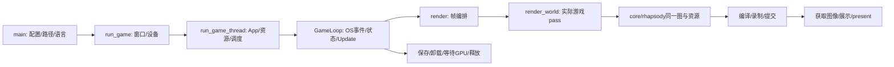

# Tiny Glade 当前实现独立审查与主链恢复

日期：2026-10-18。当前工作区：`games_test/tiny-glade`。

## 审查口径

本文件依据当前 Rust 函数体、真实 producer/consumer、ECS 类型身份、宿主调用和现场编译结果。历史完成率、函数数量、作者的“判等/闭合”标签不作为当前实现已完成的证明。

本轮恢复面向当前工程使用的 B 接口。默认分析数据库为 B patched EXE，原指令 oracle 为 B 发行 RNE；不将 C/rhapsody2 的地址、布局或调度直接移入 B 工程。A/B/C 文件组领取只用于避免并发覆盖。

## 当前上层包的实质实现

路径均相对于 `crates/`。以下是开始实施前的源码快照；后续修复必须单独记录，不能覆盖原问题。

| 包 | 已有实质逻辑 | 当前断点与直接证据 |
|---|---|---|
| water | 笔刷→core 栅格修改→历史→栅格回放 | `systems/water/src/water_audio_grid.rs:173` 写不存在的 water_level；174 将 Vec3 写入 [f32;2]，编译失败 |
| tree-tool | 放置/移动/删除/存储/历史 | hide_trees 空体；process_tree_cmds 固定 rotation/variant/flags；SpawnPrefabCmd 缺 ECS 消费桥 |
| forest | 栅格与建筑筛选、树实体生命周期、动画进度 | manage_tree_prefabs 发 SpawnPrefabCmd::default；tree_animation 的 packed/easing 结果未写回渲染数据 |
| timberframe | SparseInstanceBuffer 分配/实例写入/计数 | 矩形屋脊两条曲线均取 rect.as_curve2，点差恒零；圆梁朝向固定；plank flush 为空 |
| glade-border | 边界记录、显示请求、越界音效上升沿去抖 | core SignifierEntityBuilder::build 只插动画与 ID，未生成可绘制产物 |
| roof | 创建/编辑/删除动画/墙关联/历史 | RoofGeometryChanged 与 RecalculateRoofCmd 是独立事件；创建未插 RoofTiles；瓦片装配矩形上下文传 None |
| critters | 鸭轨迹/创建/避让/移动，羊目标与动画，鱼鸟群部分计算 | systems 与 core 使用两个不同的 Sheep 组件；鸟停靠点恒空，部分环境判断恒 false |
| clutter | 区域生成/候选排序/剔除/实体管理 | 最终实体没有 drawable；wet 射线 helper 恒 false；陷门条件 k==1 且 subtype∈{5,10} 不可达 |
| color | CPU 色表、石膏通知、颜色历史回放 | initializer 在重复 CPU schedule 中每次覆盖色表；主要交互、SSBO 写入未完成 |
| onboarding | 请求排序/抑制/提示实体管理/部分完成状态 | configure 忽略 schedule；载荷 seam 恒 0；hint_draw/render_hints 空体 |
| wall-constructor | 行切分/裁剪/洞口及部分几何 helper | from_curve_resolved 始终返回空 Vec；construct_walls 丢弃所有结果；construct_floors 直接 todo |
| decorator | 放/删/改、归档、历史写入、存储修改 | decorator_cmd_of 恒 None，尽管 core 已有 Decorator 回放变体；backup restore 未删除新增项/重建缺失桶 |
| toolbar | mei 输入/命中/拖动/导航/布局，部分按钮 | configure 仅注册四个局部系统，mei 主系统未调度；模式切换按钮、拍照、自动隐藏未完成 |
| tiny-glade | 窗口设置/监视器处理/部分帧渲染桥 | main、run_game、run_game_thread、GameLoop 主循环未实现；业务插件和资源供给未组成启动闭环 |

terrain 是额外分包，未混入上述范围。其编辑算法已有调用，但 core 历史生成仍拒绝 Terrain owner，回放转换也未接通。

## 跨包接口迁移问题

1. core 已有 ReplayCommand::Decorator，上层 extractor 仍恒 None，注释中的“core 变体缺失”已经过期。
2. core 已有 Wall/Gate/Halftimber/Roof 的颜色 SSBO trait，上层仍忽略库和上传。
3. core WaterGridCell 现为 position:[f32;2]、bits:u64、state:u8，water 使用旧接口，构成实际编译回归。
4. SpawnPrefabCmd 的发送不等于 spawn_prefabs 的调用；后者接收请求切片，当前缺事件→请求→实体组件的桥。
5. CoreRenderBridge 已连接同一设备、shader 库和 graph/session，但当前生产游戏循环没有调用它。

## 实际验证基线

2026-10-18，默认 features、`--lib --locked --offline`：

- 上述整组 cargo check 失败：system-water 的 E0609/E0308。
- 排除 system-water 后其余上述包 cargo check 通过。
- 原始日志：`/tmp/upper-source-audit-check-20261018.log`、`/tmp/upper-source-audit-other13-check-20261018.log`。
- 编译不证明游戏运行、画面正确或与原版等价；本次审查未做原版整链差分。

## 复用的逆向经验

原始经验入口：

- `games_test/reverse-engineering/tiny-glade/evidence/country-core-deep/PLAYBOOK.md`
- `crates/country-core/recovery/agent-team/planning/2026-10-17-recovery-sop.md`
- `games_test/reverse-engineering/tiny-glade/evidence/render-recovery/WORKFLOW_RESET.md`
- `games_test/reverse-engineering/tiny-glade/AI_REVERSE_TOOLS.md`

本轮采用以下具体经验，不继承历史完成状态：

1. PDB 的名字与实际行为可能错位；void()、空反编译和无 xref 都不能证明接口或业务为空。核对机器码、调用 ABI 和消费者。
2. Vec/Arc/枚举 niche 等布局知识仅用于解释原指令。实现复用 std/原锁定依赖，不手写容器、ECS 或派生胶水。
3. 先解决跨域共享类型与载荷，再连接消费方。不能用默认值、固定常量或近似载荷把主链“接通”。
4. Startup、OnEnter/OnExit、逐帧 Update 和卸载是不同生命周期，不能将所有已实现系统塞进同一个 Schedule。
5. 逐项核对分支极性、panic/返回、调用顺序、载荷、返回结构、排序和偏移；出现反编译跳表失败时读限定原汇编。
6. CPU 记录、事件、缓冲意图和真实 GPU 提交分别验证。提交 receipt 也不等于完成或 present 成功。
7. 以真实 consumer 驱动的可调用闭包为恢复单位；已有实现优先迁入生产入口，停止创建孤立候选 crate。
8. 先查 retained 原证据，但必须验证文件非空、身份与地址一致、工具无嵌套错误。此次旧 `0x140593b70_run_game.c` 是空文件，不能复用为恢复依据。

## 本轮主链与验收边界

主链每个环节需要同时记录：原入口地址与证据、实际 Rust 调用者、输入资源与类型、输出消费者、错误/关闭路径、验证结果。尚缺证据的调用不能替换为空操作或声明成功。

本轮正在取证与实施；本节不表示上图已经运行。新增代码、原始证据与尚未接通的主链环节见 [实施记录](IMPLEMENTATION.md)。
