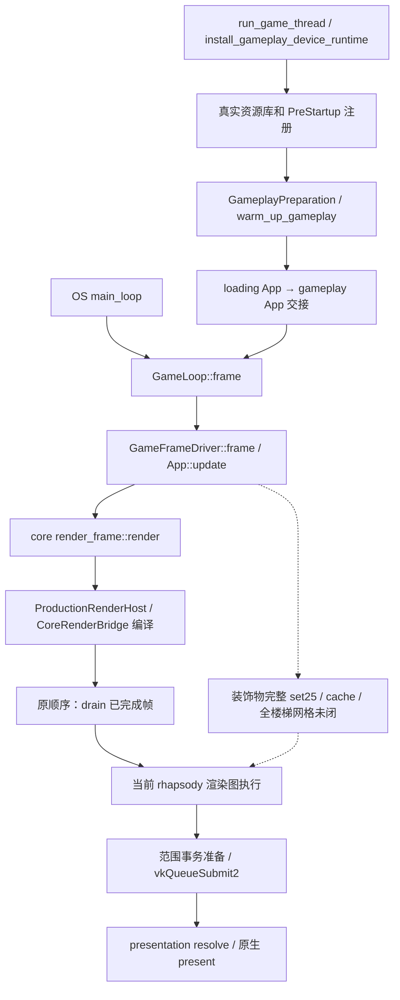

# 当前整合与真实阻点（2026-10-21 续验）

基线 `fa53d49a61dd7496cddc9af054c6fb1899fa1676`，本说明随本轮实现保存验证快照；测试执行于整合工作树，后续源码按各次冻结身份区分。本说明覆盖此前审计的状态描述；源身份和已完成日志见 `CURRENT-INTEGRATION-SOURCES.json`。用户已有 `startup_sheep.rs` 保持原字节，SHA-256 为 `b504d8977d44877eab4332f6afd7997a0e924077d44da2d7ea68a6736feb3786`。

## 完整世界为什么仍未验收

本机 M3 已实际执行到 Vulkan 设备创建和生产 ShaderHost 初始化。旧宿主请求 8192 sampled images、256 storage images、16384 storage buffers、64 samplers，合计 24896；MoltenVK 的真实 descriptor-layout support 查询拒绝该布局。旧适配只看 descriptor-indexing 分项上限，遗漏组合布局限制。对应版本 MoltenVK 源码与本机动态库指令已交叉核对，不能忽略 supported=false、裁剪资源数组或删除绘制绕过。

沙箱内设备枚举失败和真实 GPU 布局失败是不同问题。GPU 通过明确 ICD/loader 路径在沙箱外执行，强制 RHAPSODY_REQUIRE_VULKAN=1，禁止无 GPU 时静默跳过。旧链接磁盘耗尽已排除：只释放旧生成式构建缓存，未触及源码、原证、存档或当前执行输入。

完整分页接入后，真实世界越过布局失败，随后实际停在 App 更新：timberframe_beam_count_change_audio 的 EventWriter<PlayTimberframeSound> 未注册。原事件属于无条件的 add_audio_events（B 140941450），此前只在 native-audio 宿主注册。现已按原 16 通道顺序补到既有 startup_event_runtime，保持 App 每帧维护，没有关闭产生事件的业务系统。修复后重构建成功，实际续验已越过该错误；首次失败日志保留。

此前完整世界停在预热管线：原 shaders/nani_plaster.raster.hlsl 的顶点 shader 经 MoltenVK/SPIRV-Cross 转为 Metal 后，把 const device uint2 指针直接 as_type<float2>。已导出实际 SPIR-V/Metal；原 B 与当前 lowered IR 的关键 OpBitcast→OpLoad uint2 Aligned16→OpBitcast float2→OpPhi 链一致，spirv-val 实际通过。已按精确 Function uint32x2 变量载入→同型 PhysicalStorageBuffer 指针 cast 加入整数加零规范化，仅打断错误来源追踪，地址位不变；原物理 Load/Aligned16/float cast 均逐字保持。实际四项 CPU 测试通过（逐字还原、ID 上界、幂等、负例与生产入口），生产源码重构建后已在 M3 成功执行世界预热和后续 30 帧，原 Metal 编译错误已消失。

真实 loading WSI 首次执行还发现公共宿主安装器假定 PostUpdate 已存在。已用 Bevy 的 init_schedule 初始化缺失阶段并保留既有系统；实际 game_loop 八项回归通过。第二次真实窗口运行完成三帧及正常关闭，但独审发现原 any_presented 也把可恢复 OUT_OF_DATE/FULL_SCREEN_LOST 当作成功，故旧断言通过不足以证明 native present 成功。现保留原恢复策略，另记映射前 Result::Ok（含 SUBOPTIMAL）的饱和计数；28 项真实 swapchain 状态/错误矩阵回归通过。随后 v3 实际运行完成 3 帧、记录 3 次 native SUCCESS/SUBOPTIMAL 并正常关闭；二进制和日志身份单独冻结。该修改未添加任何空业务系统。

当前硬阻点已转为稳定性：上一轮 30 帧实际执行结束，测试失败于 shader bindless live drifts:6026..6059（跨度33，原阈值16未放宽）；设备分配 frame12 的1029.0MiB 到frame28的1053.4MiB仍增长。frame05→29的细分含136个256KiB host-visible块，以及两类device-local块，必须继续沿真实owner排查，不能以描述符页数量稳定代替全体无泄漏。

提交慢的具体原因已实测并修复：原上传读范围逐次重放整个已准备前缀；改为事务内保留准备状态，只追加原顺序的新后缀，保留所有范围、版本、依赖、预算准入及失败回滚。实际范围差分15项及取消保护5项通过。同一单帧真实GPU输入下，635个physical cells、3536个patches、4438个uses及1478个private reads均不变，状态准备11.1885秒→0.1219秒，rg_submit11.3071秒→0.2315秒；实际回读PPM逐字节完全相同。该约91.8倍/48.8倍仅指这个测量段和该帧，不宣称游戏FPS提升同等倍数。完整结果见 WORLD-PREFIX-RESULT-20261021.json。

常量池重复创建的独立缺陷也已修正：真实CoreGraphFrame::with_compute现在复用本App现有RasterShared owner，保留设备校验、独立公开构造接口和不同App隔离。实际Vulkan bridge回归7/7通过，含同页不重叠、取消后CPU租约内容保持、同设备不同App不共享。新30帧实际全部执行40.61秒，live漂移断言已通过，失败转为shader bindless peak keeps growing；原阈值未改。逐帧设备分配约921.9–922.4MiB，结束后submitted=completed1696，completed drain pending0→0、销毁0、字节不变；目前没有证据支持逐帧回收积压。后续内存/像素断言尚未正式执行，不能把设计修正算长稳通过。单帧退出后的真实completed drain释放53对象、34648064字节，idle_waits仍2；其位置在warmup/截图owner退出后，不能直接归因逐帧回收预算不足。

独立的原资源单帧内容测试实际1/1通过：480×270，mean_luma154.4、41882种颜色。已保存真实PPM和逐RGB字节保真的PNG；图像只是当前部分场景内容，不证明原场景视觉一致或未挂载业务完成。30帧测试的后续像素收敛断言尚未执行。

## 已落实的主链代码

- 默认无 FMOD feature 的构建恢复：同一 cfg 选择 GameplayAudioStudio，无后端使用不可实例化类型并进入既有 Disabled 分支。Critters/Sheep 生成、加载 reveal、卸载计时与八类清理所有者仍执行；Logo 的 native/disabled 动画互斥；WSI 入口传播真实 frame 错误。
- 绑定分页保留现有 rhapsody 架构与 shader ABI。共享同一 Vulkan layout，各页独立拥有 pool/set/slots；完整 draw/dispatch 组在一页准入，跨页重建全部索引，immutable push 不覆盖旧组。FrameGlobals 与 sampler 按页缓存；compute、raster、cache publish、with_push、M3 必经的 IndexedCountAdapter 均接入同一 pool。lease 按 GPU 完成退役，不用 wait_idle 或 CPU 复位代替。
- 分页完整接入后的实际默认 cargo check 通过，21.76 秒；三个集成测试入口构建成功，47.83 秒；本轮 native-audio feature check 也已通过。后续新增事件注册使用新输入单独续验。

## 实际 GPU 结果及范围

| 实际入口 | 结果 | 证明边界 |
|---|---|---|
| rhapsody 页原语 | 6/6 通过 | 共享 layout、独立索引与 lease 生命周期 |
| descriptor-layout 实测矩阵（显式执行 ignored 项） | 1/1 通过 | 1211 项可创建，1212 与原 24896 项真实查询拒绝，variable binding 不能替代分页 |
| bindless_shader_abi | 4/4 通过，0 ignored/skip | 强制五 buffer 小页迁移，真实 shader 写出 42/43/44，原 ABI 与 immutable push 保留 |
| 生产 typed VAO raster | 1/1 通过 | vertex、index、instance count 真实改变 GPU 像素，覆盖间接计数适配 |
| 生产 compute push/外部 buffer/外部图像 | 3/3 通过 | immutable push、外部资源声明、视图、像素与 lease 寿命 |
| 原资源单帧世界内容 | 1/1 通过，真实480×270回读 | 非黑图及内容检查通过；不等于原作视觉一致 |
| 增量范围准备单帧对照 | 1/1通过，旧/新PPM逐字节相同 | 同输入prepare约91.8倍、rg_submit约48.8倍；无删校验、无共享常量池混入 |
| 共享App常量池 bridge | 7/7实际Vulkan通过，无skip | 同App owner复用、取消租约保持与App隔离；不代替长稳 |
| 原资源世界30帧 | 旧433.80秒失败live漂移；新40.61秒live检查通过、失败历史peak增长 | 核查whole-pool同时峰值语义；后续内存/像素断言未到，完整长稳仍未通过 |
| loading WSI | v3 真实 3 帧、3 次 native SUCCESS/SUBOPTIMAL、正常关闭 | 可恢复过期结果不计成功，v2 仅作旧断言历史；不证明扫描输出完成 |
| 实际 gameplay 窗口 | 尚未通过 | loading present 不能替代完整世界与编辑 |

真实 gameplay App 的 240 次更新审计实际通过，distinct failures=0；这只说明已安装系统没有上报资源/事件参数失败，不证明未安装业务已完成。

这些成功结果均来自本机实际运行。窄测不外推编辑、卸载、存档或整场景完成。

## 已落实的业务修复

- 窗灯与 Nani 玻璃共用 canonical WindowLight，恢复六参系统、本地 RNG、连续插值、live retain、set36→既有 set44 上传。窗灯 8 项、builder 1 项、玻璃 6 项、连续插值 3 项实际通过；完整上游窗 producer 和 UI 命令尚未原子接入。
- 鸭子建筑反应恢复原编辑事件、真实建筑轮廓/标高/屋顶及 Duck 自有 quack。真实七实例音频工厂、轨迹 drain、WaterAudioGrid 移动音量已接入，保留原 log-once 0.3.1；本轮 system-critters 整包 lib tests 实际 35/35 通过。其余规划、姿态与历史差异仍分别跟进。
- 水声使用唯一 RaycastWorld 与真实 FloatGrid sampler；sample→eye 线段 max_toi=1.0，避免相机背后碰撞误遮挡。声明 native-physics，宿主使用原 Startup 和 set38 两个资源存在条件；保留 Demo 早退，不造默认水格。实际默认宿主水格/100+4 loops/Demo/加载卸载三项测试通过。
- 树工具恢复季节 prefab、本地 RNG、History/Event 顺序，19 项实际通过。完整五分支 signifier_factory 与水/边界 typed caller 配套恢复；Arc 工厂替代每帧泄漏。Demo ambience 3 项、builder 5 项通过。
- DecoratorInfo 原 tag6/30 字、subdivision 原 Curve 迭代器及 Rectangle corner edge directions 已接入。subdivision 5 项通过；原指令核实负 X 四元数符号后修正测试 fixture，没有改算法或放宽误差。本轮 Rectangle 6/6 与 glade-border caller 1/1 实际通过。

## 阻碍编辑与场景恢复的剩余缺口

碰撞基础已恢复原 SharedShape 内部 Arc 共享、四个 owned buffer 的独立 Clone、compound 与两个真实转换适配器；保留已有 bounded 查询。实际 native-physics collision 65/65 通过，不再为两个外层 owner 重建 primitive 几何。

canonical 装饰物四表、真实26分支loader、完整ID producer、typed caller及已闭合的动态几何已按统一合同接入28源最小包；真实cargo check第4次通过，14.40秒。前三次真实失败及三处机械导入修正留存，不将仅解析候选算编译。首次装饰物整包测试实际275通过/5失败，失败均保留并逐项取证；随后真实归档Option/所有权、显式操作ID及完整双楼梯requests等17源和两项直接依赖已接入，cargo check25.69秒通过。该批实际utils151/151通过，core2817通过/14失败/1ignored，decorator334通过/6失败；其中资产路径及旧fixture问题正在修正，不以大多数通过算全包验收。原安装树full/demo验收已实际2/2通过，四表各52/34键、原始网格/shape/描边顺序与Arc共享均核实。更正旧fixture后，当前实际全lib结果为core2831通过/0失败/1ignored、decorator340通过/0失败/2ignored、utils153通过/0失败；另曲线属性7/7和退役OOM回滚9/9通过。gothic wall window当前只做typed迁移，cache/validator及视觉宿主尚未挂载。不能把其复杂碰撞几何简化为静态Arc或包围盒，不能以数据接入替代编辑完成。

原装饰物视觉 helper 当前没有在游戏宿主安装；直接挂旧 helper 会撞上错误顺序与未恢复 cache/stairs。按原 set25 恢复 cache→derive→clear/generators→colliders→flush→copy→unleash→UI，同时补原 set10 洞口每帧清理及原两处碰撞 flush。validate_blueprints/clear_tracking、UI 闪灯 producer 与完整卸载仍需闭合核查。

后续验收依次为完整世界 30 帧、真实 WSI、长稳、编辑/保存/跨进程重启恢复。各项独立记录，失败和未执行项不以窄测覆盖。

## 协作与效率

最多 8 个活动 agent，root 独占生产源修改、Cargo、GPU 与 Git。其余提供冻结原证、候选和独审，复用原任务归属与既有 B 数据库，不重启共享 worker。工具连通和候选交付不计业务恢复；通过的相关窄测不无故重复，新增输入或具体失败仅重验其闭包。

本轮可复用的具体经验：

- 用真实 App 更新审计集中检查缺资源/缺事件，失败仍判失败，再跑完整世界；避免每次昂贵预热只暴露第一个参数错误。
- Vulkan 组合 descriptor-layout support 必须真实查询，不能由各类 descriptor-indexing 上限推断。逻辑资源容量与单物理 set 的容量分开，完整资源组才是迁页单位。
- 管线预热错误必须保留 shader 主路径、类型、附件、samples 和原错误类别。source_dependencies 首项可能只是公共 include；只有泛称初始化失败会浪费下一次 GPU 运行。
- 区分真实安装包原始 shader、已有 lowered artifact、驱动 dump 和手改实验。spirv-val 成功不代表 Metal 后端正确；先对照原指令链，再做可逐字还原的后端等价变换，最后必须从生产 Rust 入口验证。
- present 错误恢复映射出的 Ok 不等于原生成功；在原始 native result 映射前记数并测试 OUT_OF_DATE 等反例，不能让验收标记替代事实。
- 原复杂业务先闭合直接 consumer、权威状态与所有权，再挂宿主；正确 Clone 应深拷 owned buffer、共享原 inner shape，不用重建几何或新增镜像表躲接口缺口。
- 日志、源输入与实际二进制分别绑定身份；零条命中、ignored、无 GPU skip、候选解析成功都不计已执行业务验证。独审发现旧证明不足时保留历史并收紧新验收，不能覆写旧日志。
- 性能先把CPU准备、真实驱动提交和等待分别测量，再对热点做保事务语义的改进；保留相同输入规模、逐字节像素及失败路径差分。同池复用与GC是独立变量，分开运行才可归因；已完成后又释放owner形成的retire不能直接解释为预算不足。

## 本轮收口与下一阶段

用户要求本轮核心业务收束后提交并推送，再优先渲染性能和画面完整性。最新整池峰值实际30帧仍失败：54.64秒、live3042..6022，真实同时peak6022保持不变；该运行绑定WORLD-HIGHWATER-30-RESULT-20261021.json。窗口路径与headless helper的完成维护顺序正在核对，未修改steady起点、阈值或采样值；headless维护V1因提前改变compile失败副作用顺序被独审否决且未应用，保留完整compile→begin/drain→execute证据后再验。

真实GameLoop WSI验收已在既有original_loading_present入口增加显式模式，独审通过；要求loading→gameplay真实交接、同World非空draws、唯一receipt、至少12次游戏native present成功，以及真实保存线程owner启动和关闭后的detach。它尚待本机执行，不以加载专用三帧代替，也不证明编辑落盘与重启恢复。

完整楼梯插值六资源consumer与Curve3XZ原构造策略已实际接入；追加验收system-decorator350/0失败/2ignored、utils156/0失败，18.67秒构建，13项新测试均执行。cache9331B目前只有完整原证合同，607B方向函数、真实Info63 producer及完整楼梯网格仍缺实现；本轮不挂视觉宿主，下一阶段按真实画面producer需要继续闭合。

最后十源校验闭包已实际合入：完整验证器、全部11类原因与原反馈顺序、真实描边/光标工厂、位置校验、静音事件读者及同App注册。最终V4实际core2838通过/0失败/1ignored、decorator378通过/0失败/2ignored、utils160通过/0失败。首次编译缺测试依赖，已仅在dev-dependencies启用既有test-support；其后三个失败由独审确认为输入准备或Empty网格访问器误用，只修测试、保持生产函数与全部浮点期望。所有失败日志保留。默认生产check24.65秒及native-audio check28.24秒均通过，生产不启测试特性。

以下是当前真实接口关系，虚线部分保留未闭合的业务前提：

提交之后按用户优先级推进：先执行新headless V2和真实GameLoop WSI验收，保持原全部稳定性与像素断言；随后对优化构建作CPU/GPU分段测量，以实际热点修当前rhapsody。画面完善沿真实缓存、楼梯网格及场景分支producer补齐，不挂缺前提宿主、不造替代几何。编辑、落盘和跨进程恢复仍独立验收。

提交前原世界、真实WSI、CoreRenderBridge三个宿主测试入口已实际构建通过（4.79秒）；首次仅新增bridge测试误读私有device字段，已改用现有公开device()，未扩大可见性或改生产逻辑，失败JSONL保留。新GPU执行按用户顺序放在本轮Git推送之后。
