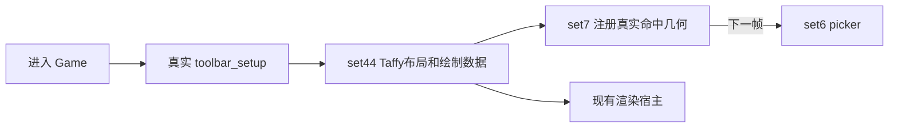
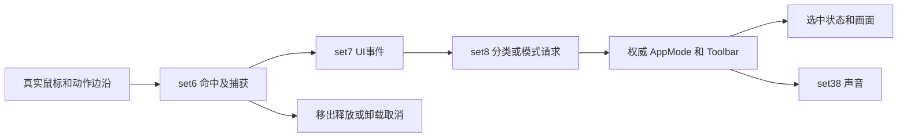
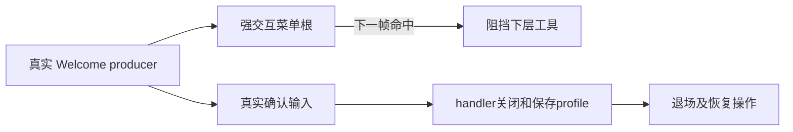
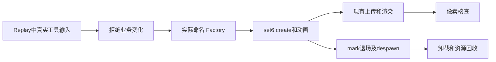
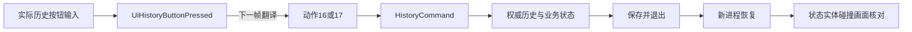
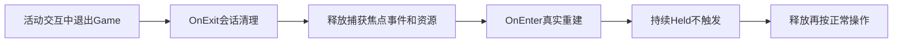

# 业务流恢复台账

当前模块：**1 公共交互／toolbar，用户要求停止，阶段性提交，未验收**。用户最新限定只完整完成本模块，验收后停止，不进入地形或后序模块。本文件合并维护状态与业务流合同，优先增量修改现有文件，不为模板拆出多套文档。旧报告、候选代码及临时日志只作为指定版本的历史证据，不是平行进度表。

## 规则与完成门槛

正确性最高优先，完整恢复原版复杂算法、数据结构、边界和生命周期；优化保持语义并验证性能。沿用现有基础库、渲染链与共享资源 owner。禁止近似／占位／假成功替代生产实现。

每条流区分原版行为、当前实现和已执行验证；状态依次为待取证→合同确认→生产接通→局部验证→整链验证→模块验收。下表的限定说明必须保留，不能把“接通”读成“通过”。当前模块五项全部交付后才进入下一模块：

1. 真实输入触发原业务逻辑。
2. 权威状态、实体、碰撞和画面同步。
3. 完整撤销／重做、保存／新进程恢复。
4. 删除、卸载、再次进入没有残留。
5. 原证核对和实际链路通过。

历史、存档、音频和渲染贯穿每条流；不适用项写明理由与禁止副作用。最后联合验收只验证共同运行，不补前序缺项。性能记录实际 Release 窗口 960×540 的持续 FPS、1% low、p95/p99 与资源变化；60 FPS 最低、120 FPS 合格，软件 Vulkan 与目标硬件结果分开。

## 当前 toolbar 流

| 业务流 | 当前结论 | 关系图 |
| --- | --- | --- |
| [T1 启动、建树、布局、可见与命中](#t1-startup-layout) | 本轮建树及输入链通过；实际窗口与连续呈现待验 | 图 |
| [T2 鼠标选择、释放、取消与工具切换](#t2-mouse-tool) | 本轮真实输入、取消及切换通过；窗口待验 | 图 |
| [T3 键位、导航、确认与返回](#t3-keyboard-navigation) | 局部验证通过：20原侧非空树对照及实际键盘链；窗口待验 | 图 |
| [T4 Welcome 与菜单输入仲裁](#t4-menu-arbitration) | 整链局部通过：真实Welcome阻挡与确认关闭已通过；实际窗口待验 | 图 |
| [T5 Replay 禁止提示、画面与释放](#t5-replay-signifier) | 局部GPU整链通过：实际像素与卸载释放；窗口待验 | 图 |
| [T6 实际历史按钮与磁盘恢复](#t6-history-persistence) | 实际按钮与三次新进程磁盘恢复通过；完整菜单保存入口待验 | 图 |
| [T7 卸载、重入与无残留](#t7-session-lifecycle) | 本轮 Held 重入与旧事件清理通过；完整会话资源待验 | 图 |

执行优先级：源码／日志核对与本地产物空间→统一局部与旧输入复验→T4 菜单修复复验→T5 Replay 像素及释放→T6 实际历史和新进程恢复→窗口／资源／性能→模块验收。原侧、实现、接线和独立验证围绕同一条当前业务流推进。

## 已有证据的适用范围

- `/tmp/toolbar-module-physical-run.log`：旧源码的 4 项真实输入链通过，覆盖建树鼠标切换、移出取消、键盘导航、Held Reload。
- `/tmp/toolbar-module-chain.log`：历史证据：旧源码 Welcome 曾穿透；本轮 `/tmp/toolbar-flow-chains.log` 已验证修复后 Welcome 1 项与 focus 2 项通过。该轮 T6 真实写盘失败，不是整个测试批次通过。
- [audio-validation.json](audio-validation.json)：78 次原侧执行、77 个 Rust 可构造样例、6 项通过；含指定源码指纹，验证声音边界而非实际可听播放。
- `/tmp/toolbar-module-lib.log`：旧源码 86 通过／1 失败，失败是原 panic 保留测试的预期字符串与实际 SlotMap panic 不符；不能称全部通过。
- Replay后续已执行通过，见本轮中央复验；`/tmp/toolbar-flow-lib.log` 的不完整摘要不作通过证据。

临时日志可能被清理；下一次运行必须保留精确命令、源码指纹、环境、退出码与可复核结果，并更新所属流。文档内源码指纹是初建静态快照，不追溯绑定旧日志。

## 全局薄索引与进入条件

| 顺序 | 模块 | 依赖／进入时展开的合同 | 当前状态 |
| --- | --- | --- | --- |
| 1 | 公共交互／toolbar | 启动、相机、MEI；详见上方七流 | 当前恢复中 |
| 2 | 地形编辑 | toolbar验收；真实readback／hover／focus→高度、采样碰撞、历史、渲染 | 未进入 |
| 3 | 路径→花园→水 | 地形与共享栅格；分别闭合绘制、记录、回放、上传并分别验收 | 未进入 |
| 4 | 墙体／规则建筑 | 交互、地形栅格；采样、吸附、合并拆分、高度、构造支撑、楼板、门栅栏及半木、删除 | 未进入 |
| 5 | 屋顶 | 墙权威与建筑几何；类型、构造、碰撞、瓦片、历史、删除 | 未进入 |
| 6 | 楼梯／平台／扶手 | 墙、屋顶、地形；完整cache、主网格、支撑扶手、碰撞、视觉宿主 | 未进入 |
| 7 | decorator | 墙→屋顶→楼梯；放置移动旋转、命中validator、set25、完整卸载 | 未进入 |
| 8 | 颜色自定义 | 交互与墙屋顶装饰物；菜单状态机、真实触发、应用、历史、GPU | 未进入 |
| 9 | clutter／ivy | 建筑、装饰物、地形；生成更新删除、碰撞上传与生命周期 | 未进入 |
| 10 | 树→森林→小动物 | 地形建筑碰撞；逐个完整行为及生命周期，优先消除鱼鸟算法近似 | 未进入 |
| 11 | 菜单／设置／主题／提示 | 已验收业务消费者；页面命令、会话切换、提示，入口对应实际功能 | 未进入 |
| 12 | 整游戏联合验收 | 前11阶段各自验收；混合编辑、历史、保存退出、新进程、窗口连续帧及资源 | 未进入 |

关键依赖：墙→屋顶→楼梯→decorator→clutter／ivy。后序模块不提前展开整套实现；只解决阻断当前流的接口。

## 跨模块接口及管理

- [SIGNIFIER-CONTRACT.md](SIGNIFIER-CONTRACT.md) 记录完整 Factory 所有权与后序 Raw 生产者整改条件；terrain、wall、stairs、decorator 等进入所属模块时恢复名字、捕获、几何、shader、动画、pass和闭包。toolbar Replay 不依赖这些 Raw，不能伪造空实体来静默通过。
- 中央维护唯一合同、共享接口与源码冻结；原证专项交行为边界，实现专项交生产修改，验证专项从真实入口独立核查；中央承担接线、唯一 Cargo／窗口运行与验收。
- 每次派工锁定流、允许写入范围、输入合同与退出条件；canonical 类型与共享 owner 改动同批更新全部消费者。变更后仅重核受影响闭包，但不得继承已失效的通过结论。
- 网络命令按进程清代理并直连；仅用本地磁盘，禁止 `/home/ubuntu/ds-download`。空间不足只清可再生成本地产物。

## 本轮中央复验更新

B 目录归并后，`/tmp/toolbar-b-chain.log` 退出码0：Welcome菜单真实遮挡1项、输入／历史／重入7项、Replay像素与释放1项通过。历史测试跨三个新进程执行真实Undo/Redo按钮、原保存worker同步Flush和原恢复loader，保存于撤销游标时保留重做尾，再恢复已应用墙记录并撤销。初始墙记录是合法已提交fixture，不能据此宣称墙构造输入、碰撞或GPU完整验收；保存由原assembler/worker触发，未覆盖菜单SaveGameCmd入口。

- `/tmp/toolbar-flow-lib-final.log`：此前toolbar库89/89通过，含20个非空原侧树对照；B归并后 `/tmp/toolbar-b-lib.log` 再次89/89通过。
- `/tmp/toolbar-flow-core-ui.log`：此前UI 41/41通过；声音6项及原侧78次执行见audio-validation，均不代表硬件可听播放。
- `/tmp/toolbar-b-window-build.log`：独立主线程真实窗口入口已编译；第一次实际启动在首加载帧因物理设备包装未挂接而panic，见`/tmp/toolbar-b-window.log`，已通过WM_DELETE正常请求退出。未计为窗口通过。
- 当前并行渲染更新已将vram查询接至现有Device的properties和驱动预算快照，不另建设备或回退渲染架构。窗口v2已通过实际启动进入gameplay；240秒截止时仅22个gameplay receipt，phase0尚未到Welcome交互，退出码1（`/tmp/toolbar-b-window-v2.log`），不是通过。软件Vulkan完整启动耗时较长，v3保持相同业务、960×540与画质，将总诊断期限延至1800秒，增加原startup日志。v3已确认完整启动与gameplay呈现；旧测试只观察world_rendered=true，菜单静态capture会停止测试阶段推进，因此中央通过真实WM_DELETE结束旧入口（退出码1，不计通过），改用包含Main静态capture receipt的完整链入口。当前环境仅bochs-drm显示设备，没有目标硬件GPU；Debug软件Vulkan不作为目标硬件高性能验收。

## 文件与性能约束

正确性优先，同时要求高性能。原算法复杂也必须完整实现；性能优化不得改变业务结果、边界或生命周期。只在真实职责隔离、独立运行入口或可复现原证需要时新增文件；优先扩展现有模块和测试，不新建平行实现、重复台账或逐项模板目录。未做目标硬件Release实测，不称性能合格。

## t1-startup-layout

**T1 启动、建树、布局、可见与命中**

## 边界与原版行为

进入 Game → toolbar_setup 构建普通／摄影工具栏与历史按钮 → Taffy 实际布局 → 可见画面与对应命中区域。缩放、四边对齐、隐藏／重显后，画面和真实命中必须一致。

以 toolbar-input-evidence 的 toolbar-widget-producer.asm、get-ui-volume.asm、hide-ui.asm 及 phase2-toolbar-layout 的实际构造、样式、调度原证为依据。普通工具、摄影工具、历史按钮不能用单一假按钮替代；隐藏时焦点处理保留完整原分支。

### 当前生产链与权威所有者

OnEnter(Game) 注册 toolbar_setup；mei_host 在 set44 执行文本测量、finalize、perform_layout、update_drawables，再执行 mei_post_update 和 flush。set6 picker 消费上一帧注册，set7 render_taffy_ui_to_widgets 为本帧提供真实屏幕几何，不可把同帧构造视为即时可命中。

TaffyLayout、ToolbarLayout／UndoRedoLayout 和 MeiContext 分别持有布局与节点；UiState 持有真实 WidgetParams。Ui2dExtent、UiMouseInteractable 与核心同名组件必须是 canonical 身份，禁止镜像组件。

布局、hover 和动画是瞬态，进入会话时重建；用户配置沿用 GameConfig／现有配置 owner，不序列化 Taffy node 或实体 ID。UI 不生成世界碰撞体；隐藏／布局变化不得改写世界权威几何。

### 已执行证据与未闭合项

旧 /tmp/toolbar-module-physical-run.log 的 startup_layout_and_canonical_device_edges_switch_real_water_category 通过；旧 toolbar --lib 有 86 通过、1 个 panic 文案断言失败，不能声称整库通过。尚缺最新整合版本、四边缩放／隐藏、实际窗口画面及稳定性。


摄影按钮本轮补正（待中央编译／实际输入复验）：按 B `crates/systems/toolbar/src/photomode/photomode_buttons.rs` 的 PDB 完整签名和原 `14234c230` 分派，tag5 只发真实 PhotoModeCmd(next)，tag9 发 PhotoModeCmd(4) 接现有截图 gather；反编译 grow_one 的 WindowFocusEvent 是错误类型别名。tag16 按机器码 `14234ca52..14234ce42` 恢复 MainCamera 当前 focus 的 2→2、3→0、其它→3 及有效位置载荷搬运，不复制原未初始化寄存器的非活动 union 字节。tag6 原样发 PhotoModeCmd(6)，完整／demo 树均无该生产者，不能声称存在相机6。tag4 恢复 RuntimePlatform0／1 的 SteamdeckScreenshotMsgScreen 通知，桌面发 OsWindowCmd、按原 create_dir 成功后 open；截图目录必须由现有宿主初始化为 paths::config()/screenshots，不得缺资源静默成功。

原证使用既有 `reverse-engineering/tiny-glade/tool-usage/jobs/toolbar-c/decomp/0x14234c230-photomode_buttons.txt`，并直接反汇编本地原 EXE 核对焦点载荷及截图常数4。现有 photomode.rs 单元测试补真实系统分派、六相机 focus 有效载荷、平台消息／OS 分流与目录创建失败分支；这不代表实际文件浏览器打开、截图文件写出或窗口像素已经验收。平台0／1说明弹窗现补原 root `steamdeck_screenshot_msg`、原 `steamdeck/screenshot_msg`／`gfn/screenshot_msg` 模板和 answer 插槽，使用 lang_lib::lookup("Ok") 与 menu_hotkey19，只有真实 used() 才关闭。既有 photomode.rs 测试通过真实 MEI pre_update 和确认动作覆盖两平台关闭，待中央执行；没有把实际全平台窗口验收提前标通过。原 pin 搬运指令是 movsd／movlps 的8字节有效 Vec2，focus 距离+0x18不改，非活动 union 未定义字节不列入业务恢复。


```sh
cargo test --offline -p tiny-glade --test toolbar_module_chain startup_layout_and_canonical_device_edges_switch_real_water_category
```



## t2-mouse-tool

**T2 鼠标选择、释放、取消与工具切换**

## 边界与原版行为

真实鼠标移动／按下／保持／释放 → 动作边沿 → 命中与捕获 → 工具分类或模式切换。释放在按钮外必须取消；背景输入抢占后不得误触世界编辑。

ui-update.asm、toolbar-widget-producer.asm 和 toolbar-steal-mouse-input.asm 定义捕获阶段、命中 volume、背景抢占与原常量。背景抢占修改原消费者所需输入值，不得任意清除 ActionSetStates。

### 当前生产链与权威所有者

set6 hover_intersection → ui_update → signifier 消费者 → mei_pre_update；set7 将 toolbar 几何和捕获结果转换为 UI 事件；set8 toolbar_steal_mouse_input 后执行按钮消费者；模式消费者更新权威 AppMode／Toolbar 并发布完整 AppModeChanged，set38 处理声音。上一帧命中注册与事件维护必须保留。

UiClickEvent／UiDragEvent 来自 toolbar::ui_interaction；RequestToolbarCategoryChange／RequestAppModeChange 来自 country_core::systems::mode_manager；ModeJustChanged 是 AppModeChanged 的 re-export，不能定义第二个同名事件。UiState 的捕获 Arc 拥有 WidgetParams，AppMode／Toolbar 是模式权威。

选择工具本身不另造世界历史事务；随后业务编辑由所属模块记录完整历史。鼠标捕获、冷却、hover 和事件不进入存档，卸载时释放；当前工具的持久化行为由原版／现有会话 owner 继续核定。音频 dispatch 已有原侧差分，但可听播放仍未验证。

### 已执行证据与未闭合项

旧物理链中 water category 切换、outside release 取消通过，4 项总数包含 T3 与 T7。audio-validation.json 记录 78 次原侧执行、77 个可构造 Rust 样例、6 项测试通过；这是指定源码的声音边界证据，不是窗口播放或全模块通过。最新输入抢占与世界不误触仍需整链验证。


```sh
cargo test --offline -p tiny-glade --test toolbar_module_chain
```



## t3-keyboard-navigation

**T3 键位、导航、确认与返回**

## 边界与原版行为

用户配置键位 → translate_input → ActionSetStates → 导航树／空间搜索 → 确认或返回。覆盖普通环、横纵链接、锚定菜单、方向相消、严格平局、隐藏节点、失效实体与焦点恢复。

ui-nav-update.asm、ui-nav-subtree.asm、ui-nav-subtree-search.asm 与 ui-nav-manifest.json 约束完整搜索。遍历次序、方向优先级、严格距离比较、父兄弟与锚点入口必须逐分支保留，不能以最近按钮近似。

### 当前生产链与权威所有者

mei_pre_update 处理 MEI 动作；set7 ui_nav_update 在真实组件和 Taffy 树上执行，横／纵 UiNav 链由实际构造者提供；mei_post_update 在 set44 完成本帧节点导航。实际键位从设备和 profile 表翻译，不手写目标 UiClickEvent 充当真实验证。

UiNavState／UiFocus 属于 country_core::systems::ui::resources::widget_params；实体 payload 必须使用完整 Entity 身份。TaffyLayout 持有树；UiNav、UiInteractionState 与规范 UI 事件使用生产类型。

焦点／导航缓存和按键长按相位属于瞬态，退出会话清除；配置键位由 profile／配置 owner 保存，不写入新 toolbar 存储。确认后的业务历史、声音与持久化转交真实消费者。

### 已执行证据与未闭合项

已报告 20 个非空原侧场景；production_navigation_matches_recorded_nonempty_native_trees 已在源码，当前统一运行未确认。旧 configured_keyboard_navigates_real_toolbar_ring_and_confirms_water 已通过；不能据此覆盖菜单、所有边界或当前源码。


```sh
cargo test --offline -p toolbar --lib production_navigation_matches_recorded_nonempty_native_trees
```


## t4-menu-arbitration

**T4 Welcome 与菜单输入仲裁**

## 边界与原版行为

Welcome／菜单真实 producer 建树 → 菜单阻挡下层工具 → 真实 Enter handler 关闭并写 profile → 退场完成后再次选择工具。验证渐隐、焦点切换与下一帧命中注册。

mei-interactive-registration-original.asm 明确 interactive = !IGNORE_INPUT && (FORCE_INTERACTIVE || content.interactive())。空内容的强交互根也必须注册；不能用 has_content 排除，更不能额外放置测试挡板。

### 当前生产链与权威所有者

mei_pre_update 已修复强交互空根过滤。真实菜单 producer 与 set44 布局生成节点，下一帧 set6 命中；Welcome handler 写 WelcomeScreenState／GameProfile 和 SaveGameProfileCmd。set7 toolbar 不应产生下层 UiClickEvent，退场后应恢复。

MeiContext 持有菜单树及 handler；UiState 捕获实际 WidgetParams；WelcomeScreenState、GameProfile 和 SaveGameProfileCmd 使用 country_core canonical 类型。菜单可见状态不等于实际阻挡，须检查权威 AppMode 未变化。

Welcome dismissal 由 GameProfile 与现有保存命令持久化；菜单节点／焦点／淡出是瞬态。撤销不应重新打开欢迎页或记录世界编辑；菜单关闭和会话卸载都要释放节点与捕获。

### 已执行证据与未闭合项

/tmp/toolbar-module-chain.log 记录真实 Vulkan、字体、原配置测试失败：点击显示中的 Welcome 下层，AppMode 实际 Water，期望 Path。修复已落；截至本文写入，修后尚无通过日志。旧 focus_chain 2 项通过，仅覆盖 canonical focus→onboarding 提示消费者，不能覆盖 Welcome 仲裁。


```sh
cargo test --offline -p tiny-glade --test toolbar_menu_chain -- --nocapture
```



## t5-replay-signifier

**T5 Replay 禁止提示、画面与释放**

## 边界与原版行为

Replay 中真实按下普通工具 → 业务切换被禁止 → icon_cross 工厂生成真实提示 → 鼠标跟随、动画、上传和可见像素 → 取消／卸载后实体和瞬态网格释放。

toolbar-replay-signifier.asm 与本目录 SIGNIFIER-CONTRACT.md 定义完整 Factory 所有权。create/mark/animation/despawn 的标准哈希、完整 WidgetId、同帧快照、唯一 Arc 检查、NaN 边界和退出动画均不得简化。

### 当前生产链与权威所有者

现有 toolbar_plugin::build 按 B 版原归属注册，把 create→mark→animation_t→animation_transform→despawn 接入 set6，位于 ui_update 后、mei_pre_update 前，使用 chain_ignore_deferred。Replay deny 的真实 Factory 在工具注册链产生；复用现有 CoreRenderBridge、资产库和视觉宿主，禁止重写渲染或生成空提示实体。

UiSignifierStream 传递命名工厂，捕获的 Arc<WidgetParams> 持有工厂列表；create 统一附加 SignifierId(hash, 完整WidgetId)。AssetMeshLibrary 与现有 GPU owner 持有实际资源；后续 Raw 数字生产点不等价于完整工厂。

Replay 拒绝不得产生模式切换或世界历史。提示和跟随状态均为瞬态，不进存档；标记删除后动画退到 t==0 才删除，OnExit 清请求并交由现有会话卸载释放实体／网格。CPU实体删除不能单独证明GPU回收。

### 已执行证据与未闭合项

`physical_replay_denial_builds_follows_rasterizes_and_unloads_the_real_cross` 本轮在 `/tmp/toolbar-b-chain.log` 通过：实际 Vulkan、原 shader/texture、非零像素readback、鼠标跟随及卸载后像素归零、实体和瞬态网格移除。尚不能据此证明真实窗口中的重复创建删除与完整GPU资源基线恢复。


```sh
cargo test --offline -p tiny-glade --test toolbar_replay_chain -- --nocapture
```



## t6-history-persistence

**T6 实际历史按钮与磁盘恢复**

## 边界与原版行为

实际 undo／redo 按钮命中 → 历史按钮动作翻译 → 权威 HistoryCommand 消费 → 已有合法业务记录改变 → 保存 → 退出 → 新进程恢复同一完整状态。不得手发目标历史命令代替按钮输入。

phase2-undo-systems 与真实 UndoRedoLayout 构造证据确定按钮载荷和布局。translate_input 原行为只取最后一个 UiHistoryButtonPressed：0→digital[16] undo，非零→digital[17] redo。模式管理的 recording guard、延迟与历史 owner 不能绕过。

### 当前生产链与权威所有者

UndoRedoLayout 已构造 HistoryButton::UNDO/REDO。set7 render_taffy_ui_to_widgets 写 UiHistoryButtonPressed；输入翻译消费前帧事件并计算动作边沿，mode_manager 把对应动作转成 HistoryCommand。事件维护与调度必须允许跨帧消费，不能手工提前 drain。权威 history replay 与实际存档消费者仍需完整追踪验证。

HistoryButton 属于 toolbar；UiHistoryButtonPressed 属于 country_core::systems::backend::input::calculate_input_delta；HistoryCommand／RequestHistoryCommand 属于 mode_manager。HistoryTransactions 与各业务记录／snapshot owner 持有完整数据；UI 不持有第二份 history。

复用已有合法记录及历史／存档入口；恢复实际状态并重建实体、碰撞和画面。按钮实体、焦点和冷却不存档。若当前无可用的合法记录链，登记明确阻断，只补闭合此流所需接口，不提前声称地形恢复。

### 已执行证据与未闭合项

`/tmp/toolbar-b-chain.log` 已通过实际按钮→权威游标变化→原worker同步落盘→三次新进程原loader恢复，验证单条CreateWall记录的游标、未来重做分支与墙存在性。初始记录是合法fixture；`/tmp/toolbar-b-history-fields.log` 退出码0、7项通过，新增完整SavedMultiEdit payload、identity、undo_anchor、墙authority/cache/height/elevation及实际WallColorIds owner=7跨进程一致性断言。菜单SaveGameCmd、snapshot、碰撞与GPU不在该通过范围。测试复用既有toolbar_module_chain/history.rs，不另建持久化业务。


```sh
cargo test --offline -p toolbar --lib setup_builds_the_original_tree_and_history_button_payloads
```



## t7-session-lifecycle

**T7 卸载、重入与无残留**

## 边界与原版行为

拖拽／导航／提示活动中退出 Game → 释放会话持有 → 再进入重建 → 持续 Held 不误触 → 释放并新按下后正常操作。覆盖旧实体、焦点、事件、鼠标抑制与瞬态 GPU 资源。

原版 ui_update 跨缺失注册帧保留捕获 Arc；未发现原版独立 direct Reload reset。当前 OnExit 清理是明确的宿主工程修复，与原算法差分分开核验，不用伪 Escape／Shutdown 或制造输入边沿代替。

### 当前生产链与权威所有者

B 归属沿用 `crates/systems/toolbar/src/menu/load.rs` 和 `crates/tiny-glade/src/run_game.rs`；当前菜单函数仍由 `menu::load::ui` 对外导出。普通加载菜单由真实缩略图点击解析历史，提交 `NextSession::from_parsed`、设置 Reload 并关闭菜单，不经过 MetaCommander。MetaCommander 的 LoadSession 是 timelapse 等脚本入口，Replay／LoadGame 中延迟执行，不能代替真实菜单验证。

生产状态顺序为：Game→Reload 的 OnExit 先 begin_glade_unload，再 uninit_clearing／despawn；Reload Update set33 的 clear_canvas 消费 ClearCanvasCmd(false)，清历史、回放、墙、地形、栅格和颜色；PostUpdate 请求 Game；下一帧 OnEnter load_game_session 消费 NextSession，发布 ActiveSession、LoadGameManager 和 AppMode::LoadGame，再由真实加载器恢复目标会话。

toolbar_plugin OnExit(Game) 另注册 clear_toolbar_session，清 UiState widget／交点／interaction、UiNavState、UiSignifierStream、MeiContext 会话节点和 UI 事件，发 Unsuppress(origin1) 与默认 brush preview；保留字体表和配置。OnEnter(Game) 真实重建。实体及资产释放还需与既有会话卸载 owner 合同核对。

UiState 是捕获 Arc owner，MeiContext 是节点与字体／配置 owner，UiNavState 是焦点 owner；Events 容器使用生产 canonical 类型。全 Entity ID 和 WidgetId 必须区分新旧会话。共享字体／配置保留不算泄漏，旧会话实体或网格保留则失败。

toolbar 清理只清瞬态 UI；完整会话卸载由 clear_canvas 清空旧会话运行态，再由加载器恢复目标会话历史，不能把“保留已保存业务”误写成保留旧会话内存历史。退出前的保存与新进程恢复由 T6 及业务 owner 核查；持续 Held 不应转换成新 JustPressed。删除、卸载、重入分别核对 CPU／GPU 活对象基线。

### 已执行证据与未闭合项

本轮 `/tmp/toolbar-b-chain.log` 中 Held 捕获释放及旧 UiHistoryButtonPressed 清理验证通过，但 fixture 是手调命名 OnExit 内的 toolbar 清理／despawn，再手调 toolbar_setup；未经过 MetaCommander 或菜单请求、StateTransition、完整卸载、set33 clear_canvas 和 startup_session，不能表述为完整会话 Reload 链已通过。T6 的三新进程历史测试和 T5 的提示像素／释放测试分别成立，也不能替代此链。

最小待验链：在真实 gameplay App 通过加载菜单缩略图选择另一合法存档，让生产状态机自行 Game→Reload→Game，并继续跑加载／回放至正常工具态；核对旧实体、Arc 捕获、MEI 节点、焦点和待消费历史按钮事件释放，目标 ActiveSession／History identity／游标及完整记录正确，旧墙／栅格／颜色与瞬态 GPU 对象不残留。保持鼠标 Held 跨状态切换不误触，释放后新按下可正常操作；再反向切回并重复，核资源基线不增长。不得手发目标 NextSession、直接改 State 或手调清理函数来声称真实入口通过。完整窗口连续帧和所有取消时机仍待验。


```sh
cargo test --offline -p tiny-glade --test toolbar_module_chain held_mouse_reload_releases_old_owner_and_requires_a_fresh_physical_press
```



## 统一源码与原证引用

- [toolbar_plugin.rs](../../crates/tiny-glade/src/toolbar_plugin.rs)
- [mei_host.rs](../../crates/tiny-glade/src/mei_host.rs)
- [toolbar_startup.rs](../../crates/systems/toolbar/src/toolbar_startup.rs)
- [ui_interaction.rs](../../crates/systems/toolbar/src/ui_interaction.rs)
- [toolbar_module_chain.rs](../../crates/tiny-glade/tests/toolbar_module_chain.rs)
- [提示工厂及后序接口合同](SIGNIFIER-CONTRACT.md)
- [输入原证目录](../business-module-recovery-2026-10-21/toolbar-input-evidence)
- [构造与调度原证目录](../../../reverse-engineering/tiny-glade/progress-20261020/phase2-toolbar-layout)
- [声音差分执行记录](audio-validation.json)
- [toolbar_button.rs](../../crates/systems/toolbar/src/toolbar_button.rs)
- [mode_manager.rs](../../crates/country-core/src/systems/mode_manager.rs)
- [events.rs](../../crates/country-core/src/resources/events.rs)
- [ui_interaction.rs（B 原导航归属）](../../crates/systems/toolbar/src/ui_interaction.rs)
- [systems.rs](../../crates/systems/toolbar/src/mei/systems.rs)
- [translate_input.rs](../../crates/country-core/src/systems/backend/input/translate_input.rs)
- [toolbar_menu_chain.rs](../../crates/tiny-glade/tests/toolbar_menu_chain.rs)
- [toolbar_focus_chain.rs](../../crates/tiny-glade/tests/toolbar_focus_chain.rs)
- [toolbar_plugin.rs（现有宿主接线）](../../crates/tiny-glade/src/toolbar_plugin.rs)
- [toolbar_replay_chain.rs](../../crates/tiny-glade/tests/toolbar_replay_chain.rs)
- [reload.rs](../../crates/tiny-glade/tests/toolbar_module_chain/reload.rs)

源码指纹集中保留在 [source-epoch.json](source-epoch.json)，仅表示记录时的源码身份；实际通过范围以绑定该源码的执行日志为准。文件或接口发生变化时只重验受影响闭包，不继承失效结果。

## B 版归属核对

实现以 `skeleton/B` 原路径为归属依据：输入抢占合入 `crates/systems/toolbar/src/toolbar_systems.rs`，导航及其原侧测试合入 `ui_interaction.rs`；提示生成、动画、删除留在 B 同路径 `country-core/src/systems/ui/signifiers/`；声音分派留在 B 同路径 `country-core/src/systems/audio/signifier_audio.rs`。宿主仅在现有 toolbar_plugin 接线，移除本轮额外拆分的 toolbar_signifiers 文件。共移除4个不必要的生产/测试拆分文件，保持算法、入口与所有权不变。独立OS测试因必须在主线程运行winit，保留独立harness入口；历史测试复用既有输入Harness的子模块，不新建业务实现。


## 当前模块独立审计修复（待本轮统一复验）

- B归属`ui_interaction`的focus-begin原Local集合在实体销毁后仍保留旧Entity；保留原版正常帧语义，将其所有权显式置于现有资源模块`ToolbarFocusTracking`，仅宿主退出会话时释放。
- B归属`photomode/ui_slider`的grab offset、导航armed、previous focus迁至同一现有资源模块`ToolbarSliderSession`，保持拖拽结束后的原版正常帧语义，仅会话退出重置，阻止旧Held与旧抓取影响新代实体。
- 摄影按钮原函数14234c230的PDB完整事件tuple为RequestAppModeChange/PhotoModeCmd/OsWindowCmd；旧反编译WindowFocusEvent别名误识已纠正。真实tag9发PhotoModeCmd(4)接既有截图消费者；tag5不多发窗口焦点事件；pin tag16按原相机focus union有效字段转换；目录按钮恢复平台分流及真实screenshots路径owner。Steamdeck／GFN说明框现已接回原安装模板及真实确认关闭，具体原证和待验范围见下文，不自动清标志伪造闭环。
- 现有OS窗口测试扩展至真实Escape保存、Load菜单、当前会话备份恢复的完整StateTransition Reload、owner清理、重建后再次输入及连续呈现。此为同SessionId恢复，不冒称不同会话切换；当前尚未实际通过。

### 摄影说明框专项实现与待验范围

B 归属为 `crates/systems/toolbar/src/photomode/photomode_buttons.rs`；本轮修改现有 `photomode.rs`，未新增页面、截图 owner 或文件。原 `14234c230` 的 PDB 完整签名核定 PhotoModeCmd／OsWindowCmd；本地原 EXE 反汇编 `14234cc9e..ccd4` 确认拍照写入字节4，`14234ca52..14234ce42` 确认 pin 的8字节有效位置载荷搬运与焦距不变。

原 EXE 字符串 `14304f2f1` 为 `steamdeck_screenshot_msg`，`14304f309` 为 `steamdeck/screenshot_msg`，`14304f321` 为 `gfn/screenshot_msg`；`14234c3e8..c4f9` 按平台0／1选模板、填 answer、lookup("Ok")、注册确认热键19；按钮 used() 检查及清可见位见其后原分支。实现直接复用上述已安装模板、MEI MenuButtonContent、lang_lib 和现有 SteamdeckScreenshotMsgScreen。真实确认才关闭，持续显示时维持输入遮挡；宿主已在现有 toolbar_plugin 插入真实 `paths::config()/screenshots` 目录资源。

现有 photomode.rs 单测新增真实系统事件分派、六相机焦点有效载荷、平台分流和实际安装模板→MEI pre_update→确认输入关闭；中央正在统一编译执行，尚未将本轮新增断言记为通过。目录创建失败分支单测不启动文件浏览器；截图真实写盘、浏览器打开及两平台窗口画面／关闭后的资源基线仍待实际验收。tag6保留原命令字节，但无原工具栏 producer，不推断不存在的相机变体。

摄影分派整表复核补正（待本轮统一复验）：原action11的 `14234caf2..cb13` 明确写菜单判别10、flag0，已由错误 Main 改为 `EscMenuState::Photomode(false)`；现有 screenshot_capture::gather 为其排真实共享纹理捕获并推进 true，LUT UI 不越过原捕获入口。原action17的 `14234cc35..cc50` 清的是 DebugGui.camera_mode(+103)和 PhotomodeScreen.enabled(+1)，已移除错误清 PhotomodeState 字段。原尾部分派恢复12／13／14／16的 Vermeer／当前配置标志／focus tag<2 的选中状态；0..3相机选中保持实际权威消费者发布。原 next@140b59720 纯读返回下一个相机字节，不写相机权威，tag5已移除提前修改 PhotomodeState。现有单测补 LUT捕获pending、退出摄影原owner和完整toggle选中双切；真实截图完成、LUT预览图像与窗口选择仍需现有实际链路验收。


## 用户停止时的提交边界

用户要求停止继续实现，先提交并推送相关文件。所有专项已冻结，Release构建已中止（退出码130），真实诊断窗口已通过WM_DELETE关闭；不继续修复或扩大工作。

最近已完成验证仍为`/tmp/toolbar-photo-dispatch-final.log`的toolbar库97项、slider生命周期8项；`/tmp/toolbar-b-history-fields.log`的输入／历史／重入7项，以及此前Welcome与Replay GPU局部验证。之后新增的摄影focus、TOD、最新OnExit／窗口探针不继承这些通过结论。

当前明确未完成：

- TOD原算法、153组原侧浮点fixture与输入测试已写入现有`gui/gui_tod.rs`，但宿主stage39注册、TodButtonState初始化／退出清理、TimeOfDayScreen清理及Cargo验证尚未完成。
- 摄影focus的CPU输入／SSBO响应／相机union／marker已实现且独立静态核对，尚未统一编译和GPU实际窗口验证。独立核查发现现有`dof_autofocus.rs` uniform适配交换了X/Y：mode3应读取focus+4/+8，其余为+0x10/+0x14；停止时未修改此渲染接口，应先按原140a17af5..b2c复核再修复，不能让CPU实现迁就错坐标。
- 真实OS入口已补菜单保存／实际备份恢复／完整StateTransition与owner探针，但最新入口尚未执行通过。旧`/tmp/toolbar-window-full-v1.log`只证明完整原启动、replay和Welcome真实呈现；旧二进制未包含真实activation-zone hover修正，中央结束诊断，不能记为toolbar操作／Reload通过。
- Vermeer原OnExit deactivate与摄影临时screen清理已接线，最新正向残留回归未执行。目标硬件Release性能、完整卸载资源稳定性均未验收。

本次是当前用户渲染工作区之上的业务恢复checkpoint；同工作区另行进行的渲染／基础库改动保留在工作区，不一并提交为toolbar成果。源码指纹是停止时工作区身份，不能把它当成旧测试日志对应源码或独立干净HEAD的通过证明。
