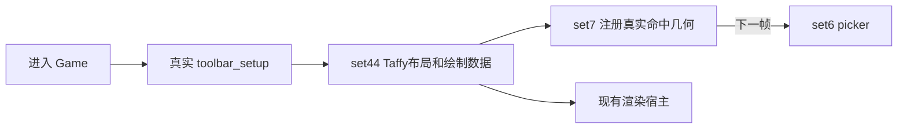
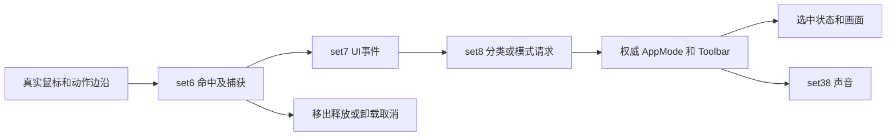
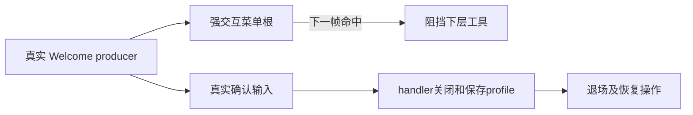
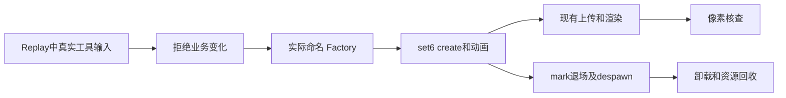

# 业务流恢复台账

当前模块：**1 公共交互／toolbar，已恢复实施，未验收**。2026-10-24 用户确认按模块推进，并要求每轮记录过程与经验。先收口当前模块，后序模块只列实施范围和进入条件，不提前展开实现。本文件合并维护状态与业务流合同，优先增量修改现有文件，不为模板拆出多套文档。旧报告、候选代码及临时日志只作为指定版本的历史证据，不是平行进度表。

### 2026-10-26 Windows 新渲染框架基线（Task 1，M01 计划起点）

详见 [M01-BASELINE-2026-10-26.md](M01-BASELINE-2026-10-26.md)，日志在 `baseline-2026-10-26/`。**此前在 macOS/Linux 旧渲染接口上取得的全部通过记录（含下文各轮）不继承到本基线**，须在新框架重验后才能引用。本基线只证明：Windows 上 toolbar/onboarding/core-ui/tiny-glade 库与 toolbar 链测试、Replay GPU 读回在真实 Intel UHD 630 通过；M01 仅余 1 项旧期望失败（welcome profile，归 Task 3）。真实窗口呈现、OS 输入、目标硬件性能均未验收。本机缺 `swapchainMaintenance1`，窗口呈现需单独处理。

### 2026-10-24 用户范围决定：Steam SDK不修复

用户明确要求记住：真实Steam SDK平台依赖缺口（TB-R8）不需要修复，不作为本轮toolbar完成阻断；保留当前注入接口和明确host入口，不制造SDK成功。其余TB-R1..R7继续按原版证据修复，完成后重新review。真实OS输入验收仍按此前要求暂缓。此前Credits、许可证和反馈删除范围继续生效。

### 2026-10-24 review后修复轮（进行中，未验收）

本轮独立复审同时修复生产者和消费者，不以页面建树或局部测试通过宣称toolbar完成。已按用户此前并行要求控制在总计8个agent以内，渲染任务继续保有render_host/production_renderer/rhapsody主体；设置仅增既有interop类型导出和手动缩放reset接口，并向owner协调真实surface设备快照。未发送OS输入。

- **TB-R4**：完整原1416feeb0无桥执行9600例，恢复首次Held计时、0.2阈值后的0.1倒计时、慢帧`max(timer+0.1,0.05)-delta`及原始analog复制。当前Rust3项定点测试通过，原差分fixture为`toolbar-input-delta.ron`；这不等于所有浮点输入或OS验收。
- **TB-R1**：已补视频完整helper（1371例原指令＋3项原字体CPU控件测试）、键位组/采集确认/重置（原非对称去重、NativeKeyCode/MouseOther完整身份持续复验）、四行15语言和总路由。设置顶部已接内部GUI schedule、WriteSettingsFileCmd和真实Apply成功后的完整LastApplied快照；CPU整体路由、磁盘和真实设备快照尚待最终验证。独立review纠正背景FullWindow/alpha、文/A文案、语言原template、空hint容器、Tab即时清零及跨菜单保留教学确认状态。
- **TB-R3**：原错误页、备份信息及15秒恢复提示已接真实异步错误状态。深入review又补回零脏块OS同步失败重试，以及Close/Open旧文件失败后保留ShadowFile并每秒重试，避免内存丢失和错误提前清空。最终worker16项、兼容1项、原模板/真实worker→Bevy告警→恢复3项均通过，并已独立review（`toolbar-save-error-review.md/json`）；不将CPU局部链升级为OS/整模块验收。
- **TB-R2/R6**：已恢复原96B请求的安全typed载荷、六种选择、每日四态/真实订阅与取消、DailyWelcome及真实startup创建/历史快照消费。285项限定原指令样本和core4/host4/NewSession3/Welcome1项CPU测试通过并review（`toolbar-new-daily-repair-handoff.json`）；没有OS或真实外网响应验收。
- **TB-R5**：查询0x1401、实际ui_confirm键位及摄影尾部分支已补。原静态写者实际在尚未恢复完整的rollercoaster_update，不是main_camera；目前恢复候选目标、轨道和车辆/动力学，禁止只注册提示却不能启动乘坐。
- **TB-R7**：两原提示消费者和circle/rectangle通知分支已补，原指令投影与模板测试在执行。真实host尚缺add_wall_shape_ux及抬升/聚焦高度等完整编辑生产链，继续恢复必要前置；未把旧CPU schedule当实际游戏注册。

新增依赖复核：实际onboarding提示绘制仍为空，当前正恢复真实模板/按键/动画/位置/生命周期；原TutorialCompletionState为19字段嵌套对象，旧bool及skip_serializing使完成标志重启丢失，正在按原schema修复。Demo必要编辑链已恢复Raise/Focus和真实装饰物归档；形状Preview旧height字段、固定dt及独立CalcShapeHeight资源均为误恢复，正在统一到ShapePlacement和TimberframeConstructionParamsCache真实authority。设置CPU整页首轮已发现测试缺MEI post布局阶段导致注入delta滞留，保留失败并修正测试边界，不修改生产算法迎合夹具。原add_wall_shape_ux的26个leaf不能由资源初始化或独立World测试冒充全部接通。

本轮经验持续沉淀：①Ghidra`size`可能是非连续body字节合计，不能当作连续地址范围；PDB物理范围又可能包含EH，须逐CFG/funclet判断；②保存失败验收必须覆盖sync清脏后OS失败、CloseFile与新旧文件同时失败的内存所有权和重试；③键位采集可接受的typed身份必须穿过OS adapter、档案与翻译器，不能UI确认后下一帧panic；④设置Apply必须追到实际成功后的snapshot回写；⑤空说明容器、原根类型/颜色alpha、匿名节点计数和同帧delta消费也属于可观察原业务；⑥原完整生产系统缺失时禁止用孤立事件注入或仅展示提示掩盖。

### 2026-10-24 深入 review：当前源码与调用链复核

**结论：toolbar 仍有明确源码／业务／接线缺口，不只是尚未做真实输入验收。** 本轮为 review，不改业务源码；独立检查生产调用者和注册，再定点复用原证／新增原机器码反证，不从旧测试数、PDB条目或完成率推算。排除用户删除的Credits、许可证和反馈入口。[审查证据、行号与指纹](toolbar-deep-review.json)记录全部发现；这是有界业务链审查，不宣称每条B函数都已全域判等。

| 优先级 | 当前实质缺口 | 影响与修复边界 |
| --- | --- | --- |
| P1 · TB-R1 | [设置可进入状态，但整页没有生产消费者](../../crates/tiny-glade/src/gui/settings.rs#L78) | 写入Settings(Audio)后无设置树/返回/保存流程；不是仅视频页未完成。 |
| P1 · TB-R2 | [两处新建入口均进入没有页面的NewSession](../../crates/tiny-glade/src/gui/gui_escape_menu.rs#L172) | 状态进入NewSession但不会构造选择页面或生成完整新建请求。 |
| P1 · TB-R3 | [自动保存I/O错误没有游戏内告警消费者](../../crates/country-core/src/systems/save/save_game.rs#L392) | 最新错误已进入SaveThreadHandle.error_state，但没有全局保存错误UI；不能用损坏存档读取告警代替。 |
| P2 · TB-R4 | [已实现的导航连发算法与原版不同](../../crates/country-core/src/systems/backend/input/calculate_input_delta.rs#L40) | 首次重复提前0.1秒；慢帧后重复节奏不同，影响MEI方向、Tab和Tweaker输入。 |
| P2 · TB-R5 | [摄影过山车提示缺写者且现存载荷错误](../../crates/systems/onboarding/src/lib.rs#L147) | 摄影/main_camera未产生DisplayRollercoasterPrompt；即使注入事件，Steam查询和键盘备选仍错误。 |
| P2 · TB-R6 | [每日/每周主题链仍有空系统和缺页](../../crates/tiny-glade/src/theme_fetcher_plugin.rs#L118) | update_daily_theme_system为空；手动传路径的helper没有生产资源发布链，DailyWelcome消费者不存在。 |
| P2 · TB-R7 | [Demo两条空间/高度提示业务未恢复](../../crates/tiny-glade/src/toolbar_plugin.rs#L113) | 当前有demo锁按钮及摄影分流，但缺完整glade尺寸提示与最大高度提示系统/注册。 |
| P2 · TB-R8 | [Steam平台支撑仍只有注入接口](../../crates/tiny-glade/src/main.rs#L87) | 默认SDK工厂返回None，正常入口失败；host入口明确离线，ActionHint真实平台来源及绑定面板无法验收。 |

本轮新增的两条独立原证反例：

- 导航长按 `digital_delta`：完整执行原 `1416feeb0`（5502字节），无依赖桥。合法槽20、previous/current都true、Held计时0.19、delta0.02时，原输出Repeating/0.1且本帧不触发，当前实际Rust函数输出Repeating/0且立即触发。Repeating计时-0.18、delta0.02时，原输出约0.03（bits3cf5c290），当前0.08（bits3da3d70a）。同样差异适用于使用同一算法的导航／Tab槽；本轮只执行两例，不冒称所有输入域。探针调用当前country_core rlib的真实函数，没有复制Rust算法；[原例](toolbar-deep-review-input-cases.json)、[原探针](review_toolbar_input_native.py)、[Rust探针](toolbar-review-current-input.rs)。需要恢复原Held→Repeating的0.1倒计时和 `max(timer+0.1,0.05)-delta`，不是只修改测试。
- 摄影过山车提示：原14227bbe9写cl=0x14，经packed_set_plus_one得到0x1401，当前为0x0101；原从第三资源+0x15c/+0x164读取实际键盘备选，当前固定None。摄影侧还缺真实PROMPT静态写者及其事件分支，所以只补事件发射也不能完成提示。详见[原函数](toolbar-deep-review-native.json)和[原头部指令](toolbar-review-prompt-head.asm)。

本轮排除了这些误报：

- 保存错误不是“完全没有接收”：save_game_system第392行已每帧drain_pending；缺的是异步错误权威状态到用户告警和恢复提示，AutoSaveState当前Option仅记录发送失败。
- ApplyVideoSettings已有PostUpdate gather和窗口／vsync消费者，缺设置页面生产端与完整应用闭环，不能把后端也报未实现。
- LUT与损坏存档告警实际在gameplay_startup的set36注册；文字、错误日志和部分debug已迁入mei_host／core，不能因旧同名函数todo否定迁移实现。
- ImageQualityPreset的Ghidra跳表出现坏指令与多余分支；直接解码原PE的5项跳表，确认0..4与当前Performance/Balanced/Quality/UltraQuality/Custom一致。本轮没有发现第5个Custom变体，不能按视频反编译中的5哨兵补造enum。
- 撤销／重做已有实际墙体权威状态、保存和新进程恢复的局部测试，不能说“历史全空”；该测试不能升级为所有核心业务、GPU画面及真实窗口验收。

验证：重新构建并运行original_escape_menu，4项通过。但其中设置测试只断言NextEscMenuState=Settings(Audio)，未推进实际设置页／配置应用，因此测试通过与TB-R1同时成立。原输入函数两例与实际Rust输出均执行成功，但语义两例不同，保留为review反证，未修改业务或测试断言使其通过。没有发送OS输入，没有跑整模块GPU长稳或性能测量。

接下来的修复次序：先修通用输入连发差异 → 收口设置整个可达页面（含视频／键位／语言／保存／应用）→ 补新建载荷和每日依赖 → 接保存错误告警 → 摄影提示及Demo分支 → 全模块编辑／历史／保存／新进程恢复／卸载与性能验收。Steam真实SDK作为平台依赖单列，当前host模式不冒充平台恢复。Credits／许可证不再恢复。

本轮经验：①“有Next状态”与“目标页实际建树”必须分开验收；②测试名称包含settings不代表测试过设置消费者；③旧缺口必须重查最新消费者，避免反复报告已经修好的队列；④长按首次进入连发的timer值和过期补偿都是业务算法，不能概括成统一延时；⑤跳表坏反编译先用原PE相对表和指令验证；⑥生产提示链同时核对writer、动作查询码和权威键位载荷，不能用None隐藏未恢复内容。

### 2026-10-24 用户删减范围：Credits与许可证

用户先要求删除许可证模块，随后明确删除整个Credits制作人员页面。已删除原owner menu/credits.rs（包括滚动控件及专属测试）、模块导出、Escape菜单入口和EscMenuState::Credits；移除toolbar及workspace中已无消费者的tiny_http依赖（Cargo.lock已无该包）。LUT和墙轮廓的旧菜单策略测试仅去除已删除变体，保留其余门控验证。后续不再恢复页面／按钮／服务／端口，也不列为验收阻断；原证、脚本及已执行日志仅保留历史分析，**不计本轮交付成果**。与此前反馈报告入口一起，在逐函数账标为用户删除范围。

### 2026-10-24 toolbar 全量收口推进（当前工作轮，持续更新）

**M01仍在实施，未验收；不进入下一业务模块。** 用户要求全部完成，真实OS输入验收仍按此前指示暂停。并行渲染任务保有rhapsody/render_host/render/ssbo，当前仅为删除Credits变体调整render_loop/lut_gallery.rs一个旧测试样本，已通知owner；未修改生产渲染逻辑。

- ImageContent的file:分支已接真实PNG解码、纹理上传、bindless索引、成功缓存、失败重试及原cloth_ferris后备纹理。纹理物理owner经Arc传入MeiHost渲染快照，覆盖排队但未开始执行的帧，不能只依赖已提交GPU命令的引用。加入快照owner后的最终源码真实MoltenVK测试已通过：PNG上传、descriptor、image→buffer逐像素核对、排队帧Arc保留和最后owner释放。此单项不代表整模块GPU稳定性或性能验收。
- ActionHint已恢复真实Steam动作源查询、两秒轮换、file:图片和无glyph空节点；MenuButton/Pill提示子树及原18槽提示门控恢复。TabSwitcher恢复输入阶段、24/25动作与每帧delta清理。
- Steam +0x160实际是动作→来源映射，旧SIMD按键快照解释错误。完整8158行原体分页恢复31条main/menu来源合同，修正controller参数、菜单analog第9槽、按住状态、输入模式冷却、右键点击/拖拽阈值。实际Bevy调度接mock SDK的3项新增测试及2项Pill测试通过；并非原Steam SDK或真实硬件验收。core自身cfg(test)一度被并行渲染mock缺try_read阻断，已通知owner，未篡改其测试；用toolbar既有集成入口验证生产core。
- Tweaker新增原B所属widgets/tweaker.rs，恢复Float/Bool/Enum/List、提示、左右按钮与输入阶段。216个原机器码浮点样本通过，有限值逐bit核对，NaN仅按预先声明的类别核对；原roundf调用桥接宿主libSystem，panic仅停在原入口，不宣称Windows CRT全域等价。3项leaf测试通过；实际控件树、格式化与右箭头副作用顺序已通过原字体表CPU测试；设置顶部/视频/键位页面及整页注册继续推进。
- 损坏存档告警恢复原模板、事件打开、模态阻挡、确认关闭及生产set36注册；原模板/字体CPU消费者测试已通过，初次缺字体失败保留。不以手动置按钮激活位的CPU消费者测试冒充OS输入。
- 设置新增原11键解锁126例、视频应用掩码420例原指令测试通过；修正FullscreenConfig为Best/ClosestMatch完整VideoMode（含刷新率/色深）并接现有窗口选择器。音频、游戏/教学、UI/光标、开发者及相机控制行已实现；4项设置CPU测试已通过，包含原模板/字体、实际reset_hints消费者、SaveGameProfileCmd请求与光标命令；尚缺完整设置路由和实际磁盘落盘闭环。PDB类型化系统接口又证实TutorialOp是关闭/重置命令，18个完成编号另属TutorialHintComplete；统一两者事件身份，并将reset/completion/backoff发回原SaveGameProfileCmd，旧WriteSettingsFileCmd物理别名误判已纠正。
- Rect原内联范围证实先四边各自points_or_zero后f32相加，移除臆造的LengthPercentage混合加法，避免百分比边抹掉另一侧绝对贡献。
- 尚需完成：NewSession选择与Reload，DailyWelcome和保存错误页面，Settings/controls消费者、Demo提示、摄影PROMPT写入、MEI剩余API与真实历史/保存/重入链验收。具体函数审计将随验证更新，旧审计为修复前快照，不能当当前完成率。

本轮经验：Ghidra单函数默认120000字符会截断，必须验证完整性并分页；优化器公共尾合并使汇编相邻常量不等于业务配对；RVA→VA使用数值相加；默认宽度函数与提示构造不能按临近名字混认；文件图片应将物理资源owner传到待执行帧快照，World卸载不能提前释放。PDB类型化EventWriter用于识别教学/档案事件，不能用ICF共用Vec::grow_one名字判类型；确认按钮子树必须在下一帧出现；原Rect是f32相加，不存在所臆造的混合LengthPercentage运算。原证、夹具、脚本、最终源码指纹和完整验证日志均收录于本目录及source-epoch.json本轮条目。

### 2026-10-24 删除范围后的验证记录

- `cargo check -p tiny-glade --tests --offline`通过，包含主程序与测试目标；不代表运行窗口。
- toolbar常规回归：103项库测试、5项集成测试通过，2项库/1项原字体集成测试需单独带原资产运行。带原字体库测试105项通过；带原字体集成最终6项通过、0项忽略；不用常规ignore替代。
- `system-onboarding`35项回归通过，验证本轮教学事件身份与档案保存请求依赖修正；设置4项CPU及文件图片1项真实GPU结果按各自边界记账。
- 原字体集成首次在prepare后要求图元，违背当前tg-text约定（render才生成）；随后暴露旧cancel点击音期望错误。只读重新获取完整原6842e0（942行、37574字符），确认536行content.pre_update先执行，601行保存声音旧状态，872行才比较点击上升沿；cancel的bit20先前已写入，不在此产生声音。测试保留真实draw和声音核验，按独立原证修正时序，不修改生产声音算法。两次失败日志保留。
- 本轮没有发送OS输入。M01未验收：Settings顶层/视频/键位、新建/每日/保存错误、摄影提示、Demo和完整历史/保存/Reload仍有实际缺口；Credits与许可证不再列入。

### 历史轮：2026-10-24 按逐函数审计续修（已被上方当前状态覆盖）

**M01 继续恢复中，未验收。** 本轮沿用原 B `mei/widgets.rs` 与 `menu/credits.rs` 的业务归属，在既有文件补实现；没有修改并行渲染任务的源码，没有启动游戏或发送 OS 输入。

- **Pill 输入字段交接已修复**：`pill_hotkey` 同步当前重构 API 的 hotkey/action 两个投影；原 `6816e2` 写与 `681938` 读同一 +44 字节。保留既有直接 action 消费者；0x12 仅跳过原 tooltip 建树，仍可绑定 ui_cancel，0x28 才是无输入哨兵。新增全部40槽位、哨兵、重新绑定、非匹配动作、Idle/JustPressed/Held/Repeating/JustReleased，以及真实 `mei_pre_update` 节点激活测试。**ActionHint 提示子树仍缺，不能把 setter 输入修好标成整个 hotkey 原函数完成。**
- **Credits 滚动算法补回**：新鲜 shared 只读 Ghidra 原体与发行 RNE 指令确认拖拽起点/保持、前一光标投影、delta最小1e-5、松手积分、目标速度趋近与上下界两次柔性回弹；替换旧硬clamp。构造常量明确初始 scroll=-400、velocity=0、previous_cursor_y=0、target_velocity=90、min=-400、max=f32::MAX；速度趋近speed1、回弹speed2。不是旧注释所说的归零减速。
- **纠正滚动上限合同**：原 `ScrollView::max_scroll_pos` 是写上限的 setter（141dfa431），span-450 由页面布局计算；不是滚动控件内部每帧推导。保留当前查询 API，增加现有 View/content 的 `set_max_scroll_pos` 适配入口。旧 content_min/max 保留为兼容字段，不冒充原状态中的边界。
- **补可选背景实际绘制**：独立布尔判别保留原 Option<u32> 语义，颜色0也是合法Some；调用真实 RawShapeStream→TextRenderer 矩形路径，未设置背景时无图元。未使用简化子内容绘制替代 MEI 的遍历。
- [原指令](credits-scroll-original.asm)、[只读函数结果](toolbar-controls-followup-native.json)、[可复跑探针](native_scroll.py)、[边界元数据](toolbar-scroll-native.json) 与 `tests/fixtures/native/toolbar-scroll.ron` 保存原证。**100例**执行原滚动函数及其真实lerp指令，Rust六个状态字段均按f32 bits一致；唯一依赖桥是原 expf 调用接宿主 libSystem.expf，不宣称原Windows CRT全域等价。覆盖drag开始/保持/结束、零及极小delta、两侧越界及上下界反置时两个回弹的顺序。
- 最终 `cargo test -p toolbar --lib --test original_menu_widget --offline`：**103项库测试、2项Pill集成测试通过，1项需要原字体资产的旧测试仍ignore**。最终主程序 `cargo check -p tiny-glade --offline` 结果与日志见source-epoch。没有新增OS、Credits页面、存档或GPU验收，也未测量性能，不能由这些CPU结果推出上述链条通过。
- 继续缺口：Credits页面建树/生产注册/边界统计/构造器布局属性仍未闭合；ActionHint需原动作源映射、图标轮换/路径缓存与文件图片纹理消费者，不能凭名称编造按键标签。Image file分支、Tab/Tweaker、NewSession/Settings/告警页面、摄影PROMPT分支仍按逐函数审计保留。本轮不进入下一业务模块。

本轮经验：①函数体之外必须读取构造常量，不能猜初始值和惯性目标；②PDB getter/setter同名不代表同一调用方向，需查实际写指令；③0x12提示门控与0x28输入门控是不同合同；④保留原两个独立越界判断，不合并为clamp；⑤缺失原消费者时，恢复控件不能计作页面完成；⑥夹具编码失败与运算差分失败分开记录。本轮初次Pill测试误将声音作为已证明合同，实际只确认激活位，移除无原证支持的声音期望，声音验收保持未新增；初次RON数组使用列表而不是固定数组元组，修正编码后执行100例一致，未修改算法或放宽比较。两次失败日志均保留。

### 2026-10-24 按 B 目录逐函数独立审计（修复前历史）

**B 版 toolbar 尚未完整恢复，而且不只是缺少真实输入验收。** 用户已选择“暂不进行真实输入验收”；本轮只做原证/源码审核和独立CPU字段探针，没有启动游戏或操作窗口、没有修改业务/渲染源码。

- [逐目录/逐函数审计](B-FUNCTION-AUDIT.md) 按 B 的38个源文件保留914条PDB函数记录，其中840条toolbar命名空间记录，另74条外部/归属重叠；这些含闭包、单态、derive和重复，**不是独立函数数或完成率**。[逐条JSON](toolbar-b-function-audit.json) 保存原名/RVA/原元数据行、业务功能、当前承载/候选行、判定及原证边界。全量入账不等于每条机器码全域判等，未决均未升级为完成。
- 新鲜原体复核确认 ImageContent 文件缓存/读图/纹理创建分支缺失，当前file:直接assert；Credits ScrollContent缺拖拽和柔性回弹，当前硬clamp且无draw；TabSwitcher/ActionHint/Tweaker具体族缺失。原非空输入/绘制函数不能用NodeContent默认false/空draw代替。
- 独立Pill字段交接探针已复现：`pill_hotkey(19)` 后 `hotkey=19` 而 `pre_update_action=40`，断言退出101；原RNE6816e2/681938明确写/读同一+44字节。只证明该API交接错误，不声称执行了原二进制或真实按键；现有直接写action的调用者是另一条可用路径。
- NewSession/Credits/Settings有状态生产入口，但对应页面消费者缺失或仍todo；每日欢迎、全局保存错误/损坏告警页面与两个demo提示也未恢复。底层会话和保存事件存在不等于这些UI完成。
- 已排除误报：字体/文本流迁入mei_host；LUT页面实际在gameplay_startup的set36注册；decorate_hovered、Taffy样式helper和许可证HTTP服务已在现有owner实现。反馈报告按用户明确删除范围单列，其残留TextEdit不计游戏恢复阻塞。
- 当前结论为“已恢复一批真实业务，存在明确缺口/简化/接线错误，原B toolbar不完整”；不能以101项库测试或生产世界图通过替代原函数全表和调用链验收。后续按审计中的具体业务闭环逐项修复，不按缺文件机械复制旧架构。

本轮经验：①先从原目录建立完整符号账，再做业务/依赖/闭包分类；②缺原文件先追迁入后的实际owner；③同一原字段拆成多个Rust字段时必须查所有setter/consumer一致性；④默认空trait方法既可能是原版真空叶子，也可能掩盖缺失override，必须核对具体类型和原函数体；⑤用户主动删除的功能与未恢复业务分别统计。独立探针前期显式链接country_core的E0463均保留，未执行的尝试不当业务失败；最终只链接实际toolbar产物的字段探针构建成功后才复现错误。

### 2026-10-24 工具修复后 M01 续修（历史轮次）

- **模块仍未验收**。本轮没有进入地形或后续模块，也未修改 rhapsody、渲染宿主、线程或世界几何结构。已向并行渲染任务同步边界；其资源帧槽收尾后，仅定点修复现有 `dof_autofocus.rs` 的坐标映射。
- 修复后首次通过 SDK/shared 重新读取 B `14234b010`、`1406884c0`，原始结果见 `reverse-engineering/tiny-glade/evidence/toolchain/toolbar-focus-resume-20261024.json`。摄影标记建树只置根节点 ignore_input，原 post_update 才传播给后代；旧测试遗漏布局阶段。保留原断言，补实际布局及标记位置/尺寸/后代屏蔽检查后 toolbar 库 **100/100 通过**。没有修改生产布局来满足错误的测试顺序。
- 已修 autofocus X/Y：mode3 使用 `f04/f08`，其余相机分支使用 `f10/f14`；保留当前重构 API、原运算顺序和真实 SSBO/深度消费者。原发行 RNE `140a17ad7..140a17b5c` 实际执行 **180 组**，Rust UV 按 f32 bits 精确一致；7 项 pass 测试通过。夹具在 `tests/fixtures/native/toolbar-autofocus.json`，复跑脚本 [native_autofocus.py](native_autofocus.py)，原指令 [autofocus-uniform-original.asm](autofocus-uniform-original.asm)。该段不包含 mode2 鼠标资源查找、ECS lock gate、shader 或实际点击验收。
- 顺查原函数尾部，补回步行摄影关闭吸附时的 `camera ghost` safe frame 与原 `other/camera_ghost` 模板。依据完整参数 tuple，`rbp+1c8` 来自 Modifiers；`1408c5680` 读取首字节，不能采用反编译器的同址 `StructureType::is_fence` 名称。已沿用现有 Modifiers 权威资源和 `photomode_focus` 的 screen.enabled 门控；不额外受焦点标记显示/菜单门控影响。原参数与尾部指令保存在 [photomode-parameter-original.asm](photomode-parameter-original.asm)、[photomode-walk-overlay-original.asm](photomode-walk-overlay-original.asm)。新增 6 相机×4 修饰字节组合及真实安装模板验证后，toolbar 库 **101/101 通过**。
- 原尾部相邻 `PROMPT_ROLLERCOASTER` → DisplayRollercoasterPrompt 分支尚未闭合：事件/提示消费者存在，当前摄影实现及 main_camera 尚无该原静态状态的真实生产链；不得填默认 false 或凭名称移接其它状态。下一轮须追原写者、摄影发事件分支及现有提示消费者，作为 M01 未决项保留。
- 本机真实 Apple GPU 的现有生产 App→非空世界图→physical export 回归已通过 1 项，实际 502 个砖实例、172 个 draw-list 条目、480×270 输出；此为 autofocus 修改后的回归，新增 ghost 系统参数后的同项复验也通过（29.66s），最新窗口验收 target 编译通过；具体源码/运行边界记录在 source-epoch 中。不能将默认相机世界图通过称为摄影点击/对焦读回全过程验收。
- 为真实 OS 验收在**已有** `toolbar_window_chain.rs` 增加外部输入协议，保留 X11 驱动。`TG_TOOLBAR_EXTERNAL_INPUT_DIR` 必须为新的绝对目录；程序原子发布 request.json（递增 sequence、精确 PID/标题、物理客户区坐标与 scale），真实 OS 驱动操作后原子写 response.json `{ "sequence": N, "ok": true }`。响应只同步驱动；后续仍检查 winit 真实释放事件、权威 AppMode/历史、实际保存、Reload 和 native present，不能用响应代替操作。
- 首次 Mac 窗口已进入世界和 Welcome，却停在 phase0：按钮确实由原 hide_ui 收起，尺寸全部为0；旧脚本等待可见按钮后才允许 Enter。现补隐藏按钮真实布局中心的点击路径，不改游戏可见性；它只验证隐藏期间无误操作，不能宣称“可见按钮被遮挡”。修后实跑已在第93帧发布第一条真实点击请求，phase0 等待已解除；未收到实际输入，最终 **phase1 超时、mouse=0、enter=0**，不计交互通过。
- 当前 Computer Use 返回“Computer Use was not approved to use Tiny Glade Toolbar Validation”，Python 的 AX/事件发送预检也为 false。本轮未通过其它自动化方式绕过限制，已向用户请求仅操作独立测试游戏窗口的授权。所有窗口进程已退出，真实输入、保存/Reload 的完整窗口链仍待验；既有局部历史恢复结果保留原范围。
- 所有通过、首轮失败、窗口超时、命令、源码/夹具指纹及验证范围统一落在 [source-epoch.json](source-epoch.json) 的 `toolbar_focus_followup_2026_10_24`；不把共享工作区的运行后指纹冒充整工程冻结构建身份。

本轮经验：①先找当前阶段和最终消费者，再判断中间状态是否错误；②折叠符号需用参数来源和字节读取确认语义；③真实 RON 必须走生产 Options/IMPLICIT_SOME 入口，裸 ron::from_str 的失败不是业务算法失败；④Unicorn 沙箱 JIT 终止（exit132）与原算法差分失败分开，授权环境重跑后才取得原指令结果；⑤OS 测试必须观察生产 UI 的真实可见性，不能修改游戏状态来解除脚本等待；⑥测试协议成功、原生呈现、业务交互通过是三个独立边界。

### 2026-10-24 恢复实施与并行边界

- 本轮先执行 `cargo check -p tiny-glade --tests --offline`，退出 0，用时 2m56s；日志 `/tmp/toolbar-resume-check.log`。这是修改 TOD 接线之前的工作区检查，不代表后续代码或窗口验收。
- 写入范围限定已有 `toolbar_plugin.rs`、`gui/gui_tod.rs` 与 `run_game.rs` 的 GUI 注册小块；rhapsody、render_loop、world_geometry、render_host、production_renderer 与渲染报告由另一渲染重构任务推进，本轮不修改。共享 Cargo 锁正常等待，不终止其他任务、不清理其产物。
- 已补 TodButtonState 会话初始化、set39 内部 GUI 调度注册，以及退出时 TOD 按钮动画/拖动/屏幕边沿清理；新增旧会话拖动→退出→隐藏帧→重新打开的回归。编译和执行结果须后续填入，不先记通过。
- 对焦原指令复核确认 X/Y 反置：原 B RNE `140a17af5..140a17b55` 中 mode3 选择 rcx=4、rax=8，先取 rcx 并除 aspect，再与 rax 打包；其他相机模式为 rcx=0x10、rax=0x14。当前 `dof_autofocus::autofocus_uniforms` 传入顺序相反；world_geometry 按实际偏移读取正确。此项留为渲染接口交接，禁止通过改 CPU 相机字段迁就错误。尚未修改共享渲染文件。
- 原 B RNE 实际 SHA256 为 `f507a6cea25c5199447b88ba746a5293e64a279f73797ca74c1ce7f4ff2b7d03`，patched EXE 为 `cf048e27acdc266b2efc7c094dd435bacecb3f26c2afe54de4d09cd3f7036323`，本轮重新计算。GUI set39 原指令 `1405a050f` 写 r8b=0x27，`1405a0512` 调用 `140611040`；当前仍沿用原 gui/gui_tod.rs 归属。
- 当前 toolbar 真实窗口测试只支持 Linux X11/XTest，本机为 macOS；不能将它在当前机器上的不可运行判为输入通过。下一步需在已有窗口入口补足本机输入验证，配合渲染任务的稳定版本执行，避免同时启动竞争 GPU 的长跑。
- 本轮 TOD 修改后 `cargo test -p tiny-glade --lib gui::gui_tod::tests --locked --offline -- --test-threads=1` 退出 0，4 项通过，包含原指令 153 组映射、50 组控件输入、实际模板建树及新增退出重入回归；已构建同一测试二进制的 `toolbar_plugin::registration_tests` 1 项通过。`cargo test -p toolbar --lib --locked --offline -- --test-threads=1` 退出 101，99 项通过、1 项摄影 focus 模板节点标志断言失败，位置 `photomode.rs:778`；保留失败，未改预期绕过。
- 用户随后要求优先修完逆向工具，本轮暂停进一步业务修改。Ghidra 原失败查询经授权重启后已原样复跑通过，其他五个工具入口也完成限定范围复验；工具修复与经验见 [现场记录](../../../reverse-engineering/tiny-glade/evidence/toolchain-revalidation/ai-guide/tool-repair-2026-10-24.json) 及 [工具说明](../../../reverse-engineering/tiny-glade/AI_REVERSE_TOOLS.md)。模块继续保持未验收，下一轮先定位上述摄影 focus 失败，再推进实际输入与窗口合同。

### 本轮逆向经验（后续轮次先复用）

- 同一二进制里的两个 float 被 `unpcklps` 打包时，应追踪寄存器选择、aspect 除法与 shuffle 的最终分量，不能根据旧字段注释猜 X/Y；该问题已在原指令上确认，未借候选单测证明候选自己。
- 原 GUI 算法已有单测不意味着生产启用：必须同时查实际内部 Schedule、资源初始化、退出清理和 MEI set44 消费。
- MCP 成功连接/身份元数据不等于反编译成功。本轮 shared Ghidra 元数据成功，但定点 `get_functions` 返回 `java.io.IOException: Corrupted BufferMgr state`，报告 `/tmp/toolbar-tod-registration-result.json`，退出 1；不重启或修改另一任务可能正在使用的 shared 数据库。当前以身份绑定 RNE 的 LLVM 指令补充静态核对，不能把失败调用计作有效原证。
- 后端启动锁在沙箱外，首次调用因 `startup.lock` 权限失败；用授权的工具运行环境重试后才实际连通。权限失败、数据库失败和业务证据不足分别记录，避免混成同一原因。

## 规则与完成门槛

正确性最高优先，完整恢复原版复杂算法、数据结构、边界和生命周期；优化保持语义并验证性能。沿用现有基础库、渲染链与共享资源 owner。禁止近似／占位／假成功替代生产实现。

每条流区分原版行为、当前实现和已执行验证；状态依次为待取证→合同确认→生产接通→局部验证→整链验证→模块验收。下表的限定说明必须保留，不能把“接通”读成“通过”。当前模块五项全部交付后才进入下一模块：

1. 真实输入触发原业务逻辑。
2. 权威状态、实体、碰撞和画面同步。
3. 完整撤销／重做、保存／新进程恢复。
4. 删除、卸载、再次进入没有残留。
5. 原证核对和实际链路通过。

历史、存档、音频和渲染贯穿每条流；不适用项写明理由与禁止副作用。最后联合验收只验证共同运行，不补前序缺项。性能记录实际 Release 窗口 960×540 的持续 FPS、1% low、p95/p99 与资源变化；60 FPS 最低、120 FPS 合格，软件 Vulkan 与目标硬件结果分开。

## 当前 toolbar 流

| 业务流 | 当前结论 | 关系图 |
| --- | --- | --- |
| [T1 启动、建树、布局、可见与命中](#t1-startup-layout) | 本轮建树及输入链通过；实际窗口与连续呈现待验 | 图 |
| [T2 鼠标选择、释放、取消与工具切换](#t2-mouse-tool) | 本轮真实输入、取消及切换通过；窗口待验 | 图 |
| [T3 键位、导航、确认与返回](#t3-keyboard-navigation) | 局部验证通过：20原侧非空树对照及实际键盘链；窗口待验 | 图 |
| [T4 Welcome 与菜单输入仲裁](#t4-menu-arbitration) | 整链局部通过：真实Welcome阻挡与确认关闭已通过；实际窗口待验 | 图 |
| [T5 Replay 禁止提示、画面与释放](#t5-replay-signifier) | 局部GPU整链通过：实际像素与卸载释放；窗口待验 | 图 |
| [T6 实际历史按钮与磁盘恢复](#t6-history-persistence) | 实际按钮与三次新进程磁盘恢复通过；完整菜单保存入口待验 | 图 |
| [T7 卸载、重入与无残留](#t7-session-lifecycle) | 本轮 Held 重入与旧事件清理通过；完整会话资源待验 | 图 |

执行优先级：源码／日志核对与本地产物空间→统一局部与旧输入复验→T4 菜单修复复验→T5 Replay 像素及释放→T6 实际历史和新进程恢复→窗口／资源／性能→模块验收。原侧、实现、接线和独立验证围绕同一条当前业务流推进。

## 已有证据的适用范围

- `/tmp/toolbar-module-physical-run.log`：旧源码的 4 项真实输入链通过，覆盖建树鼠标切换、移出取消、键盘导航、Held Reload。
- `/tmp/toolbar-module-chain.log`：历史证据：旧源码 Welcome 曾穿透；本轮 `/tmp/toolbar-flow-chains.log` 已验证修复后 Welcome 1 项与 focus 2 项通过。该轮 T6 真实写盘失败，不是整个测试批次通过。
- [audio-validation.json](audio-validation.json)：78 次原侧执行、77 个 Rust 可构造样例、6 项通过；含指定源码指纹，验证声音边界而非实际可听播放。
- `/tmp/toolbar-module-lib.log`：旧源码 86 通过／1 失败，失败是原 panic 保留测试的预期字符串与实际 SlotMap panic 不符；不能称全部通过。
- Replay后续已执行通过，见本轮中央复验；`/tmp/toolbar-flow-lib.log` 的不完整摘要不作通过证据。

临时日志可能被清理；下一次运行必须保留精确命令、源码指纹、环境、退出码与可复核结果，并更新所属流。文档内源码指纹是初建静态快照，不追溯绑定旧日志。

## 全局薄索引与进入条件

| 顺序 | 模块 | 依赖／进入时展开的合同 | 当前状态 |
| --- | --- | --- | --- |
| 1 | 公共交互／toolbar | 启动、相机、MEI；详见上方七流 | 当前恢复中 |
| 2 | 地形编辑 | toolbar验收；真实readback／hover／focus→高度、采样碰撞、历史、渲染 | 未进入 |
| 3 | 路径→花园→水 | 地形与共享栅格；分别闭合绘制、记录、回放、上传并分别验收 | 未进入 |
| 4 | 墙体／规则建筑 | 交互、地形栅格；采样、吸附、合并拆分、高度、构造支撑、楼板、门栅栏及半木、删除 | 未进入 |
| 5 | 屋顶 | 墙权威与建筑几何；类型、构造、碰撞、瓦片、历史、删除 | 未进入 |
| 6 | 楼梯／平台／扶手 | 墙、屋顶、地形；完整cache、主网格、支撑扶手、碰撞、视觉宿主 | 未进入 |
| 7 | decorator | 墙→屋顶→楼梯；放置移动旋转、命中validator、set25、完整卸载 | 未进入 |
| 8 | 颜色自定义 | 交互与墙屋顶装饰物；菜单状态机、真实触发、应用、历史、GPU | 未进入 |
| 9 | clutter／ivy | 建筑、装饰物、地形；生成更新删除、碰撞上传与生命周期 | 未进入 |
| 10 | 树→森林→小动物 | 地形建筑碰撞；逐个完整行为及生命周期，优先消除鱼鸟算法近似 | 未进入 |
| 11 | 菜单／设置／主题／提示 | 已验收业务消费者；页面命令、会话切换、提示，入口对应实际功能 | 未进入 |
| 12 | 整游戏联合验收 | 前11阶段各自验收；混合编辑、历史、保存退出、新进程、窗口连续帧及资源 | 未进入 |

关键依赖：墙→屋顶→楼梯→decorator→clutter／ivy。后序模块不提前展开整套实现；只解决阻断当前流的接口。

## 按模块实施计划（2026-10-24）

依赖审查见 [当前源码审查](../2026-10-24-dependency-audit.md)。该文档记录审查快照，本文件仍是实施状态与验收的唯一台账。以下是工作计划，不是完成声明。

### 模块边界与执行方式

- 以完整业务模块交付，不按文件、crate 数量或“先写 CPU、以后接 GPU”交付。一个模块可以跨 country-core、systems crate、宿主和 shader；修改仍放在既有归属位置。
- 每次只推进一个主业务模块。启动、渲染、历史、音频作为该模块的配套依赖，仅修复阻断当前业务的接口；共享模块不整包重写。
- 每个模块内部执行：核对原证与现实现→补完整算法和分支→接真实生产者/消费者→验证历史与持久化→验证卸载/重入→真实 GPU 与性能→记录验收结论。
- 未知原语义先取证；不以空资源、默认值、近似算法或绕过入口来解除阻塞。原版本身的 panic、空分支按原证区分，不机械消除 TODO。
- 每模块验收都覆盖真实输入、权威状态、实体/碰撞/画面、撤销重做、保存重启、删除卸载和性能；不适用项逐项注明原因。原码差分和产品有意修复分别记录。

### 实施次序与具体交付

| 顺序 | 业务模块 | 实现范围 | 进入条件与关键交付 |
| --- | --- | --- | --- |
| M01 | 公共交互 / toolbar | 建树布局、鼠标命中与取消、键盘导航、工具切换、菜单抢占、Replay 提示、历史按钮、摄影/TOD 控件与会话清理 | 当前模块。先消除最新整合源码的不确定性，完成下方收口步骤；不把进入窗口当整个模块通过。 |
| M02 | 地形编辑 | 真实地形/鼠标 readback、hover/focus/widget、绘制和编辑、采样碰撞、撤销重做、上传与删除 | M01 通过；替换目前没有真实 writer 的输入适配，证明编辑实际改变同一地形权威和画面。 |
| M03 | 路径 / 铺石 | 四栅格绘制/擦除、笔刷与预览、分层规则、历史、staging/GPU、边界和卸载 | M02 通过；安装完整事件和系统，逐种路径验收，不能只恢复已有存档的显示。 |
| M04 | 花园 | 绘制/擦除、花园栅格、植被、碰撞/装饰联动、历史与生命周期 | M02、M03 共享输入和栅格合同稳定；接回 draw/record 的生产调用并验证植被增删。 |
| M05 | 水与林地边界 | 水绘制/擦除、植被/波纹/声音、统一 pinned-clutter 事件、边界显示与越界反馈 | 地形与共享栅格稳定；不保留只为参数校验而存在的事件替身，验证岸线及相邻业务联动。 |
| M06 | 墙体 / 规则建筑 | 自由墙及规则形状、吸附、合并拆分、高度、洞口、门/栅栏、支撑柱/支架、楼板、抹灰与半木 | 前序交互/地形/路径通过；按原证补构造 TODO 和未安装的形状生产者，墙权威→几何→碰撞→渲染全链交付。 |
| M07 | 屋顶 | 类型、屋脊/尖顶/檐口、瓦片、墙联动、碰撞、历史、删除与失效通知 | M06 通过；核对尚未定位的注册点，真实编辑后墙与屋顶共同更新。 |
| M08 | 楼梯 / 平台 / 扶手 | 放置编辑、附着缓存、平台和手工楼梯、主网格、支柱/支架/magic support、碰撞、历史和卸载 | M06、M07 通过；补完整构造算法，为后续装饰生成提供真实 cache，不能以已有 draw pass 代替上游实现。 |
| M09 | decorator | 放置移动旋转、命中与 validator、锚定联动、归档恢复、set25 全生成、碰撞和完整卸载 | M08 通过；从仅 startup resources 推进到完整生产注册，并完成原卸载业务。 |
| M10 | 颜色 / 自定义 | 墙、屋顶、门、半木、装饰物、灯光与楼梯选项；菜单取消回滚、历史和 GPU | 对应对象模块通过；逐对象验证显示与实际权威一致，不能只证明颜色事件发出。 |
| M11 | clutter | 候选、建筑/树/水边装点、stitches/merlons、编辑、碰撞、历史与资源生命周期 | M09、M10 通过；逐项替换缺真实 producer 的适配状态，验证更新与删除没有残留。 |
| M12 | ivy | 生长、避洞、修剪、叶片、动画、上传、声音和建筑变化联动 | 墙洞和装饰生命周期稳定；接完整持续更新，核对原事件替代与生成/修剪顺序。 |
| M13 | 树工具 | 放置、移动、弯曲、删除、隐藏恢复、地形/建筑/水联动和历史 | 地形及建筑碰撞合同稳定；同一 TreeStorage 权威贯穿编辑、渲染、保存和卸载。 |
| M14 | 森林 | 预放树转换、prefab 管理、批量更新、动画、隐藏与释放 | M13 通过；与树工具共同验证地形变化和重载，防止重复实例或旧订阅残留。 |
| M15 | 小动物 | 羊、鸭、鱼、鸟、蝴蝶、萤火虫逐族恢复；行为、轨迹、交互、鸟点认领释放、动画和音频 | 水/路径/建筑/装饰/森林通过；优先消除 fish flock/四路径采样和 boids 方向表近似，逐族通过后再混合运行。 |
| M16 | 菜单 / 设置 / 主题 / 引导 | 完整页面命令、语言和设置、每日主题到 ECS、引导触发/完成；摄影/TOD/截图剩余业务与真实声音效果 | 消费的业务已通过；页面不能进入空实现，提示必须来自真实操作，截图需实际写盘且退出释放。 |
| M17 | 整游戏联合验收 | 混合编辑、历史顺序、存档兼容、新进程恢复、反复切场景、窗口生命周期和 Release 长稳 | M01–M16 分别验收后进入；这里只验证共同运行，不承担补前序缺项。 |

M13/M14 在其真实依赖通过后具备独立推进条件；默认执行仍遵循上表，不自动发起并行任务。M16 的菜单抢占/保存入口等前置部分应在所属模块同步验证，不能等到 M16 才提供验收入口。

### M01 当前模块收口步骤

1. **恢复可验证基线**：核对当前源码、资产路径和已保留日志；编译现有目标，修最新整合引入的构建问题。先运行现有局部输入/菜单/历史测试，不沿用旧二进制结果。
2. **补摄影与 TOD 的具体缺口**：按原证复核 autofocus 的 CPU→uniform 坐标映射；完成 gui_tod 在原 set39 的注册、TodButtonState 初始化与退出清理；核对摄影 focus union、命令消费者和退出状态。先核实再修改，不让一端迁就另一端错误。
3. **闭合普通工具栏输入**：实际 Game 进入后验证可见布局与命中一致，覆盖缩放/隐藏、按住移出取消、释放重按、键盘导航、Welcome/菜单抢占及 Replay 禁用提示。工具切换验状态，不冒称后序工具算法已完成。
4. **闭合历史与会话生命周期**：使用真实历史按钮和菜单保存/加载入口，验证新进程恢复与完整 Reload；跨会话保留按键时不得误触，释放旧焦点、捕获、事件、临时 screen 和资源。
5. **验证实际画面与性能**：在本机真实 GPU 上运行当前源码构建的窗口入口，观察连续 present、摄影控件反馈与退出；固定 Release/分辨率/画质记录 FPS、1% low、p95/p99 和资源趋势。软件 Vulkan 结果单列。
6. **验收并冻结模块**：将本次精确命令、源码身份、环境、日志、未通过项写回 T1–T7；全部必要项通过才标模块验收。阻塞时在 M01 内修复，不提前分散到地形或其他业务模块。

## 跨模块接口及管理

- [SIGNIFIER-CONTRACT.md](SIGNIFIER-CONTRACT.md) 记录完整 Factory 所有权与后序 Raw 生产者整改条件；terrain、wall、stairs、decorator 等进入所属模块时恢复名字、捕获、几何、shader、动画、pass和闭包。toolbar Replay 不依赖这些 Raw，不能伪造空实体来静默通过。
- 中央维护唯一合同、共享接口与源码冻结；原证专项交行为边界，实现专项交生产修改，验证专项从真实入口独立核查；中央承担接线、唯一 Cargo／窗口运行与验收。
- 每次派工锁定流、允许写入范围、输入合同与退出条件；canonical 类型与共享 owner 改动同批更新全部消费者。变更后仅重核受影响闭包，但不得继承已失效的通过结论。
- 网络命令按进程清代理并直连；仅用本地磁盘，禁止 `/home/ubuntu/ds-download`。空间不足只清可再生成本地产物。

## 本轮中央复验更新

B 目录归并后，`/tmp/toolbar-b-chain.log` 退出码0：Welcome菜单真实遮挡1项、输入／历史／重入7项、Replay像素与释放1项通过。历史测试跨三个新进程执行真实Undo/Redo按钮、原保存worker同步Flush和原恢复loader，保存于撤销游标时保留重做尾，再恢复已应用墙记录并撤销。初始墙记录是合法已提交fixture，不能据此宣称墙构造输入、碰撞或GPU完整验收；保存由原assembler/worker触发，未覆盖菜单SaveGameCmd入口。

- `/tmp/toolbar-flow-lib-final.log`：此前toolbar库89/89通过，含20个非空原侧树对照；B归并后 `/tmp/toolbar-b-lib.log` 再次89/89通过。
- `/tmp/toolbar-flow-core-ui.log`：此前UI 41/41通过；声音6项及原侧78次执行见audio-validation，均不代表硬件可听播放。
- `/tmp/toolbar-b-window-build.log`：独立主线程真实窗口入口已编译；第一次实际启动在首加载帧因物理设备包装未挂接而panic，见`/tmp/toolbar-b-window.log`，已通过WM_DELETE正常请求退出。未计为窗口通过。
- 当前并行渲染更新已将vram查询接至现有Device的properties和驱动预算快照，不另建设备或回退渲染架构。窗口v2已通过实际启动进入gameplay；240秒截止时仅22个gameplay receipt，phase0尚未到Welcome交互，退出码1（`/tmp/toolbar-b-window-v2.log`），不是通过。软件Vulkan完整启动耗时较长，v3保持相同业务、960×540与画质，将总诊断期限延至1800秒，增加原startup日志。v3已确认完整启动与gameplay呈现；旧测试只观察world_rendered=true，菜单静态capture会停止测试阶段推进，因此中央通过真实WM_DELETE结束旧入口（退出码1，不计通过），改用包含Main静态capture receipt的完整链入口。当前环境仅bochs-drm显示设备，没有目标硬件GPU；Debug软件Vulkan不作为目标硬件高性能验收。

## 文件与性能约束

正确性优先，同时要求高性能。原算法复杂也必须完整实现；性能优化不得改变业务结果、边界或生命周期。只在真实职责隔离、独立运行入口或可复现原证需要时新增文件；优先扩展现有模块和测试，不新建平行实现、重复台账或逐项模板目录。未做目标硬件Release实测，不称性能合格。

## t1-startup-layout

**T1 启动、建树、布局、可见与命中**

## 边界与原版行为

进入 Game → toolbar_setup 构建普通／摄影工具栏与历史按钮 → Taffy 实际布局 → 可见画面与对应命中区域。缩放、四边对齐、隐藏／重显后，画面和真实命中必须一致。

以 toolbar-input-evidence 的 toolbar-widget-producer.asm、get-ui-volume.asm、hide-ui.asm 及 phase2-toolbar-layout 的实际构造、样式、调度原证为依据。普通工具、摄影工具、历史按钮不能用单一假按钮替代；隐藏时焦点处理保留完整原分支。

### 当前生产链与权威所有者

OnEnter(Game) 注册 toolbar_setup；mei_host 在 set44 执行文本测量、finalize、perform_layout、update_drawables，再执行 mei_post_update 和 flush。set6 picker 消费上一帧注册，set7 render_taffy_ui_to_widgets 为本帧提供真实屏幕几何，不可把同帧构造视为即时可命中。

TaffyLayout、ToolbarLayout／UndoRedoLayout 和 MeiContext 分别持有布局与节点；UiState 持有真实 WidgetParams。Ui2dExtent、UiMouseInteractable 与核心同名组件必须是 canonical 身份，禁止镜像组件。

布局、hover 和动画是瞬态，进入会话时重建；用户配置沿用 GameConfig／现有配置 owner，不序列化 Taffy node 或实体 ID。UI 不生成世界碰撞体；隐藏／布局变化不得改写世界权威几何。

### 已执行证据与未闭合项

旧 /tmp/toolbar-module-physical-run.log 的 startup_layout_and_canonical_device_edges_switch_real_water_category 通过；旧 toolbar --lib 有 86 通过、1 个 panic 文案断言失败，不能声称整库通过。尚缺最新整合版本、四边缩放／隐藏、实际窗口画面及稳定性。


摄影按钮本轮补正（待中央编译／实际输入复验）：按 B `crates/systems/toolbar/src/photomode/photomode_buttons.rs` 的 PDB 完整签名和原 `14234c230` 分派，tag5 只发真实 PhotoModeCmd(next)，tag9 发 PhotoModeCmd(4) 接现有截图 gather；反编译 grow_one 的 WindowFocusEvent 是错误类型别名。tag16 按机器码 `14234ca52..14234ce42` 恢复 MainCamera 当前 focus 的 2→2、3→0、其它→3 及有效位置载荷搬运，不复制原未初始化寄存器的非活动 union 字节。tag6 原样发 PhotoModeCmd(6)，完整／demo 树均无该生产者，不能声称存在相机6。tag4 恢复 RuntimePlatform0／1 的 SteamdeckScreenshotMsgScreen 通知，桌面发 OsWindowCmd、按原 create_dir 成功后 open；截图目录必须由现有宿主初始化为 paths::config()/screenshots，不得缺资源静默成功。

原证使用既有 `reverse-engineering/tiny-glade/tool-usage/jobs/toolbar-c/decomp/0x14234c230-photomode_buttons.txt`，并直接反汇编本地原 EXE 核对焦点载荷及截图常数4。现有 photomode.rs 单元测试补真实系统分派、六相机 focus 有效载荷、平台消息／OS 分流与目录创建失败分支；这不代表实际文件浏览器打开、截图文件写出或窗口像素已经验收。平台0／1说明弹窗现补原 root `steamdeck_screenshot_msg`、原 `steamdeck/screenshot_msg`／`gfn/screenshot_msg` 模板和 answer 插槽，使用 lang_lib::lookup("Ok") 与 menu_hotkey19，只有真实 used() 才关闭。既有 photomode.rs 测试通过真实 MEI pre_update 和确认动作覆盖两平台关闭，待中央执行；没有把实际全平台窗口验收提前标通过。原 pin 搬运指令是 movsd／movlps 的8字节有效 Vec2，focus 距离+0x18不改，非活动 union 未定义字节不列入业务恢复。


```sh
cargo test --offline -p tiny-glade --test toolbar_module_chain startup_layout_and_canonical_device_edges_switch_real_water_category
```



## t2-mouse-tool

**T2 鼠标选择、释放、取消与工具切换**

## 边界与原版行为

真实鼠标移动／按下／保持／释放 → 动作边沿 → 命中与捕获 → 工具分类或模式切换。释放在按钮外必须取消；背景输入抢占后不得误触世界编辑。

ui-update.asm、toolbar-widget-producer.asm 和 toolbar-steal-mouse-input.asm 定义捕获阶段、命中 volume、背景抢占与原常量。背景抢占修改原消费者所需输入值，不得任意清除 ActionSetStates。

### 当前生产链与权威所有者

set6 hover_intersection → ui_update → signifier 消费者 → mei_pre_update；set7 将 toolbar 几何和捕获结果转换为 UI 事件；set8 toolbar_steal_mouse_input 后执行按钮消费者；模式消费者更新权威 AppMode／Toolbar 并发布完整 AppModeChanged，set38 处理声音。上一帧命中注册与事件维护必须保留。

UiClickEvent／UiDragEvent 来自 toolbar::ui_interaction；RequestToolbarCategoryChange／RequestAppModeChange 来自 country_core::systems::mode_manager；ModeJustChanged 是 AppModeChanged 的 re-export，不能定义第二个同名事件。UiState 的捕获 Arc 拥有 WidgetParams，AppMode／Toolbar 是模式权威。

选择工具本身不另造世界历史事务；随后业务编辑由所属模块记录完整历史。鼠标捕获、冷却、hover 和事件不进入存档，卸载时释放；当前工具的持久化行为由原版／现有会话 owner 继续核定。音频 dispatch 已有原侧差分，但可听播放仍未验证。

### 已执行证据与未闭合项

旧物理链中 water category 切换、outside release 取消通过，4 项总数包含 T3 与 T7。audio-validation.json 记录 78 次原侧执行、77 个可构造 Rust 样例、6 项测试通过；这是指定源码的声音边界证据，不是窗口播放或全模块通过。最新输入抢占与世界不误触仍需整链验证。


```sh
cargo test --offline -p tiny-glade --test toolbar_module_chain
```



## t3-keyboard-navigation

**T3 键位、导航、确认与返回**

## 边界与原版行为

用户配置键位 → translate_input → ActionSetStates → 导航树／空间搜索 → 确认或返回。覆盖普通环、横纵链接、锚定菜单、方向相消、严格平局、隐藏节点、失效实体与焦点恢复。

ui-nav-update.asm、ui-nav-subtree.asm、ui-nav-subtree-search.asm 与 ui-nav-manifest.json 约束完整搜索。遍历次序、方向优先级、严格距离比较、父兄弟与锚点入口必须逐分支保留，不能以最近按钮近似。

### 当前生产链与权威所有者

mei_pre_update 处理 MEI 动作；set7 ui_nav_update 在真实组件和 Taffy 树上执行，横／纵 UiNav 链由实际构造者提供；mei_post_update 在 set44 完成本帧节点导航。实际键位从设备和 profile 表翻译，不手写目标 UiClickEvent 充当真实验证。

UiNavState／UiFocus 属于 country_core::systems::ui::resources::widget_params；实体 payload 必须使用完整 Entity 身份。TaffyLayout 持有树；UiNav、UiInteractionState 与规范 UI 事件使用生产类型。

焦点／导航缓存和按键长按相位属于瞬态，退出会话清除；配置键位由 profile／配置 owner 保存，不写入新 toolbar 存储。确认后的业务历史、声音与持久化转交真实消费者。

### 已执行证据与未闭合项

已报告 20 个非空原侧场景；production_navigation_matches_recorded_nonempty_native_trees 已在源码，当前统一运行未确认。旧 configured_keyboard_navigates_real_toolbar_ring_and_confirms_water 已通过；不能据此覆盖菜单、所有边界或当前源码。


```sh
cargo test --offline -p toolbar --lib production_navigation_matches_recorded_nonempty_native_trees
```


## t4-menu-arbitration

**T4 Welcome 与菜单输入仲裁**

## 边界与原版行为

Welcome／菜单真实 producer 建树 → 菜单阻挡下层工具 → 真实 Enter handler 关闭并写 profile → 退场完成后再次选择工具。验证渐隐、焦点切换与下一帧命中注册。

mei-interactive-registration-original.asm 明确 interactive = !IGNORE_INPUT && (FORCE_INTERACTIVE || content.interactive())。空内容的强交互根也必须注册；不能用 has_content 排除，更不能额外放置测试挡板。

### 当前生产链与权威所有者

mei_pre_update 已修复强交互空根过滤。真实菜单 producer 与 set44 布局生成节点，下一帧 set6 命中；Welcome handler 写 WelcomeScreenState／GameProfile 和 SaveGameProfileCmd。set7 toolbar 不应产生下层 UiClickEvent，退场后应恢复。

MeiContext 持有菜单树及 handler；UiState 捕获实际 WidgetParams；WelcomeScreenState、GameProfile 和 SaveGameProfileCmd 使用 country_core canonical 类型。菜单可见状态不等于实际阻挡，须检查权威 AppMode 未变化。

Welcome dismissal 由 GameProfile 与现有保存命令持久化；菜单节点／焦点／淡出是瞬态。撤销不应重新打开欢迎页或记录世界编辑；菜单关闭和会话卸载都要释放节点与捕获。

### 已执行证据与未闭合项

/tmp/toolbar-module-chain.log 记录真实 Vulkan、字体、原配置测试失败：点击显示中的 Welcome 下层，AppMode 实际 Water，期望 Path。修复已落；截至本文写入，修后尚无通过日志。旧 focus_chain 2 项通过，仅覆盖 canonical focus→onboarding 提示消费者，不能覆盖 Welcome 仲裁。


```sh
cargo test --offline -p tiny-glade --test toolbar_menu_chain -- --nocapture
```



## t5-replay-signifier

**T5 Replay 禁止提示、画面与释放**

## 边界与原版行为

Replay 中真实按下普通工具 → 业务切换被禁止 → icon_cross 工厂生成真实提示 → 鼠标跟随、动画、上传和可见像素 → 取消／卸载后实体和瞬态网格释放。

toolbar-replay-signifier.asm 与本目录 SIGNIFIER-CONTRACT.md 定义完整 Factory 所有权。create/mark/animation/despawn 的标准哈希、完整 WidgetId、同帧快照、唯一 Arc 检查、NaN 边界和退出动画均不得简化。

### 当前生产链与权威所有者

现有 toolbar_plugin::build 按 B 版原归属注册，把 create→mark→animation_t→animation_transform→despawn 接入 set6，位于 ui_update 后、mei_pre_update 前，使用 chain_ignore_deferred。Replay deny 的真实 Factory 在工具注册链产生；复用现有 CoreRenderBridge、资产库和视觉宿主，禁止重写渲染或生成空提示实体。

UiSignifierStream 传递命名工厂，捕获的 Arc<WidgetParams> 持有工厂列表；create 统一附加 SignifierId(hash, 完整WidgetId)。AssetMeshLibrary 与现有 GPU owner 持有实际资源；后续 Raw 数字生产点不等价于完整工厂。

Replay 拒绝不得产生模式切换或世界历史。提示和跟随状态均为瞬态，不进存档；标记删除后动画退到 t==0 才删除，OnExit 清请求并交由现有会话卸载释放实体／网格。CPU实体删除不能单独证明GPU回收。

### 已执行证据与未闭合项

`physical_replay_denial_builds_follows_rasterizes_and_unloads_the_real_cross` 本轮在 `/tmp/toolbar-b-chain.log` 通过：实际 Vulkan、原 shader/texture、非零像素readback、鼠标跟随及卸载后像素归零、实体和瞬态网格移除。尚不能据此证明真实窗口中的重复创建删除与完整GPU资源基线恢复。


```sh
cargo test --offline -p tiny-glade --test toolbar_replay_chain -- --nocapture
```



## t6-history-persistence

**T6 实际历史按钮与磁盘恢复**

## 边界与原版行为

实际 undo／redo 按钮命中 → 历史按钮动作翻译 → 权威 HistoryCommand 消费 → 已有合法业务记录改变 → 保存 → 退出 → 新进程恢复同一完整状态。不得手发目标历史命令代替按钮输入。

phase2-undo-systems 与真实 UndoRedoLayout 构造证据确定按钮载荷和布局。translate_input 原行为只取最后一个 UiHistoryButtonPressed：0→digital[16] undo，非零→digital[17] redo。模式管理的 recording guard、延迟与历史 owner 不能绕过。

### 当前生产链与权威所有者

UndoRedoLayout 已构造 HistoryButton::UNDO/REDO。set7 render_taffy_ui_to_widgets 写 UiHistoryButtonPressed；输入翻译消费前帧事件并计算动作边沿，mode_manager 把对应动作转成 HistoryCommand。事件维护与调度必须允许跨帧消费，不能手工提前 drain。权威 history replay 与实际存档消费者仍需完整追踪验证。

HistoryButton 属于 toolbar；UiHistoryButtonPressed 属于 country_core::systems::backend::input::calculate_input_delta；HistoryCommand／RequestHistoryCommand 属于 mode_manager。HistoryTransactions 与各业务记录／snapshot owner 持有完整数据；UI 不持有第二份 history。

复用已有合法记录及历史／存档入口；恢复实际状态并重建实体、碰撞和画面。按钮实体、焦点和冷却不存档。若当前无可用的合法记录链，登记明确阻断，只补闭合此流所需接口，不提前声称地形恢复。

### 已执行证据与未闭合项

`/tmp/toolbar-b-chain.log` 已通过实际按钮→权威游标变化→原worker同步落盘→三次新进程原loader恢复，验证单条CreateWall记录的游标、未来重做分支与墙存在性。初始记录是合法fixture；`/tmp/toolbar-b-history-fields.log` 退出码0、7项通过，新增完整SavedMultiEdit payload、identity、undo_anchor、墙authority/cache/height/elevation及实际WallColorIds owner=7跨进程一致性断言。菜单SaveGameCmd、snapshot、碰撞与GPU不在该通过范围。测试复用既有toolbar_module_chain/history.rs，不另建持久化业务。


```sh
cargo test --offline -p toolbar --lib setup_builds_the_original_tree_and_history_button_payloads
```


## t7-session-lifecycle

**T7 卸载、重入与无残留**

## 边界与原版行为

拖拽／导航／提示活动中退出 Game → 释放会话持有 → 再进入重建 → 持续 Held 不误触 → 释放并新按下后正常操作。覆盖旧实体、焦点、事件、鼠标抑制与瞬态 GPU 资源。

原版 ui_update 跨缺失注册帧保留捕获 Arc；未发现原版独立 direct Reload reset。当前 OnExit 清理是明确的宿主工程修复，与原算法差分分开核验，不用伪 Escape／Shutdown 或制造输入边沿代替。

### 当前生产链与权威所有者

B 归属沿用 `crates/systems/toolbar/src/menu/load.rs` 和 `crates/tiny-glade/src/run_game.rs`；当前菜单函数仍由 `menu::load::ui` 对外导出。普通加载菜单由真实缩略图点击解析历史，提交 `NextSession::from_parsed`、设置 Reload 并关闭菜单，不经过 MetaCommander。MetaCommander 的 LoadSession 是 timelapse 等脚本入口，Replay／LoadGame 中延迟执行，不能代替真实菜单验证。

生产状态顺序为：Game→Reload 的 OnExit 先 begin_glade_unload，再 uninit_clearing／despawn；Reload Update set33 的 clear_canvas 消费 ClearCanvasCmd(false)，清历史、回放、墙、地形、栅格和颜色；PostUpdate 请求 Game；下一帧 OnEnter load_game_session 消费 NextSession，发布 ActiveSession、LoadGameManager 和 AppMode::LoadGame，再由真实加载器恢复目标会话。

toolbar_plugin OnExit(Game) 另注册 clear_toolbar_session，清 UiState widget／交点／interaction、UiNavState、UiSignifierStream、MeiContext 会话节点和 UI 事件，发 Unsuppress(origin1) 与默认 brush preview；保留字体表和配置。OnEnter(Game) 真实重建。实体及资产释放还需与既有会话卸载 owner 合同核对。

UiState 是捕获 Arc owner，MeiContext 是节点与字体／配置 owner，UiNavState 是焦点 owner；Events 容器使用生产 canonical 类型。全 Entity ID 和 WidgetId 必须区分新旧会话。共享字体／配置保留不算泄漏，旧会话实体或网格保留则失败。

toolbar 清理只清瞬态 UI；完整会话卸载由 clear_canvas 清空旧会话运行态，再由加载器恢复目标会话历史，不能把“保留已保存业务”误写成保留旧会话内存历史。退出前的保存与新进程恢复由 T6 及业务 owner 核查；持续 Held 不应转换成新 JustPressed。删除、卸载、重入分别核对 CPU／GPU 活对象基线。

### 已执行证据与未闭合项

本轮 `/tmp/toolbar-b-chain.log` 中 Held 捕获释放及旧 UiHistoryButtonPressed 清理验证通过，但 fixture 是手调命名 OnExit 内的 toolbar 清理／despawn，再手调 toolbar_setup；未经过 MetaCommander 或菜单请求、StateTransition、完整卸载、set33 clear_canvas 和 startup_session，不能表述为完整会话 Reload 链已通过。T6 的三新进程历史测试和 T5 的提示像素／释放测试分别成立，也不能替代此链。

最小待验链：在真实 gameplay App 通过加载菜单缩略图选择另一合法存档，让生产状态机自行 Game→Reload→Game，并继续跑加载／回放至正常工具态；核对旧实体、Arc 捕获、MEI 节点、焦点和待消费历史按钮事件释放，目标 ActiveSession／History identity／游标及完整记录正确，旧墙／栅格／颜色与瞬态 GPU 对象不残留。保持鼠标 Held 跨状态切换不误触，释放后新按下可正常操作；再反向切回并重复，核资源基线不增长。不得手发目标 NextSession、直接改 State 或手调清理函数来声称真实入口通过。完整窗口连续帧和所有取消时机仍待验。


```sh
cargo test --offline -p tiny-glade --test toolbar_module_chain held_mouse_reload_releases_old_owner_and_requires_a_fresh_physical_press
```


## 统一源码与原证引用

- [toolbar_plugin.rs](../../crates/tiny-glade/src/toolbar_plugin.rs)
- [mei_host.rs](../../crates/tiny-glade/src/mei_host.rs)
- [toolbar_startup.rs](../../crates/systems/toolbar/src/toolbar_startup.rs)
- [ui_interaction.rs](../../crates/systems/toolbar/src/ui_interaction.rs)
- [toolbar_module_chain.rs](../../crates/tiny-glade/tests/toolbar_module_chain.rs)
- [提示工厂及后序接口合同](SIGNIFIER-CONTRACT.md)
- [输入原证目录](../business-module-recovery-2026-10-21/toolbar-input-evidence)
- 构造与调度原证目录（旧 `progress-20261020` 已清理，未随本次保留）
- [声音差分执行记录](audio-validation.json)
- [toolbar_button.rs](../../crates/systems/toolbar/src/toolbar_button.rs)
- [mode_manager.rs](../../crates/country-core/src/systems/mode_manager.rs)
- [events.rs](../../crates/country-core/src/resources/events.rs)
- [ui_interaction.rs（B 原导航归属）](../../crates/systems/toolbar/src/ui_interaction.rs)
- [systems.rs](../../crates/systems/toolbar/src/mei/systems.rs)
- [translate_input.rs](../../crates/country-core/src/systems/backend/input/translate_input.rs)
- [toolbar_menu_chain.rs](../../crates/tiny-glade/tests/toolbar_menu_chain.rs)
- [toolbar_focus_chain.rs](../../crates/tiny-glade/tests/toolbar_focus_chain.rs)
- [toolbar_plugin.rs（现有宿主接线）](../../crates/tiny-glade/src/toolbar_plugin.rs)
- [toolbar_replay_chain.rs](../../crates/tiny-glade/tests/toolbar_replay_chain.rs)
- [reload.rs](../../crates/tiny-glade/tests/toolbar_module_chain/reload.rs)

源码指纹集中保留在 [source-epoch.json](source-epoch.json)，仅表示记录时的源码身份；实际通过范围以绑定该源码的执行日志为准。文件或接口发生变化时只重验受影响闭包，不继承失效结果。

## B 版归属核对

实现以 `skeleton/B` 原路径为归属依据：输入抢占合入 `crates/systems/toolbar/src/toolbar_systems.rs`，导航及其原侧测试合入 `ui_interaction.rs`；提示生成、动画、删除留在 B 同路径 `country-core/src/systems/ui/signifiers/`；声音分派留在 B 同路径 `country-core/src/systems/audio/signifier_audio.rs`。宿主仅在现有 toolbar_plugin 接线，移除本轮额外拆分的 toolbar_signifiers 文件。共移除4个不必要的生产/测试拆分文件，保持算法、入口与所有权不变。独立OS测试因必须在主线程运行winit，保留独立harness入口；历史测试复用既有输入Harness的子模块，不新建业务实现。


## 当前模块独立审计修复（待本轮统一复验）

- B归属`ui_interaction`的focus-begin原Local集合在实体销毁后仍保留旧Entity；保留原版正常帧语义，将其所有权显式置于现有资源模块`ToolbarFocusTracking`，仅宿主退出会话时释放。
- B归属`photomode/ui_slider`的grab offset、导航armed、previous focus迁至同一现有资源模块`ToolbarSliderSession`，保持拖拽结束后的原版正常帧语义，仅会话退出重置，阻止旧Held与旧抓取影响新代实体。
- 摄影按钮原函数14234c230的PDB完整事件tuple为RequestAppModeChange/PhotoModeCmd/OsWindowCmd；旧反编译WindowFocusEvent别名误识已纠正。真实tag9发PhotoModeCmd(4)接既有截图消费者；tag5不多发窗口焦点事件；pin tag16按原相机focus union有效字段转换；目录按钮恢复平台分流及真实screenshots路径owner。Steamdeck／GFN说明框现已接回原安装模板及真实确认关闭，具体原证和待验范围见下文，不自动清标志伪造闭环。
- 现有OS窗口测试扩展至真实Escape保存、Load菜单、当前会话备份恢复的完整StateTransition Reload、owner清理、重建后再次输入及连续呈现。此为同SessionId恢复，不冒称不同会话切换；当前尚未实际通过。

### 摄影说明框专项实现与待验范围

B 归属为 `crates/systems/toolbar/src/photomode/photomode_buttons.rs`；本轮修改现有 `photomode.rs`，未新增页面、截图 owner 或文件。原 `14234c230` 的 PDB 完整签名核定 PhotoModeCmd／OsWindowCmd；本地原 EXE 反汇编 `14234cc9e..ccd4` 确认拍照写入字节4，`14234ca52..14234ce42` 确认 pin 的8字节有效位置载荷搬运与焦距不变。

原 EXE 字符串 `14304f2f1` 为 `steamdeck_screenshot_msg`，`14304f309` 为 `steamdeck/screenshot_msg`，`14304f321` 为 `gfn/screenshot_msg`；`14234c3e8..c4f9` 按平台0／1选模板、填 answer、lookup("Ok")、注册确认热键19；按钮 used() 检查及清可见位见其后原分支。实现直接复用上述已安装模板、MEI MenuButtonContent、lang_lib 和现有 SteamdeckScreenshotMsgScreen。真实确认才关闭，持续显示时维持输入遮挡；宿主已在现有 toolbar_plugin 插入真实 `paths::config()/screenshots` 目录资源。

现有 photomode.rs 单测新增真实系统事件分派、六相机焦点有效载荷、平台分流和实际安装模板→MEI pre_update→确认输入关闭；中央正在统一编译执行，尚未将本轮新增断言记为通过。目录创建失败分支单测不启动文件浏览器；截图真实写盘、浏览器打开及两平台窗口画面／关闭后的资源基线仍待实际验收。tag6保留原命令字节，但无原工具栏 producer，不推断不存在的相机变体。

摄影分派整表复核补正（待本轮统一复验）：原action11的 `14234caf2..cb13` 明确写菜单判别10、flag0，已由错误 Main 改为 `EscMenuState::Photomode(false)`；现有 screenshot_capture::gather 为其排真实共享纹理捕获并推进 true，LUT UI 不越过原捕获入口。原action17的 `14234cc35..cc50` 清的是 DebugGui.camera_mode(+103)和 PhotomodeScreen.enabled(+1)，已移除错误清 PhotomodeState 字段。原尾部分派恢复12／13／14／16的 Vermeer／当前配置标志／focus tag<2 的选中状态；0..3相机选中保持实际权威消费者发布。原 next@140b59720 纯读返回下一个相机字节，不写相机权威，tag5已移除提前修改 PhotomodeState。现有单测补 LUT捕获pending、退出摄影原owner和完整toggle选中双切；真实截图完成、LUT预览图像与窗口选择仍需现有实际链路验收。


## 用户停止时的提交边界

用户要求停止继续实现，先提交并推送相关文件。所有专项已冻结，Release构建已中止（退出码130），真实诊断窗口已通过WM_DELETE关闭；不继续修复或扩大工作。

最近已完成验证仍为`/tmp/toolbar-photo-dispatch-final.log`的toolbar库97项、slider生命周期8项；`/tmp/toolbar-b-history-fields.log`的输入／历史／重入7项，以及此前Welcome与Replay GPU局部验证。之后新增的摄影focus、TOD、最新OnExit／窗口探针不继承这些通过结论。

当前明确未完成：

- TOD原算法、153组原侧浮点fixture与输入测试已写入现有`gui/gui_tod.rs`，但宿主stage39注册、TodButtonState初始化／退出清理、TimeOfDayScreen清理及Cargo验证尚未完成。
- 摄影focus的CPU输入／SSBO响应／相机union／marker已实现且独立静态核对，尚未统一编译和GPU实际窗口验证。独立核查发现现有`dof_autofocus.rs` uniform适配交换了X/Y：mode3应读取focus+4/+8，其余为+0x10/+0x14；停止时未修改此渲染接口，应先按原140a17af5..b2c复核再修复，不能让CPU实现迁就错坐标。
- 真实OS入口已补菜单保存／实际备份恢复／完整StateTransition与owner探针，但最新入口尚未执行通过。旧`/tmp/toolbar-window-full-v1.log`只证明完整原启动、replay和Welcome真实呈现；旧二进制未包含真实activation-zone hover修正，中央结束诊断，不能记为toolbar操作／Reload通过。
- Vermeer原OnExit deactivate与摄影临时screen清理已接线，最新正向残留回归未执行。目标硬件Release性能、完整卸载资源稳定性均未验收。

本次是当前用户渲染工作区之上的业务恢复checkpoint；同工作区另行进行的渲染／基础库改动保留在工作区，不一并提交为toolbar成果。源码指纹是停止时工作区身份，不能把它当成旧测试日志对应源码或独立干净HEAD的通过证明。
