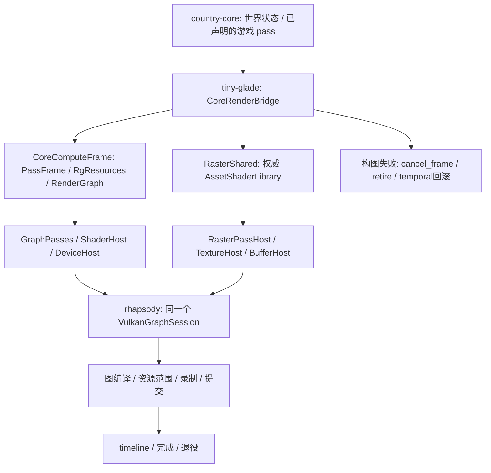

# country-core ↔ rhapsody 调用调查与接线

> 用户最新约束：rhapsody 已经重构，保留当前库的架构与 API，只补功能和修缺陷，不能按原版重新复现。后续原版主链、真实 GPU/WSI 验证及残余缺口见 [原版优先复核](../2026-10-18-main-chain-recovery/ORIGINAL-FIRST-REVIEW.md) 和 [架构边界](../2026-10-18-main-chain-recovery/RHAPSODY-BOUNDARY.md)。下文是首次桥接时的限定记录，不覆盖后续实现。

日期：2026-10-18。检查对象为当前开发 workspace 的 `country-core`、`rhapsody` 和实际承载桥接的 `tiny-glade`。原作目标仍为 B；本轮主要处理当前 Rust API 的生产调用闭包，没有运行原游戏、修改原二进制或共享分析数据库。

## 结论与范围

二者已有真实底层调用，不能描述为“完全未连接”。但已有桥分散在多处，core 的计算 `PassFrame` 没有生产实现，光栅 shader 另行分配 ID，缺少统一的帧构建/执行/取消入口。本轮补了这些接口和消费者，使用既有 rhapsody V9 实现，不新增独立 candidate crate。

**本轮接通的是可调用的游戏侧图桥，不是完整游戏帧。** 整个 `render_world::FramePasses`、`render_frame::RenderHost`、World 资源生产/映射和应用主循环仍未闭合。不能据本轮代码编译或局部 CPU 验证宣称游戏可运行。

## 三层关系



`rhapsody` 不依赖游戏 crate；`country-core` 声明消费合同；`tiny-glade` 拥有设备及宿主资源，把两端连接起来。把这些宿主反向塞进 rhapsody 会造成错误依赖方向。

## 接口映射

| core 输入 / 消费者 | 实际宿主与 rhapsody 入口 | 当前事实 / 边界 |
|---|---|---|
| `ssbo::rhapsody_boundary::GraphicsDevice` | `BufferHost` → `Device::create_buffer` / update / transfer | 已有真实托管缓冲；本轮增加保留 generation 的 managed 查询供帧导入 |
| 纹理 `TextureDevice` | `TextureHost` → managed texture / image view | 已有描述转换和纹理生命周期；应用材质纹理索引还未统一 |
| `ShaderBackend` / `ComputePassDevice` | `ShaderHost` / `DeviceHost` → 编译包、反射、异步 pipeline、V9 bindless | 已有真实实现；不再把 core 便捷包装中的 Unsupported 当作“全无后端” |
| `RecordedComputePass.program` | **新增** `CoreComputeFrame` → 同一 `AssetShaderLibrary` → pipeline → `GraphPasses::add_compute` | 缺程序、错库或后端拒绝均失败；不允许从整数猜另一管线 |
| `PassEnv.frame: dyn PassFrame` | **新增** `CoreComputeFrame` 实现三组 trait | 结束时强制检查 void `record` 的锁存错误；高层 World 仍由业务提供 |
| `RgResources` raw/named/temporal | **新增** `GraphPasses` 直接使用其已借用的 session | 与 staging/compute 共用图、设备和 session，错误保留原类别 |
| `UniformAllocator` | **新增** `ComputeUniformAllocator` → 声明期 CPU 字节；录制时 DynamicConstants 上传 | 不伪造 GPU 分配；真正参数缓冲仍由现有宿主创建 |
| 光栅 DrawPacket.shader | **修复** `RasterShared::new_with_shader_library` → 权威 core 程序库 | 不再以 renderer 私有 Vec 的 1-based ID 查询游戏资产句柄；独立注册模式与 core 模式互斥 |
| callback 内首次 push → dispatch | **修复** `ComputeParameterState` → 延迟首个参数绑定；后续 with_push | 不补零伪数据；无合法参数时 direct/indirect dispatch 均拒绝；四项 CPU 反例通过，GPU 未验收 |
| shader sampler 名称 | **修复** `ShaderHost` → rhapsody `get_built_in_sampler_by_name` | 外部 override 优先，否则用已恢复的内置表；未知名仍报真实错误 |
| `RasterPass::render` | `RasterPassHost` → 附件/管线/参数 → rhapsody 图回调 | 已有真实光栅桥；部分 DrawKind、frame constants 与材质表仍阻断实际游戏输入 |
| 真实 Buffer/Texture 导入 | **新增** `CoreGraphFrame::import_buffer/import_texture` → `session.import_frame_*` | 不要求调用者手工注册物理 token；同图重复身份复用和租约回收由 rhapsody 管理 |
| 构图/执行 | **新增** `CoreRenderBridge::render_frame` → begin/build/execute | 只有所有构图阶段成功才进入提交；返回 receipt 是提交证据，不是 GPU 完成证据 |
| 构图错误 / unwind | **新增** `VulkanGraphSession::cancel_frame` | 释放回调、执行 retire、回收 frame imports，回滚 named/parity 和 pending cache；不触碰已提交 pending 帧 |
| 帧外遗留的 raster host | **新增** 私有 `FrameDeclarer` + active/GraphId | 成功取图/失败 Drop 都撤销；所有声明入口先检查，再访问 session，避免污染下一帧 |
| GPU 完成 | `collect_completed_frames` / `wait_submits_done` | 复用 rhapsody 真实完成域；没有第二套计数器或伪完成通知 |

## 公开入口与使用

新入口：[render_bridge.rs](../../../crates/tiny-glade/src/render_bridge.rs)。计算落点：[compute_frame.rs](../../../crates/tiny-glade/src/compute_frame.rs)。可编译的链级使用样例在 [core_render_bridge.rs](../../../crates/tiny-glade/tests/core_render_bridge.rs)。

```rust,ignore
let shaders = Arc::new(AssetShaderLibrary::new());
let mut bridge = CoreRenderBridge::new(device, compiled_shader_root, shaders)?;
let backend = bridge.hosts().shaders.clone();

bridge.render_frame(|frame| {
    frame.with_compute(|compute| {
        // world 必须提供真实库/资源和 DeviceHost，不能填虚构原 TypeId 指针。
        let mut uniforms = ComputeUniformAllocator;
        let mut env = PassEnv::new(world, &*backend, &mut uniforms, compute);
        // 调用真实 core pass，使用 env.record(...) 登记返回的 pass。
        build_game_compute_passes(&mut env)?;
        Ok(())
    })?;
    frame.with_raster(|host| {
        // 用 core RasterPass / DrawBuilder 消费 host；shader 使用同一库的 ID。
        build_game_raster_passes(host)
    })?;
    frame.with_graph(|graph| {
        // 声明实际输出/副作用；由图编译器决定活跃 pass。
        export_game_outputs(graph)
    })
})?;
```

该片段表达调用位置，`build_game_*`/`export_game_outputs` 是待接的游戏消费者名，不是本工程已存在函数。完整 World/FramePasses 未恢复前，不以空输入代替它们。本轮实际链测试走 core 的上传 helper，源码中没有伪造整套世界。

所有 buffer/texture 必须来自此 bridge 的 HostTables。旧句柄只编码槽号和 generation，不携带 host 命名空间，因此不能保证识别任意另一 Host 恰好同值的句柄；本轮统一拥有表解决正常路径的混用，没有声称恢复原完整 managed ABI。

## 错误和生命周期

- `PassFrame::record` 原合同没有 Result：计算桥保存首个错误，停止后续 compute 登记，`finish` 将原错误返回给帧驱动。
- 即使业务闭包忽略了 `with_compute/with_raster/with_graph` 返回的错误，帧驱动的 failed 标志也禁止提交。
- raw 资源创建合同没有 Result，失败仍按已有 fatal 策略 panic；正常展开会 Drop 帧并取消。业务主动捕获并吞掉 fatal panic 不在可恢复合同内。
- raster host 不允许逃逸到构图闭包之外；额外 Rc 会在提交前触发拒绝，租约也会撤销。
- 执行/录制/提交阶段的错误由 rhapsody 已有事务处理；若已有批次提交，仍由 pending 队列保有资源。因此不承诺所有运行错误都“零提交”。

## 当前仍阻碍恢复的实现缺口

详细源码位置见 [GAME_BLOCKERS.md](GAME_BLOCKERS.md) 和 [SHADER_BOUNDARY.md](SHADER_BOUNDARY.md)。按依赖顺序：

1. **游戏宿主**：main/run_game/GameLoop 仍有未实现入口；core startup 和 draw-list 构建尚无完整生产驱动。
2. **世界到 pass**：`ResourceLookup for World` 不能把原二进制 128 位 TypeId 转成当前 Rust 类型；WorldAccess 尚无生产实现。E/G 等资源合同未知，不能补假指针。
3. **整帧编排**：`FramePasses` 和 `RenderHost` 仍只有测试替身；当前桥不能自动实现所有 W1–W54 pass 的业务资源与调用顺序，也未接整个 swapchain/present 游戏链。
4. **全局绑定**：shader 中 set1 帧常量缺自动注入，材质 Color/TextureLibrary 的旧索引与 V9 bindless lease/index 尚未统一。pass 局部参数绑定可用不代表这些表可用。
5. **实际绘制类型**：GPU-driven/间接计数等常用 DrawKind 仍被显式拒绝；不能用基础三角形成功代替 nani 真实绘制验收。raster 的非零原 push ABI 也有明确不支持边界。
6. **世界持久化**：首次 ActiveSession 创建、完整保存载荷生产、History 游标同步、快照 Version/全域编码以及 Apply/域写回仍未闭合。
7. **碰撞/音频与平台**：宿主尚须正确选择 native-physics/native-audio，提供真实资产、设备和依赖。默认无物理查询不能支撑可交互游戏。

本轮未把这些缺口改写成“已完成”。后续应按真实世界消费者补第 2–5 项，并用它们驱动新帧桥；启动和保存问题分别在其业务链解决。

## 验证口径与旧报告有效性

验证详情及指纹在 [verification.json](verification.json)。本轮 CPU 检查与源码接线不是原版 oracle，未新增原码等价验收。

- 两项计算程序身份/首错误检查通过。
- 两项光栅权威句柄/禁止混用检查通过。
- 帧声明错图/撤销有效期 CPU 检查通过。
- 四项 callback push/dispatch 时序 CPU 检查通过；合计九项本轮针对性 CPU 检查。
- 三包 all-targets locked/offline check 通过，有既有告警。
- 两项实际 Vulkan 链测试已编译，但本机缺 `libvulkan.dylib`，初始化时明确 SKIP；测试进程 exit 0 不代表上传、提交、取消和回读的 GPU 路径通过。

本轮改变了调用桥、program lookup 与 sampler 生产路径；旧 shader/host/V9 结果只保留原输入哈希范围，不能直接验证本轮新源。未修改的底层算法证据不因此全部失效。新的源码/API 检查由本目录单列，不更新旧原码报告的成功标签。
