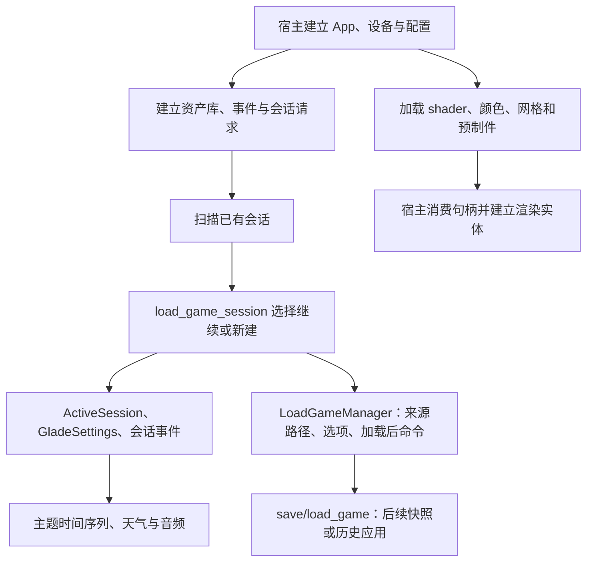

# startup：启动资源与会话初始化

本目录负责把配置、存档请求和磁盘资产转为游戏启动时需要的 ECS 资源、资产句柄和加载任务。它包含业务实现、宿主接口和历史上的聚合注册入口；**当前尚不是一个能独立完成整场游戏启动的插件**。

本文以 2026-10-18 的当前源码和实际调用方为准。正确性审查见 [REVIEW.md](REVIEW.md)，复现与验证记录见 [startup-review 报告](../../../../reports/startup-review-2026-10-18/README.md)。源码中 B 地址用于追溯恢复来源，不代表全部行为已与原版等价。

## 业务流程



图中的后续消费关系说明责任边界，不表示所有箭头已经接入生产调度。尤其快照/历史的完整应用仍在下游明确报错，不能把启动函数返回理解为场景已加载。

### 会话选择与加载请求

`startup_session::load_game_session` 消费 `NextSession`：

1. 排队移除请求资源；当前要求 `on_load` 为空，非空会立即 panic。
2. `LoadSavedGame` 从已排序会话列表取首项，`LoadOnLoad` 使用请求中的 ID；`None` 会 panic。校验已有会话失败时发损坏警告并改走新建。
3. 继续会话使用其 `history.json`；新建会话生成 ID、建立目录、写 `meta.json`，再选起始模板。新建主题取最近会话可读取的 meta，否则为 Autumn；请求模板中的额外载荷未参与此主题选择。
4. 首次新建（`new_glade_count == 0`）选择 `intro`；以后将其他子目录排序，按 `(count - 1) % len` 循环。demo/full 使用各自模板根目录；后续没有候选目录时 panic。
5. 新会话直接从选中模板的 `history.json` 加载，只把存在的 `snapshots` 子目录复制到新存档。当前复制结果被忽略，不复制整个模板根目录。
6. 从会话 meta 确定主题，读取主题资产下的 `GladeSettings`。demo 强制 Summer，并覆盖建筑/墙/屋顶颜色与落叶数量。
7. 更新或延迟插入 `ActiveSession`，把 `AppMode` 设为 `LoadGame`；向 `LoadGameManager` 提交文件路径、快照忽略选项、新会话揭示选项和完成后切换模式的命令。

`NewSessionStartedCmd` / `SessionLoadedCmd` 在完整历史应用之前发出，表示会话选择阶段的通知。真正完成应由后续加载系统确认。文件、meta、模板和 JSON 的若干失败分支会 panic；没有事务回滚，失败可能留下已建立的会话目录。

`copy_dir_all` 只是逐层建目录和复制文件，不排序、不排除 `intro`、不处理业务上的模板选择。`STARTUP_DEMO_MODE` 是进程级原子开关，宿主在加载前设置；它不是每个 World 独立的配置。

### 资源加载

| 文件 | 功能与输出 | 当前范围 |
|---|---|---|
| [init_color_library.rs](init_color_library.rs) | 默认调色板上传 SSBO，登记 `assets/colors.json` 监听，返回 CPU 调色板 | 宿主负责把返回值插入同一个 World；该函数本身不读颜色 JSON |
| [init_photomode_state.rs](init_photomode_state.rs) | 建立拍照状态，进入拍照时重置指定字段 | full/demo 的 scalar 为 3/1；保留相机模式、自由相机初始化状态和焦点标记开关 |
| [load_shaders.rs](load_shaders.rs) | 6 个 UI shader、13 个通用 shader 的有序注册 | 第 5 个通用 shader 写入 FinalPost 槽位；编译由宿主后端提供，失败 panic |
| [startup_blit.rs](startup_blit.rs) | 注册 3 个 swapchain 解析/拉伸 blit shader | 复用共享 shader 载入入口 |
| [load_textures.rs](load_textures.rs) | 启动纹理白名单与 demo/full 背景选择 | 只有筛选谓词，未扫描、解码或上传纹理；使用路径分量匹配，`logo.png` 不匹配 `logo` |
| [startup_garden_brush.rs](startup_garden_brush.rs) | 注册石头、花朵网格；另有完整 mesh→shader→spawn 的宿主接口 | ECS 入口只注册网格；`run_garden_brush` 通过 `GardenBrushHost` 委托渲染和生成，花朵带不投影标志 |
| [startup_ivy.rs](startup_ivy.rs) | 注册 ivy branch、leaf、flower 三个网格 | debug cube、shader 和实体生成未接入 |
| [load_prefabs.rs](load_prefabs.rs) | 递归扫描 RON、继承与删除部件筛选，建立 `PrefabLibrary`；收集热重载通知 | 只映射部分运行字段；网格和 AABB 仍为空，未消费扫描结果的依赖表 |
| [load_glade_audio.rs](load_glade_audio.rs) | 停止音乐、载入 4 条 Halloween 曲目、写主题标量与后端参数 | 忽略传入目录，不读取 `audio.json`；参数存在已确认错误，见审查 |
| [load_glade_tod_and_weather.rs](load_glade_tod_and_weather.rs) | 载入主题 `tod.json`，失败读取时回退默认文件；重建 Weather | malformed JSON 直接 panic；雾、风来自设置，冬季 snow_amount=1，其余为 0；已导出但未找到生产调用 |
| [startup_terrain.rs](startup_terrain.rs) | 向已有索引 Vec 追加规则网格的 CW/CCW 三角形 | 按最多 4 列分块，块内逐行；不建立顶点、完整地形或 GPU 资源 |

网格索引接口使用调用方提供的列区间、行数与行宽，采用 `u32` wrapping 运算；不会核验顶点缓冲长度或自动清空输出。反向区间 panic，空区间或零行不追加索引。调用方必须提供与顶点布局一致的尺寸。

### 预制件与热重载

`PrefabWatcher::new(true)` 建立 100 ms 防抖监听，回调只把预制件名或 atlas subset 放进集合；关闭监听仍保留可手动写入的集合。当前只接受 `Write` 事件。

`reload_prefabs` 先取走两个集合；有变化则全目录重扫，再返回集合供宿主发送修改事件。当前存在失败丢通知问题。成功重扫采用逐项覆盖，磁盘中消失的预制件不会删除；`scan.dependencies` 未用于自动注册监听。因此仅调用 `load_prefabs_impl` 不会自动获得可用的完整热更新链。

部件只恢复季节 albedo、部分 RT kind 和音频 kind；`Mesh::new("")`、零尺寸 bounds、空音频 name/rank 是现有占位值。不能将加载成功的库直接当作完整的可绘制、可射线检测或完整音频资产。

## 调度与宿主责任

`run_game::register_core_startup<B, S>` 建立会话、命令器、配置、存档等资源，并把音乐初始化、会话加载和历史/地形/墙/常春藤/花园/输入/羊等运行系统注册到**同一个外部 Schedule**。`add_game_startup_systems` 再增加两组网格加载。`B` 是宿主音乐后端，`S` 是 Studio；依赖资源仍须由宿主注入。

这个聚合 API 存在一次性系统与每帧系统混排的问题，见 F1。函数内的调用书写顺序也不等于 ECS 执行顺序；该入口没有统一建立生产者与消费者的先后边。

当前真实宿主 [tiny-glade/src/run_game.rs](../../../tiny-glade/src/run_game.rs) 没有调用这个聚合入口，而是分别装配 `Startup`、`Update` 和 `OnEnter(AppLoadingState::Game)`，其中会话加载带 `resource_exists<NextSession>` 条件。生产 shader 消费者在 [production_renderer.rs](../../../tiny-glade/src/production_renderer.rs) 直接调用通用/UI/blit 加载函数。两条入口不能混为已经验收的一条完整启动链。

宿主还需管理事件轮转、资源初始化时机、设备与资产库的一致性、主题加载时机，以及快照/历史真正应用后的完成通知。完整地形、ivy/花园实体、预制件 mesh/atlas 和部分主题资源仍有缺口。

## 审查与验证

本轮结论为 `changes_required`：2 项 P1、2 项 P2，详见 [REVIEW.md](REVIEW.md)。只新增文档与审查证据，没有修改业务源码。

标准限定测试命令为：

```sh
# 在 games_test/tiny-glade 下
cargo test -p country-core --lib startup:: --offline --locked
```

本轮该命令因工作区清单与 Cargo.lock 不同步而退出 101，未进入编译。替代验证直接编译六个当前 startup 源文件，配合已记录 SHA256 的缓存支持库：18 个既有测试和 4 个审查探针共 22 项通过。它验证限定源码行为，不能替代最新整 crate 构建；其中探针通过表示缺陷或限制成功复现。音频参数另对身份确认的 B 原发行 RNE 做了局部静态指令与常量核对；没有执行原程序、GPU 或整游戏验收。
